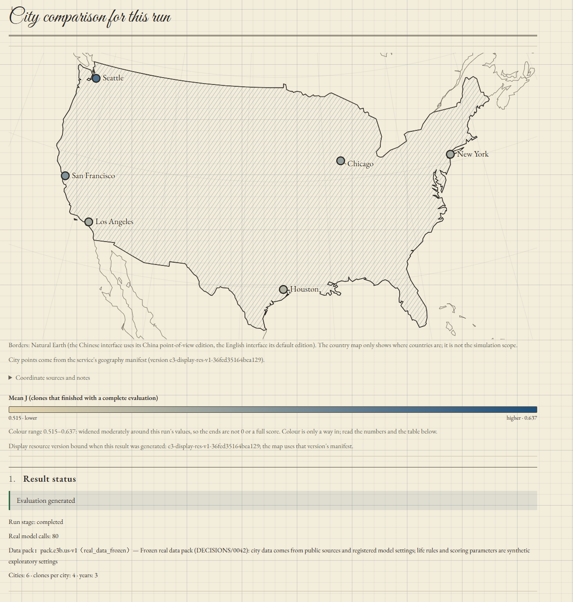

# Homo-Spatialis · LLMs Becoming Us

English · [简体中文](README.zh-CN.md)

*Let LLMs live many versions of your life around the world. Explore and compare cities and countries.*

Homo-Spatialis explores what cities, countries, and regions can offer through the lives of individual people. It aims to make comparisons of living standards in different cities and nations more meaningful by grounding them in the person experiencing them. Our skills, resources, priorities, and individual circumstances all shape the world we see. The project offers a way to explore that world through our own preferences.

Our long-term goal is to make comparisons of living standards—Shanghai and New York, London and Paris—meaningful to the individual: given my skills, resources, and preferences, what kind of life could I lead in each city?

It creates simulated versions of the same person and lets them live in different cities. Language models make plans; an economic model carries them out and accounts for the results. Over three years, choices about work, housing, food, commuting, and learning become different paths through life.

“LLMs Becoming Us” comes from a simple thought: most of us have only a few opportunities to move somewhere new, and each move is costly. How can we use our limited resources to satisfy our boundless curiosity about the world?

<p align="center">
  
</p>
<p align="center"><em>The city comparison page of a six-city run (offline planner, paper look). Life rules and scoring parameters are synthetic exploratory settings; results do not rank real cities.</em></p>

## Research motivation

A higher salary can come with higher rent, taxes, or a longer commute. A city’s attractions matter differently to different people. Someone who rarely visits the coast may still pay for its appeal through housing costs.

Even the cost of living depends on the person. People buy different things, have different skills, and value their time differently. Research on [consumer preferences and local product choices](https://realestate.wharton.upenn.edu/wp-content/uploads/2022/04/w836.pdf) and [living standards across income groups](https://web.stanford.edu/~diamondr/DiamondMoretti.pdf) shows why a single city price index tells only part of the story.

Homo-Spatialis brings these factors into one person’s simulated life. It follows how local opportunities and personal choices combine, giving people a way to explore the trade-offs that city averages leave out.

## How it works

1. **Describe yourself.** Choose cities and enter your circumstances, qualifications, and preferences.
2. **Live through the simulation.** Each agent makes an annual plan. The environment carries it out month by month, tracking money, time, energy, health, and skills.
3. **Compare the lives.** View city summaries, then follow individual agents through their yearly records.

A course can use money and spare time this year while opening a different job next year. A cheaper home can leave more to spend while adding to the commute. These choices accumulate across the simulation.

Results include both the scores and the lives behind them. Completed evaluations, inability to meet basic living costs, and incomplete simulations are reported separately. A bundled [six-city example](contracts/product/v3/samples/104_service_e3b_result.json) shows the output using an offline planner.

## Research questions

Three questions guide the research:

- **How well does AI understand a person’s preferences?** Work on [learning preferences from choices](https://arxiv.org/abs/2401.07345) motivates a practical question: can an imperfect model still make useful decisions, and which people bear the largest costs when it gets them wrong?
- **Can we calibrate the simulation to better reflect real life?** Its rules encode assumptions about economic and behavioral relationships. We want to use real-world observations to improve those rules and parameters, explore parameter search and machine learning, and test the results on independent data.
- **How should real data become a decision environment?** Turning statistics into available homes, jobs, and purchases requires choices about detail, uncertainty, and what an agent gets to see.

## Run locally

With [uv](https://docs.astral.sh/uv/getting-started/installation/) installed, run these commands from the repository root:

```sh
uv sync
uv run python scripts/run_product_full.py --mock --out runs/first-run
```

This runs the full simulation process on a small synthetic example using an offline planner. No API key is needed. The run summary is saved to `runs/first-run/summary.json`. Use a new output directory for each run.

For the browser interface, follow the [web setup guide](web/README.md). It uses Node.js 22 and includes a local mode with the six-city dataset. The [reproduction guide](docs/REPRODUCING.md) covers the environment, saved outputs, and checks in more detail.

## Current scope

The current dataset covers New York, Los Angeles, San Francisco, Chicago, Houston, and Seattle, with geographic coverage defined by each city’s data and tax rules. Simulations follow a single adult earning wages over three years.

The environment combines public data, derived estimates, and explicit model assumptions. Results describe the life supported by those inputs and the person’s stated preferences. The interface supports English and Chinese; model planning currently runs in Chinese.

## Roadmap

**V1.1 — Contribute a city.** We are building a common format and submission process for city data. Contributors will be able to submit data for places they know or want to explore, with clear requirements for sources, dates, units, and geographic coverage. Validation and mapping will turn those submissions into usable city datasets. The [contribution guide](CONTRIBUTING.md) describes how to propose data and mapping work today.

**V2 — More detail in everyday life.** Improve the models and data mappings for commuting, leisure and hobbies, and everyday consumption, so the simulation captures more of how people spend their time and money.

**V3 — Learn through conversation.** Add interview-based input to help people describe their experiences, priorities, and trade-offs. This draws on research into [conversational preference elicitation](https://aclanthology.org/W19-5941/) and [agents built from interviews and surveys](https://arxiv.org/abs/2411.10109v3).

The longer-term goal is to compare cities across national borders, bringing local incomes, prices, taxes, services, and opportunities into a consistent framework.

## Model and methods

### From data to available choices

**A** starts with common options and uses comparable local quotes D to update a price correction δ. **B** combines marginal and conditional distributions of attributes x and y, such as housing location and rent:

$$
\begin{aligned}
\text{A:}\quad p(\delta\mid D)&\propto p(D\mid\delta)\,p(\delta),\\
\text{B:}\quad p(x,y)&=p(x)\,p(y\mid x).
\end{aligned}
$$

B preserves observed relationships and uses explicit assumptions where sources cannot be linked. The bundled six-city data still lacks qualifying quotes for A's update. See [data mapping](docs/DATA.md#mapping-methods) for both methods.

### From choices to a life trajectory

The LLM supplies an annual plan a. The economic model F updates the agent's state x each month, using city options O, events ε, and rule parameters θ:

$$
x_{m+1}=F(x_m,a_y,\mathcal O_c,\varepsilon_m;\theta).
$$

Subscripts y, m, and c denote the year, month, and city. Money, time, and energy constrain today's choices; learning, spending, and health change tomorrow's possibilities. The [life model](docs/METHODS.md#life-kernel) defines these relationships.

### From lived conditions to personal evaluation

Many components use a saturating response to represent diminishing gains from additional resources or services:

$$
f(z)=\min\left(c,\frac{z}{z+\tau}\right),
\qquad
B_m=\sum_{k=1}^{6}w_k s_{k,m}.
$$

Here z measures the conditions or services actually obtained, c caps the response, and τ controls how quickly it levels off. Component scores combine into six dimension scores s, weighted by the person's stated preferences w. Health enters the [monthly evaluation](docs/METHODS.md#monthly-scoring) separately; [longer-term evaluation](docs/METHODS.md#terminal-evaluation) also considers the life supported by remaining cash, skills, and equipment.

Full formulas, assumptions, and implementation notes are collected in the [documentation index](docs/INDEX.md). See also the [research methods](docs/RESEARCH.md) and [references](docs/REFERENCES.md).

## License

[Apache License 2.0](LICENSE). See [NOTICE](NOTICE) for attribution and third-party material.

For research use, please [cite the software](CITATION.cff) and the data sources you use.
