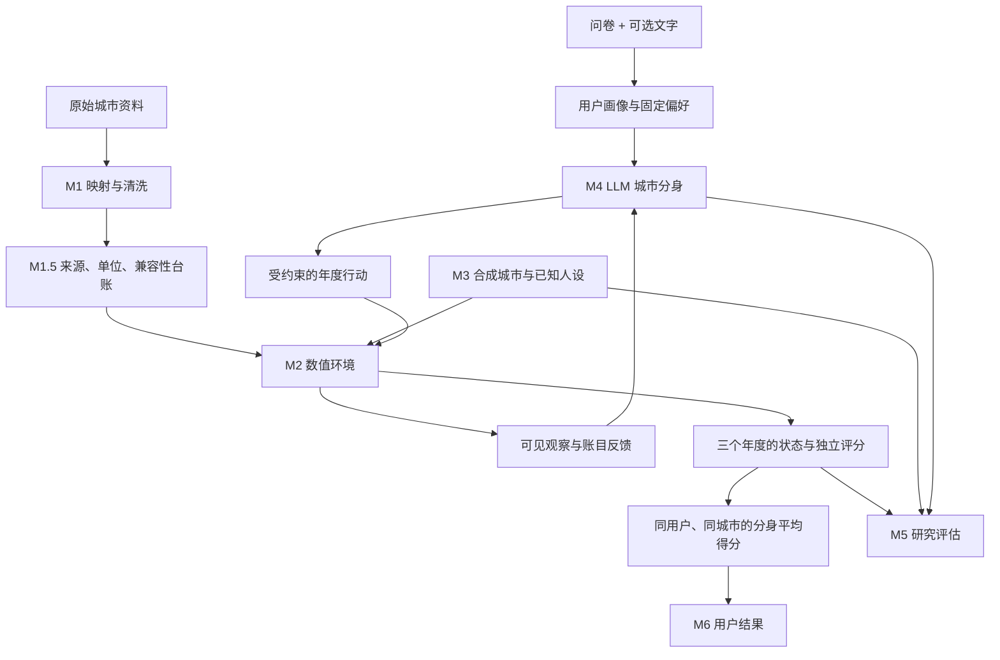
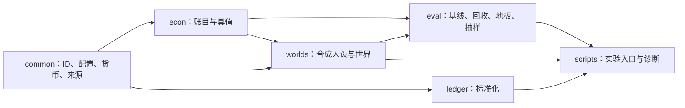

# 重生模拟器 / Homo Spatialis

> 把一个人的分身放进不同城市，让语言模型负责生活中的选择，让经济环境负责算账；比较三年生活结果，再检验模型究竟理解了哪些偏好、忽略了哪些偏好。

**开发期（2026-10-18 起按普通软件项目推进）。** 各部分的进度、命名与默认入口见 [docs/INDEX.md](docs/INDEX.md)；当前阶段与下一步见 [PLAN.md](PLAN.md)。本文只讲愿景与方法。

本文解释项目愿景、产品流程、研究问题和方法。文档基线为 **2026-10-05**，不等同于软件包版本或产品发布版本。

阅读路线：

- 想知道做什么：第 1–4 章。
- 想知道一个用户如何使用：第 5–9 章。
- 想知道研究怎样判断模型是否够好：第 10–11 章。
- 想查边界、文献和现有代码用途：第 12–15 章。
- 想开始工程工作：先读文件规则，再读 PLAN 的当前阶段；E3/E5 新窗口先读[共享接口与设计约定](docs/design/e3-e5-product-contract.md)，再读 [E3 交接](docs/handoffs/e3-data-input-handoff.md)或 [E5 交接](docs/handoffs/e5-product-handoff.md)。
- 想查生活机制怎样变成公式与代码：[技术设计说明索引](docs/design/README.md)，其中 [E1-3 技术说明](docs/design/e1-3-life-model.md) 集中解释当前实现、增补与 V2 扩展，[E1-4 技术说明](docs/design/e1-4-time-energy.md) 解释月度时间与精力约束（E1-4A）与上一年满足感对下一年精力额度的有界反馈（E1-4B）。
- 想知道哪些是现实资料、哪些是我们的假设：[参数与假设目录（超参数附录）](docs/design/parameter-assumption-register.md)。它解释现行参数、数据映射、代理认知及 E1/V2 待定规则，也记录未来 V3 怎样研究它们。

---
## 前言

远渡重洋的航班抑或是通往异乡的轨道，故事在这些章节走向晦涩的间章抑或崭新的开始。前进到下一页的人会想：我当初是不是能有更好的选择？尚未翻开新页的人会说：向左或向右，如何在事件尚未发生之时找到正确的通道？

面对信息的有限性与变量的庞大数量和复杂联系，普通人在面对这些事件时常常深陷迷茫。如今，我们尝试用人工智能去解读万事万物，却又如何能容许在此等重要决定上徒留彷徨。因此，我尝试用一个多智能体框架来尝试解答这个问题。对于你或者我，哪里才是应许之地，乌有之邦？

### 关于名字

每个代理都是用户的一个分身。它这一世在这座城市生活，下一世在别处；三年之后各自结算，回头去看哪一世过得更好。如果重活一世，结果会不会不同？这就是"重生模拟器"。

`homo-spatialis` 是一次明确的致敬与定位。Horton、Filippas 与 Manning (2023/2026) 提出 *homo silicus*，主张大语言模型因其训练方式而成为人类的隐式计算模型，可以像经济学家使用 *homo economicus* 那样使用它；而 *homo economicus* 本身是这条谱系的起点。本项目研究的是这个"硅基人"在**空间**中的行为，故名 *homo spatialis*。这个名字既是双关，也是一次学术站位声明。

---

## 文件分工与冲突规则

| 文件 | 只放 |
|---|---|
| **README**（本文） | 愿景、产品流程、方法、研究问题、版本范围 |
| [docs/INDEX.md](docs/INDEX.md) | 层与命名、各轮状态、默认入口（**唯一的状态来源**） |
| [PLAN.md](PLAN.md) | 当前阶段与下一步 |
| [CLAUDE.md](CLAUDE.md) | 编码代理每次要读的不变量、安全约束与工作方式 |
| `DECISIONS/` | 为什么这样定（只在真正的设计决定时写） |
| [docs/design/](docs/design/README.md) | 公式、代码位置、手算例子、省略了什么；[参数与假设目录](docs/design/parameter-assumption-register.md) |
| `MEMOS/`、`runs/`、[docs/history/](docs/history/) | 历史记录与运行输出 |

本文各节可能还留有"本段已被 DECISIONS/00NN 推翻"的指针：以指向的 ADR 为准。各机制的实现进度不写在本文，见 INDEX。

**处理冲突的顺序：** 项目所有者最新明确决定优先；愿景与 V1/V2 范围看本文；状态看 INDEX；具体数值协议看有效的 ADR；代码说明当前实际行为、文档说明目标与约束，两者不一致时先登记差距再决定改哪边。

**本次明确替换的旧指令：**

- 旧“抽取权重后直接计算排序／softmax 代替产品选择”不再是 V1 产品闭环。相应数学仍用于真值参照、合成自检和研究对照。
- 旧“任何 M4 工作前必须全部通过 P8/P9/P10 和三个研究门”改为按用途设门：允许有预算上限的最小生活试点；正式报告某项研究指标前，必须满足该指标的测量条件。
- 旧“禁止记忆”不能禁止年度状态延续。V1 保留有限状态和往年摘要，不做不断增长的自由记忆流；追问访谈、城际交流仍属 V2。
- 旧“差分法对角协方差是唯一主规格”按 [ADR0013](DECISIONS/0013-research-profile-alr-full-material.md) 改为 ALR 完整协方差。旧分支保留复现用途。
- 旧总体闭式协方差、共同插值路径按 [ADR0015](DECISIONS/0015-estimand-scheme-a-and-gate-inputs.md) 更新；第 11 章同时订正其中“d 由个体后验构造”的错误表述。
- 原来的 0.005 数值容差不是 V1 开发的普遍先决条件。历史判定保持原样，探索精度档单独定义。

**继续有效的保护：** 答案侧对象不进被测代理输入；数值来源可追溯；密钥不进仓库；跨计价单位不直接比较；经济公式只有一份；修改 `src/econ/` 仍须说明理由并得到相应授权。本次仅重构 README 与 PLAN，不构成修改该目录的授权。

## 1. 这个项目做什么

### 1.1 产品：让同一个人在不同城市各过一次生活

城市排名无法回答每个人的问题。重视通勤、医疗和闲暇的人，与愿意用这些换取收入的人，需要的可能是不同的城市。本项目把“你是谁”放进比较过程。

用户先填写结构化问卷，也可以补充文字。系统为这个用户建立多个 LLM 分身，分配到各候选城市。V1 中分身固定住三年，每年观察环境、作出受约束的选择，再接受经济环境的结算和反馈。最后比较**同一用户的分身在每座城市的平均模型得分**，给出更适合与更不适合的城市、生活过程与数据限制。

“平均”是跨同一用户的重复模拟，不是把不同人的幸福直接平均。三年计分的具体规则仍需在工程阶段 E1 冻结，见第 8–9 章。

这对应最初的设想：把一把代表同一个人的“豆子”撒进城市网格，看它们三年后长得怎样。LLM 决定怎么生活；环境决定行动是否可行、账目如何变化及怎样计分。

### 1.2 研究：这台模拟机器是否够好

长期问题保留：

- **大模型的偏科究竟容易伤害哪些偏好的用户？**
- **大模型不是完美的人类行为模拟器，但在这个问题上是否已经足够好？**

| 版本 | 研究问题 | 本阶段能支持的结论 |
|---|---|---|
| **V1** | 模型误解了什么偏好？在受控任务上能否比生活成本计算器更好？ | 已知偏好的合成用户中，行为、城市结果和偏好是否一致；哪些偏好组表现较差 |
| **V2** | 误解造成什么错误选择、多大代价？能否像这个人一样生活和选择？ | 模型定义的损失、行为机制与真人或外部资料对照 |
| **V3 及以后** | 经济模型本身遗漏了什么，能否改善现实解释力？ | 更丰富约束、非线性偏好、家庭与市场反馈等模型扩展 |

“够好”必须相对于任务、比较对象和误差范围。合成城市中的成功不能直接证明现实推荐可靠。已有协方差、方向投影、地板校准与货币损失代码仍保留，用于进一步解释结果，不再代替两项 V1 问题。

### 1.3 两种模式如何相互服务

产品提供实际任务：同一个用户跨城市生活，环境负责账目与约束。研究先造出偏好已知的人和城市，检查 LLM 是否按这些偏好行动，寻找容易出错的偏好组和情境。研究结果再用于限定产品适用范围、改善输入与反馈、提示不确定性。

产品问卷权重是用户**陈述**的偏好；研究注入权重是实验者**设定**的偏好。前者不因为进入经济公式就变成了真人的完整心理真值。研究校正后的数字也不能伪装成代理自己说的话。

## 2. 为什么仍需要经济模型

使用 LLM 是为了模拟主观取舍和行为；它不能替代可信的税额、预算和价格计算。

例如，分身决定增加储蓄。它可以说明理由，但不能宣布“今年因此多存了两万美元”。环境用工资、税和预算检查是否可能；下一年的分身读取实际结算状态再作选择。

| 经济层的工作 | 输入与输出 | 对 LLM 的可见性 |
|---|---|---|
| **环境结算** | 状态、城市数据、已接受行动 → 收入、支出、资产、约束结果 | 可作下一年事实反馈 |
| **内部评分与测试标尺** | 状态／轨迹、固定偏好、评分协议 → 得分、参照选择、研究指标 | 与代理输入隔离，结束后比较 |

这套模型是写明的“游戏规则”：可以检查玩家在规则内过得怎样，但不能凭自身证明规则完整描述了现实。

现有 M2 静态福利分已经可用；**LLM 行动接入年度状态转移尚未完成**。目前已有场地、计分器和测试仪器，尚未接成连续生活流程。（2026-10-12 补记：年度规划闭环已用可控的 mock 规划器接通，见 8.14；真实 LLM 的接线与试跑在 E1-7B。2026-10-13 补记：E1-7B 已把真实千问模型接进同一个闭环，并完成 1 个分身的先导与 8 个分身 × 3 年的合成小规模试跑，待独立复核，见 8.15；同日起产品运行默认用 Qwen3.8 Flash，旧 Max 设定要显式选，见 8.15 末尾。）

## 3. 架构与信息边界

### 3.1 各层职责

这是目标信息流；M4、M6 当前仍是占位包。已有代码依赖的主要方向如下，箭头表示“被后者使用”：

这是模块概览，不是逐文件 import 的穷尽图。逐文件职责见第 14 章；早期依赖快照保留在 [审核附图](MEMOS/2026-09-28-python-dependencies.mmd)。

### 3.2 什么可以进入代理输入

| 层 | 例子 | 处理 |
|---|---|---|
| L0 城市属性 | 通勤、环境、医疗资料 | 可见 |
| L1 经济数据 | 工资、价格、税制资料 | 可见 |
| L2 环境算账 | 税后收入、合法支出、结余、失败原因 | 可见 |
| L3 内部效用 | 固定偏好下的福利分、分项贡献 | 留在评分侧 |
| L4 答案与评价 | 最优城市、错误选择损失、回收误差 | 留在研究侧 |

已有 `PersonaBrief / Persona`、`Observable / GroundTruth` 与 `ChoiceSetTruth` 区分这些信息；`AgentInput` 会递归拒绝答案侧对象，包括藏在 dataclass、列表、字典内的对象。

年度反馈必须经显式可见字段出口。当前 `YearState` 含 `ln_utility`，不能把整份对象直接序列化成下一年 prompt。

产品可以在任务允许时告诉 LLM 用户明确提供的偏好；研究“从文字理解隐藏偏好”的实验不能同时给出注入权重。两者须有写清楚的信息许可，不能为方便调用取消隔离。

> 生活模型的可见投影已按此落地（E1-1，[ADR0016](DECISIONS/0016-life-model-contract.md) 第 2.3 节）：观察由显式许可逐字段构造，许可没有默认值；生活模型现在只有产品条件 `product_stated_profile`（研究期的 `research_text_only` 已随旧版本删除，[ADR0037](DECISIONS/0037-life-keep-only-product-version.md)）；显示精力的观察另标为动态反馈条件，不与静态文字理解实验混用。E1-2 起（[ADR0017](DECISIONS/0017-life-monthly-settlement.md)）只为仍在生活中的分身构造观察，终态与出局都不再接受行动；年度可见反馈由 `visible_feedback` 从结算结果逐字段取出，结算结果整体不能进 payload。E1-3 起（[ADR0018](DECISIONS/0018-life-exploratory-monthly-scoring.md)）评分规格、城市评分条件、评分偏好与各层评分结果都是内部对象，同样被扫描拦截；用户自己给出的物质细项点数是陈述，由显式许可决定是否可见。E1-3 增补（[ADR0019](DECISIONS/0019-life-e1-3-supplement.md)）新增的景观与通勤评分明细、比较组和覆盖报告也是内部对象；机会的需求功能与方案属性、住房写明的往返分钟、工作方式是可见的生活事实。E1-4A（[ADR0020](DECISIONS/0020-life-monthly-time-energy.md)）起，公开的资源事实（岗位工时与到岗、每次或每月的小时、使用频率、每小时负担、家务替代）与每月时间预算可见，年度反馈逐月给出实际资源使用；精力额度与精力用量沿用原有的精力可见许可（2026-10-08 起标准产品许可显式打开，研究对照可显式关闭）；资源规则与整年、整月的资源账是内部对象，整体进 payload 会被拦截。E1-4B（[ADR0021](DECISIONS/0021-life-satisfaction-energy-feedback.md)）起，分身看到当前年度的精力额度，看不到年度满足感分数、反馈政策与反馈记录；但额度随上一年满足感变化本身就是间接评价信息，观察因此另记信息条件（额度是否可见、反馈是否真正开启、静态文字理解还是含生活反馈的动态条件），文字理解对照必须关闭反馈。

### 3.3 M4 的作用

M4 组织用户画像、当前观察和有限往年摘要，取得 LLM 行动，验证格式与可行性，再把环境反馈交给下一年度；同时负责重试、预算、模型版本与日志。

它不改写工资、税额或得分，不读取内部答案后将其包装成 LLM 推荐。静态真值最优城可作研究参照；产品主排序必须经过真实 LLM 行动轨迹与环境评分。

## 4. 模块总览

| 模块 | 职责 | 当前概况 |
|---|---|---|
| M0 `common` | 类型、配置、来源、计价、日志、防泄漏 | 主要基础设施已有 |
| M1 `data` | 真实资料采集、辅助模式映射 | 占位 |
| M1.5 `ledger` | 单位、价格归一、兼容性、冻结参照 | RPP 归一已有，其余待接 |
| M2 `econ` | 经济算账、效用、固定城市时间推进 | 核心已有；尚无年度行动接口 |
| M3 `worlds` | 合成城市、人设、难度、画像冻结 | 已有；多项标定仍是暂定参数 |
| M4 `agentlayer` | LLM 逐年生活与流程编排 | E1-7A（已实现、自测通过，待独立复核）：安全规划请求、只认 JSON 的解析、安全诊断、记忆投影与 mock 已实现，多分身运行器在 `orchestration`（见 8.14）；真实模型接线是 E1-7B，仍是 V1 核心缺口（原登记：占位；V1 核心缺口）。2026-10-13 补记：E1-7A 收尾已通过独立复核；E1-7B 真实千问模型规划器、付费预算账本与小规模合成试跑已实现、待独立复核（见 8.15）；产品默认模型 Qwen3.8 Flash（ADR0032，待独立复核） |
| M5 `eval` | 基线、回收、测量诊断、抽样、报告 | 大量工具已有；入口仍有接线缺口 |
| M6 `ui` | 问卷与展示 | 占位 |
| M7（路线图称呼） | 跨国扩展 | V2；目前没有独立 M7 包 |

**模块已有不等于流程完成。** 新进度表分别检查函数、调用入口和产物证据，避免“写好工具却没用起来”。

## 5. 数据：先保证能比较，再让分身生活

### 5.1 V1 的真实数据范围

V1 先做美国国内城市。以下是计划来源与用途，不能解读为已全部下载接通：

| 数据 | 候选来源 | 用途及注意事项 |
|---|---|---|
| 职业工资及分位 | BLS OEWS | 职业、地区、能力分位；记录缺失和地区边界变化 |
| 跨城价格水平 | BEA RPP | 分租金、商品、其他服务 |
| 税制 | 对应年份和辖区的公开规则 | 上游处理辖区，M2 不猜税率 |
| 消费份额 | BLS CEX | 城市无关的个人篮子；现有合成份额仍暂定 |
| 通勤、住房、公共服务、环境 | ACS 及专业来源 | 记录统计单位、覆盖人群、时间和构造 |
| 外部验证 | 迁移资料、真人选择／调查 | 后续验证资料，尚非完成的 V1 证据 |

OECD BLI 等真实偏好资料可作后续对照，但微观权重是否可得、量表映射和样本偏差均须核实，不作为主实验依赖。论文描述的数据规模不等于项目已获得的数据。

### 5.2 个人化价格指数

房租、理发、托育等本地服务不能像商品那样搬到另一城消费，往往是跨城价格差异的重要来源。RPP 三分项分别保留：

$$
\ln P_{i,c}=\sum_{j\in\{\mathrm{rent,goods,other}\}}s_{i,j}\ln p_{c,j},
\qquad \sum_j s_{i,j}=1.
$$

同样面对昂贵住房，住房占预算 40% 与占 20% 的人，生活压力不同。CPI 衡量地区内部随时间的变化，不能直接作跨城价格水平；RPP 从发布基准 100 归一为 1，再进入对数计算。

**同一个人的份额 $s_i$ 在各城市固定。** 不按候选城收入重新查份额，否则同时换了价格和篮子。`Persona.shares` 已冻结份额，M2 不持有消费份额 provider。

品种接口允许未来加入菜系、汽车、手机差异；V1 的 `NullVarietyAdjustment` 返回零。住房质量“方案 B”保留为上游质量调整价格的方向，真实处理未完成，不能又在效用里重复加住房品质。

### 5.3 不同维度如何放到一把尺子上

舒适度转为越大越好的 $A_k$。标度会改变跨维取舍，必须冻结并做敏感性分析。

- 优先用可解释的物理／制度锚点；合成环境维采用 PM2.5 锚点，通勤采用清醒时间占比。
- 无可靠锚点时，可用固定参照总体的分位表；它会丢掉原始差距大小，可与截尾后线性映射对照。
- 保存 `reference_id`、年份、成员、方法与版本。不能按每次候选城市重新算分位。
- 合成生成器另四维的离散度是显式参数，当前 `PROVISIONAL` 配置不代表现实标定完成。

绝对锚点也不能消除统计构造差异。两国都叫“犯罪率”，事件定义、报案率与覆盖范围仍可能不同。

### 5.4 数据转化模型的权限

> 模型可以决定一个数字放在哪里，永远不能决定这个数字是什么。

LLM 辅助识别表头和分类；可审计代码换算单位；映射经复核后冻结。每个值保留来源地址、表、单元格或等价定位、日期、构造定义和覆盖范围。

“月薪乘十二”是单位换算；“行业平均工资当职业工资”改变了测量对象，不能靠换格式解决。列名相同不足以证明可比。

### 5.5 集合级 A/B/C 兼容性

**选城市 → 建字段台账 → 按整个集合分级 → 去掉 C → 检查必要维度及权重覆盖 → 模拟。**

| 等级 | 含义 | 处理 |
|---|---|---|
| A | 同构造、同覆盖、细节足以匹配 | 直接比较 |
| B | 可映射，偏差已知并记录 | 带说明使用 |
| C | 缺失或不能可靠映射 | 不用于本次比较 |

`Provenance`、`Grade` 和最低等级合并已有；完整集合解析器尚未实现。不能因多数城市有工资而允许另一城完全缺工资。完整性与可比性要分别检查。

### 5.6 覆盖率与停止条件

$$
\mathrm{coverage}_i=\sum_{k\in\text{本次有数据支持的维度}}w_{ik}.
$$

- 先检查必要账务资料与硬要求；偏好覆盖率不能豁免计价错误或最低生活资料缺失。
- 覆盖率按所有候选城市共同支持的偏好分项计算，物质细项用“物质权重 × 细项权重”；同时显示估计、合成假设和未知部分。
- 用户应看到缺少哪些关切，再选择缩小城市集合或查看有限比较。历史 50% 设想保留为候选产品提示线，具体交互留 E1-6/展示阶段裁决，不作为探索评分通过线。
- 正权重缺失时不补零、不逐城重新归一化、不生成伪完整总分。知道城市背景不等于已经模拟相应行动效果。
- 界面写“该维度在本次比较中无数据支持”；不知道不等于没差别。

建议移除部分城市来提高覆盖率，属于 V2 交互扩展。

### 5.7 跨国与跨年

中国、加拿大等放 V2。可比性针对具体城市集合和用户；工资构造、税制、购买力基准和标度都要对齐。无量纲研究误差也只有在任务、信息量、实验设计可比时才适合横向比较。

金额携带 `numeraire_id`。三年用固定基年的实际金额和实际增长率；不同计价基准不能直接相减。`Money` 已提供保护，真实资料转换仍待接。

> 生活模型的当地报价使用独立口径 `<币种>_<基年>_LOCAL`（当地价格水平、基年不变价），不用已空间平减的 `USD_2024_US100` 装原始标价；实际报价与价格指数是两个类型，指数不能当付款单价；城市身份用完整的国家/体系/代码。本轮不做汇率或 PPP 转换。见 [ADR0016](DECISIONS/0016-life-model-contract.md) 第 2.4 节。

## 6. 用户输入与偏好

**2026-10-17 产品设计更新：** E3 负责用户输入处理与美国真实资料，E5 负责界面与前端。以下是新产品的目标，不是已经上线的问卷；现有 E1 仍是七维合计 100 的画像契约，迁移任务与偏差控制统一见[共享约定](docs/design/e3-e5-product-contract.md)。

> ⚠ 本段已被 DECISIONS/0034 推翻，见该记录。（只推翻“现有 E1 仍是七维合计 100 的画像契约”这半句：2026-10-18 起 E1 另有六维产品画像分支——六维精确合计 100、独立健康回答、偏好来源 `product_confirmed_six_dim`，由 E3-A 的离线链显式编译进入；旧七维契约、旧问卷与研究真值照旧。仍不是已经上线的问卷，见 §6.2 末尾的指针。）

### 6.1 四类输入各用合适形式

| 内容 | V1 输入 | 用途 |
|---|---|---|
| 重视什么 | 六维 100 分；物质内部另分配；健康风险应对独立回答 | 陈述取舍，不替用户固定开支比例 |
| 工作与相关特征 | 自然职业文字与可读候选、年龄、可用现金与币种；必要时确认资格 | E3 匹配职业和生成标准开局，用户不填职业编号 |
| 物质与商品偏好 | 当前受支持的需求功能；品牌、菜系等留扩展接口 | 需求可以跨城相同，实际购买由价格、机会和分身行动决定 |
| 额外说明 | **可选自由文本** | 补充规划；不能自动改权重、工资、资格或硬要求 |

问卷为主，文本可选。模型总结理解并继续追问属于 V2；V1 不要求多轮聊天。

> **固定的是人的偏好，而不是替他固定消费结果。** 同一个人的偏好跨城保持稳定；价格、机会和历史状态可以改变实际生活安排。V1 物质需求按功能组织，方案属性与当地报价分开；V2 再让品牌、菜系、档次和爱好差异进入评价，见 [E1-3 消费机制](docs/design/e1-3-life-model.md#consumption)。

### 6.2 现有 E1 的七维结构与新界面

| 代码维度 | 含义 |
|---|---|
| `material` | 物质生活、实际消费能力 |
| `safety` | 安全 |
| `healthcare` | 旧协议为医疗可及性；E1-5C 健康版为健康风险应对倾向，只供规划。新产品将其移出定和量表、独立保存 |
| `opportunity` | 机会与发展条件 |
| `leisure` | 闲暇及相关条件 |
| `environment` | 环境与气候相关条件 |
| `commute` | 交通便捷程度及出行对生活的影响（上班通勤是其中最常见的部分；[ADR0024](DECISIONS/0024-life-growth-satisfaction-and-transport.md)） |

借鉴 WHOQOL 等领域划分，不是经验证的 WHOQOL 原量表。WHOQOL 的近期生活体验评分不等于本项目的选择权重。家人、故乡、社会关系具有“人 × 城市”特征，留 V2；不能称当前输入覆盖全部重要偏好。

> 版本边界：E1-5C 的健康语义见 [ADR0027](DECISIONS/0027-life-illness-emergency-recovery.md)和 §8.11。新产品“六维＋独立健康”仍需 E3 显式适配，不能只给旧 `healthcare` 填占位分；旧协议和旧问卷不重解释。

> ⚠ 本段已被 DECISIONS/0034 推翻，见该记录。（只推翻“仍需 E3 显式适配”的状态：E3-A 已按这里的要求显式适配——新增有版本的六维产品画像与独立健康声明，有效权重 = 点数 / 100、只转一次，没有给 `healthcare` 填占位分；在六维比例相同时与旧七维评分严格相等。“不能填占位分、旧协议和旧问卷不重解释”继续有效。已实现、离线自测通过，待独立审核。）

### 6.3 量表与文字的限制

定和量表要求“多给交通一些，就要少给别处一些”，不等于客观测出了完整偏好。新版不预填数字或人格套餐，不默认按比例扣减其它维度；从未分配点数开始，满额后由用户指定挪动。明确 0、未答、无所谓和未支持分别记录。题干、改善范围、层级拆分、顺序仍可能影响答案，需实际理解检查。

新版允许用户明确给 0 分，不沿用早期“每维至少 3 分”的草案。旧 `ConstantSumResponse` 与研究 Dirichlet 人设不因新版问卷被改写。旧 `elicitation.py` 的文本调整上限为**归一化前每维 ±8 分**、秩一致性门槛 **0.80**，真实 LLM 文本抽取未接通；这些是旧路径的实现记录，不是新产品自动调分政策。新产品提取出的结构化答案须经用户确认。

$$
H_{\mathrm{norm}}(w)=-\frac{\sum_k w_k\log w_k}{\log 7}.
$$

上式是旧七维的权重熵口径。它描述偏好是集中还是均衡，不能证明“均衡的人不需要个性化”；新六维若需要展示熵，必须显式采用相应维数，不直接复用分母。城市属性不同，均衡偏好也可能有清楚的最优选择。

### 6.4 可贸易品的预留

旧模型已有品种接口；E1 生活机会已有功能与属性字段，品牌、菜系等属性尚未参与匹配评分。新产品保留用户陈述与支持状态，明确哪些仅供规划或留存；V2 有可比报价、供给与匹配规则后再启用，不让 LLM 常识补造数值，也不以“中性值”掩盖未支持。

## 7. 福利模型（M2）：目前已经能算什么

本章说明已有数学；年度动作和三年综合分的新增契约另见第 8 章。函数、状态与评分来源保持一份，避免产品和研究各写一套公式。

### 7.1 效用与预算分配

现有模型是 Cobb–Douglas：

$$
U=C^\alpha H^\beta\prod_{k=2}^7 A_k^{\theta_k},
\qquad \alpha+\beta+\sum_{k=2}^7\theta_k=1.
$$

$C$ 是非住房消费，$H$ 是住房数量／服务，$A_k$ 是城市舒适度。指数表达取舍强度。它容易计算、解释和构造已知答案，但固定替代弹性为 1，对复杂人生只是简化。

给定当期消费预算 $B>0$，令 $w_1=\alpha+\beta$，最优预算分配为：

$$
C^*=\frac{\alpha}{w_1}\frac{B}{p_C},
\qquad H^*=\frac{\beta}{w_1}\frac{B}{p_H}.
$$

分母是物质通道的总权重 $w_1$，不是所有权重之和 1。代回后得到代码主要使用的间接效用：

$$
\ln V=\ln\kappa+w_1(\ln B-\ln P)
+\sum_{k=2}^7 w_k\ln A_k,
\qquad
\kappa=(\alpha/w_1)^\alpha(\beta/w_1)^\beta.
$$

“间接”意味着消费和住房的分配已经由公式优化掉了。因此不能让 LLM 任意指定具体支出，再用这条最优分配公式假装评价了它的实际支出。V1 行动范围必须与此边界相容；要放开该边界，先修改模型契约。

同一个人的 $\kappa$ 跨城恒定，但不同人之间不同。价格必须为正，舒适度取对数时当前下限为 `MIN_AMENITY=1e-6`。零权重项按实现中的连续延拓处理，不能直接算 `0 * log(0)`。

### 7.2 权重与消费篮子是两个通道

$$
\alpha=w_1(s_{\mathrm{goods}}+s_{\mathrm{other}}),\qquad
\beta=w_1s_{\mathrm{rent}},\qquad
\theta_k=w_k\quad(k=2,\ldots,7).
$$

例如，两人都给物质生活 40 分，但住房份额分别为 40% 与 20%。重视物质的程度相同，受房租影响的程度不同。问卷价值权重不能取代消费行为题。

M2 通过 `features/coefs` 暴露同一效用的线性分解，M5 用它构造选择数据；不在评估层复制另一份“近似真值”。

### 7.3 标度与国家边界

M2 只接收标准化城市记录。国家的数据接口、职业口径、税制与价格转换在上游完成，不在核心写 `if country == ...`。虚构国家测试能检验这种接口独立性，不能证明所有国家的数据已经可比。

### 7.4 单次计入

`UtilityGraph` 记录原始字段进入哪些效用项，防止同一经济机制被重复算分；它数的是计分路径，不是读取文件的次数。

- 房租进入价格指数后，不能又从同一消费预算单独扣一遍。
- 住房负担比可以作为诊断，不自动再成为一个效用惩罚。
- 标度、收入和舒适度项的分工写清楚。
- 份额和为 1、预算为正、计价一致、答案隔离，是所有模式的共同约束。

### 7.5 现有三年转移核

当前 `TransitionKernel.run` 固定城市、固定储蓄率 $\rho$，工资和租金按配置的实际增长率演进：

$$
Y_{\mathrm{net},t}=Y_{\mathrm{gross},t}-Tax_t,\qquad
saving_t=\rho Y_{\mathrm{net},t},\qquad
B_t=(1-\rho)Y_{\mathrm{net},t},
$$

$$
S_{t+1}=(1+i_{\mathrm{real}})S_t+saving_t.
$$

$S_t$ 是存款余额。房租通过 $P$ 影响消费购买力，储蓄式不再单独扣房租。舒适度在这条核中不随三年变化；工资、租金是外生路径，不由代理整体行为反过来改变。

**已实现：** 年度账目、存款结转、固定城市时间推进。

**未实现：** 逐年接收 LLM 动作、执行后的安全反馈、分身编排与三年总分。

目前存款不进入后续消费或期末效用。若开放储蓄动作而只累计现有消费效用，会机械奖励少储蓄；这是 E1 必须先解决的最小评分问题。

享乐适应不在 V1。未来必须先定义它是人的状态如何变化，不能简单让城市的日照或空气质量“住久了就衰减”。

### 7.6 已有货币度量

在固定参照环境 $P_{\mathrm{ref}}=1,A_{\mathrm{ref}}=1$ 下：

$$
\ln e=\frac{\ln V-\ln\kappa}{w_1},\qquad
L=e(V_{\mathrm{best}})-e(V_{\mathrm{chosen}}).
$$

它表示**固定参照环境下的货币等价值差**，不是现实中任意城市补发同额工资就一定补偿了损失。

最优和实际选择都用同一真值偏好评价；近似偏好只负责产生选择。损失不减去偏好估计器的“地板”。美元解释是 V2 研究重点，代码仍是现有资产。

保留对数结果；货币转换有语义范围，范围外标缺失而非零。现实现的全部损失端点校验尚不完整，见 PLAN，不能把需求写成已验收。不同人的模型美元量也不是无需假设就能加总的社会福利。

选择集还保留三种不同的对数量：最优与次优的 **gap**、最优与最劣的 **range**、所有城市的标准差 **dispersion**。前两者与分组用的离散度不能互换。已有归一化损失为：

$$
L_{\mathrm{norm}}=
\frac{\ln V_{\mathrm{best}}-\ln V_{\mathrm{chosen}}}
{\ln V_{\mathrm{best}}-\ln V_{\mathrm{worst}}}.
$$

它描述在这个选择集的效用范围内损失了多少；所有城市精确并列时分母为零，当前接口拒绝计算。分组和难度使用对数量，不能因为美元转换缺失就悄悄删掉一类人。

## 8. 产品模式：完整 V1 流程

> 本章讲机制与规则。各小节对应的实现轮次与状态见 [docs/INDEX.md](docs/INDEX.md) 第 2 节。

### 8.1 从资料到分身

1. **准备城市：** 冻结来源、单位、标准化数据、兼容等级、参照标度和版本。
2. **理解用户：** 问卷为主，文字可选；保存陈述权重、固定消费篮子、职业和相关特征。
3. **检查能否比较：** 必要信息齐全，权重覆盖率达到要求；否则解释缺口并停止。
4. **投放分身：** 同一用户在每个候选城都有分身。各城使用相同的人设、起始条件和评分规则，并记录分配与随机种子。
5. **固定生活三年：** 每年执行下面的闭环。
6. **结算城市：** 按冻结规则得到每个分身的三年分数，跨同城分身求平均，展示差异与限制。

随机投放必须保证每城覆盖，不能让某城没有分身却照样参加排序。重复次数由预算和稳定性检查决定，不在 README 固定成高成本主规模。

### 8.2 一年的顺序

循环执行三个年度。第三年结束后才进入三年汇总。

“我要努力工作”若没有对应的可执行机制，只是叙述，不能凭这句话提高工资。每种有效行动都要列出合法范围、影响的状态与执行失败规则。V1 可以从很小的行动集合开始，但必须有行为真正进入结果。

> **一年之内怎么记账（E1-2 已实现，[ADR0017](DECISIONS/0017-life-monthly-settlement.md)）。** 每年仍只有一份计划、一次 LLM 调用；环境在内部按月执行。每月先发当月工资、按年内累计扣合成税，再检查“最低住房 + 最低食品”付不付得起：付不起就出局，钱恰好够算通过，检查本身不扣钱。之后付实际住房与食品和其他按月服务，最后执行当月的一次性购买。所以开局只有 500 的分身，攒两个月工资就能在第 2 月买下 3,000 的电脑，但不能提前花未来的工资。最低住房与食品由每座城的数据声明，不靠城市名或模型猜。自选的贵房子付不起时，只有计划里声明了“兜底”才降级到最低方案，否则这份计划被退回（不算出局）。出局的分身保留记录、不再结算，也不从城市平均的分母里删除；正常模拟 N 年（默认 3）后进入编号 N + 1 的终态。培训现在可以报名和参加，但只记学费与参与月份，技能与工资变化仍未实现。账目里的税是合成测试替身，数字只验证记账规则，**不是真实税后生活成本**；满足感、计分与城市排序仍未实现。

> ⚠ 本段“技能与工资变化仍未实现”已被 DECISIONS/0023 推翻（只在 E1-5A 新协议 `life-v1-e1-5a`：学完授予命名能力、下一行动年起可选相应岗位；旧协议照旧），见该记录。

> ⚠ 本段“也不从城市平均的分母里删除”已被 DECISIONS/0028 更正（所有者 2026-10-11 口径）：城市平均分排除已确认的生活出局者；原计划人数、出局比例（以原计划人数作分母）及原因的报告保留全部分身；模拟问题造成的未完成计算另作不确定性分析。见该记录与 8.12。

### 8.3 实现前仍需冻结的三个规则

**一，行动集合。** 哪些变量由 LLM 控制，哪些由环境给定，哪些只用于解释。固定城市意味着搬家不是 V1 动作。培训、休闲、健康等目前没有行动机制，不因文字出现就视为实现。

> ⚠ 本段“培训……目前没有行动机制”已被 DECISIONS/0023 推翻（只在 E1-5A 新协议：培训有付费、参加、完成与下一年生效的规则，岗位要求按年初状态判断；休闲、健康仍没有行动机制），见该记录。

**二，单个分身的三年分数。** 用 $A$ 表示尚待确定的汇总规则：

$$
S_{i,c,b}=A(u_{i,c,b,1},u_{i,c,b,2},u_{i,c,b,3},\text{期末状态}),
\qquad
\bar S_{i,c}=\frac1{B_{i,c}}\sum_{b=1}^{B_{i,c}}S_{i,c,b}.
$$

用户已确认右侧的跨分身平均；左侧 $A$ 仍待 E1 冻结。要说明年度用效用还是对数效用、是否折现、期末状态如何处理。平均效用和平均对数效用可能改变排序；各城不能独立做 z-score 后假装分数天然可比。

**三，期末资产。** 若储蓄是有效动作，余额怎样再消费或计入期末价值必须一致；不能将美元直接加到无量纲效用，也不能重复奖励同一笔财富。若先固定储蓄政策，它只是环境参数，并不算 LLM 生活动作已完成。

这些问题属于最小闭环契约，不要求现在解决完整的生命周期经济学。工程代理应先提出小而可检验的方案，得到对应确认后实现。

> ⚠ 规则二、三在 2026-10-11 有了合成探索版（DECISIONS/0028，见 8.12）：单个分身的 $A$ 取实际 N 年逐月满足感的加权平均 L_actual 与参考方案期末估值 V_reference 按月份权重的合成 J（主设定 δ = 1、估值期 12 个月，N = 3 时 J = 0.75 L + 0.25 V）；期末资产只通过估值期里实际买得起、用得上的生活起作用，不把美元加到满足感上，也不另加残值。它是探索选择，不是冻结的正式规则；跨分身平均仍在 E1-6B。2026-10-12：同城分身的汇总已在 E1-6B 实现（DECISIONS/0029，见 8.13）——完整评价分身的平均 J、出局比例与模拟缺失范围，仍是合成探索版。

> **E1-1 落地了数据契约，E1-2 落地了月度记账，E1-3 落地了探索月度评分（见 8.5），E1-4A 落地了月度时间与精力约束（见 8.6），E1-4B 落地了探索版的满足感 → 下一年额度反馈（见 8.7）；上面三条规则仍未冻结**——探索评分只到逐月与完整年份，没有定下规则二的三年汇总 $A$，也没有定下期末资产。 行动、状态、结果与信息边界的数据形状见 [ADR0016](DECISIONS/0016-life-model-contract.md)。八条数学政策中，收付时序已由 [ADR0017](DECISIONS/0017-life-monthly-settlement.md) 定下；失败处理部分定下（付不起最低生活即出局、自选项失败不算出局、兜底必须事先声明），格式错误的重试与出局期间如何计分仍开放；评分映射、物质细偏好聚合、精力反馈、风险、折现与期末价值仍**未采纳**（精力反馈定下了“每月负担不超过额度”的约束部分，见 [ADR0020](DECISIONS/0020-life-monthly-time-energy.md)；满足感对下一年额度的反馈只有合成探索版，见 8.7 与 [ADR0021](DECISIONS/0021-life-satisfaction-energy-feedback.md)，经验标定与是否允许低于基础仍开放），ADR0016 第六节的建议不是默认值。在它们定下之前，生活协议不能标为可评分，也不输出城市排序。

### 8.4 为什么保留有限经历

下一年必须知道上一年的真实余额、执行过什么、什么失败了；否则三个年度只是三次独立问答。V1 用固定结构状态和有长度上限的摘要，避免成本随对话无限增长。

分身之间不交流、不打听、不搬家。V2 再加入邻近／远方城市消息与迁移，并分别检验其影响。

### 8.5 生活评分（E1-3 探索版）

评分接在年度结算之后：读一年**实际**发生的记录（住了哪套房、吃了什么、用了哪些服务、发生了哪些
体验、持有物服务了哪些月），逐月说明分身享受了什么、七维各得多少、哪些硬要求没满足、每个数从哪条
记录来。它只读不写，不改余额与物品；结算也不依赖它。它不是旧模型的间接效用——旧公式假设消费已经
最优分配，这里评价的是实际执行的安排。

每个生活条件分项用同一个探索函数：

$$
z=b+\sum \eta\,x,\qquad s=\min\!\Big(c,\ \frac{z}{z+\tau}\Big)
$$

$x$ 是这个月实际得到的数量或条件，$b$ 是不花钱也有的城市基础条件，$\eta$ 是改善效率，$c$ 是这座城
可达的上限，$\tau$ 是所有城市共用的锚点（$z=\tau$ 时截顶前为 0.5）。物质维 $s_{\text{material}}=\sum_j m_j s_j$，
月度分 $u=\sum_k w_k s_k$（$w$、$m$ 是这个人的权重，不随城市变）；十二个月都可评分才有年均分，先
逐月评分再平均。钱只决定买得起什么：价格从不进入评分，同样的房子标价更高不会得分更高，工资和余额
本身也不产生满足感。

例（合成设定）：住 500 平方英尺的单间，面积分 $z=0.01\times500=5$，$\tau=5$，得 0.5；同月租了共享
办公，工作空间分 $(1+3)/(1+3+1)=0.8$；不租的月份只剩城市基础条件 $1/(1+1)=0.5$。半年共享办公
就是六个月 0.8、六个月 0.5，不会被算成全年。

研究路径用合成的已知偏好；产品路径只用用户明确给出的数值（七维点数与物质细项点数各除以 100），
不够就报"偏好信息不足"，不把 low/medium/high 换成数字，也不借用研究真值。硬要求逐月单独检验
（满足／不满足／无法判断），不进分数、不触发出局。缺数据不补零、不重新归一化；出局当月与之后单列，
不生成年均分。

> ⚠ 本段已被 DECISIONS/0027 推翻，见该记录。（只推翻新评分版本 `e1-5c-health-v1` 里的七维加权：那里月度总分 = 0.8 × 六维日常生活分 + 0.2 × 健康项 H(月初病情)，医疗维没有城市背景分项、healthcare 点数不进满足感；旧评分版本照旧。见 8.11 节。）

**限制：** 参数是合成探索设定，不是现实标定；安全、医疗、机会、环境、通勤五维当前只有城市基础条件，
没有行动改善机制（这是旧版本 `e1-3-explore-v1` 的说法；增补的新版本里环境加了景观项、通勤改为方案级，见下段与 ADR0019；E1-5A 补充版本里发展维加了实际成长、通勤改为广义交通，见 8.9 与 ADR0024）；没有时间与精力（E1-4；2026-10-07 起新协议有月度时间与精力约束，见 8.6，但它们只是约束、不进评分）、培训收益（E1-5）、三年汇总与终值（E1-6）；不输出城市
排序。规则与参数表见 [ADR0018](DECISIONS/0018-life-exploratory-monthly-scoring.md)，设计取舍见
[原 E1-3 设计备忘](docs/design/history/2026-10-06-e1-3-design.md)。

### 8.6 时间与精力（E1-4A，月度约束）

**已完成，代码未提交**（[ADR0020](DECISIONS/0020-life-monthly-time-energy.md)；新协议 `life-v1-e1-4a`，生活规则
`e1-4a-monthly-v1`；执行修订 r2 于 2026-10-08 在约定的合成月度模型范围内通过架构审核。满足感对下一年额度的反馈
是 E1-4B，见 8.7）。环境按月核算钱、时间、精力三本账，判断一份年度
计划能不能实际执行：

- 每月时间预算 = 年度净可分配小时 / 12（睡眠与声明的基本休息已预留在外）；每月活动负担 ≤ 每月可承受额度。
  月与月不借用，未用完的不结转，满足感不改变预算或额度，额度用完也不另扣幸福分。没安排的时间月底作废，不算
  休息回血，也不要求把时间安排满。
- 每项机会写明数的是什么（每服务月、每月使用次数 × 每次、每次发生、岗位方案）以及每小时负担；岗位把薪酬与
  工时、到岗日绑在一起，计划改不了。可以同时做几份工作（r2），工资、工时、负担相加；通勤 = Σ 实际所住住房（含
  兜底）的往返分钟 × 每个到岗岗位的到岗次数 / 60，每个岗位每次到岗算一趟完整往返。家务取"替代后残余用时"
  （本人处理整项家务仍要花的整月时间）的最小值，不重复抵扣。
- 只计实际执行的活动；住房降级后按新住房重新核算。超限是计划不可行（整份计划不提交，带诊断），资料缺失是
  资料错误，付不起最低生活仍是出局。出局当月（r2）记下已入账工资对应的工作，并检查这部分已知用量：已知劳动就
  超了额度，同样是计划不可行，资金出局不能绕过资源约束；没超照常出局，但只标"只查已知下限"，不说这个月通过了
  完整检查。需要到岗而没有住房时通勤记为未知，全远程时为零。
- 标准产品观察（r2）显式给出每月时间预算、精力额度与单位、公开资源成本、简化规则的说明与上年逐月的时间和负担；
  研究对照仍可显式隐藏精力额度与汇总（公开的每小时负担照样可见）。

例（合成）：同一份线下工作，住近处每月房租 1,400、通勤 10 小时；住远处房租 1,000、通勤 23⅓ 小时——每月省 400，
多花 13⅓ 小时，两件事分别留在现金账与资源账里，不互相换算。

**限制：** 负担系数、净可分配小时与额度都是合成设定，不是生理学或时间利用调查的标定；12 个标准月，不排每日
日程；每座合成城只有一个到岗地点，多份工作各算各的往返、不合并同日行程（会高估能顺路兼职的人的通勤）；家务只有
洗衣与打扫两项；时间与精力只是约束，不进评分（远程、混合、多份工作资源上可执行，现有通勤满足感仍报不支持）；
E1-4A 协议的额度固定，满足感 → 下一年额度的反馈见 8.7。旧协议照旧：年度时间检查、精力只记录。技术说明见
[E1-4 时间与精力](docs/design/e1-4-time-energy.md)，执行范围见 [E1-4A prompt](docs/design/prompts/2026-10-07-e1-4a-time-energy.md) 与
[修复 prompt](docs/design/prompts/2026-10-08-e1-4a-fixes.md)。

> ⚠ 本段“现有通勤满足感仍报不支持”已被 DECISIONS/0024 推翻（只在评分版本 `e1-5a-growth-transport-v1`：无工作、远程、混合、多份工作按资源账的到岗次数评交通；旧评分版本照旧），见该记录。

### 8.7 上一年满足感 → 下一年精力额度（E1-4B，合成探索）

**已实现，代码未提交，待架构审核**（[ADR0021](DECISIONS/0021-life-satisfaction-energy-feedback.md)；新协议 `life-v1-e1-4b`，
生活规则 `e1-4b-monthly-feedback-v1`，反馈政策 `e1-4b-satisfaction-quota-v1`）。一年结束后，环境先按月结算，再用 E1-3
探索评分器给这一年的实际生活打分，然后定下一年每个月的精力额度：

    下一年额度 = 基础额度 × (1 + α × 上一年完整年度满足感)，向下保留到 0.01 负担点

生活含义：上一年过得越满意，下一年每月能承受的活动负担略多一点，最多多 α（本版 ≤ 10%），不会少于自己的基础额度。
只看上一年、每次从固定基础额度算（不复利），下一年 12 个月同一额度；时间预算不变，空闲时间不回血，额度也不加进
满足感。满足感必须是 12 个月都已评分的年度平均：产品路径只用用户明确给出的数值，研究路径用合成真值，不互相借用。

例（合成，实际运行）：基础额度 250、α = 0.10，第一年满足感 0.5604… → 第二年每月额度 264.01。第二年加上夜校后每月负担
255：开启反馈可行，关闭反馈（额度 250）不可行——第一年的生活两边完全相同，差别从第二年的额度开始。

关闭或 α = 0 时额度就是基础值，不需要评分，结果复现 E1-4A。反馈开着却没有完整评分时，当年结算保留，下一年额度报
“反馈信息不足”（不补零、不维持旧加成）；计划不可行不推进；出局不更新；第 N 年之后是终态，不算加成。分身看到当前
额度，看不到分数与公式，但额度变化本身就是间接评价信息（见 3.2 节）。

**限制：** α、评分参数与负担系数都是合成设定，反馈的方向与幅度没有经验标定，不模拟临床疲劳、疾病或休息恢复；只加
不减、只看上一年；`energy_feedback` 政策仍未正式采纳，协议不可评分，也不排序城市。技术说明见
[E1-4 技术说明](docs/design/e1-4-time-energy.md) 第 16–23 节，执行范围见
[E1-4B prompt](docs/design/prompts/2026-10-08-e1-4b-feedback.md)。

**复核结论（2026-10-08）：** r2 在约定的合成 E1-4B 范围内通过复核（本机运行记录：全量离线 1,258 条通过、原审核与适配反例 24 条通过、演示 19 项核对通过；代码仍未提交）。下面保留 r2 实施时的原话。

### 8.8 学习与技能 → 岗位 → 实际收入（E1-5A，合成探索）

**已实现，代码未提交；2026-10-09 在合成范围内通过独立审核**（本机运行记录；[ADR0023](DECISIONS/0023-life-training-abilities-jobs.md)；新协议 `life-v1-e1-5a`，生活规则
`e1-5a-monthly-career-v1`，职业规则 `e1-5a-career-v1`）。今年真实付钱、真实花额外时间与负担学习，学满课程要求的月数，才得到
一项命名能力（资格证书、技能或某家雇主的内部知识，只有“有 / 没有”）；这项能力从**下一个行动年**起才满足岗位要求，而且要在
下一年的计划里实际选择那份岗位，工资才变成新岗位的工资。

例（合成，实际运行）：同一个文员（年薪 36,000），第 1 年上会计课：学费 1,200，每月多 40 小时、48 负担点（195 → 243，额度 250），
年末现金 10,100（不学是 11,300）；第 2 年去做会计：年薪 48,000、合成税 7,200、每月负担 211，年末 28,700。学了会计但仍做文员，
第 2 年工资不变（19,100）。会计资格不能拿去应聘开发岗位，那要 Python；网鹊科技的人事规则也不能用在账房事务所。零价的 Python
自学同样每月占 30 小时、30 负担点；同一年两门课一起上，195 + 48 + 30 = 273 > 250，整份计划不可行，什么都不留下。年中开课的人
跨年继续学、不重复交学费，第 2 年第 6 月学完，第 3 年才能做会计。

资格一律按年初状态判断：年初已有的能力、年初的当前岗位；计划里写了年初不合格的岗位，整份计划退回。岗位明确可得且合格就按
目录执行（确定性合成规则，没有录用概率或竞争）；工资、合成税、通勤与负担都走原有账本。年末按实际领到工资的岗位写岗位记录，
下一年的职业与雇主要求读这份记录；用户开局陈述的职业单独保留。分身能看到已有能力、学习进度与学费、课程授予什么与何时生效、
岗位“现在能选 / 还缺什么”，看不到分数或内部记录。

**限制：** 能力、学费、学习时长、负担与工资全部是合成设定，不是现实培训回报或录用规律；学习与职业成就本身不计满足感（未实现）；
没有熟练度、遗忘、短课程、竞争；没有线下工作的月份与同月两份到岗工作的通勤满足感仍报不支持。储蓄用途（E1-5B，2026-10-09 已实现，见 8.10）与疾病应急
（E1-5C，未开始）当时未开始。技术说明见 [E1-5 技术说明](docs/design/e1-5-career-savings-risk.md) A 部分，执行范围见 [E1-5A prompt](docs/design/prompts/2026-10-08-e1-5a-training.md)。

> ⚠ 本段“学习与职业成就本身不计满足感（未实现）”与“没有线下工作的月份与同月两份到岗工作的通勤满足感仍报不支持”已被 DECISIONS/0024
> 推翻（只在新评分版本 `e1-5a-growth-transport-v1`：学习的月份按实际能力进度计成长，交通按到岗次数评分；持续成就感仍未实现；E1-5A
> 原评分版本照旧），见该记录。另订正：整年暂停学习、来年恢复且不重收学费已经支持；不支持的是同一年里分几段上同一门课与短课程。

### 8.9 学习的成长与广义交通（E1-5A 补充，合成探索）

**已实现，代码未提交，待审核**（[ADR0024](DECISIONS/0024-life-growth-satisfaction-and-transport.md)；新协议 `life-v1-e1-5a-growth-transport`，评分版本 `e1-5a-growth-transport-v1`）。
**这改变了评分**，只在新版本；E1-5A 原协议与评分照旧。两处变化都用已有的维度与数学形式：

* 发展维 = 城市的发展条件 + 这个人这个月**实际新增的能力进度**。学会计的那一年，每个参加的月份发展维从 0.5 变成 0.6（合成参数）；
  发展权重 0.2 的人这个月总分多 0.02，权重 0 的人照样学、总分不变。证书本身、换岗与涨薪不另加分，钱仍通过实际生活服务起作用。
* 通勤维的含义是“交通便捷程度及出行对生活的影响”：按实际住房的往返分钟与这个月实际到岗的次数评分。不上班专心学习、纯远程、
  混合办公、兼两份工作的月份都能评（原来报“不支持”）；天天到岗一份工作与原来同分。评分里的“等效分钟”只是中间量，时间与精力账不变；
  非工作出行没有细化。

新评分会改变下一年的精力额度与计划可行性：例如远程客服原来第 1 年反馈受阻，现在第 2 年额度 264.75，一份每月负担 260.5 的计划因此
可行。成长系数、交通参数都是合成探索设定，不是现实的成长感或出行感受。技术说明见 [E1-5 技术说明](docs/design/e1-5-career-savings-risk.md)
A13–A16 节，执行范围见
[补充 prompt](docs/design/prompts/2026-10-09-e1-5a-growth-transport.md)。

### 8.10 目标储蓄（E1-5B，合成探索）

**已实现、自测通过，待独立复核**（[ADR0026](DECISIONS/0026-life-savings-goals.md)；新协议 `life-v1-e1-5b-savings`；2026-10-09 在合成范围内通过独立复核，审核摘要（本机记录））。分身可以在年度计划里给未来的一笔购买或学费设一个**资金目标**：一次性购买的耐用品，或一门课的一次性学费，同一时刻一个。目标是软约束——不另开账户、不扣款、不锁钱；环境每个月月末记下实际余额、当前报价和还差多少。"余额不少于报价"只是一条比较，钱够了也不会自动购买；只有年度行动里明确关联目标、实际付清的那一笔才算兑现（付清学费也不等于学会）。到期没买成只记"到期未兑现"，不会出局；下一年可以改时点、取消或再安排购买。设目标、存钱或兑现都不加满足感，买到的东西照原规则产生结果。例如每月净存 120 的人第 1 年攒到 1,940、第 2 年第 5 月买下 2,400 的洗烘一体机；同样的人若第 2 年先花 1,500 探亲，第 6 月就买不起、目标逾期，第 3 年改时点后买下。全部数字是合成样例。说明见 [E1-5 技术说明](docs/design/e1-5-career-savings-risk.md) B 部分，执行范围见 [E1-5B prompt](docs/design/prompts/2026-10-09-e1-5b-savings-goals.md)。期末未花现金与未兑现目标怎样评价留给 E1-6；疾病应急留给 E1-5C。

### 8.11 疾病、应急与恢复（E1-5C，合成探索）

**已实现、自测通过，待独立复核**（[ADR0027](DECISIONS/0027-life-illness-emergency-recovery.md)；新协议 `life-v1-e1-5c-health`、评分版本 `e1-5c-health-v1`）。（2026-10-11 补记：E1-5C 主体通过独立核查，发现三个收尾项；本轮修复已实现、自测通过，等待独立复核——见本节末段。）分身的一年里会生病：月初定下这个月是
健康、小病还是大病（先用指定事件检验，再接配对随机数）。小病照常上班，但要多花恢复的时间与精力；大病整月病假、没有工资，学习与有参与时间的活动
暂停。年度计划里写好"应急安排"：小病、大病各选条件允许就治还是不治，时间精力不够时按什么顺序暂停哪些活动。治疗当月月末恢复，但不补当月的工资或
学习；不治的话小病 2 个月、大病 3 个月后自然恢复。城市只通过治疗的价格、就医时间与有没有影响生活——同样的病，在门诊 300 元的城市治得起，在资料
未知的城市就是资料缺口。

医疗点数的含义换了：新协议里它表示**健康风险应对倾向**，只告诉分身你多看重应对健康风险；它不改变生病的概率、病有多难受或治疗效果，也不进入满足感。
满足感 = 0.8 × 六维（物质、安全、发展、休闲、环境、交通）日常生活分 + 0.2 × H，H 是这个月月初的病情（健康 1、小病 0.5、大病 0）：同样一个小病月，每个人
都少 0.1，付了医疗费也不会多得分。

例（合成）：每月净存 120 的门店兼职，第 3 月小病去门诊：740 + 1,500 − 1,380 − 300 = 560，当月月末就好；不去也行，病两个月、不花钱。第 5 月大病：没有
工资、住院 2,000，余额从 3,480 掉到 100；不住院的话病假三个月，第 7 月付不起最低生活而出局。计划本身可行、事件之后应急安排仍然放不下的，模拟停在
那个月、之前的生活全部保留——这是模拟器的支持边界，不是现实中活不下去。默认不告诉分身疾病与工作负担的关系、概率表或未来事件。全部数字是合成设定，
不是医学结论。说明见 [E1-5 技术说明](docs/design/e1-5-career-savings-risk.md) C 部分，执行范围见
[E1-5C prompt](docs/design/prompts/2026-10-11-e1-5c-illness-recovery.md)。保险、带薪病假、死亡与伤残、慢性病不在本轮；停止与期末仍未恢复的疾病怎样评价留给 E1-6。

**收尾修订（2026-10-11，已实现、自测通过，等待独立复核）：** ① 分身看到的疾病规则必须就是产生它当前病情的那一套——规则对不上时，观察与结算用同一份判断拒绝，不会先告诉分身一个错误的恢复日期；② 年度计划可以声明"购买那个月生着病，就取消这件一次性耐用品的购买"，把钱留着看病（例：开局 4,000，第 3 月小病、第 4 月大病，第 3 月原计划买 2,400 的洗烘一体机——不声明会在第 5 月出局，声明了第 4 月还有 680 付完住院）；③ 健康项里"健康 = 1"固定为评分基准，表示没有疾病造成的扣减。只看重交通的人大病月分数可能更高，这个反例已登记给 E1-6。说明见 [E1-5 技术说明](docs/design/e1-5-career-savings-risk.md) C10，执行范围见 [收尾 prompt](docs/design/prompts/2026-10-11-e1-5c-closeout-fixes.md)。

### 8.12 单分身跨期评价（E1-6A，合成探索）

> ⚠ 本节原来的"五个预先声明的参考方案"已被 DECISIONS/0029 修订（2026-10-12 收尾）：参考估值改为基础生活模板 + 独立的治疗分支，并撤回了"现金更多，V 必须不下降"的一般承诺；见该记录。下文已按新规则改写。

**已实现、自测通过**（[ADR0028](DECISIONS/0028-life-single-clone-evaluation.md)；2026-10-12 收尾后评价版本 `e1-6a-evaluation-v2`，[ADR0029](DECISIONS/0029-life-e1-6a-closeout-and-city-aggregation.md)，待独立复核）。分身实际生活三年之后，回答两件事：**过去过得怎样**——36 个月逐月满足感的平均 L_actual（每个月都要有合法评分）；**留下的资源还能支持怎样的生活**——从真实终态出发，按预先声明的少量基础生活模板（现职或已具资格的岗位 × 基本或较舒适的生活；估值期初带着病时，每个模板再分"条件允许就治"与"不治疗"两个分支，治疗选择不由医疗点数生成）在 12 个月估值期里真实结算、评分，取能完整执行的最高者 V_reference。两者按月份合成 J = 0.75 L + 0.25 V。V 不是预测，也不是全局最优；J 不是货币，也不是"75% 的真实幸福"。

钱、物品与资格不直接加分，只通过估值期里买得起、用得上、做得了的生活起作用。例（合成）：两人三年生活相同，期末现金 4,820 的只能延续基本生活（V = 0.542072），13,320 的付得起近处住房、新鲜食材、健身和一台洗烘一体机（V = 0.656614），J 是 0.542072 对 0.570708；期末还剩 108 个月的洗烘一体机照用、不重复付款，已到期的二手洗衣机要重新买；第 3 年学完的会计资格第 4 年起可以支持会计岗位；带着大病结束的人估值期照常病完，住院资料未知的城市不给 V 与 J。估值期假设没有新发疾病、价格冻结、不续学课程、只看 12 个月——这些都会让部分人的未来被高估或低估，见[技术说明](docs/design/e1-6-evaluation.md)第 7 节。证据见 本机运行记录，执行范围见 [E1-6A prompt](docs/design/prompts/2026-10-11-e1-6a-evaluation.md)。

**城市层面的口径（所有者 2026-10-11 确认，计算在 E1-6B）：** 确认生活出局的分身不进城市平均、不当未知分数，出局比例以原计划人数作分母并保留事件链；资料缺失、评分不支持、反馈受阻、程序错误等模拟问题与出局分开，另作不确定性范围，不补零；部分分身停止不取消别人的结果；E1-5C 的“停止”不自动改称出局。城市平均是“完成且评分完整的分身平均”，不代表全部可能人生。同城平均、出局与缺失报告、城市比较当时都还没有实现（2026-10-12 已在 E1-6B 实现，见 8.13）。

### 8.13 城市汇总（E1-6B，合成探索）

**已实现、本轮自测通过，待独立复核**（[ADR0029](DECISIONS/0029-life-e1-6a-closeout-and-city-aggregation.md)；汇总版本 `e1-6b-aggregation-v1`；2026-10-12 补记：最小收尾在合成范围内通过独立复核，审核摘要（本机记录），E1-6 的 V1 工程范围结束）。同一用户的多个分身在几座城各生活三年之后，城市报告先说**原计划多少人**——名单在看任何结果之前冻结，不从收到多少结果反推——再把每个分身归入三类之一：**完整评价的分身**（实际生活、评分与期末估值都完整）给出平均 J，以及同一批人的 L 与 V；**确认的生活出局**（付不起最低住房与食品）不进均值，单独报告人数、占原计划的比例与按记录写成的事件链；**模拟还算不出来的分身**（资料缺口、停止、估值不完整、结果没返回、程序问题）不当成出局、不补零，而是给出"模拟缺失范围"：已知的月份照算，未知的部分在 0 到 1 之间都留着。这个范围不是置信区间，也不预测没跑完的分身会怎样。同一用户的两座城可以比较：范围差含 0 就说"这些缺失下不能确定方向"，出局率一起看；硬要求单独报告，不删人、不扣分。

例（合成）：α 在 A95 原计划 5 人——3 人完整（平均 J 0.540110）、1 人第 1 年第 2 月大病、第 3 月付不起最低生活而出局、1 人结果没有返回，范围 [0.405, 0.655]；同样的大病在 B96 因为住院资料未知而"停止"，归入缺失、不算出局。不同用户分别出报告，不混成一个推荐分；不设最低通过人数或缺失比例门槛。**当前能力边界（2026-10-12 收尾，[ADR0029](DECISIONS/0029-life-e1-6a-closeout-and-city-aggregation.md) 第八节）：** 城市比较只接受**标准开局**——同一个人的每个分身都从同样的个人条件出发（现金、年龄、能力、时间与精力），开局时健康、没有已有物品、在学课程或旧的资金目标；用户真实拥有的家具、病史、在学课程还不能导入，也不会被当成已经模拟过。差异只在生活开始之后产生（各城的价格、岗位、事件与分身自己的选择）。名单冻结前还会核对同名的参考生活在各城真是同一类东西；说“只换了评价假设”之前，先确认两边用的是同一批生活记录。说明见[技术说明](docs/design/e1-6-evaluation.md)第 9 节，执行范围见 [E1-6B prompt](docs/design/prompts/2026-10-12-e1-6b-aggregation.md)。全部是合成样例，不排序真实城市。

### 8.14 代理规划闭环（E1-7A，mock，合成探索）

**已实现、自测通过，待独立复核**（[ADR0030](DECISIONS/0030-life-e1-7a-agent-planning-loop.md)；规划接口 `e1-7a-planning-v1`）。到 E1-6 为止，每一年的
计划都是样例里预先写好的；E1-7A 换成一个规划接口：分身每年拿到一份**安全请求**——按信息许可投影的观察（余额、物品、能力、岗位、病情、
本城可选的方案与公开成本、上一年的可见反馈）、城市背景事实、记忆（事实与标明的"代理自述"）与公开规则——交回需求摘要、计划理由与
年度行动（一个 JSON 对象）。环境先在**没有新随机事件**的前提下逐月试算这份计划：不通过就什么都不提交，给分身一份**安全诊断**（例如
"第 1 月安排了 292.875 负担点，公开额度是 250"），每年最多改两次；通过之后真实执行，之后发生的疾病、出局与停止都是已经发生的生活，
不回到年初重来。生活结束后照旧由 E1-6 评价与汇总。

**本轮的规划器是可控的 mock，不是大语言模型**：它只检验接口、状态传递、错误处理与信息隔离，"跑通了"不等于真实模型已经会生活。例（合成）：
同一个人在 A95 第 1 年学会计、第 2 年按真实资格当会计（年末现金 7,640 → 26,480），在没有会计岗位的 B96 就不学；第一份草稿精力超限的分身
看诊断改掉一份工作；第 2 年第 5 月的大病在执行中发生，不重新规划；第 2 年给不出合格计划的分身停在规划阶段，第 1 年照常算进评价。城市背景
事实（安全、发展、休闲、环境）现在以可见事实表的形式给分身，隐藏的评分参数另存，开跑前逐项核对两边一致。说明见
[技术说明](docs/design/e1-7-agent-loop.md)，执行范围见 [E1-7A prompt](docs/design/prompts/2026-10-12-e1-7a-agent-loop.md)。
真实模型的接线、预算与试跑（E1-7B）还没有开始；全部是合成样例，不排序真实城市。

### 8.15 真实模型接入与小规模试跑（E1-7B，千问，合成探索）

**已实现、离线验收通过、先导与三年小规模试跑已完成，待独立复核**（[ADR0031](DECISIONS/0031-life-e1-7b-live-model-pilot.md)）。同一个规划闭环换上真实
模型：DashScope 的千问固定快照 `qwen3.7-max-2026-06-08`（思考关闭、温度 0.2、JSON 输出、输出上限 4,096），设置写在运行配置里，与实际规划器
逐项核对。分身多看到两样东西：本城**实际使用的合成税规则**（从环境扣税用的同一份税表投影）与**年度行动说明书**（月份、数量、兜底、课程生效、
资金目标与 `goal_id`、生病时暂停与取消购买的区别、治疗的四种状态）。计划不合法照旧有限修订；服务请求失败最多再试一次，仍不行就整批**停下**
（不是生活结果，不替分身生成计划）；付费请求共用一本预算账（本轮上限 150 次、50 元，先预留后核算，没有用量不记零；应用侧控制，不是供应商
账单上限）。第一次付费调用之前冻结全部输入，重放只用归档、不需要密钥。

试跑（合成）：先导 1 次请求；主试跑 2 个画像 × 2 座城 × 2 个分身 × 3 年，21 次请求（含 2 次修订，没有服务重试），合计 22 次、按报价估算
4.10 元。想考证的用户四个分身都第 1 年学会计、第 2 年起当会计；想住得舒服的用户 4 个分身里 3 个出局——其中两个在 C97 的计划把近处、远处
住房读成"同价"（实际 1,400 与 1,000），每月花 1,910 而兼职只有 1,500。同一名单的 mock 对照 8 个全部完成。**这只说明这个模型在这一次合成
试跑里的表现**：不能比较城市，也不代表模型的一般能力。说明见[技术说明](docs/design/e1-7-agent-loop.md)第 15 节，执行范围见 [E1-7B prompt](docs/design/prompts/2026-10-13-e1-7b-live-pilot.md)。

## 9. 用户结果与“喜欢／讨厌”

V1 主结果来自经济层结算的平均得分，**不再由最终评议 LLM 重排**。最终评议放 V2，作为与环境计分不同的对照。

结果至少包含：

| 输出 | 如何理解 |
|---|---|
| 每城平均三年分数、排序 | 同一用户、同一协议下的模型内结果 |
| 最适合／最不适合城市 | 按上述分数；保留用户“最喜欢／最讨厌”的表达需求，但标明是模拟结果 |
| 各年经历、分维剖面和账目 | 展示为何得出这个结果，以及实际发生了什么 |
| 有效分身数、失败数、分数分散程度 | 避免仅看平均值；失败不得被静默删除（2026-10-11 口径见 8.12：出局另报比例与事件链，模拟问题另作不确定性范围；2026-10-12 的计算见 8.13） |
| 数据覆盖率、A/B 等级、未支持维度 | 表明这次比较看见了什么 |
| 代理主观感受（如采集） | 单独列出，不能冒充环境评分或跨城最终投票 |

如果要用“LLM 最喜欢／最讨厌”来声称模型直接作过跨城比较，需要额外任务和信息条件；目前固定住一城的分身没有亲身体验其余城市。V1 不把环境排序包装成它说过的话。

### 9.1 三种不确定性分开记

1. **输入不确定性：** 用户问卷／文字的不稳定。
2. **模型运行差异：** 同一输入多次 LLM 输出不同。
3. **环境与数据不确定性：** 工资增长、资料误差或显式环境冲击。

确定环境里重复调用 LLM，只测得第二种，不是人生预测置信区间。没有建模的现实风险不能靠增加分身数自动覆盖。

### 9.2 与生活成本计算器对照

生活成本基线不能只当一个低门槛靶子。使用相同城市、时间范围和公开信息，预先说明它如何形成排序；比较时采用同一评价规则。

现有基线代码提供：

- $L_{\mathrm{rep}}$：代表性篮子、只按物质生活作选择。
- $L_s$：仅换为代表性篮子，保留真值价值权重。
- $L_{\mathrm{amen}}$：保留个人篮子，但选择时只看物质维度。

后两者是诊断对照，不是无需用户偏好信息的现实计算器。它们的损失**不可相加**来分解 $L_{\mathrm{rep}}$。V1 需将这些工具与新的三年流程对齐；当前并无完整动态基线报告。

## 10. 检验与防护：不要把测量问题当模型问题

### 10.1 所有流程的共同检查

- 相同行动和相同外生路径可以重放；结算与评分用同一年度记录。
- 允许动作确实改变账目或后续状态，解释文字不凭空改变数值。
- 每个分身先完整结算，再按同一规则汇总；报告无效和中断情况。
- 原始数值来源、固定偏好、模型版本、种子、协议与预算可追溯。
- 公式、国家适配、单次计入和计价保护沿用第 3、5、7 章。

### 10.2 答案泄漏检查

已有单值数值扫描、七维权重多重集指纹和叙述／备选顺序检查。单值相对容差 `1e-3`，向量指纹 `4e-2`，用途不同，不能统一。整数百分比可能绕过过紧的单值匹配，多数值共同匹配才提供更强证据。[ADR0001](DECISIONS/0001-leak-scan-tolerances.md)

散文只生成一次再冻结；加载时核对真值指纹，防止相同流水 ID 配到不同 seed 的人设。当前生成入口没有补齐所有可选溯源字段，见 PLAN。

结构防护能拦截直接泄漏，不能证明文本没有任何间接答案线索。研究仍需中性城市名、顺序随机化与明确的信息条件。

### 10.3 三个旧研究门保留，但明确管什么

| 门 | 实际问题 | 适用范围 |
|---|---|---|
| 门一 | 静态生活成本基线的模型损失是否大于问卷扰动噪声 | 原研究设计的产品前提诊断；不是新三年产品的全部验收 |
| 门二 | 估计器自身收缩后，是否还有可测窗口 | 正式解释 $\lambda,W,r$ 之前 |
| 门三 | 噪声／收缩是否随偏好距离改变，能否用一个总斜率 | 正式方向指标的报告形式 |

最小 M4 试点是取得真实重复数据的途径之一；要求所有门在任何 LLM 调用之前通过会形成循环。允许小规模、标明探索性质的试点；缺输入或有效重复不足时不能输出正式 PASS。

门一的问卷噪声按“先取同一人多次扰动损失的均值，再跨人取中位数”汇总；旧的人内中位数仅保留作历史对照。同时报告选择翻转概率与翻转后的条件损失：$E[L]=P(\mathrm{flip})E[L\mid\mathrm{flip}]$。多数扰动不翻转，不等于少数翻转的损失可以忽略。[ADR0010](DECISIONS/0010-noise-floor-aggregation.md)

### 10.4 比较基座与重复运行

模型家族、具体版本、prompt 和推理设置都可能改变行为。工程闭环可以先用一个模型跑通；需要对模型家族作一般研究结论时，再按冻结设计比较不同基座。

优先使用可固定的模型快照，记录实际返回版本。没有快照时披露可复现限制，不把滚动别名当永久固定模型。重试和解析失败也记入日志，不能只保留成功样本。

## 11. 研究模式：问题、考题与现有测量工具

### 11.1 V1 的两项主问题怎样落到实验

**偏好误解。** 构造偏好已知的人，在收入与通勤、医疗与租金等冲突选择中观察模型行为。按事前定义的偏好组报告错误方向和频率；不能仅凭复制输入中的数字证明模型理解了偏好。

**是否优于生活成本计算器。** 在同一组城市和冻结规则下，比较系统排序与基线排序对已知偏好的符合程度。首选一致率、成对排序一致率、各偏好组差异是候选主指标，尚须在 PLAN E1/E4 固定定义、并列处理和最低有意义改进。

分开报告两类实验：

- **静态理解诊断：** 已有合成选择题；环境和真值固定，便于定位误解。
- **三年产品任务：** 完整生活闭环产生轨迹和城市排序；需要与同时间范围的基线、公平参照政策比较。

静态题答得好不能代替三年流程验证。动态最优参照还要受同一行动集合和期末规则约束，不能直接拿静态 `argmax` 当作已求出的三年最优人生。

### 11.2 合成世界与人设

已有生成器使用相关城市属性，而不是把所有指标独立抽样。两因子结构、税与宜居耦合、舒适度锚点用于创造可控的权衡；它们是实验世界设定，不是现实因果估计。

主生成总体的权重为：

$$
w\sim\operatorname{Dirichlet}(1.5,0.5,0.5,0.5,0.5,0.5,0.5),
\qquad E[w]=(1/3,1/9,\ldots,1/9).
$$

研究人设不加产品量表 3 分下限。主研究职业轴暂固定／惰性，避免与偏好回收混在一起；现有城市记录还不是完整的“职业 × 工资分位”真实资料管线。

[ADR0006](DECISIONS/0006-asymmetric-dirichlet.md)、[ADR0007](DECISIONS/0007-absolute-anchoring-and-explicit-dispersion.md)、[ADR0008](DECISIONS/0008-tax-amenity-coupling.md) 记录这些选择。长通勤设计与旧 profile 都保留，当前七维包括通勤并披露弱回收，不因难估就删维。设计来源见 [ADR0012](DECISIONS/0012-long-commute-experimental-arm.md)，最终保留七维的裁决见 [ADR0015](DECISIONS/0015-estimand-scheme-a-and-gate-inputs.md)。

### 11.3 四类考题

| 任务 | 例子／目的 |
|---|---|
| 支配 | 一城各方面都不差，检查基本理解 |
| 权衡 | 高薪长通勤与低薪短通勤，区分偏好 |
| 精确并列 | 在设定偏好下打平，检查无理由偏向 |
| 对抗 | 名义高薪被税和成本抵消，检查表面线索依赖 |

`difficulty.py` 与 `targets.py` 控制效用间隔、范围和离散度。困难不只是城市数变多；两个备选的真实差距越小，选择越难解释。构造失败要报告，不悄悄替换成容易通过的世界。

### 11.4 可观测集是一条实验轴

- **O1：** 原始城市与经济资料。
- **O2：** O1 加环境算账。
- **O3：** O2 加代表性篮子的实际收入。

高层增加信息，不删除原字段。O3 保留舒适度和人设，因此不能说与纯生活成本基线处于完全相同信息条件。比较这些层有助于区分“不会算账”和“没有遵循偏好”。

### 11.5 人设文字是另一条实验轴

设计上保留隐含、混合、显式三档，控制偏好表达的直接程度，与 O1/O2/O3 独立。**当前生成入口固定为隐含档**，其余两档只有接口预留，尚未接通；不要求 V1 先铺满九格组合。研究散文不包含隐藏数值权重，维度叙述顺序随机并记录。冻结清单绑定实际真值，保证改 seed 后不复用错误画像。

画像生成模型不是被测生活代理。它写出人设，不等于 M4 已经开始生活。

### 11.6 选择多样性与噪声

真值 softmax 提供合成选择参照，其中 $v_{itj}$ 是 M2 对数效用：

$$
p_{itj}(\sigma)=
\frac{\exp(v_{itj}/\sigma)}{\sum_\ell\exp(v_{it\ell}/\sigma)},
\qquad H(p)=-\sum_jp_j\log p_j.
$$

比较 LLM 的选择熵与对应参照熵，可以描述多样性，但不是偏好理解的完整度量。全体 $m$ 个备选精确并列时参照熵为 $\log m$；只有部分并列、另有较差城市时，整体熵仍取决于差距和噪声。

$\sigma$ 的研究校准来自**同一批题的真实重复选择分歧率**：

$$
D(\sigma)=\operatorname{mean}_{i,t}\left(1-\sum_jp_{itj}(\sigma)^2\right).
$$

这是一种校准启发式，不是已证明等价的心理噪声。不能直接用匹配模型的 $1/\gamma_0$ 替代；等大小 $J$ 选择集的独立重复分歧上界为 $1-1/J$。[ADR0003](DECISIONS/0003-sigma-calibration-by-disagreement.md)

### 11.7 从选择回收偏好（P9）

把七项偏好看成总计 100 分的七格分配。知道六格，第七格便确定，所以不能把七维都当互相独立的随机量。

当前研究主规格使用 ALR（加性对数比）：

$$
a_{ik}=\log(w_{ik}/w_{ib}),\qquad
a_i\sim N(\mu_a,C_a),\qquad w_i=S_b(a_i).
$$

$S_b$ 补回基准维后做 softmax，得到正数且总和为 1 的七维权重。主规格用 material 作基准、完整协方差，四个固定起点共用积分点。当前入口从未抛异常的结果中按模拟似然选解，同时记录收敛诊断；不能据此声称所有候选都已通过收敛筛查。[ADR0013](DECISIONS/0013-research-profile-alr-full-material.md)

- 通过 `fit_research` 进入主规格；裸 `RecoveryConfig()` 的兼容默认值不是这套主规格。
- 总体协方差来自拟合的分布，不能拿个体后验均值的样本协方差冒充；后者往往更收缩。
- 完整协方差理论上对换 ALR 基准有相容性；有限积分点和优化误差仍要检验。
- 当前权重变换仍裁剪 ALR 坐标到 ±40。统一实现消除了分叉，不等于裁剪风险已不存在。
- 自实现模拟似然、梯度和 Halton 有现存测试／数值协议用途，文档重构不触发更换库。

**历史差分分支保留：**

$$
v_j=\sum_kw_kx_{jk},\quad
\gamma_0=1/\sigma,\quad
\gamma_k=w_k/\sigma,
$$

设计矩阵用基准原值和六列 $x_k-x_b$，再从 $\gamma$ 反解权重。该分支与对角 ALR 用于复现和比较，`xlogit` 用于交叉核验。差分反解可能越界或受小分母影响，结果报告而不暗中裁成合法权重。

### 11.8 P/Q/S、抽样与分组（P10）

- **P：** 生成总体。
- **Q：** 按冻结配额分配后的实验人群设计。
- **S：** 本轮实际抽到的名单。

主回收在 Q 设计下评价这份 S；真值矩来自 S：

$$
m_S=\frac1N\sum_iw_i,\qquad
C_{w,S}=\frac1N\sum_i(w_i-m_S)(w_i-m_S)'.
$$

这里分母用 $N$，即 `ddof=0`。bootstrap 重复值的样本标准差仍用 `ddof=1`，不能因“统一”而混改。

事前分层变量：

$$
z_i=\|w_i-\mu_P\|,\qquad \mu_P=(1/3,1/9,\ldots,1/9).
$$

先用独立参考样本定边界和层概率，再抽实际名单。不能按结果中的拟合距离重新抽人。过采样尾部后，人口报告按设计概率还原，层内报告保持条件解释；跨层回归显式选目标。加报告权重不会自动改变未加权拟合的对象。

[ADR0014](DECISIONS/0014-p10-stratified-sampling-and-floor-reuse.md) 给出抽样工具，[ADR0015](DECISIONS/0015-estimand-scheme-a-and-gate-inputs.md) 裁定估计对象与 S 的分母；后者取代前者的待决口径。

**逐人报告已有的保护：** 复用已拟合的后验，保留七维，以注入真值或事前特征分组，不按回收权重事后分组。与同设计的合成地板误差 `floor_rmse` 对照；地板也难以回收时标记 `measurement_limited`，表示当前尺子量不清楚，不能把全部误差归给 LLM。探索中找到的群体差异与独立确认分开记录，不为每个人重新拟合一套总体模型，也不计算个体小分母 $r$。

### 11.9 区分模型压缩与估计器自身收缩（P8）

只看到“回收的人都变得很像”还不能全怪 LLM。有限选择记录的估计器本身也会把不确定的人往中心拉。好比模糊相机把本来不同的脸拍得相似，先要测相机的模糊程度。

保留两类证据：

**总体差异。** 比较回收总体协方差与 $C_{w,S}$，逐维方差比是摘要，同时报告真值自检中的估计偏差。不是用生成总体 P 的闭式矩给任何非比例样本作分母，也不能声称协方差比单独识别了所有原因。

现有摘要包括逐维比值 $\hat C_{w,kk}/C_{w,S,kk}$ 和整体 Frobenius 差异 $\|\hat C_w-C_{w,S}\|_F$，后者可理解为把所有矩阵误差平方加总后开根号。协方差行和受定和约束，不能逐元素除以可能接近零的非对角项。均值漂移另报，不与方差收缩混为一项。

**方向。** 三个臂使用同一个权重空间中心 $c$：

$$
d_i=\|w_i-c\|,\qquad u_i=(c-w_i)/d_i,\qquad
proj_i=\langle\hat w_i-w_i,u_i\rangle.
$$

$d_i=0$ 时方向未定义，须按明确规则标记处理。投影测“误差有多少朝向中心”，不保证在 $[0,d_i]$ 内。

将投影对距离回归，得到真实匹配臂斜率 $s_{\mathrm{matched}}$、打乱画像配对臂斜率 $s_{\mathrm{shuffled}}$，以及真值模拟选择经过同一估计器的地板斜率 $\lambda$。

$$
W_h(t)=s_{\mathrm{shuffled},h}-\lambda_h(t),\qquad
r_h(t)=\frac{s_{\mathrm{matched},h}-\lambda_h(t)}{W_h(t)}.
$$

分母用实测打乱斜率，不用理论常数 1；不将 $r$ 夹到 $[0,1]$，不把无效窗口填零，不按每个人的小分母算比例。[ADR0002](DECISIONS/0002-attenuation-cancelling-denominator.md)

打乱臂是“文字与这个人不再匹配”的参照，不是任何误差模型下的严格上界。协方差与投影机械相关，不能充当两份独立互证。

### 11.10 方案 A：在同一中心下看敏感性

$$
C_a(t)=(1-t)C_{a,S}+tC_{a,\mathrm{matched}},
\qquad
E[S_b(\mu_a(t)+L_t\xi)]=c.
$$

先改变 ALR 空间的协方差，再校准位置使权重空间均值保持同一个 $c$。注意 $E[S_b(a)]$ 一般不等于 $S_b(E[a])$。

这里 $c$ 是匹配臂**拟合分布**的权重均值，不是个体后验均值的平均；$C_{a,S}$ 来自同一实际名单、同一 ALR 基准，使用 `ddof=0`；$L_tL_t'=C_a(t)$，$\xi\sim N(0,I)$。

每个 $t$ 用独立积分点复核校准；不能只看求解时用的点是否对上。整条路径用于敏感性分析，不要求单调，端点不声称严格上下界。旧 `floors/path.py` 保留历史／实验用途，正式协议不混用。[ADR0015](DECISIONS/0015-estimand-scheme-a-and-gate-inputs.md)

**对旧文档的订正：** $d_i$ 由真值 $w_i$ 和共享中心 $c$ 构造，不是由个体后验构造。个体后验积分误差主要进入 $proj$，继而影响斜率、$\lambda,W,r$。ADR0015 第六节相关句子以此为准。

### 11.11 联合 bootstrap 与有效窗口

按人设重抽整组选择记录，不拆散一个人的题。每次重复中各臂共用同一批索引、重建需要的共享中心与路径，再计算成对差：

$$
\operatorname{Var}(W)=\operatorname{Var}(s_{\mathrm{shuffled}})
+\operatorname{Var}(\lambda)
-2\operatorname{Cov}(s_{\mathrm{shuffled}},\lambda).
$$

两臂会一起变化，所以不能只取 `std(λ)`，也不能直接假定独立相加。当前联合窗口模块已有，完整真实多臂、多 $t$、多层流程尚未接齐。

现有正式窗口协议要求至少 200 个有效重复；小 B 是工程检查。非正窗口比例、有效 $r$ 数和窗口标准误分别报告。现有 10% 非正窗口规则是工程规则，不是覆盖率证明；逐点区间不等于整条曲线的同时置信带。

门二现行设计量为 $\lambda/s_{\mathrm{shuffled}}\le0.8$、$W/SE(W)$ 达到预先选定阈值、$s_{\mathrm{shuffled}}\ge0.5$。1.96 是当前方案采用的设计阈值，不保证 80% 功效。门三未显著也不证明处处恒定，条件曲线与总斜率需按协议区分。

### 11.12 数值精度：精算测量工具不等于改善 LLM

区分三种积分工作：

- $R_{\mathrm{fit}}$：拟合总体参数的积分点数。
- $R_{\mathrm{post}}$：求每个人后验偏好的积分点数。
- $R_{\mathrm{moment}}$：把拟合分布映回权重均值／协方差的积分点数。

诊断旧称的“M3 指标”是**后验积分最大差**，不是第 4 章的 M3 世界生成模块：

$$
\max_{i,k}\left|\hat E[w_{ik}\mid y]^{(R)}
-\hat E[w_{ik}\mid y]^{(R_*)}\right|.
$$

0.005 相当于 100 分偏好里半分；0.05 是五分。它比较低算力与高算力近似，不是模型与真人相差多少，也不是推荐错误率。高算力参照本身仍有误差。

初期可以采用更宽的探索容差，先检查偏好组、排序和相关斜率是否稳定。**0.01–0.05 是待选范围，不是任意一个都已经被证明够用。** 具体档位、下游稳定性规则和预算另行冻结，历史 0.005 未通过的记录不改成通过。

ESS 反映积分权重集中程度，不等于真实样本量或误差保证。低点数 bootstrap 也不自动保守：它可能改变偏差和相关性。已有精度结果及下一步最小工作见 PLAN。

## 12. 边界与后续版本

| 主题 | V1 | V2 | V3 及以后 |
|---|---|---|---|
| 输入 | 问卷 + 可选文字 | 总结理解、追问访谈 | 更丰富偏好测量 |
| 城市生活 | 固定城、三次年度闭环 | 打听、付代价迁移 | 更丰富状态与长期机制 |
| 推荐 | 环境结算后按同城分身平均分 | 最终评议 LLM 作独立对照 | 外部行为验证后再扩大解释 |
| 地理范围 | 美国国内 | 中国、加拿大等可比子集 | 持续扩展 |
| 家庭、故乡、社会关系 | 不纳入当前七维 | 单独建模人城关系 | 深化互动 |
| 研究 | 误解哪些偏好；对比生活成本基线 | 错误选择、损失、真人相似性 | 检验和扩展经济模型 |
| 数据能力 | 可溯源资料、必要维度、覆盖检查 | 可行城市子集、品种差异 | 更广来源与动态更新 |

共同边界：

- Cobb–Douglas 的替代关系、固定份额和静态舒适度是简化，不能宣称全面幸福。
- 收入、房租外生，未建一般均衡；没有直接经济互动，不会自动出现真实社会的全部反馈。
- 模拟人设分布不等于现实人口，过采样与人口还原必须写清。
- 行为更随机不等于更像人；语言更流畅也不等于更懂偏好。
- 更多副本缩小模拟均值的抽样波动，不能修复错误公式、坏数据或缺失机制。
- 受控差异或“看起来涌现”不自动成立因果识别；干预、比较对象和识别假设须另行定义。

## 13. 文献如何影响本项目

借鉴论文的具体方法，不把引用当作架构正确或现实有效的证明。

| 工作 | 本项目采用的思想 | 没有因此得到的保证 |
|---|---|---|
| [AgentSociety，§3.6、§4.1、§4.4](https://arxiv.org/html/2502.08691v2) | 行动—反馈—状态更新；环境承担数值、成本与约束 | 不能证明我们的城市数据和经济函数准确 |
| [Agentopia，§4.1](https://arxiv.org/html/2606.07513v1) | 持续生活、分周期结算和多维生活结果 | 其 life reward 不等于真实幸福，也没有替本项目定义城市平均分 |
| [Homo Silicus](https://arxiv.org/html/2301.07543v2) | 给 LLM 指定信息与偏好，作为可实验的经济代理 | 复现部分定性行为不等于预测任一具体用户 |
| [Can an LLM Learn Preferences from Choice Data?](https://arxiv.org/html/2401.07345v3) | 已知偏好测试、独立评价，不同偏好成分可能理解不对称 | “偏好理解存在异质性”不是本项目独占的新发现 |
| [Synthetic Personalities](https://arxiv.org/html/2606.04592v1) | 输入材料与信息深度影响个人模拟 | 其他问卷场景结论不能直接外推城市生活 |
| [Distribution-First Population Simulation](https://arxiv.org/html/2607.18310v1) | 群体分布与个体表现不同，不能只看均值 | 不要求产品转为纯粹预测人口分布 |
| [Train：Discrete Choice Methods with Simulation](https://eml.berkeley.edu/books/train1201.pdf) | 选择模型、混合 logit、模拟积分 | 方法成熟不等于本实验可识别、积分已充分 |
| [Handbury：Are Poor Cities Cheap for Everyone?](https://www.jessiehandbury.com/papers/Handbury_NHP_currentpublic.pdf) | 不同消费组合与品种可得性影响生活成本 | 三项 RPP 不是其完整模型的复刻 |

**特别说明两篇模拟论文：** AgentSociety 的环境分工支持“LLM 行动、环境算账”，但其地点选择实现不要求本项目照搬 softmax。Agentopia 的年度奖励结合社会、主观和经济项，经标准化后加权；经济项涉及存款变化，环境又含生成式模型。因此本项目只借鉴持续生活和独立结算的思路，不照搬其奖励、不称其全部由确定性真值评分。同一用户跨分身取平均是本项目自己的汇总决定。

这也解释了研究问题为何演变：仅证明模型能扮演一个人，或总体平均看起来合理，还不够；要看它遗漏了谁的偏好，在我们的城市任务上是否优于简单方法。已有文献促成了研究工具扩展，但没有取消产品生活闭环。

**接入层讨论补充：用户输入与偏好。** 下表记录已经用于设计的启发和边界；采用设计思想不表示已经实现论文算法，也不表示当前问卷经过效度验证。

| 工作 | 本项目采纳的信息 | 保留的边界 |
|---|---|---|
| [Radlinski 等（2019）：Coached Conversational Preference Elicitation](https://aclanthology.org/W19-5941/) | 具体经历、喜欢或不喜欢的原因，可以作为澄清偏好的材料；保留原始回答与确认画像的区别 | 电影对话不能直接换算成六维生活权重；访谈实施后置 |
| [Handa 等（2024）：Bayesian Preference Elicitation with Language Models（OPEN）](https://arxiv.org/abs/2403.05534v1) | 问题应帮助减少取舍的不确定性；推断值与用户明确陈述必须区分 | 尚未采用主动提问或贝叶斯估计；不能让模型猜测的权重冒充用户确认值 |
| [Park 等（2026 修订版）：LLM Agents Grounded in Self-Reports Enable General-Purpose Simulation of Individuals](https://arxiv.org/abs/2411.10109v3) | 结构问卷与访谈是可替换、可比较的信息来源，获取方法与稳定的画像含义分开 | 原题为 Generative Agent Simulations of 1,000 People；问卷和实验回答的表现不证明短访谈能预测三年生活 |
| [Zhao 等（2025）：Do LLMs Recognize Your Preferences?（PrefEval）](https://arxiv.org/abs/2502.09597) | 分开检查偏好提取、记忆和实际遵循；不能默认长对话中的偏好会被正确使用 | 该基准不是本项目规划器已通过的测试 |
| [Jain 等（2026）：Decisive](https://aclanthology.org/2026.acl-long.1465/) | 选项事实与用户取舍分开；情境比较提供的是偏好证据，不自动确定唯一权重 | 两两提问算法后置；不照搬其选项评分矩阵作为本项目满足感 |
| [Yang 等（2022）：Eliciting risk preferences that predict risky health behavior](https://pmc.ncbi.nlm.nih.gov/articles/PMC9305924/) | 提问方式与措辞影响健康风险回答；情境题并不天然比直接陈述更有效 | 暂定健康题只提供规划信息，不据此估计患病概率、痛苦权重或风险厌恶系数 |

**接入层讨论补充：真实资料怎样成为可执行环境。** 当前美国 V1 的设计采用分板块混合 A/B：A 为覆盖合理组合后按本地资料校准，B 为由资料支持的条件关系生成。这里的 A/B 是机会生成方案，不是 §5.5 的历史数据兼容等级。具体实现状态仍以 [项目索引](docs/INDEX.md) 为准。

| 工作 | 本项目采纳的信息 | 保留的边界 |
|---|---|---|
| [Xu 等（2025）：Developing an Automated Microscopic Traffic Simulation Scenario Generation Tool（RealTwin）](https://doi.org/10.1177/03611981251349433) | 原始资料、统一口径的事实、场景映射与模拟器适配分层；对象之间的对应关系不能丢 | 交通场景的校准不是生活模型的标定；不能照搬其默认参数 |
| [Sun、Erath（2015）：A Bayesian network approach for population synthesis](https://doi.org/10.1016/j.trc.2015.10.010) | 用小的条件分布表达相关属性，支持方案 B；可按顺序生成，不必一律使用 MCMC | 生成居民属性的方法不能直接当作房源、招聘供给或录用概率；不要求照搬整套网络 |
| [Ye 等（2017）：Population Synthesis Based on Joint Distribution Inference Without Disaggregate Samples](https://www.jasss.org/20/4/16.html) | 交叉表与统计约束可以用于重建、校准分布；为方案 A 的加权提供方法参照 | 仅有边缘分布不能唯一恢复联合关系；重新赋权不是自动完成贝叶斯更新 |
| [Feng 等（2025 版本）：CityBench](https://arxiv.org/abs/2406.13945v3) | 将真实城市资料整理为环境对象，再提供行动接口；区分观测资料与生成的模拟输入 | 城市任务基准不证明本项目住房、食品或生活评价有效 |
| [Xia 等（2026）：Empirical Grounding Improves the Realism of LLM Agents Simulating Human Behavior During Disruptions](https://arxiv.org/abs/2607.17437) | 资料进入结构化属性与约束；外部行为验证与资料拟合分开 | 人群行为验证不能替代同一个用户的偏好验证；不随机改用户开局 |
| [Santos 等（2026）：When Plausible Is Not Realistic](https://arxiv.org/abs/2606.13835) | 分项检查空间、时间与行为结果，不能用流畅的生活故事代替现实检验 | 输入统计吻合、程序测试通过和现实有效是不同层次 |
| [Koaik 等（2026）：LLM Powered Social Digital Twins](https://arxiv.org/abs/2601.06111v2) | 环境资料、代理行为与结果评价分别验证；校准资料与检验资料分开 | 群体输出的校准不能证明个人分身准确，也不能用于擅自改用户权重 |
| [Xu 等（2026）：Towards Fully Automated City Operations: Integrating Agentic AI with Urban Digital Twins](https://discovery.ucl.ac.uk/id/eprint/10225208/1/Batty_ssrn-5596992.pdf) | 流程组织、数据业务与专业计算工具保持分工，作为现有架构的参照 | 属于概念架构及原型讨论，不要求引入新自主代理或让 LLM 生成环境数值 |

[美国国家科学院等（2024）：Foundational Research Gaps and Future Directions for Digital Twins](https://www.nationalacademies.org/read/26894/chapter/2)用于界定资料更新、模型验证与决策反馈的关系。本项目当前采用真实资料支持的生活模拟定位，不因引用数字孪生文献就宣称已经建立经过现实验证的个人孪生。

**已讨论但算法后置的方向：** [Jutras-Dubé 等（2024 版本）的 Copula 迁移生成](https://arxiv.org/abs/2302.09193v3)用于考虑未来资料稀疏城市及跨国扩展；本地边缘吻合不保证迁移来的关联正确。[Kukic、Bierlaire（2025）的 Adaptive synthetic generation using one-step Gibbs Sampler](https://transp-or.epfl.ch/documents/technicalReports/KukicBier2025.pdf)作为以后资料更新的参考，不等于当前年度机会菜单抽样。[Zhang 等（2026 修订版）的 Agentic Economic Modeling](https://arxiv.org/abs/2510.25743v4)作为后续真人行为校正与独立检验的研究参考，不用于本轮修改用户确认的偏好。

分板块选择、同城分身共享菜单、住房接触机会抽样与普通商品完整目录，是本项目结合接口和目标作出的设计决定；上述论文没有直接验证这套组合。采用人口合成方法时，尤其要区分居民已经作出的选择与新用户能够获得的机会。

**六城生活资料包的收尾设计依据（2026-10-22）。** 下列文献用于约束住房品质、地区条件、职业路径和通勤的映射。这里记录的是已采纳的设计方向，不表示算法已经落地或生活评价已经现实标定；实现状态仍看项目索引。

| 工作 | 本轮采用的启发 | 不据此作出的推断 |
|---|---|---|
| [Rosen（1974）：Hedonic Prices and Implicit Markets: Product Differentiation in Pure Competition](https://doi.org/10.1086/260169) | 住房价格共同反映多个属性；房子本身、地区条件与交通分别表达，租金只作为品质推断的证据之一 | 完全竞争不意味着租金就是室内品质或个人幸福度；涨价本身不加分，卧室数与由它推断的面积不重复奖励 |
| [Albouy（2016）：What Are Cities Worth? Land Rents, Local Productivity, and the Total Value of Amenities](https://www.nber.org/papers/w14981) | 城市间工资与住房成本还反映生产率、区位与税等因素；品质推断需控制市场和地区差异 | 不能把跨城绝对租金排名当作住房好坏，也不能把同一地段优势在住房、安全、环境和交通里反复计分；链接为对应工作论文页 |
| [Sen 等（2025 初稿、2026 v2）：MoveOD: Synthesizing Origin-Destination Commute Distribution from U.S. Census Data](https://arxiv.org/html/2510.18858v2) | 用 LODES 居住—工作联系、ACS 通勤分布与空间网络约束生成的通勤；本项目先采用片区级关系表 | 论文案例不等于六城已验证；LODES 不直接提供出行方式和耗时，开车时间不能冒充公交时间，不照搬建筑级、分钟级系统 |
| [Fay、Herriot（1979）：Estimates of Income for Small Places: An Application of James-Stein Procedures to Census Data](https://math.umd.edu/~plahiri/SAE/Papers/FayHerriot1979.pdf) | 小地区资料不足时借用更广样本的信息，同时保留估计误差；原始缺失与补出的模型值分开 | 收入估计模型不能直接套用犯罪计数；推断值不冒充实测，没有资料支撑的共同先验仍是模型假设 |
| [del Rio-Chanona 等（2021）：Occupational mobility and automation: a data-driven network model](https://pmc.ncbi.nlm.nih.gov/articles/PMC7879770/) | 职业之间存在不同的转移路径与阻力；用明确的既有能力、培训成果和岗位要求表达边界 | 历史职业流动不等于培训的因果效果，不授予未经确认的真实学历或资格，不引入论文中的劳动力市场均衡模拟 |
| [Waddell（2002）：UrbanSim: Modeling Urban Development for Land Use, Transportation, and Environmental Planning](https://doi.org/10.1080/01944360208976274) | 住房位置、就业位置和交通应保持关联；借鉴模块之间用明确空间对象衔接的思想 | 保留现有生活引擎与 LangGraph，不引入城市开发商、人口竞争或土地市场反馈等整套 UrbanSim 机制 |

**本轮配套的方法与数据文档：** [NIST 可靠性手册](https://www.itl.nist.gov/div898/handbook/apr/section1/apr161.htm)帮助区分使用寿命与随机故障；常数风险只是可选近似，不提供家电或品牌的经验故障率。[O*NET 数据库](https://www.onetcenter.org/database.html)用于职业与技能要求；[BEA 地区价格平价](https://www.bea.gov/data/prices-inflation/regional-price-parities-state-and-metro-area/)用于有基准报价的成本换算，指数不直接当单价；[EPA Smart Location](https://www.epa.gov/smartgrowth/smart-location-mapping)供交通与可达性资料筛选，须核对年份、覆盖与跨地区可比性；[FBI 2024 资料说明](https://www.fbi.gov/news/press-releases/fbi-releases-2024-reported-crimes-in-the-nation-statistics)提示犯罪统计的报告覆盖与口径问题，缺报不当零。这些入口不等于资料已全部下载、获准使用或接入程序。

## 14. 现有代码地图：每个文件留在这里做什么

以下覆盖 `src/` 和 `scripts/` 中现有 Python 文件。路径相对仓库根目录；完成状态和后续任务以 PLAN 为准。

### 14.1 公共层、数据与台账

| 文件 | 用途 |
|---|---|
| [common/ids.py](src/common/ids.py) | 城市、职业、辖区标识 |
| [common/countries.py](src/common/countries.py) | 国家包注册，给未来跨国适配留位置 |
| [common/providers.py](src/common/providers.py) | 城市、税、份额、标度等数据接口 |
| [common/money.py](src/common/money.py) | 金额／福利单位与计价基准保护 |
| [common/provenance.py](src/common/provenance.py) | 字段来源、A/B/C 等级 |
| [common/config.py](src/common/config.py) | 配置加载及模型角色：研究基座 base_a / base_b 只接受带日期的快照；产品规划角色 `product_planner`（2026-10-13，ADR0032）单独一类，必须声明版本策略，滚动型号只在这里允许；找不到角色就报错，不回退 |
| [common/runlog.py](src/common/runlog.py) | 运行与调用日志基础 |
| [common/leakcheck.py](src/common/leakcheck.py) | 数值、向量、顺序泄漏检查 |
| [common/weights.py](src/common/weights.py) | 权重熵、距离等描述量 |
| [data/__init__.py](src/data/__init__.py) | M1 职责占位，尚无真实采集实现 |
| [ledger/normalization.py](src/ledger/normalization.py) | RPP 从 100 制归一为 1 |
| [common/life_contracts.py](src/common/life_contracts.py) | 生活模型数据契约：画像陈述／真值、城市机会、最低生活与合成税声明、状态（含出局与终态）、年度计划、结算结果形状与协议身份（E1-1/E1-2；本身不结算）；E1-5A 的职业规则、能力与作用域、岗位记录、资格标签与共用的年初资格判断 |
| [ledger/life_catalog.py](src/ledger/life_catalog.py) | 生活目录加载与跨对象校验：结构是否自洽、能否结算（最低生活及其与合格目录的一致性、税配置、计划的月份与覆盖、年份不超过 N）；结算前检查与结算共用；E1-5A 检查能力与雇主引用、作用域冲突、学习资源与状态里的学习成果；不评分 |
| [common/life_billing.py](src/common/life_billing.py) | 生活协议唯一的计费换算（报价 → 整数最小单位的年额与逐月份额）；结算与加载器共用 |
| [common/life_feedback_contracts.py](src/common/life_feedback_contracts.py) | 满足感 → 下一年精力额度的内部记录（E1-4B）：反馈记录、年度交接结果与内部类型登记；不进观察 |
| [common/life_scoring_contracts.py](src/common/life_scoring_contracts.py) | 探索评分的数据形状：评分规格、城市评分条件、评分偏好、逐月与年度评分结果（E1-3）；增补的景观、方案级通勤、比较组、省略清单与覆盖报告形状；E1-5A 补充的成长项与广义交通规格、明细与版本门 |
| [ledger/life_scoring_config.py](src/ledger/life_scoring_config.py) | 探索评分配置的加载与跨对象检查（锚点共用、基础条件不超上限、改善效率齐全、城市与协议配套；增补的景观检查与比较组共同粒度检查；E1-5A 补充核对协议里真有成长与交通要读的事实）；不评分 |
| [common/life_evaluation_contracts.py](src/common/life_evaluation_contracts.py) | 跨期评价的数据形状（E1-6A）：评价规格（时间权重 δ、估值期 H、基础生活模板与治疗分支、各城槽位绑定）、逐月明细与事实摘要、期末估值与合成分、单分身结果与内容身份；内部对象，不进观察 |
| [ledger/life_evaluation_config.py](src/ledger/life_evaluation_config.py) | 评价规格的加载与跨对象检查（E1-6A）：按城检查（加载器与正式评价入口共用一份）与比较组层面的检查（城市集合、同一槽位在各城是同一类东西）；不评分 |
| [common/life_aggregation_contracts.py](src/common/life_aggregation_contracts.py) | 城市汇总的数据形状（E1-6B）：原计划名单与冻结名单（含通过的开局检查与执行修订的身份）、完整 / 出局 / 缺失三类名单项记录、城市报告与比较、评价对照的证据状态；内部对象，不进观察 |
| [common/life_city_facts.py](src/common/life_city_facts.py) | 城市背景事实（E1-7A）：代理可见的事实表（含义、数值或类别、单位、已知 / 确定不存在 / 资料未知、时间口径、来源性质）与内部的事实 → 评分输入换算（来源分开）；内部对应不进观察 |
| [common/life_planning_contracts.py](src/common/life_planning_contracts.py) | 代理规划的数据形状（E1-7A）：输出（需求摘要、理由、年度行动）、安全诊断、修订附加部分、记忆（事实与代理自述）、可见城市事实、运行配置与运行记录（调用、处置、接受的行动、进度、运行清单） |
| [ledger/life_city_facts.py](src/ledger/life_city_facts.py) | 城市事实表的加载与跨对象检查（E1-7A）：各城定义相同、已知事实换算的 b 与评分条件逐位相等、未知只对应未知、有背景的分项都有可见事实；不评分 |
| [ledger/life_run_config.py](src/ledger/life_run_config.py) | E1-7A / E1-7B 运行配置的加载与跨对象检查：规划器种类、受控行为指向的分身、协议支持；真实模型的服务商、端点、模型与版本策略与 `configs/models.yaml` 里那个角色一致（只读声明，不读密钥，不回退到别的角色）；目录与事实表里写给开发者的说明；不运行生活 |
| [ledger/life_roster.py](src/ledger/life_roster.py) | 原计划名单的加载与跨对象检查（E1-6B）：标准开局 v1（只接受第 1 年、还没有生活记录的开局）、同一用户的个人条件逐字段一致、每个运行臂的完整跨城评价配置检查；加载与直接冻结共用一份；不算分数 |

### 14.2 经济环境

| 文件 | 用途 |
|---|---|
| [econ/types.py](src/econ/types.py) | 人设、城市、可见观察、隐藏真值、输入隔离 |
| [econ/core.py](src/econ/core.py) | 组装工资、税、价格、舒适度；观察、评分、选择集真值 |
| [econ/utility.py](src/econ/utility.py) | 唯一的纯效用数学与货币度量 |
| [econ/graph.py](src/econ/graph.py) | 单次计入图与检查 |
| [econ/kernel.py](src/econ/kernel.py) | 固定城市、多年度外生推进和账本 |
| [econ/variety.py](src/econ/variety.py) | 品种价格调整接口与 V1 零调整 |
| [econ/life_settlement.py](src/econ/life_settlement.py) | 生活协议的年度结算：一年一份计划、按月记账、最低生活约束与出局、终态 N + 1；合成税测试替身与显式税绑定（E1-2）；E1-4A 新协议每月按实际执行检查时间与精力，超限为计划不可行；E1-5A 新协议记完成年月、资格读年初状态、年末写学习与岗位事实；不读偏好真值、不评分 |
| [econ/life_resources.py](src/econ/life_resources.py) | 月度时间与精力的纯函数（E1-4A，执行修订 r2）：每月预算与额度、多岗位通勤、家务替代后残余、一个月的资源账（完整检查 / 出局当月只查已知下限 / 未发生）与超限诊断；只依赖生活契约，不读偏好、评分或加载器 |
| [econ/life_scoring.py](src/econ/life_scoring.py) | 探索月度评分：读实际结算记录，逐月给出分项、七维与月度分、完整年份的年均、硬要求与来源（E1-3）；增补的功能计分、景观加分与方案级通勤只在新评分版本启用；E1-5A 补充的成长项（当月新增能力进度）与广义交通（到岗次数读资源账）只在`e1-5a-growth-transport-v1` 启用；日常生活便利（实际减少的家务小时读资源账，2026-10-18）只在 `e1-convenience-v1` 启用；只读不写，不是正式评分 |
| [econ/life_feedback.py](src/econ/life_feedback.py) | 上一年完整满足感 → 下一年月度精力额度的纯函数（E1-4B）：核对分数身份与来源、基础 × (1 + α × S) 向下保留到 0.01、写入下一年状态；不读偏好真值或理由 |
| [econ/life_year.py](src/econ/life_year.py) | 年度交接的薄编排（E1-4B）：结算 → 对本次结果评分 → 反馈 → 下一年状态；r2 起结算与评分在 `settle_and_score` 里一起完成并封存成年度绑定，反馈只从它生成；不是通用 runner，不调用 LLM |
| [econ/life_career.py](src/econ/life_career.py) | 学习成果与岗位记录的纯函数（E1-5A）：把当年完成的课程授予的能力并进已有能力（按能力 ID 去重、下一年起可用），按实际领到工资的月份写岗位记录与当前岗位；不读偏好、评分或理由 |
| [econ/life_coverage.py](src/econ/life_coverage.py) | 偏好覆盖报告（E1-3 增补；2026-10-08 起 coverage-v2）：按偏好叶子报告规则覆盖、城市资料覆盖与实际行动可评分性，事实来源与参数来源分开（E1-5A 补充：广义交通对任何安排可评、发展维有行动机制）；只报告，不设阈值、不解锁总分 |
| [econ/life_savings.py](src/econ/life_savings.py) | 目标储蓄的记录器（E1-5B）：年初的目标指令、月末余额与报价差距、兑现与逾期记录；只读结算算好的余额与支出，不动钱、不评分，结算是唯一调用方 |
| [econ/life_health.py](src/econ/life_health.py) | 疾病、应急与恢复（E1-5C）：配对随机键、治疗决定、病程转移与逐月健康记录的纯函数与记录器；结算是唯一调用方，不读健康输入或偏好 |
| [econ/life_evaluation.py](src/econ/life_evaluation.py) | 单分身跨期评价（E1-6A）：只认受控运行的年度结果（外层身份与封存记录逐项一致），逐月加权汇总实际生活 L、合成 J、编排单分身结果；不改生活 |
| [econ/life_terminal_value.py](src/econ/life_terminal_value.py) | 期末估值（E1-6A）：从真实终态构造估值上下文，基础生活模板 × 治疗分支在 12 个月估值期里真实结算与评分，取参考集合内最高 V；不是预测，也不是全局最优 |
| [econ/life_aggregation.py](src/econ/life_aggregation.py) | 城市汇总（E1-6B）：冻结名单，核对并分类每个名单项，完整者均值、出局比例与模拟缺失范围，事件链、硬要求、城市比较与评价对照的证据配对；纯函数，没有新的生活数学 |
| [common/life_units.py](src/common/life_units.py) | 生活评分用到的少量规范单位与明确别名（E1-3 边界修复）：资料单位与读取单位核对、读取单位到分项单位的登记换算（E1-5A 补充登记“能力进度/月”）；不是通用换算系统 |

### 14.3 世界、人设和考题

| 文件 | 用途 |
|---|---|
| [worlds/dimensions.py](src/worlds/dimensions.py) | 七维名称、顺序与公共约定 |
| [worlds/attributes.py](src/worlds/attributes.py) | 合成属性标度与配置 |
| [worlds/generator.py](src/worlds/generator.py) | 相关城市属性和合成世界 |
| [worlds/taxes.py](src/worlds/taxes.py) | 合成税制 |
| [worlds/shares.py](src/worlds/shares.py) | 暂定消费份额生成；不是已接真实 CEX |
| [worlds/personas.py](src/worlds/personas.py) | Dirichlet 人设、参数映射与总体矩 |
| [worlds/elicitation.py](src/worlds/elicitation.py) | 问卷、行为题、文本调整的构造和校验 |
| [worlds/narrative.py](src/worlds/narrative.py) | 画像生成客户端、顺序随机、冻结与加载校验 |
| [worlds/difficulty.py](src/worlds/difficulty.py) | 四类难度构造 |
| [worlds/targets.py](src/worlds/targets.py) | 目标效用间隔／离散度求解 |
| [worlds/controls.py](src/worlds/controls.py) | 属性交换、无人设、打乱画像对照 |
| [worlds/selfcheck.py](src/worlds/selfcheck.py) | 已知真值的 softmax 选择和自检 |

### 14.4 基线、偏好回收、地板与抽样

| 文件 | 用途 |
|---|---|
| [eval/baselines.py](src/eval/baselines.py) | 三条静态生活成本／偏好对照与损失 |
| [eval/perturbation.py](src/eval/perturbation.py) | 问卷权重扰动与噪声地板 |
| [eval/gates.py](src/eval/gates.py) | 旧门一：基线收益相对噪声 |
| [eval/individual.py](src/eval/individual.py) | 逐人真值、后验、误差和福利字段；分组与跨臂表 |
| [recovery/schema.py](src/eval/recovery/schema.py) | 选择面板与输入校验 |
| [recovery/design.py](src/eval/recovery/design.py) | 条件选择／差分设计矩阵 |
| [recovery/msl.py](src/eval/recovery/msl.py) | 差分分支模拟似然、积分与梯度 |
| [recovery/alr.py](src/eval/recovery/alr.py) | ALR 与权重变换、基准变换、裁剪诊断 |
| [recovery/msl_alr.py](src/eval/recovery/msl_alr.py) | ALR 模拟似然、梯度、后验 |
| [recovery/estimator.py](src/eval/recovery/estimator.py) | 条件／混合 logit 拟合调度 |
| [recovery/profiles.py](src/eval/recovery/profiles.py) | 冻结研究主规格与多起点 |
| [recovery/inversion.py](src/eval/recovery/inversion.py) | 差分反解与单纯形／协方差检查 |
| [recovery/results.py](src/eval/recovery/results.py) | 拟合结果、诊断与报告结构 |
| [recovery/identifiability.py](src/eval/recovery/identifiability.py) | 设计秩、变异度和弱识别 |
| [recovery/bootstrap.py](src/eval/recovery/bootstrap.py) | 人设块重抽样及回收不确定性 |
| [recovery/xlogit_backend.py](src/eval/recovery/xlogit_backend.py) | 外部库交叉核验 |
| [floors/design.py](src/eval/floors/design.py) | 地板自检设计与场景 |
| [floors/bias.py](src/eval/floors/bias.py) | 真值模拟选择、回收偏差与协方差诊断 |
| [floors/geometry.py](src/eval/floors/geometry.py) | 共享中心、方向投影与斜率 |
| [floors/path.py](src/eval/floors/path.py) | 旧共同插值路径，保留历史／实验协议 |
| [floors/scheme_a.py](src/eval/floors/scheme_a.py) | 固定权重中心的方案 A 与独立复核 |
| [floors/sigma.py](src/eval/floors/sigma.py) | 从重复分歧率校准噪声 |
| [floors/window.py](src/eval/floors/window.py) | 成对窗口与比值的不确定性 |
| [floors/reuse.py](src/eval/floors/reuse.py) | 地板产物复用签名规则；主流程尚未完整消费 |
| [floors/gates.py](src/eval/floors/gates.py) | 门二、门三及 pending 状态 |
| [floors/runner.py](src/eval/floors/runner.py) | P8 合成实验入口编排，尚非正式真实多臂流程 |
| [sampling/strata.py](src/eval/sampling/strata.py) | 事前分层变量和参考边界 |
| [sampling/plan.py](src/eval/sampling/plan.py) | 冻结配额与设计配置 |
| [sampling/draw.py](src/eval/sampling/draw.py) | 抽样、层标签与设计权重 |
| [sampling/moments.py](src/eval/sampling/moments.py) | P/Q/S 口径与实际名单真值矩 |
| [sampling/report.py](src/eval/sampling/report.py) | 人口、条件和跨层报告 |

### 14.5 脚本与包入口

| 文件 | 用途 |
|---|---|
| [scripts/_bootstrap.py](scripts/_bootstrap.py) | 脚本导入路径辅助 |
| [scripts/check_env.py](scripts/check_env.py) | 环境及模型连通性检查；会访问服务 |
| [scripts/fetch_data.py](scripts/fetch_data.py) | 数据采集占位，当前退出失败 |
| [scripts/freeze_reference.py](scripts/freeze_reference.py) | 参照冻结占位，当前退出失败 |
| [scripts/generate_personas.py](scripts/generate_personas.py) | 生成／冻结画像；有离线 dry-run |
| [scripts/demo.py](scripts/demo.py) | 合成世界与真值 logit 演示；不是 LLM 生活产品 |
| [scripts/run_gate_one.py](scripts/run_gate_one.py) | 门一实验 |
| [scripts/run_p8.py](scripts/run_p8.py) | P8 配置与产物入口 |
| [scripts/run_life_e1_7b.py](scripts/run_life_e1_7b.py) | 生活规划器真实模型运行的入口：开跑前检查（零网络）、先导、主试跑、恢复、mock 对照、零调用重放、预算汇总；新运行默认读测试配置（Claude Haiku 5.5，2026-10-18 起，ADR0035；2026-10-13 至 2026-10-18 是 Qwen3.8 Flash），Flash 与旧 Max 用 `--config` 显式选，真实运行必须写新的 `--run-id`；恢复与重放只按归档冻结的模型执行、不接受 `--config`；真实调用只在先导、主试跑与恢复里发生，凭证在调用时读取、不打印不落盘 |
| [diagnostics/check_base_change.py](scripts/diagnostics/check_base_change.py) | ALR 换基、缓存复用诊断 |
| [diagnostics/check_integration_precision.py](scripts/diagnostics/check_integration_precision.py) | 固定拟合参数的积分精度诊断 |
| [diagnostics/diag1_multistart.py](scripts/diagnostics/diag1_multistart.py) | 多起点优化诊断 |
| [diagnostics/diag2_tasks.py](scripts/diagnostics/diag2_tasks.py) | 题数设计比较 |
| [diagnostics/diag3_material.py](scripts/diagnostics/diag3_material.py) | material／safety 基准与协方差规格比较 |
| [diagnostics/compare_p9.py](scripts/diagnostics/compare_p9.py) | P9 参数化分支比较 |
| [diagnostics/compare_commute.py](scripts/diagnostics/compare_commute.py) | 新旧通勤 profile 比较 |
| [diagnostics/diagnose_commute.py](scripts/diagnostics/diagnose_commute.py) | 通勤维弱回收诊断 |

[ui/__init__.py](src/ui/__init__.py) 是尚未实现的 M6 包占位，[agentlayer/__init__.py](src/agentlayer/__init__.py) 是 M4 包入口（E1-7A 的规划接口见 14.7）；[agentlayer/life_views.py](src/agentlayer/life_views.py) 只提供按许可构造的可见观察与年度可见反馈（E1-1/E1-2；E1-5A 起含能力、岗位、资格提示与规则说明），不含模型调用。其余包入口负责组织、说明或导出已有能力：
[common](src/common/__init__.py)、[ledger](src/ledger/__init__.py)、[econ](src/econ/__init__.py)、[worlds](src/worlds/__init__.py)、[eval](src/eval/__init__.py)、[recovery](src/eval/recovery/__init__.py)、[floors](src/eval/floors/__init__.py)、[sampling](src/eval/sampling/__init__.py)。

### 14.6 测试、配置和工程依赖

[tests/](tests/) 覆盖经济公式与边界、画像／世界、基线、回收、抽样、窗口与入口；它们不证明尚未实现的产品流程可用。默认 pytest 排除 `live` 测试。[configs/](configs/) 保存实验、模型、门一、P8 与 P10 配置；[runs/](runs/) 和 [MEMOS/](MEMOS/) 保存证据和分析。

Python 3.11+；NumPy/SciPy 承担数值，pandas/openpyxl/Arrow 支持数据，Pydantic/YAML 支持配置校验，OpenAI 兼容客户端和 httpx/tenacity 支持调用，pytest/ruff 支持质量检查，matplotlib 支持图表，xlogit 支持交叉核验。实际依赖以 [pyproject.toml](pyproject.toml) 为准，不因文档整理重复实现库能力。

安装、可运行命令、哪些入口会调用服务或长时间计算，统一见 [PLAN 工程入口](PLAN.md#commands)。

### 14.7 代理规划与编排（E1-7A；真实模型 E1-7B）

| 文件 | 用途 |
|---|---|
| [agentlayer/life_planning.py](src/agentlayer/life_planning.py) | 规划接口：安全请求（许可投影的观察、城市事实、记忆、公开规则、修订诊断）与纯 JSON 载荷、提示模板、只认一个 JSON 对象的解析（不执行代码）、服从信息许可的安全诊断、记忆投影；mock 与真实模型共用 |
| [agentlayer/life_mock.py](src/agentlayer/life_mock.py) | 可控的 mock 规划器：确定性规则，只读请求 JSON；受控行为（多做一份工作、选不合格的岗位、格式错误、意外异常、只换措辞）；2026-10-18 起另有日常生活便利版规则（按公开报价、寿命与残余时间挑设备或按月服务），以及 E3-A 的产品规则（读六维精确点数，应急是固定测试政策“能治就治”，不读健康回答），按运行配置的身份构造。不代表真实模型的能力 |
| [orchestration/life_runner.py](src/orchestration/life_runner.py) | 多分身年度循环：运行前检查与支持范围说明、实际规划器设定与声明的核对、按阶段处置执行前检查、修订上限与全局调用上限、失败范围、E1-6 评价与汇总接线、重放与恢复（恢复前逐条核对归档并按同一套代码重放比较）；持有内部对象，交给规划器的只有安全投影 |
| [orchestration/life_archive.py](src/orchestration/life_archive.py) | 运行归档：运行清单、调用与处置记录、接受的行动、进度、评价与报告；新运行时目录已存在就拒绝；整份写入先写临时文件再替换（Windows 上被短暂占用时有限次重试，E1-7B） |
| [agentlayer/life_llm.py](src/agentlayer/life_llm.py) | 真实模型规划器（E1-7B）：DashScope OpenAI 兼容端点上的千问（研究角色用固定快照；产品角色可用声明过的滚动型号，返回型号按写死的规则核对，2026-10-13），2026-10-18 起另有 Claude Agent SDK 传输层（测试角色的 Claude Haiku 5.5：单轮、无工具、隔离环境；结束原因与错误翻译成统一写法）——规划器 `LlmPlanner` 与厂商无关、计费可选（ADR0035），与 mock 同一个 `plan()` / `effective_spec()` 接口；可替换的传输层（SDK 自动重试关闭、显式超时、思考关闭、JSON object）、SDK 错误换成安全字段、每份候选最多 1 次服务重试、输入 token 的保守估计、服务请求明细 `provider_calls.jsonl`、最终请求的隔离检查；密钥只在传输层 |
| [orchestration/life_budget.py](src/orchestration/life_budget.py) | 付费预算账本（E1-7B）：先导、主试跑与诊断共用；发送前按保守上界预留次数与费用、返回后按实际用量核算，没有用量保留预留；额度写在账本头文件里，换目录或 run_id 不重置。应用侧控制，不是供应商账单上限 |
| [orchestration/__init__.py](src/orchestration/__init__.py) | 编排层的包入口 |

### 14.8 产品输入与共享契约（E3-A，2026-10-18，待独立审核）

| 文件 | 用途 |
|---|---|
| [common/product_contracts.py](src/common/product_contracts.py) | 产品共享消息的唯一权威结构（13 份消息、共同元数据、错误、公开说明、样例出处标签）；导出到 [contracts/product/v2/](contracts/product/v2/README.md)（v1 是收尾前的历史导出） |
| [product/public_errors.py](src/product/public_errors.py) | 公开错误的白名单与内部诊断（E3-A 收尾 F5）：分身说明、批次暂停与预检查拒绝只由结构化类别生成，原文留在运行归档或内部诊断 |
| [common/life_product_profile.py](src/common/life_product_profile.py) | E1 侧的六维产品画像：六维与物质三项的精确点数、独立健康回答、硬要求与文字；不含 healthcare |
| [product/](src/product/__init__.py) | E3-A 的业务层：精确数、资料包、能力清单、职业匹配、审阅与确认、便利资料编译与目录覆盖、编译成 E1 输入、预检查、离线提交与运行、结果投影、合成场景与新旧等价比较；不含生活数学 |
| [scripts/product_e3a.py](scripts/product_e3a.py) | 导出与核对 schema、重新生成样例、正常闭环、拒绝例子、新旧严格等价；零网络 |
| [configs/product/e3a_synthetic_pack.yaml](configs/product/e3a_synthetic_pack.yaml) | 纯合成资料包：词表、问卷暂定稿、硬要求与属性的支持清单、便利资料候选；显式采用 E1 便利版整套配置 |

## 15. 参考资料与文档迁移

### 15.1 保留的领域参考

除第 13 章已链接的模拟与方法论文，下列既有参考继续保留为设计背景；不代表每项结论都已在本项目验证。

**空间经济学与消费：** Roback (1982), *Wages, Rents, and the Quality of Life*；Rosen (1979), *Wage-based Indexes of Urban Quality of Life*；Albouy (2009), *The Unequal Geographic Burden of Federal Taxation*；Moretti (2013), *Real Wage Inequality*；Diamond (2016), *The Determinants and Welfare Implications of US Workers' Diverging Location Choices by Skill*；Handbury (2021), *Are Poor Cities Cheap for Everyone?*；Kaplan & Schulhofer-Wohl (2017), *Inflation at the Household Level*。

**选择与测量：** McFadden (1978), *Modelling the Choice of Residential Location*；Train, *Discrete Choice Methods with Simulation*；Bayer, Ferreira & McMillan (2007)；Kennan & Walker (2011)；Lenk, DeSarbo, Green & Young (1996), *Hierarchical Bayes conjoint analysis: recovery of partworth heterogeneity from reduced experimental designs*；Louviere, Flynn & Marley, *Best-Worst Scaling*；Schwartz 的 Portrait Values Questionnaire；WHOQOL-BREF；OECD Better Life Index 与 Regional Well-being。

**既有待进一步核对条目：** *Polypersona: Persona-Grounded LLM for Synthetic Survey Responses*；*Do large language models shop like people? Comparing GPT and human food choices using discrete choice experiments*。保留阅读线索，未核对条目不单独承担本次架构结论。

旧文档指向的 `RELATED_WORK.md` 当前仓库不存在，因此本文件直接保留核心引用，不再要求读者跳到不存在的文献库。

### 15.2 旧章节与新位置

许多代码注释和历史 ADR 引用旧 README 小节，本次不改代码注释。阅读时按下表迁移，不能根据旧编号恢复已替换的设计。

| 旧位置／主题 | 新位置 |
|---|---|
| §1.2 三问、坍缩、美元伤害 | §1.2 分期问题；§7.6、§11.9–11.12 方法 |
| 第 3 章架构与边界 | 第 3 章 |
| §5.2.2 份额、§5.3 标度、§5.8 计价 | §5.2、§5.3、§5.7 |
| §6.3.1 权重熵 | §6.3 |
| §7.1.1 间接效用、§7.1.2 住房方案 | §7.1、§5.2 |
| §7.4.1 断言、§7.5.1 适应 | §7.4、§7.5 |
| 第 8 章直接评分产品流程 | 第 8 章年度行动闭环；旧流程只留作参照 |
| §9.1.1 美元基线、§9.3 不确定性 | §7.6、§9.1–9.2 |
| §10.3 四个子节：自检与门 | §10.3、§11.6、§11.9–11.12 |
| §11.7 回收／协方差／bootstrap | §11.7、§11.9–11.11 |
| §11.8 重复子集 | §11.6、§11.11 与 PLAN R 线 |
| §11.9 分层、规模与预算 | §11.8 与 PLAN 的阶段、预算 |
| §11.10 对照与打乱臂 | §9.2、§11.9 |
| 第 14 章状态和旧补丁 | PLAN 当前基线、P1–P10 账本 |

### 15.3 历史设计仍可追溯

v0.1–v0.5 建立经济环境、信息边界、数据兼容和产品结构；v0.6–v0.9 扩展美元损失、偏好回收、地板、抽样与识别问题。其详细文本保留在 Git 历史和现存迁移／决策记录中。

本次 2026-10-05 文档重构恢复产品生活流程的地位，按 V1/V2/V3 整理研究目标，吸收已生效方法裁决，并把工程状态归到 PLAN；不改历史结果、不改变软件包版本、不宣称已有产品发布。

## 许可

代码采用 [MIT 许可](LICENSE)。公共统计资料的许可按各发布方条款处理。
