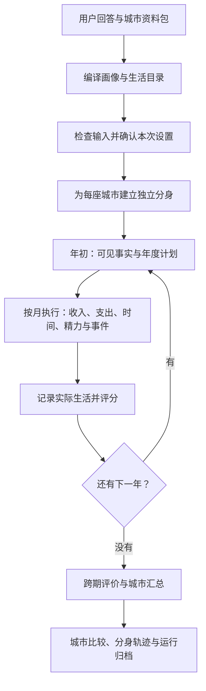

# 架构与代码入口

[English](ARCHITECTURE.en.md) · 简体中文

Homo spatialis 把“一个人去另一座城市生活”拆成三个问题：有哪些选择，如何做计划，计划执行后会发生什么。资料层准备选择，语言模型制定计划，生活引擎负责执行和评价。网页、命令行和后台服务使用同一套生活引擎。

第一次了解项目，可先读 [README](../README.zh-CN.md) 和 [方法概览](METHODS.md)。本页帮助你找到代码；具体运行步骤见 [复现说明](REPRODUCING.md)，当前实现状态与默认配置见 [项目索引](INDEX.md)。

## 一次模拟怎样走完

1. **准备同一个人。** 接入层把用户确认的回答转成画像，核对职业与资格，再结合资料包生成各城的开局状态。编译过程保留输入、资料和规则的版本身份。
2. **确定本次运行。** 预检查核对资料、画像、可运行范围和设置。服务记录用户的开始授权，条件变化后重新检查；后台流程负责登记、排队、启动和恢复。
3. **每年制定计划。** 每个分身得到本年度可见的城市事实、选择目录、个人状态和过去的事实记忆。规划器提交一份年度计划；格式或可行性检查需要修订时，按配置给出有限次数的机会。
4. **每月执行计划。** 引擎按目录中的价格、税制、时间和资源约束处理工作、住房、食品、通勤、学习及活动。实际执行记录决定当月生活；计划中的愿望和文字理由不会替代已经发生的结果。
5. **把生活带入下一年。** 结算后的状态、经历和有长度上限的事实记忆进入下一轮。每个分身独立推进，分身之间不交易，也不共同改变工资或租金。
6. **汇总并保留依据。** 模拟结束后评价已完成的生活和期末状态，再形成城市报告。完成、生活出局和模拟缺失分别统计，结果可追溯到分身、年度和月度记录。

## 各层负责什么

| 位置 | 职责 |
|---|---|
| [`src/common/`](../src/common/) | 定义画像、目录、计划、账目与公共消息的结构，以及单个对象必须满足的约束。 |
| [`src/ledger/`](../src/ledger/) | 加载资料和配置，检查对象之间的引用、单位与内容是否一致。 |
| [`src/product/`](../src/product/) | 接收用户回答，处理职业与资格，编译资料包，执行预检查，把运行结果整理成产品可以展示的结构。真实资料的获取与映射在 `realdata/`。 |
| [`src/agentlayer/`](../src/agentlayer/) | 构造代理允许看到的事实，生成规划请求，接入 mock 或真实模型，解析年度计划。 |
| [`src/econ/`](../src/econ/) | 执行生活计划、记账、检查资源、评分并评价。经济公式在这里实现。 |
| [`src/orchestration/`](../src/orchestration/) | 管理多城市、多分身和多年度运行，以及调用预算、归档、恢复和重放。 |
| [`src/workflows/`](../src/workflows/) 与 [`src/product/service/`](../src/product/service/) | 管理一次产品请求的生命周期：检查、授权、登记、后台执行和结果交付；服务还管理会话、任务与配额。 |
| [`web/`](../web/README.zh-CN.md) | 收集回答，展示设置、进度和结果。前后端共享消息定义，界面不另算生活分数。 |

这里有两层循环。`workflows` 管一次产品请求是否已经获准、开始或完成；`orchestration` 管分身的几年生活。LangGraph 属于前者，月度经济运算属于后者调用的生活引擎。

## 为什么要分开观察、执行与评分

**代理看到的是生活事实。** 许可出口由 [`life_views.py`](../src/agentlayer/life_views.py) 中的 `AgentObservation` 和 [`life_planning.py`](../src/agentlayer/life_planning.py) 构造。它可以知道可选住房、工资、通勤、自己的状态和已经发生的事；研究真值、内部评分参数和未来随机事件留在引擎侧。信息过长时，使用按板块的可逆压缩，保留可选项目的身份、数值和条件，见 [`compact_payload.py`](../src/agentlayer/compact_payload.py)。

**执行只依据计划和环境。** [`life_settlement.py`](../src/econ/life_settlement.py) 核算发生了什么，不用偏好分数改变账目。金额用整数最小货币单位记录；每个金额都带计价口径，跨币种或跨基年需要显式转换。

**评分读实际结果。** [`life_year.py`](../src/econ/life_year.py) 把年度结算、评分和下一年状态衔接起来。评分使用已确认的偏好和实际消费、活动、资源记录；未知资料保留为未知。评分不完整、生活出局、规划停止与程序故障各有自己的状态，城市汇总保留原计划的分身人数。

**重放依靠归档。** [`life_archive.py`](../src/orchestration/life_archive.py) 保存计划、输入绑定和执行记录；运行器可以据此核对结果，无需再次询问模型。恢复则从已完成的进度继续，需要新计划时才调用规划器。

## 从哪里开始读代码

| 你要理解的问题 | 代码入口 | 对应测试或说明 |
|---|---|---|
| 用户回答怎样变成可运行画像？ | [`answers.py`](../src/product/answers.py)、[`qualifications.py`](../src/product/qualifications.py)、[`compile.py`](../src/product/compile.py) | [`test_ratings.py`](../tests/product/test_ratings.py)、[产品输入](design/e3a-product-input.md) |
| 真实记录怎样成为住房、岗位和其他选择？ | [`realdata/`](../src/product/realdata/) | [数据与映射](DATA.md)、[`test_life_pack_assembly.py`](../tests/product/test_life_pack_assembly.py) |
| 规划器如何提出和修订计划？ | [`life_planning.py`](../src/agentlayer/life_planning.py)、[`life_llm.py`](../src/agentlayer/life_llm.py) | [代理闭环](design/e1-7-agent-loop.md)、[`test_runner.py`](../tests/life/test_runner.py) |
| 钱、时间和精力怎样约束生活？ | [`life_settlement.py`](../src/econ/life_settlement.py)、[`life_resources.py`](../src/econ/life_resources.py) | [`test_settlement.py`](../tests/life/test_settlement.py)、[时间与精力](design/e1-4-time-energy.md) |
| 一段生活怎样得到分数？ | [`life_scoring.py`](../src/econ/life_scoring.py)、[`life_evaluation.py`](../src/econ/life_evaluation.py)、[`life_aggregation.py`](../src/econ/life_aggregation.py) | [`test_scoring.py`](../tests/life/test_scoring.py)、[`test_evaluation.py`](../tests/life/test_evaluation.py)、[评价方法](design/e1-6-evaluation.md) |
| 产品请求怎样接到生活引擎？ | [`graph.py`](../src/workflows/graph.py)、[`e3_adapters.py`](../src/workflows/e3_adapters.py)、[`service_worker.py`](../src/workflows/service_worker.py) | [`test_e3_wiring.py`](../tests/workflows/test_e3_wiring.py)、[`test_smoke_flow.py`](../tests/product_service/test_smoke_flow.py) |
| 网页与后端怎样约定输入输出？ | [`product_contracts.py`](../src/common/product_contracts.py)、[`contracts/product/v3/`](../contracts/product/v3/README.zh-CN.md)、[`web/`](../web/README.zh-CN.md) | [`test_contracts_schema.py`](../tests/product/test_contracts_schema.py)、[网页说明](design/e5-web-ui.md) |

共享消息的源定义在 Python 契约中，导出的 JSON Schema 和公共样例供前端使用。`contracts/product/v3/` 是这一代结构的目录；具体修订号以契约声明和 [项目索引](INDEX.md) 为准。

## 生活模拟与研究线

生活模拟回答的是：给定一个人的回答、这些城市资料和一套生活规则，规划与执行会形成怎样的轨迹。它采用年度决策、月度执行和跨期评价。

仓库还保留静态研究线：[`src/worlds/`](../src/worlds/) 生成合成世界与人设，[`src/econ/core.py`](../src/econ/core.py)、[`kernel.py`](../src/econ/kernel.py) 和 [`utility.py`](../src/econ/utility.py) 计算已知偏好下的福利，[`src/eval/`](../src/eval/) 研究偏好回收、向平均偏好收缩及相应的福利损失。这条线可以控制真值，用来研究模型表现；它的静态福利量与生活模拟的跨期分数是不同的测量对象。详见[研究方法](RESEARCH.md)与[参考文献](REFERENCES.md)。

## 扩展时改哪一层

增加城市通常先改资料来源、映射和资料包；换模型服务商通常只需补传输层与配置。新增一种生活行为，需要先说明它消耗什么资源、产生什么可观测结果，再决定是否扩展引擎契约和经济规则。单纯的展示变化留在产品展示层或网页。

公式、代理变量和默认参数都影响实验结论。修改它们时，在 [参数与假设目录](design/parameter-assumption-register.md) 登记含义与依据，并同步相关设计文档。具体协作方式见 [贡献指南](../CONTRIBUTING.zh-CN.md)；维护者和编码代理的工作约定见 [CLAUDE.md](../CLAUDE.md)。
