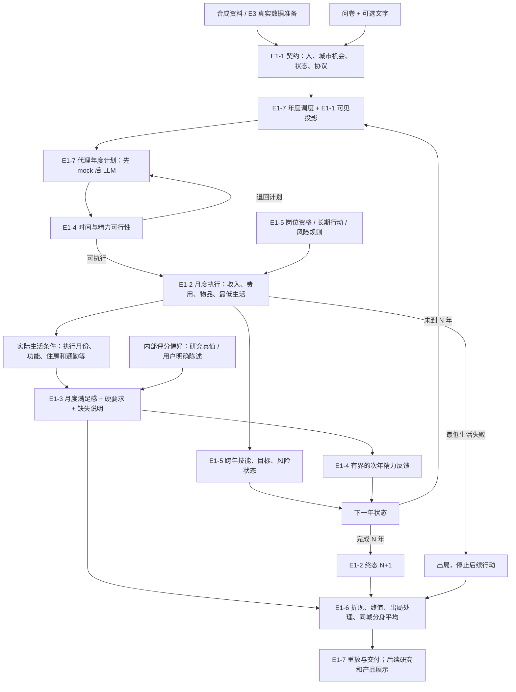

# E1-3 生活条件与满足感：技术说明

[English](e1-3-life-model.en.md) · 简体中文

> **2026-10-19 起只保留产品版（[ADR0037](../../DECISIONS/0037-life-keep-only-product-version.md)）：** 本文的手算例子与配置名来自当时的样例（`synthetic_e1_*`、`run_e1_7b_*` 等），这些配置与旧版本的规则、评分、模板已从仓库删除；机制与公式仍是现行代码的说明，现行样例是 `configs/life/*_product.yaml`。

> **固定的是人的偏好，而不是替他固定消费结果。**

更新：2026-10-07（增补实施后同步）。读者：项目所有者、架构讨论者与 coding agent。本文说明当前实现、已同意的增补方向，以及之后怎样扩展；不把目标冒充已实现功能。

## 阅读与效力

- **当前代码**：2026-10-07 工作区中 ADR0018 的探索版，加上 [ADR0019](../../DECISIONS/0019-life-e1-3-supplement.md) 的增补（新协议 `life-v1-e1-3s`、新评分版本 `e1-3-supplement-v1`）。代码仍是未提交改动、停在审核点；标“当前代码”的段落都写明了函数、配置与测试。
- **本轮待实现**：2026-10-07 的增补已按 coding prompt 实现，相应段落已改为“当前代码”；仍未实现的部分保留“待实现/E1-x/V2”。所有者代码核对之前，状态是“已实现、待审核”。
- **后续设计**：E1-4/5/6/7 或 V2 的方向，不表示运行时已经具备相应能力。
- **建议公式**：只授权合成探索验证，不代表医学、价格或幸福度的现实估计。参数来源与版本必须进入结果。
- 所有者最新明确决定优先；[README](../../README.zh-CN.md) 管愿景，[项目索引](../INDEX.md#status) 管工程状态，[PLAN](../../PLAN.md) 管版本方向，有效 ADR 管具体协议。本文解释它们并导航代码，不以日期自动覆盖 ADR。
- 旧探索规则见 [ADR0018](../../DECISIONS/0018-life-exploratory-monthly-scoring.md)，旧协议 `life-v1-e1-3` 继续按它运行；增补规则见 [ADR0019](../../DECISIONS/0019-life-e1-3-supplement.md)，只在新协议与新评分版本里启用，旧配置和结果继续可读。
- 2026-10-18：物质维的"洗衣"推广为"日常生活便利"（评分版本 `e1-convenience-v1`，[ADR0033](../../DECISIONS/0033-life-daily-convenience.md)），见[第 21 节](#daily-convenience)。已实现、自测通过，待独立复核；旧版本照旧。（2026-10-18 补记：在声明的 V1 合成范围内通过独立审核（本机记录），可以交接 E3；真实资料接入和参数标定尚未完成。）

阅读顺序：

1. [模型要回答什么](#purpose)；
2. [当前评分怎样计算](#current)；
3. [功能、属性与城市报价怎样分开](#consumption)；
4. [七维增补与后续机制](#dimensions)；
5. [数据、覆盖与遗漏](#coverage)；
6. [工程落点与检查清单](#engineering)。

## 1. 我们在评价什么

LLM 分身提出一年生活安排，环境判断它实际上买到了什么、享受了多久、承担了什么资源消耗。E1-3 再按明确来源的个人偏好评价这些实际条件。

一份高分生活不等于 LLM 写了一份好听的报告，也不等于花了很多钱。相同居住条件的房子涨价，住房体验不自动变好；高价格通过预算限制其他选择。

### 1.1 同一个人跨城保持什么不变

偏好、硬要求、能力和初始资源的对齐规则固定；实际安排允许因城市价格、机会和历史状态而变化：

\[
a_{ict}=\pi(\theta_i,\mathcal O_c,x_{ict}).
\]

这里 θ 是人的偏好，O 是城市机会目录，x 是当前状态，a 是行动。喜欢大房子的人在昂贵城市暂住小房子，并不表示他改变了偏好。这是配对比较，不是假设跨城实际选择独立同分布。

旧静态模型的固定消费份额仍按其原协议保留；不能把它当成新生活代理必须遵守的固定支出结果。

### 1.2 简化不等于随机残差

本版保留少量主要作用。没有模拟的住房选址、品牌与爱好差异，要记录“省略了什么”和“影响哪些偏好的人”。没有证据时，不能声称遗漏因素一定均值为零、与用户偏好无关。

### 1.3 环境由谁计算

真实资料或明确的情景假设 → 冻结的机会目录 → 代理选择 → 代码结算 → 代码评分。

V1 不引入在线环境 LLM 来决定价格、行动效果、工资或满足感。离线 LLM 可辅助字段匹配和分类；数值必须回到来源，转换由可审计规则完成。没有价格的项目不能靠语言模型常识补价。

## 2. E1 全流程与职责

这是目标流程；E1-1/2、E1-3 基础探索版与 2026-10-07 增补已存在，其余节点仍需实施。

分数、研究真值与评分参数不直接回传给代理。事实反馈经过许可投影；精力等动态反馈也必须记录信息条件。出局分身不复活，也不从总体分母消失。

> ⚠ 2026-10-11 更正（[ADR0028](../../DECISIONS/0028-life-single-clone-evaluation.md)，所有者口径）：“不从总体分母消失”指原计划人数与出局比例——城市平均分排除已确认的生活出局者；原计划人数、出局比例（以原计划人数作分母）及原因的报告保留全部分身；模拟问题造成的未完成计算另作不确定性分析。见 [E1-6 技术说明](e1-6-evaluation.md) 第 6 节。

## 3. 当前代码的契约与调用路径

| 文件 | 职责 |
|---|---|
| [life_contracts.py](../../src/common/life_contracts.py) | 生活机会、用户陈述、内部真值、状态、行动、实际结果与持有服务 |
| [life_billing.py](../../src/common/life_billing.py) | 加载检查与结算共用的金额/计费换算 |
| [life_catalog.py](../../src/ledger/life_catalog.py) | 加载及跨对象检查；当前也承担一部分可行性检查 |
| [life_settlement.py](../../src/econ/life_settlement.py) | settle_year / settle_plans：执行、精确记账、状态推进 |
| [life_scoring_contracts.py](../../src/common/life_scoring_contracts.py) | 分项、城市评分条件、偏好、月度和年度评分结果；增补的景观、方案级通勤、比较组、省略清单与覆盖报告形状 |
| [life_scoring_config.py](../../src/ledger/life_scoring_config.py) | 评分配置加载、条件检查与比较组共同粒度检查（comparison_group_problems） |
| [life_scoring.py](../../src/econ/life_scoring.py) | preference_from_research_truth / preference_from_stated_profile / score_year / source_table |
| [life_coverage.py](../../src/econ/life_coverage.py) | coverage_report：偏好叶子覆盖（增补；只报告，不解锁总分） |
| [life_views.py](../../src/agentlayer/life_views.py) | 显式许可的观察、事实反馈及内部对象扫描 |

score_year 接收协议、评分规格、城市条件、机会目录、年初状态、实际结算结果、评分偏好和硬要求。它没有“年度计划理由”参数；不修改账目。持有物数量直接读结算写出的 HoldingService.quantity；只有旧评分版本读旧记录时才借年初状态推断，见第 6 节。（本文早先写的函数名 research_preference / stated_preference 与代码不符，代码里是 preference_from_research_truth / preference_from_stated_profile，已改正。）

三种就绪状态不同：

- settlement_ready：能按当前账务规则结算。
- exploration_scoring_ready：探索评分配置可运行；个别人仍可能因正权重缺失拿不到总分。
- scoring_ready：完整生活协议可正式评价。当前仍为 false，不靠将待定政策改成 decided 解锁。

## 4. 当前评分公式

### 4.1 从实际条件到分项满足感

\[
z_j=b_j+\Delta_j,\qquad
s_j=\min\left(c_j,\frac{z_j}{z_j+\tau_j}\right).
\]

| 符号 | 含义 | 约束 |
|---|---|---|
| x | 实际得到的规格数值、数量或真假条件 | 来自实际执行/服务月份；不是付款金额 |
| ηx | 来源产生的有效改善 | 当前 x、η 非负 |
| b | 不依赖这次购买的基础条件 | 当前 b 非负 |
| Δ | 按 sum/max/any 合并的改善 | 同一分项内必须可解释、单位一致 |
| τ | 共同锚点 | 正数，同一评分规格内所有城市共用 |
| c | 满足感上限 | 0–1，当前可因城而异，须说明来源 |

z=τ 时，**截顶前**为 0.5，最终是 min(c,0.5)。加载器还检查 b/(b+τ)≤c。当前参数只是合成设定，不是实测的幸福兑换率。

同样增加一单位 z，起点越高，收益越小，因为未截顶时导数为 τ/(z+τ)²。500 平方英尺、η=0.01、τ=5 的住房得 0.5；1000 平方英尺得约 0.667。这里的数字只解释公式。

当前不支持任意负效应、实际条件替换背景、享乐适应或复杂跨行动交互。通勤没有把“更长通勤分钟”当正向 x 塞进去：增补用的是单独的方案级映射（第 10 节）。

### 4.2 多个来源怎样合并

| 规则 | 计算方式 | 适合什么 |
|---|---|---|
| sum | Δ=Σηx | 可相加的实际服务量 |
| max | Δ=max(ηx) | 同类可替代方案只取最好的一项 |
| any | 任一真假条件满足，加一次 eta_any | 家中工作间或共享办公满足同一需求 |

max 比较的是改善量 ηx，不是未经换算的原始 x。any 的来源只能是 spec_flag 或 present（增补：这个月有一件在用的、声明了该功能的候选就取 1）。同一需求在两个地方满足，不自动翻倍。按功能过滤、只取“存在”或数量的来源不能用 sum（契约校验时就拒绝）；只有读取明确容量规格的来源可以相加。

每条来源保存是否计入 counted，可以重建 z。不同单位不能因为都是数字就相加，例如医疗等待分钟不能直接加保险报销比例。

### 4.3 评分只读哪一份记录

| 项目 | 唯一来源 |
|---|---|
| 住房、食品、按期服务、一次体验 | ItemExecution.covered_months |
| 预付服务、耐用品 | HoldingService.covered_months |
| 方案级通勤（增补） | 当月 ItemExecution（role=housing，含兜底那条）的往返分钟，配当月 ItemExecution（role=job）的工作方式；工资本身仍不计分 |
| 工资、付款、现金、培训 | 当前不是评分来源 |

预付服务虽然在执行记录中也有服务月份，评分只读持有服务记录，防止重复计分。耐用品按服务月份产生收益，购买瞬间不再额外奖励。

没有声明使用安排的会员卡，不自动算成已经锻炼。现有样例把“年卡＋每月 8 次”定义为一个行为方案；真正的时间可行性留给 E1-4。（2026-10-07：E1-4A 的新协议已按每月 8 次 × 1.5 小时计入时间与精力约束，见 [E1-4 技术说明](e1-4-time-energy.md) 第 4 节；本节的评分读法不变。）

### 4.4 七维与全年

\[
S_{\text{material},im}=\sum_j m_{ij}s_{ijm},\qquad
U_{im}=\sum_{k=1}^{7}w_{ik}S_{ikm}.
\]

w 与 m 都非负、各自和为 1。物质细项在总分中的有效权重为 w_material×m_j。两层权重固定于人，实际支出不固定。

当前六个非物质维各只能有一个评分分项；物质允许多个。不要误认为契约已经支持任意多层医疗或环境子指标。

十二个月全为 scored 才有：

\[
\bar U_i=\frac1{12}\sum_{m=1}^{12}U_{im}.
\]

先逐月评分，再求均值。半年工作空间 0.8、半年 0.5，年均是 0.65，不能先平均原始条件再经过非线性函数。当前不计算三年折现、终值、城市排行或跨分身平均。

### 4.5 当前手算例子与配置

完整参数以 scoring_e1_3.yaml（已删除） 和 [ADR0018 第三节](../../DECISIONS/0018-life-exploratory-monthly-scoring.md) 为准，不在多个文档维护平行参数表。

样例 u01 第 1 年第 2 月：

- 住房 0.5、鲜食 0.3、工作空间 0.8、电脑功能按件数得到 0.5（旧版本 e1-3-explore-v1 的规则）。
- 物质 = 0.4×0.5+0.1×0.3+0.3×0.8+0.2×0.5 = 0.57。
- 五个基础维各 0.5，休闲为 0.25。
- 总分 = 0.35×0.57+0.60×0.5+0.05×0.25 = 0.512。
- 年均约 0.5002083。

这是“程序符合这套规则”的核对，不是 51.2% 幸福或现实幸福的置信度。证据见 手算核对（本机记录）。

增补样例的手算（u11 第 5 月月度分 0.5802917、两部手机只计一次、景观 0.58、近远通勤 2/3 与 6/13 等 26 条）见 增补运行证据（本机记录），参数以 scoring_e1_3s.yaml（已删除） 为准。

## 5. 偏好、硬要求、缺失与信息隔离

### 5.1 两条偏好路径

- 研究：research_preference 读取 InternalPreferenceTruth。
- 产品：stated_preference 读取 StatedLifeProfile 的七维点数和物质细项点数，各除以 100。
- 产品换算拿不到内部真值；不从 low/medium/high、自由文字或消费开支比例猜权重。
- 物质权重为正但缺细项数值时返回 PreferenceInsufficient，不补均匀权重。
- 产品措辞为“按你提供的偏好和当前模型计算”，不称已知用户真实幸福权重。

### 5.2 硬要求

当前只支持每个月都要满足。条件有类别、min_字段、max_字段、字段相等；同一方案内条件同时成立，替代方案之间任一成立即可。

逐月报告满足、不满足、未知、未生活。它不扣分、不触发出局。只有六个月满足就报告六个月，不能用另外六个月的高分抵消。未来推荐怎样处置硬要求失败属于 E1-6/7。

### 5.3 缺失不是没买

- 确定未买或没执行：没有该项新增改善。
- 候选来源缺必要规格：unknown。
- sum/max 遇到候选未知，整个分项未知。
- any 已有一个确定满足时可以判满足；否则有未知就不能判定。
- requires_spec_key 用于筛选候选。例如没写 visits_per_month 的年卡不成为锻炼来源；这和一个已声明锻炼方案缺次数不同。
- 正权重分项未知：月度 incomplete，完整总分为空；不补零、不逐城重新归一化。
- 零权重项未知不阻断总分。

### 5.4 出局与降级

出局当月为 exit_month，之后为 after_exit；二者不计分，也不能当普通空值跳过后取年均。出局年的年均为空。完整轨迹处理留 E1-6。

降级按实际获得的条件评分，不再增加“失望分”。最低生活检查、金额精确守恒和出局逻辑归 E1-2；真实税表核查仍是独立任务。

### 5.5 内部答案不进观察

用户陈述可按许可进入观察，研究真值、完整内部状态/结果、评分规格、城市评分条件、评分偏好和分数对象不能整体进入提示或事实反馈。新增的商品属性与通勤分钟可作为生活事实，但不能顺带暴露评分系数或答案权重。

*当前代码（2026-10-08 订正，ADR0019 第十二节第 5 条）*：内部评分对象本身、以及它们**原样序列化后的字典**，在正式加载（机会的规格、属性、安排项）、可见投影和最终 payload 三处都被拒绝：一道是保留参数键名（`RESERVED_SCORING_KEYS`：beta、tau、η、a_nature……），一道是结构检查（`serialized_internal`：字典里与某个内部类型同名的字段能原样校验成该类型，就算混在正常属性里也认得出）。品牌、菜系、准备方式、住房规格与通勤分钟照样可见。防护边界：这不是对任意改名或自然语言隐写的通用检测器。

## 6. 数量、持续时间与跨年

**当前代码已有：**

- Holding.quantity；
- 耐用品年寿命换算成月；
- acquired_month、remaining_months、生效时点；
- 按实际服务月递减，跨年延续，到期移除；
- 可配置模拟年数 N，终态 N+1。

**当前代码（ADR0019 第二节）：HoldingService.quantity。** 结算写持有服务记录时直接写出每条记录的数量，评分（`life_scoring._holding_quantities`）直接读取，与记录顺序无关；未成功的购买不产生持有记录。评分结果写明数量来源 `holding_quantity_source`（recorded / legacy_order_inference / no_holdings）。

旧记录兼容：增补之前写出的结果没有数量，只有旧评分版本 `e1-3-explore-v1`（`LEGACY_QUANTITY_INFERENCE_VERSIONS`）按 ADR0018 推断（信息来源：年初状态的数量 + 本年成交数量 + 结算写出顺序），对不上就报错；新版本拒绝并提示重新结算；部分有、部分没有一律拒绝；任何情况都不默认为 1。历史输出不回写。

已验证（`tests/life/test_supplement_records.py`）：旧持有与续购数量不同（年付服务到期后续买，1 张 → 2 张）、记录重排（新记录不受影响；旧推断在重排后会把数量配错，这正是改动的理由）、持续物品在之后年份续购、到期移除、次年生效、旧样例去掉数量后由旧版本读出逐月相同的结果。E1-2 的结算规则不允许在还持有同一件持续物品时再买一批（不同剩余期限不叠成一件），所以“同一年里同一物品新旧两批”只会出现在年付服务上。

**V2：** 更长模拟下的生命周期数据与替换策略。维护、维修、故障、老化、转售、真实折旧与使用强度影响寿命是待设计候选，不表示本轮全部采纳。已有按月寿命不能撤回或延期；E1-6 仍需先规定现有现金和物品的期末评价，不能因真实二手价格模型尚未完成就推迟终值问题。

## 7. 从 V1 功能方案到 V2 品牌与饮食偏好

功能拆分可以支撑用户愿景，但“功能相同”不等于“主观体验完全相同”。需要区分四层：

| 层 | 例子 | 谁决定 |
|---|---|---|
| 需求功能 | 居住、饮食、通信、出行、工作空间 | 共同分类 |
| 方案属性 | 品牌、车型、菜系、档次、烹饪方式、规格 | 方案资料 |
| 城市供给 | 当地同版本报价、资格、可得性、使用成本 | 有来源的城市目录 |
| 个人偏好 | 功能重视程度、属性喜好、最低要求、可接受替代 | 用户陈述或研究真值 |

**当前代码（ADR0019 第三节）：** `LifeOpportunity.functions`（需求功能，词表在生活输入的 `functions` 里声明）与 `LifeOpportunity.attributes`（方案属性，词表 `attribute_keys`；只存储、不评价）。可测的规格仍放 `spec`，同一个键不能同时出现在 spec 与 attributes。评分结果列出在用物品“已记录、未评价”的属性（`unevaluated_attributes`）。“能存 brand”不代表评分已经支持品牌偏好：V1 只验证可扩展存储、共同功能和粗方案；V2 才让细属性匹配进入评分。

*当前代码（2026-10-08 订正，ADR0019 第十二节第 1、4 条）*：生活输入的 `function_kinds` 给评分要用的功能声明数量语义——存在型（通信、工作设备、洗衣、工作空间、家务）或容量型（储物）；每个评分来源声明 `measure`（presence / capacity / level / count），存在型不能以任何方式让件数进入（数量取值、按件乘规格、sum 都被拒绝），容量型必须读“规格容量 × 件数”。每座城用 `function_supply` 写明评分要用的功能是可得、确定不可得还是资料未知：目录里没有记录不等于确定没有；资料未知时没在用的月份报未知，不给确定的 0。

### 7.1 用户例子如何落在四层中

| 用户想表达的偏好 | 功能 | 将来的属性 | V1 / V2 |
|---|---|---|---|
| BYD 或 Tesla | 私人交通/出行 | 品牌、车型、容量、续航、使用方式 | V1 方式与成本；V2 车型品牌 |
| 小米或苹果 | 通信及相关功能 | 品牌、系统、规格、服务兼容 | V1 功能；V2 属性匹配 |
| 中餐或意大利餐 | 饮食 | 菜系、取得渠道、当地可得性 | V2；V1 留字段接口 |
| 大众或高端 | 某一具体需求的品质体验 | 质量、品牌、档次 | V1 只用能测的规格；V2 丰富属性 |
| 外卖或自己做 | 饮食与准备服务 | 准备方式、送达、准备时间 | V1 可做粗方案和时间事实 |
| 有机蔬菜、烤鸡、冰淇淋 | 饮食 | 食材、认证、菜品、组合 | V1 鲜食/便利粗分类；V2 细品类 |

不能写“某品牌在某国一定更便宜”。价差取决于同版本、年份、税费、渠道和当地报价；用户例子说明需求，不是已经核实的价格定律。

“高端”不自动更有用；某人确实重视的品质、口味或品牌适合度才可能贡献。偏好未知时不从价格反推喜欢程度。

### 7.2 属性如何进入未来评分

当前物质聚合框架可以保留：

\[
S_{\text{material}}=\sum_j m_{ij}\,s_j(q,\text{规格},\text{属性匹配};\theta_i).
\]

新增属性改变原需求内部的适合度，不凭空新增第八个总维度，也不自动稀释住房等权重。具体匹配函数、互补性与容量规则在 V2 裁决；本轮不暗定“喜欢某品牌加 0.2”。

品牌相同或不同的第二台手机，不自动获得第二份完整通信满足感；第二台确有工作用途时，需要另有实际需求或容量规则。

同一商品可服务多个需求，但同一效果只计一次。例如汽车费用归账务，行程时间归通勤，单独的拥有体验只有用户明确表达且模型单列时才评价，不能因“贵车”在每个维度都加分。

### 7.3 V1 物质分项

1. **住房服务**：面积/房间数、独占性、基本设施；V1 先租住，购房融资与房产终值后续再议。*当前代码*：评分读面积（`housing_space`，max）；独占、基本设施、房间数是结构化规格事实，供最低生活声明与硬要求检验，不另设分项。
2. **食品方案**：至少能表示鲜食/便利的粗区别、成本与准备时间；不自动推断健康效果。*当前代码*：鲜食分读每周新鲜餐数；自做/外购是属性 `prep_mode`，准备时间是时间事实（`time_cost_hours_per_year`，计入结算的时间合计），不另给“省时幸福”。
3. **功能性耐用品**：通信、工作设备、洗衣等；用功能与实际服务期替代无条件按件数加分。*当前代码*：通信、工作设备、洗衣各一个叶子（any + present），储物按声明的升数相加（sum + 容量规格 × 数量）。
4. **工作空间**：住宅与外部空间可替代，同一需求只算一次。*当前代码*：住宅工作间（spec_flag）与外部工位（功能 workspace，present）any 合并；新样例不设城市基础值。
5. **便利及基本服务**：少量餐食准备、清洁等；省下的时间交 E1-4，水电含在租金里时不再重复扣。*当前代码*：保洁只记录功能 `home_cleaning` 与时间事实，本轮没有对应分项；给家务正权重的人月度总分不完整（未支持的需求，覆盖报告列出）。
6. **未覆盖消费**：登记缺口；不能用一个“其他消费”字段假装覆盖所有个性。*当前代码*：覆盖报告的“没有评分分项”与评分规格的省略清单。

上面是功能分类，不授权自动重分配偏好权重。若将原 `durables` 拆成多个评分叶子，新样例必须明确给出各叶子的偏好点数；不能平均分配旧权重，也不能按价格分配。最小实现也可保留原叶子、仅按功能去重，但需在新 ADR 写清聚合与容量规则。*当前代码*：新样例（`synthetic_e1_3s.yaml`）拆成通信、工作设备、洗衣、储物四个叶子，三位用户逐项给了点数；旧样例保留原 `durables` 叶子与按件数相加的旧规则（只在旧版本里）。

## 8. 七维的本轮增补边界

| 维度 | 本轮范围 | 后续 |
|---|---|---|
| 物质 | 功能、粗方案、数量、实际服务；属性扩展接口 | V2 品牌/菜系/档次/细商品 |
| 安全 | 同口径城市背景；不发明住房开支买安全曲线 | 有共同数据时再做区位选择 |
| 医疗 | 可及性背景；明确风险场景设计，不运行病程（⚠ E1-5C 新评分版本里没有医疗背景分项，见第 11 节指针） | E1-5 年龄/工作强度相关大病小病场景（E1-5C 已实现） |
| 机会 | 岗位、资格与成长机制说明；本轮不自动涨薪 | E1-5 学习—资格—岗位 |
| 休闲 | 抽象休闲机会、可负担方案与实际使用 | E1-4 时间精力；V2 爱好—地理匹配 |
| 环境 | 背景 + 自然景观/户外吸引力的有界探索加分 | V2 更细环境暴露或爱好联系 |
| 通勤 | 背景或统一方案级；简化租金—通勤配对 | E1-4 时间约束；更细地址路线以后再做 |

*当前代码*：物质（功能叶子）、环境（景观加分）、通勤（方案级）已按本表实现；安全、医疗、机会仍只有城市背景（评分报告写“当前没有行动改善机制”）；休闲沿用 E1-3 的抽象使用安排与体验。医疗、机会的 E1-5 机制与休闲的 E1-4/V2 部分只登记。

## 9. 环境：自然景观加分

**用户已确认：自然景观与户外环境吸引力可以增加环境分。** 商业、购物、历史古迹等旅游吸引力不因此等同空气或气候好，未来归休闲讨论。

本轮建议一个明确、局部的合成规则：

\[
S_{\text{env}}=\min(c_{\text{env}},S_{\text{physical}}+\beta A_{\text{nature}}).
\]

- S_physical：新协议定义的基础环境得分；本轮继续使用显式合成值，不表示已完成空气、气候等真实资料的映射。
- A_nature：按共同定义得到的 0–1 自然景观/户外吸引力；直接资料、代理估计和合成设定分开标。
- β：全比较组共用、非负、有明确上限的合成加分系数，配置化；β=0 为关闭对照。
- 本轮可用 β=0.1 作手算演示，不把它认定为现实标定。
- 不按城市名、游客数或旅游收入自动贴“环境好”标签。
- 如果基础环境已经包含同一自然景观，不能再因“旅游城市”重复奖励。
- β>0 且景观数据未知时不能默认为 0；β=0 则该未启用项不阻断。
- 基础环境未知时，景观加分不能把它补成已知；必要输入的缺失继续按正权重缺失规则传播。
- 输出保留基础分、景观加分、截顶情况和来源，不能只留一个黑箱综合数。

*当前代码（ADR0019 第七节）*：`LandscapeSpec`（β 写在评分规格里，0 ≤ β ≤ 0.5，全组共用；城市条件里没有 β 字段）、`NatureCondition`（城市的 A_nature 与来源；未知不是零；可声明 `base_includes_landscape`）与 `life_scoring._score_component` 的景观分支；结果明细 `LandscapeTerm`（β、A、基础分、景观贡献、来源类型）与截顶标记。加载检查拒绝：β > 0 时缺景观数据、基础已含景观再加分、没启用景观的分项写景观数据。演示：A41 环境 = 3/(3+3) + 0.1×0.8 = 0.58；B42 景观未知 → 环境未知、月度总分不完整；β = 0 对照下两城都回到 0.5。测试见 `tests/life/test_supplement_scoring.py` 的景观部分。该规则只在新评分版本启用，不回写 ADR0018 的旧样例分数。城市基础环境不同于活动量；本轮不增加旅游出行系统。

## 10. 住房与通勤：有限配对，保留真实选择

用户已同意：暂不做精细地图，但允许“更长通勤换更低租金”的简单选择。采用少量显式住房—通勤组合，而非事后由 LLM 解释位置。

例子仅为合成说明：

| 方案 | 相同住房条件 | 月租 | 每个工作日往返通勤 |
|---|---|---:|---:|
| 近一些 | 独立一居室 | 1400 | 30 分钟 |
| 远一些 | 独立一居室 | 1000 | 70 分钟 |

所有城市采用同样字段和规则，实际价差/分钟可以不同。没有数据时写“合成情景”，不称为现实租金斜率。不同住房方案要满足本城最低生活声明的一致性检查。

路线条件来自实际执行的住房；降级时一起切换。是否发生通勤还要看当月实际执行的线下工作。不能选择远处便宜房租，却保留近处短通勤，也不能因住了一整月就假定通勤了一整月。

本轮最小演示先限于明确、固定的线下工作安排。无工作、远程或多岗位等安排若没有已声明的评分规则，就显式报方案级评分不支持/信息不足，不自动记为长通勤、零通勤或最高分。新 ADR 必须写清适用范围，并用负例验证；E1-4 再扩展工作日、远程比例与时间占用。

建议通勤探索映射：

\[
S_{\text{commute}}(T)=\frac{\tau_T}{\tau_T+T},\quad T\ge0.
\]

T 是每个工作日的往返分钟，τ_T 是所有城市共用的正锚点。本轮可用 60 分钟作合成手算：30 分钟得 2/3，70 分钟得 6/13。它是建议的新局部映射，不复用“分钟越多正改善越大”的旧分项路径。

本轮只对已支持的实际工作安排使用方案通勤评分；乘工作日数变成月度占用、与其他活动竞争时间属于 E1-4。一次住房选择的事实可以同时用于约束和评价，但不能将同一通勤时间负担在两个分项重复扣分。

住房选择仍不自动改变安全或室外环境；这两个被省略的联系写入第 15 节。

*当前代码（ADR0019 第八节）*：`PlanCommuteSpec`（往返分钟与工作方式的规格键、线下取值、单位；τ_T 就是分项的 τ）、`life_scoring._score_plan_commute`（读当月实际所住住房，含兜底；要求当月恰好一份执行了的线下工作），以及 `life_scoring_config.comparison_group_problems` 的方案级检查（全组每个可得住房写明分钟、每份可得工作写明工作方式、城市条件写 `plan_level`、分钟不能被列成可选安排——那就是拆配）。不支持的安排统一报“方案级通勤评分不支持/信息不足”，分项未知。演示：近处 30 分钟 → 2/3，远处 70 分钟 → 6/13；u13 第 4 月降级到远处，住房与通勤一起切换；工作只做到第 6 月时，第 7–12 月通勤报不支持。

*2026-10-09（DECISIONS/0024）*：评分版本 `e1-5a-growth-transport-v1` 把通勤维的人话含义改为"交通便捷程度及出行对生活的影响"，改用广义交通 k = ρ + (1 − ρ)·D/D_ref、T_eq = k·T、S = τ_T/(τ_T + T_eq)（D 读资源账的到岗次数）：无工作、远程、混合、多岗位都能评，天天到岗一份工作与上式同分。本节的方案级通勤在 `e1-3-supplement-v1` 及 E1-5A 原评分里照旧。见 [E1-5 技术说明](e1-5-career-savings-risk.md) A14。

**需要所有者注意的后果**（2026-10-08 订正说法）：在其他实际消费相同、节省的现金留存到期末的当前演示中，节省部分尚未获得期末评价，因此分数只体现通勤劣势：远处一年省 4,800，月度分每月低 0.15×(2/3−6/13) ≈ 0.031。这不等于省钱永远不能提高满足感——省下的钱若用于其他可评分的实际服务，收益已经经那些服务体现，不再给现金节约另加一次分；留存现金的未来价值由 E1-5/E1-6 处理。

通勤映射保留原样：τ_T/(τ_T+T) 不加城市背景上限（值本身在 0–1，T = 0 是该指标的最好端点），plan_level 条件不带 b、c、η；零分钟只在已支持的线下工作安排里按公式评价。2026-10-08 起比较组还核对单位：往返分钟的资料单位必须与 τ_T 同为分钟，写成小时会被拒绝（评分器不替人换算）。

## 11. 医疗：E1-5 的年龄与工作负荷情景

> ⚠ 2026-10-11：E1-5C 已实现（[ADR0027](../../DECISIONS/0027-life-illness-emergency-recovery.md)，已实现、自测通过，待独立复核）。新协议 `life-v1-e1-5c-health` 与评分版本 `e1-5c-health-v1` 里，医疗维**没有**城市背景分项，七维的 healthcare 点数改为健康风险应对倾向（只供代理计划、不进满足感），健康由全组共用的健康项 γ·H(月初状态) 评价；疾病、病假、治疗与恢复按 ADR0027 运行（病假没有工资）。本节以下是当时的设计讨论，旧协议与旧评分版本照旧。

**方向已同意，当前未实现；本轮只记录契约设计。**

用 none / minor / major 表示无事件、小病情景、大病情景。它们是费用与活动影响的模拟类别，不是医学诊断。年龄、工作负荷与概率关系都要有来源或标合成假设。

建议的概率接口为：

\[
(p_0,p_{\text{minor}},p_{\text{major}})
=P(\text{年龄},r_{\text{历史窗口}};\phi),\quad
p_k\ge0,\quad\sum p_k=1.
\]

r 是实际工作精力负担 / 相应的可用精力预算，E1-4A 已在 `MonthResources.work_relative_burden` 记录统一比例，但还没有疾病概率映射。不能把工时比例和精力比例混写。建议用上一期实际负荷或预先冻结的窗口，避免本期生病减少精力又反过来改变同一次生病概率的循环。

必须先定：

- 月度还是年度概率，不能将年概率原样用于每月；
- 首期历史负荷如何初始化；
- 年龄怎样随模拟时间推进；
- 场景的服务需要、费用、时间与精力损失、工作中断及恢复规则；
- 服务怎样满足需要，不能花医疗费越多就幸福越高；
- 无风险对照和合成参数敏感性。

配对随机数：同一分身、同一时间跨城共用 u；若各城工作强度不同，p 可以不同，因此事件结果也可以不同。共用随机数不等于强制所有城市生同一种病。随机流应与分身/时间身份绑定，避免遍历顺序改变结果。

**2026-10-08 所有者补充（[ADR0022](../../DECISIONS/0022-parameter-register-and-e1-5-scope.md)，待实现）：** 默认不主动披露模拟器设定的疾病—工作负担关系，包括定性方向、概率表与系数，不预告随机事件；行动时间和负担仍是可见规划成本。环境实际风险、提供的风险信息、代理如何理解风险分开登记；以后可以改变信息条件研究行为，定性风险提示也要显式选择，不同时悄悄改变实际风险。隐藏映射不保证 LLM 没有常识。只用少量可手算情景，不要求 V1 建复杂心理/医学模型。参数与状态见[目录](parameter-assumption-register.md) HK-01–07、IN-04–06。

WHO/ILO 的长工时研究不能直接提供本项目的“大病/小病概率表”。本轮不实现病假扣薪、疾病死亡或自动医疗决策，也不改 E1-2 的收入规则。（⚠ 2026-10-11：E1-5C 在新协议里实现了大病病假没有工资与合成的大病/小病概率表，见 [ADR0027](../../DECISIONS/0027-life-illness-emergency-recovery.md)；仍没有疾病死亡，也不替代理自动选择治疗。）

## 12. 职业：E1-5 的学习—资格—岗位

**后续设计：**

实际付费与参与培训 → 达到完成条件 → 获得指定技能/资格 → 下一年度具备申请条件 → 按明确岗位获得规则进入岗位 → 新工资、工时、负担进入结算。

- 岗位有职业分类、资格、报酬周期、时间和精力负担。
- 培训有费用、期限、进度、完成条件和授予资格。
- 资格解锁不必保证录用；V1 合成试点可明确设定确定性解锁，现实版本另查证。
- 工资进入预算；若再评价成就或成长，必须有独立定义，不能重复给收入加分。
- 培训、通勤和工作分别计时，避免把一种小时扣两遍。
- 本轮已有培训进度，但没有训练后自动增长技能和工资。

ILO 提供职业与技能分类，不提供培训涨薪公式。AgentSociety 可借鉴劳动和账务结算；Agentopia 可借鉴岗位门槛、技能成长和年度申请结构，不能复制其合成参数当现实规律，也不引入环境 LLM 来裁定工资。

**2026-10-08 所有者补充（待实现）：** 培训既可取得证书，也可学习具体技能，如编程语言、公司特定的人事规则；必须与目标岗位要求明确相关，占用额外学习时间与负担。会计证不能解锁无关开发岗位，但互联网公司内的会计岗位可有相应资格要求。V1 用少量命名技能/资格与显式关系，不建通用技能树，不把公司知识默认迁移到所有雇主；同一小时不能既算完成工作又免费增加额外学习。见参数目录 CA-01–06。

**2026-10-08 补记（E1-5A 已实现、待审核）：** 上面这条链在新协议 `life-v1-e1-5a` 中按合成规则实现：学完授予命名能力、下一行动年起可选要求它的岗位、工资只来自实际执行的岗位；学习与成就本身仍不计满足感。见 [E1-5 技术说明](e1-5-career-savings-risk.md) A 部分与 [ADR0023](../../DECISIONS/0023-life-training-abilities-jobs.md)。旧协议仍是“有培训进度，但没有训练后自动增长技能和工资”。

**储蓄的范围（E1-5B/E1-6）：** 用于未来购买、培训和应急；同一笔钱只记一次。所有者已取消独立“有积蓄让我安心”加分，不再作为待做心理奖励。目标进度、未来消费、折现和期末评价分开，防重复计分；见 SV-01–03、EV-01–02。

## 13. 数据输入：共同概念、当地资料

跨国扩展不要求所有国家使用同一个网站，而是使用共同定义：面积/房间、食品规格、分钟、服务范围、资格、币种、基年、地理边界。

每条关键事实至少能说明：

1. 它是什么构造、什么单位；
2. 对应哪种地域、人群和时期；
3. 原始来源或合成依据；
4. 做了什么换算、估计或映射；
5. 是否可得、不可得、未知；
6. 适用限制和版本。

*当前代码（2026-10-08 订正，ADR0019 第十二节第 3 条）*：单位按 `common/life_units.py` 的少量规范单位与明确别名核对。资料单位（比较组单位表）必须与评分读取单位是同一个规范单位——评分器不换算原始资料，资料若是立方英尺或小时，要在整理时按可审计规则换算并标为 derived；读取单位到分项单位（平方英尺 → 百平方英尺、升 → 百升）的换算系数写进来源表；方案级通勤的 τ 与往返分钟必须同一单位。未登记的写法、空单位、冲突一律拒绝；ADR0018 旧版本的单位仍是说明文字，不检查。

*当前代码（ADR0019 第四节）*：`SourceRecord.kind` 为 observed / derived / estimated / synthetic。observed 必须带已有的 `Provenance`、不能写换算规则；derived 与 estimated 必须列出输入 `inputs` 与规则 `rule`（能据此重算或复核）；synthetic 必须写 `synthetic_note`、不能带观测溯源。检查挡得住缺输入、缺规则、合成冒充观测；挡不住把别城数字抄来标成同类来源——那要人工审计 inputs/rule。

同一比较组冻结共同粒度、行动类型、单位与锚点。真实没有服务与没有查到资料要区分；缺资料时缩小城市集合、全组降级到共同资料或停止相应比较，不逐城填默认值。*当前代码*：评分配置可声明 `ComparisonGroup`（城市、评分版本、地理粒度、币种与基年、时间基准、行动类型、允许的来源类型、通勤粒度、单位表），`comparison_group_problems` 逐条检查；确定不可得（如 B42 没有共享办公）合法，某类行动一条记录都没有则报错。

支出=价格×数量×支付比例，平均支出不能直接当价格或效率。国家 PPP 也不能代替城市商品报价。V1 继续使用当地基年不变价结算，不能先空间平减再按当地单价扣钱。

## 14. 覆盖报告与有限结论

**当前代码（ADR0019 第六节，`econ/life_coverage.py` 的 `coverage_report`）：只增加可读的覆盖报告，不改变“正权重未知则完整总分为空”。**

*2026-10-08 订正为 coverage-v2（ADR0019 第十二节第 2 条）*：v1 只核对评分条件有没有声明。v2 逐叶子分三层——规则覆盖、城市资料覆盖（规则真正读到的目录规格、功能供给、景观、住房分钟与工作方式，候选与取值用评分器同一份函数）、实际行动可评分性（方案级通勤看实际安排）；来源分“生活事实”与“评分映射参数”两类，依赖里还有合成设定就不是 data_coverage。v1 旧报告仍能读，但标为 `catalog_facts_checked = False`。

先得到全部候选城市共同支持的最小评分分项集合 J。人的叶子权重 a 为非物质维 w_k 或物质维 w_material×m_j：

\[
C_i=\sum_{\ell\in J}a_{i\ell}.
\]

至少分别报告直接/确定性换算支持、估计支持、仅合成情景支持和未知部分。假设字段填满，不等于真实数据覆盖 100%。背景已知也不等于相应的行动机制完整。

*当前代码*：报告逐叶子写出支持状态（supported / unknown_in_some_city / no_component）、证据类别（observed_or_derived / estimated / synthetic_only / mixed）、有无行动改善机制与未知的城市；全部受支持的叶子都只有合成输入时标“合成契约覆盖”。演示：u11 的 C = 0.9（环境在 B42 景观未知），β = 0 对照下 1.0；u12 的家务叶子 0.04 没有评分分项。方案级通勤的叶子另注明：城市资料齐全不等于每个人的安排都能评（远程、无工作的月份仍报不支持）。

三条规则分开：

- **能否结算**：关键收入、基本费用和计价口径等不能缺；覆盖高也不能绕过。
- **硬要求**：不知道就报告未知，不给通过结论。
- **偏好覆盖**：展示共同能评价的权重及缺项，用户以后可选择缩小范围或查看有限结果。

50% 是历史产品设想中的提示/停止线，ADR0018 未把它作为探索评分器默认门槛。本轮不靠它解锁总分，也不擅自新增 80% 等“科学合格线”；产品交互阈值留 E1-6/展示阶段裁决，历史文档差异以此范围说明衔接。

**E1-6 待所有者提出方案：** 完成者平均分不能代表原计划全体。现在保留预定人数、部分轨迹与各类停止原因；具体如何估计/报告由该轮先讨论后冻结。下面的有限区间只是可讨论工具，不是已采纳的最终处理，也不能自动补零、删人或改分母。见参数目录 EV-03–05。

> ⚠ 2026-10-11：所有者已确认口径（[ADR0028](../../DECISIONS/0028-life-single-clone-evaluation.md) 第二节）——城市平均是完成且评分完整的分身平均；确认的生活出局不进平均、不当未知分数，比例以原计划人数作分母；模拟问题与出局分开、另作不确定性范围、不补零；`stopped` 不自动改称出局。单分身的分类与证据在 E1-6A（[E1-6 技术说明](e1-6-evaluation.md)），城市层面的计算（含下面的有限区间是否采用）在 E1-6B。

后续 E1-6 可以对有界的单期评分报告：

\[
K_c=\sum_{\ell\in J}a_{i\ell}s_{c\ell},\qquad
U_c\in[K_c,K_c+1-C_i].
\]

这只是遗漏项在 0–1 模型内的最宽范围，不是置信区间；不覆盖公式错误或遗漏因素影响未来精力、工资和行动的后果。本轮不新增城市排名或完整三年误差界。

## 15. 省略了什么，哪些偏好的人会受影响

这张表应随每轮扩展维护；不把所有省略项归成一个无结构残差。

| 暂未覆盖 | 可能受影响的人 | 已保留接口/责任阶段 |
|---|---|---|
| 住宅区位改善空气、风景、安全 | 重视微环境、通过选址规避风险的人 | 城市/方案身份；未来区位模型 |
| 真实街道、拥堵、准点与复杂通勤网络 | 重视稳定到达、夜班、无障碍的人 | 统一通勤分钟和方式；更细路线后续 |
| 品牌、型号、系统与商品品种 | 品牌偏好或特殊功能依赖较强的人 | 功能＋spec 属性＋报价；V2 |
| 菜系、认证食材、细菜品 | 饮食偏好鲜明或有特殊要求的人 | 食品属性/硬要求；V2，当前缺项明确报告 |
| 爱好与地理匹配 | 滑雪、冲浪、登山、特定文化活动偏好者 | 抽象休闲保留；V2 细化爱好占比 |
| 精细疾病与个体治疗效果 | 特殊健康需求、慢性病照护需求者 | E1-5 先大病/小病情景；更细机制后续 |
| 岗位竞争、真实培训因果回报 | 换行业、认证受限、职业路径特殊的人 | E1-5 资格链；现实数据验证另做 |
| 长期维护、故障、替换、二手市场与真实折旧 | 长期持有、节俭维修、耐用消费偏好者 | 已有寿命保留；E1-6 先定期末现金/物品如何评价；V2 细化真实生命周期 |
| 家人、故乡与社会网络 | 强关系和地方依恋人群 | 已定 V2，不悄悄塞入七维 |
| 享乐适应、期望落差 | 强适应或参考点依赖的人 | 本版按实际条件评分，后续另议 |
| 通勤乘工作日后的月度时间占用、与其他活动竞争时间 | 时间紧、通勤长又想多做别的事的人 | 已记录分钟与工作方式；E1-4（2026-10-07：E1-4A 已作为月度时间与精力约束实现，见 [E1-4 技术说明](e1-4-time-energy.md)；不进满足感） |
| 远程、混合办公、多份工作的通勤 | 远程或兼多份工作的人（本轮通勤报不支持/信息不足） | 工作方式字段；E1-4（当前，E1-4A r2：资源核算支持远程、混合与多份工作，包括同月两份到岗工作，各岗位分别往返、不合并通勤；通勤满足感对远程、混合、多份工作仍报不支持。2026-10-07 的 r1 曾拒绝两份到岗工作，已被 r2 取代） |
| 家务与清洁需求的评分 | 重视家务外包、给家务正权重的人（总分不完整；2026-10-08 起 E1-4B 反馈开启时，这类人的年度评分不完整还会让下一年精力额度无法更新） | 保洁的功能与时间事实；E1-4（2026-10-07：E1-4A 只核算家务时间与替代，评分缺口未变；E1-4B 的阻断规则见 [E1-4 技术说明](e1-4-time-energy.md) 第 19、23 节）。2026-10-18：评分版本 `e1-convenience-v1` 用"日常生活便利"评洗衣与打扫的实际减负（[第 21 节](#daily-convenience)）；旧版本的缺口不变 |
| 外购现成餐、便利服务省下的时间 | 时间紧、看重少做饭的人 | 准备时间事实；E1-4（2026-10-07：E1-4A 把省下的时间作为释放的资源计入，不加满足感） |
| 留存到期末的现金与物品尚未获得期末评价（省下的房租若花在可评分的实际服务上，已经经那些服务体现，不另给节约加分） | 看重储蓄、愿意住远省钱并把钱留存下来的人 | 现金与持有物状态已保留；E1-5/E1-6 |

增补的评分规格 `scoring_e1_3s.yaml` 用 `omissions` 把其中 11 条带进每份评分说明与覆盖报告（省略了什么、影响谁、归哪一轮）。

## 16. 本轮工程落点与实施顺序

本轮入口：[coding prompt](prompts/2026-10-07-e1-3-supplement.md)。主任务限于 E1-3 增补，不抢做 E1-4/5/6/7。

1. 保留工作区、旧配置与历史产物，记录本轮基线。
2. 写新 ADR：偏好固定、七维范围、功能替代、自然景观、租金—通勤方案、共同粒度、来源与覆盖；明确新旧评分版本。
3. 补 HoldingService.quantity 并移除新记录评分中的顺序推断。
4. 复用生活目录加入功能/属性与来源声明；实现共同覆盖报告，不建设全部真实数据管线。
5. 在新合成配置演示功能替代、抽象休闲、自然景观和租金—通勤取舍。
6. 验证后更新本文的“当前代码/待实现”状态，附代码与证据位置；停在审核点。
7. E1-4 处理月度时间与精力、规则模块分工；E1-5 处理职业和疾病；E1-6 汇总；E1-7 代理接线。

*2026-10-07 状态*：第 1–6 步已完成（代码、配置、测试与运行证据见 ADR0019 第十一节），停在审核点；第 7 步属于后续轮次。

允许最小、专门的评分规则扩展；不要求先写通用表达式解释器、无限商品系统、全地图或所有维度的多层评分框架。不能把经济公式偷偷移到 loader、配置预计算或代理层来绕开 econ 审查。

## 17. 验收：我们要防住哪种错误

- 同一人的偏好跨城不变，改变价格可以改变可行选择，但相同实际条件不因更贵而直接加分。
- 同功能多件物品不无条件重复满足；明确的容量型需求仍可按规则增加实际服务量。
- 新旧持有物数量各自正确，记录重排不改变评分；寿命与跨年服务不回退。
- 自然景观只贡献声明的环境项；不把游客人数当空气好，不重复奖励已含景观。
- 远处住房拿到远处通勤；降级后条件同步；更长通勤不会被正向公式奖励。
- 同一比较组粒度一致；缺资料、确定不可得、未建模三个原因可区分。
- 正权重未知时完整总分仍为空；叶子权重覆盖计算正确。
- 新来源能重建推导，不能把估计数伪装实测。
- 新内部评分对象和参数不进入代理观察；事实反馈仍无分数。
- 旧 E1-1/2/3 样例、研究公式、golden 和历史证据不被改写以迎合新结果。
- 演示能手算；复跑相同输入结果一致；新增功能没有偷偷运行疾病、培训涨薪、终值或 LLM。

历史基线：生活模块 256 条、全量 937 条是 E1-3 原报告的数字。增补之后（2026-10-07，未提交）：生活模块 310 条（新增 54 条：`tests/life/test_supplement_records.py`、`test_supplement_scoring.py`、`test_supplement_groups.py`），全量 991 条全部通过；19 处针对性变异（数量推断、重复功能、缺失当零、通勤方向与配对、景观、比较组、覆盖、隔离、标价）逐条破坏后都有测试失败，并逐条确认由针对它写的测试抓到；运行证据在 runs/2026-10-07-e1-3s-demo（本机记录）（26 条手算核对全部通过）。

2026-10-08 边界修复之后：生活模块 350 条（新增 `tests/life/test_supplement_boundaries.py` 40 条），全量离线回归 1031 条全部通过（3 条在线测试未运行）；独立审核的 7 条边界反例在调整复制件里全部通过；18 处针对新防线的变异检查全部被测试抓到；默认合法样例的账目与逐月评分与 2026-10-07 演示逐字节相同。证据在 runs/2026-10-08-e1-3s-boundary-fixes（本机记录）。

## 18. 与研究测量工具的关系

旧 P8/P9/P10 保留原协议和验证结论。新生活模型用相同七维名称，不意味着它的动态选择可直接套用旧静态似然。以后从生活轨迹反推偏好，需要新协议的小规模已知真值核验。

研究两问继续保持：

1. 哪些偏好被误解：模型未覆盖的需求不能算成 LLM 的错误。
2. 是否胜过生活成本计算器：共用用户、机会、预算、风险规则与评分；城市背景的优势不能自动记成代理能力。

数值误差、数据误差、模型遗漏和代理错误分开说明。不因写了新生活功能就重跑全部 P8/P9/P10，也不把旧精度结论当新生活模型的背书。

## 19. 参考与继续阅读

- [设计说明索引](README.zh-CN.md)、[原 E1-3 设计备忘](history/2026-10-06-e1-3-design.md)。
- [ADR0016 契约](../../DECISIONS/0016-life-model-contract.md)、[ADR0017 月度结算](../../DECISIONS/0017-life-monthly-settlement.md)、[ADR0018 探索评分](../../DECISIONS/0018-life-exploratory-monthly-scoring.md)。
- [ILO ISCO-08](https://isco.ilo.org/en/isco-08/) 与 [工时工资口径](https://ilostat.ilo.org/methods/concepts-and-definitions/description-wages-and-working-time-statistics/)：职业分类和统计定义，不是培训收益模型。
- [AgentSociety v2](https://arxiv.org/html/2502.08691v2) §3.5/4.4：劳动、收入与消费结算；不提供本项目所需的现实培训回报。
- [Agentopia](https://arxiv.org/html/2606.07513v1) 附录 B.13—B.15：岗位、技能、门槛和年度申请结构；参数与环境机制为模拟设定。
- [WHO/ILO 长工时研究说明](https://www.who.int/news-room/questions-and-answers/item/global-regional-and-national-burdens-of-ischemic-heart-disease-and-stroke-attributable-to-exposure-to-long-working-hours-for-194-countries-2000-2016)：不是通用大病/小病概率标定。
- [WHO 医疗覆盖与财务负担](https://www.who.int/data/gho/data/themes/universal-health-coverage)、[联合国 COICOP](https://unstats.un.org/unsd/classifications/coicop)、[世界银行 PPP 使用范围](https://www.worldbank.org/en/brief/2021/05/18/vc-uses)：用于共同概念和数据边界，不能替代所有城市的报价与作用系数。

## 20. 更新记录

| 日期 | 修改 | 状态 |
|---|---|---|
| 2026-10-07 | 汇总当前探索实现、所有者增补意见、V1/V2 边界、实施与检查方法 | 仅文档；增补代码尚未实现 |
| 2026-10-07 | 增补实现：持有服务数量、功能叶子与属性、来源四类、比较组与覆盖报告、自然景观、方案级通勤；对应段落改为“当前代码”，补省略表与函数名更正 | 已实现，未提交，待所有者审核 |
| 2026-10-08 | 边界修复：功能供给声明与数量语义、单位约定、coverage-v2、内部参数原样序列化的拦截；订正“住远省钱”的说法 | 已实现，未提交，待所有者审核 |
| 2026-10-07 | E1-4A 实施后：4.3 节与第 15 节省略表四行加指针，指向 [E1-4 技术说明](e1-4-time-energy.md)；E1-3 的公式与状态不变 | 仅文档指针 |
| 2026-10-08 | E1-4A r2 通过审核后：省略表“远程、混合办公、多份工作的通勤”一行改为当前状态（多份工作资源上可执行，通勤满足感仍不支持） | 仅文档指针 |
| 2026-10-08 | E1-4B 实施后：省略表“家务与清洁需求的评分”一行补上反馈开启时的后果（年度评分不完整会阻断下一年额度更新）；E1-3 的公式与状态不变 | 仅文档指针 |
| 2026-10-18 | 新增第 21 节：日常生活便利（物质第三项从"有没有洗衣设备"换成"实际减少的家务小时"）；省略表一行加指针 | 已实现，未提交，自测通过，待独立复核 |
| 2026-10-18 | 独立审核通过后：第 21 节补审核指针，统一"省下的时间"与偏好点数的读法，补覆盖报告与寿命未知的说明；公式与参数不变 | 在声明的 V1 合成范围内通过独立审核（审核说明（本机记录））；仅文档 |

后续实现者每次修改机制，至少同步：本节、对应原理段、遗漏人群表、INDEX 状态、有效 ADR 和运行证据。不要把整篇历史讨论粘回 README。

## 21. 日常生活便利（2026-10-18，ADR0033）

*当前代码*，只在评分版本 `e1-convenience-v1`（协议 `life-v1-e1-convenience`）启用；规则见 [ADR0033](../../DECISIONS/0033-life-daily-convenience.md)，参数见目录 SC-16–SC-20，
E3 交接见 [docs/handoffs/e1-daily-convenience-to-e3.md](../handoffs/e1-daily-convenience-to-e3.md)。旧版本（含 E1-7B 样例的洗衣分）原样运行。
2026-10-18 在声明的 V1 合成范围内通过独立审核（审核说明（本机记录）），可以交接 E3；真实资料接入和参数标定尚未完成。CLI 默认运行仍是原生活配置，便利版要显式选择（对照表见交接第 0 节）。

**它评什么。** 物质三项：居住空间、新鲜食品、日常生活便利（生活扩展之后是四项，新鲜食品扩成饮食生活，另加个人消费与享受，见 [生活扩展](e1-8-life-extension.md)）。"日常生活便利"是用户愿意在多大程度上花钱减少日常杂务，可以用设备（一次付款，服务期内持续减负）
或人工服务（按月付款，实际买到的月份减负）实现；用户不分别填设备与服务的偏好，分身自己选。它替换了新版本里的"有没有洗衣设备"，两者不并存。点数表示相对于
其他需求的重视程度，不直接表示愿付金额，也不是必须购买的指令。

**怎样算。** 只读两样结构化事实——协议 `resource_rules.household_tasks` 的基准小时，与这个月资源账里 household_task 那几行的本人小时：

    q_m = Σ_{洗衣, 打扫}（基准 − 本人残余）        s = min(c, q_m / (q_m + τ))，τ = 8 小时/月，c = 0.9（全组共用）

本人残余由结算的 `household_rows` 写出：同一项家务取当月在用方案里残余最小的那一个（不相减、不相加）。评分器不重算替代、不解析说明文字、不读价格或付款。

| 本人当月 | 洗衣 / 打扫（小时） | q | s |
|---|---|---|---|
| 自己全做 | 12 / 10 | 0 | 0（确定的 0，不是未知） |
| 便利设备包在用 | 4 / 6 | 12 | 12/20 = 0.6 |
| 日常杂务服务在用 | 2 / 2 | 18 | 18/26 ≈ 0.692 |
| 两者都在用 | min(4, 2) / min(6, 2) | 18 | 18/26（不重复加分） |

**没有第二份奖励。** 成交本身、花钱多少、储蓄目标兑现都不计分：买下设备的那个月与年初就持有同一台设备的月份，便利分与总分逐位相同（离线故事核对）。减少杂务本身
对应便利满足感；剩余未安排时间不额外获得休闲或满足感。实际利用腾出的资源参加其他活动时，按该活动原有规则评价——例如全职文员加会计课每月负担 252.5 > 250，计划不可行；用了设备包（246.1）或杂务服务（242.7）就可行，
学习要求与授予时点不变。

**只有实际生效的服务算。** 年中第 7 月买的设备只从第 7 月起有减负；年初还剩 5 个月的设备到期后减负消失；按月服务付不起的月份没有减负；下一年才起作用的设备不提前
加分；生病时按声明取消的购买没有减负。资源账这个月不是完整检查或缺家务行 → 这一项未知（有正权重时这个月总分不完整，不补 0）；重复家务行、残余越界、单位冲突、
协议没有声明的任务 → 拒绝。

**输入与隔离。** 便利版本拒绝旧的 `laundry` 点数（旧问卷问的是"有没有洗衣条件"），旧版本拒绝 `daily_convenience`。τ、c 与评分明细是内部对象，不进观察；家务
基准与方案残余是公开资源事实，照常可见。覆盖报告：便利叶子的行动机制为真，任何实际安排都能评。覆盖报告的 `city_data=complete` 只说明评分要读的资料在
这份合成目录里齐全，不等于城市设备与服务目录已完整采集；可执行的耐用品要求明确的 1–30 年寿命，缺失时不填 null 继续执行、不静默补值（E3 的读法见交接第 4 节）。

**限制。** 这是粗粒度近似：设备与人工、品牌、服务质量、对陌生人进家的顾虑没有区分；代表性杂务只有洗衣与打扫，不含做饭（食品准备另记）、通勤、工作、学习、疾病
恢复与未安排时间。τ、c、残余、价格与寿命全部是合成设定。
