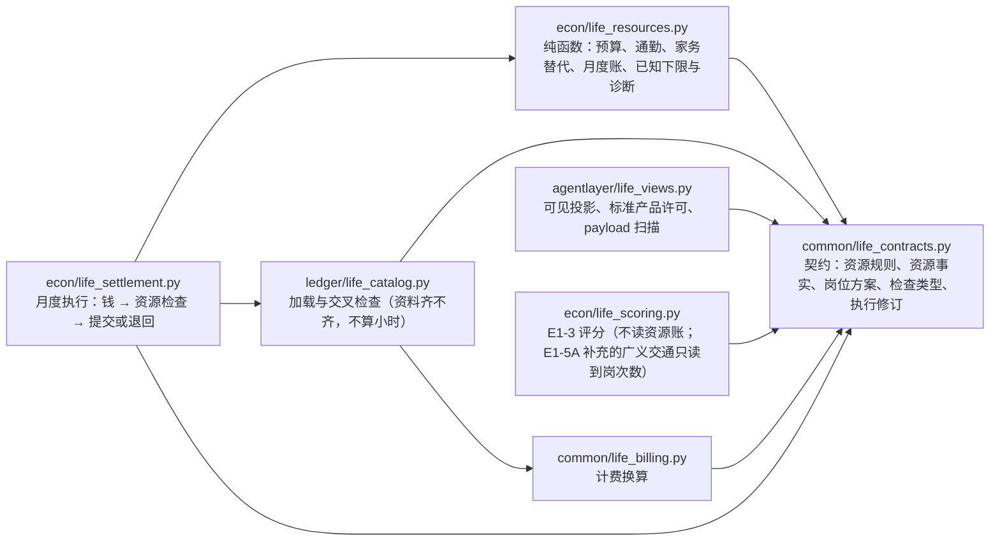
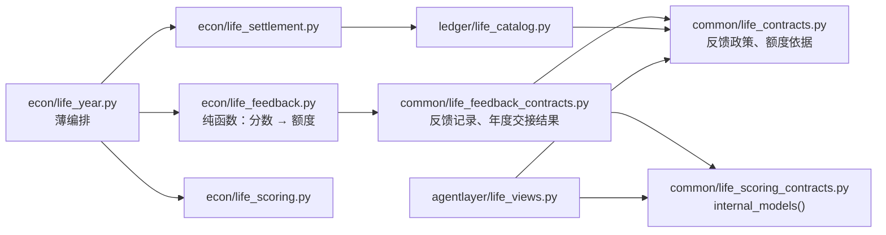

# E1-4 时间与精力：技术说明

> **时间与精力是生活的约束，不是新的加分项。**

参数导航（2026-10-08）：[参数与假设目录](parameter-assumption-register.md) 的 RE/FB 条目解释时间、负担与 α 等设定；IN/HK 条目区分未来疾病规则和代理风险认知。默认不主动告知模拟器的疾病—工作负担映射，不改变本篇已实现的公开资源成本。参数登记是 [ADR0022](../../DECISIONS/0022-parameter-register-and-e1-5-scope.md) 的长期工作规则，风险功能仍待 E1-5。

更新：2026-10-08（E1-4B 年度交接执行修订 r2 实施后；同日复核通过，合成范围，见 `runs/2026-10-08-e1-4b-r2-review/audit.json`）。E1-5A 的学习与岗位见 [E1-5 技术说明](e1-5-career-savings-risk.md)。读者：项目所有者、架构讨论者与 coding agent。本文说明
E1-4A 的当前实现（第 1–15 节）、E1-4B 上一年满足感对下一年额度的有界反馈（第 16–23 节），以及独立审核后的 r2 修复：
政策内容绑定、同一次生活的年度绑定、三种能力的边界与单个分身停止（第 24–27 节）：为什么这样算、代码在哪、怎样验证、
省略了什么；不把目标冒充已实现功能。

## 阅读与效力

- **当前代码**：2026-10-08 工作区中的 E1-4A（[ADR0020](../../DECISIONS/0020-life-monthly-time-energy.md)，含第十二节
  的执行修订 r2）：新协议 `life-v1-e1-4a`、生活规则版本 `e1-4a-monthly-v1`、资源规则版本 `e1-4a-monthly-resources-v1`、
  执行修订 `r2-2026-10-08`、精力尺度 `e1-4a-monthly-quota-v1`。r2 已于 2026-10-08 在约定的合成月度模型范围内
  **通过架构审核**（ADR0020 第十三节），F1 出局月资源下限与 F2 简单多岗位执行已关闭；代码仍是未提交改动。标"当前代码"
  的段落都写了函数、配置与测试。
- **E1-4B（2026-10-08，已实现，待架构审核）**：[ADR0021](../../DECISIONS/0021-life-satisfaction-energy-feedback.md)，
  新协议 `life-v1-e1-4b`、生活规则版本 `e1-4b-monthly-feedback-v1`、反馈政策版本 `e1-4b-satisfaction-quota-v1`；
  月度资源规则与执行修订沿用 E1-4A（`e1-4a-monthly-resources-v1`、`r2-2026-10-08`）。见第 16–23 节；代码未提交。
  E1-4A 协议照旧固定额度，不读反馈政策。`energy_feedback` 政策仍是 undecided，协议仍不可评分。
- **r3（2026-10-09，E1-5A 收尾，已实现、自测通过，待独立复核；2026-10-09 在合成范围内通过独立复核，见[审核摘要](../../runs/2026-10-09-e1-5ab-review/audit.json)）**：额度还绑定评分规格的内容身份（只在声明了它的政策），见第 28 节与
  [ADR0025](../../DECISIONS/0025-life-scoring-content-binding.md)。
- **E1-4B r2（2026-10-08，独立审核后的修复，已实现；同日在约定的合成范围内通过复核，`runs/2026-10-08-e1-4b-r2-review/audit.json`）**：ADR0021 第十三节、第 24–27 节；证据
  `runs/2026-10-08-e1-4b-fixes/`。r1 的结果留在 `runs/2026-10-08-e1-4b-feedback/`，审核记录在
  `runs/2026-10-08-e1-4b-review/`（只读）。
- **r1 → r2（历史）**：2026-10-07 的实现（r1）出局当月不判额度、同月两份到岗工作一律拒绝——这两条都**不再是**当前规则；独立审核与所有者裁决之后，r2
  改为出局当月检查已知下限、允许多份工作（每个岗位每次到岗一趟往返），并给标准产品观察足够的规划信息。只保留
  r2 的执行器；r1 的结果留在 `runs/2026-10-07-e1-4a-resources/`。
- **未实现**：共享通勤与每日排班、家务满足感、反馈参数的经验标定、E1-5/6/7 与 V2。它们只登记，不表示运行时
  已经具备。
- **旧协议照旧**：生活规则 `e1-2-monthly-v1`（E1-2、E1-3、E1-3 增补的样例）继续用年度时间检查、精力只记录；
  旧配置、旧评分基线与历史 runs 不改写。
- 所有数字都是**合成设定**，只用来检验规则是否按设计执行，不是现实生活的可行性判断，不是现实规律，也不排序城市。
- 所有者最新明确决定优先；[README](../../README.md) 管愿景，[PLAN](../../PLAN.md) 管工程状态，ADR0020 管具体规则。
  本文解释它们并导航代码，不以日期覆盖 ADR。

## 1. 要回答什么

一个分身在某座城一年的计划是：住哪套房、吃什么、做哪份或哪几份工作、买哪些服务和东西、参加哪些活动。E1-2 已经
能按月算**钱**够不够；E1-3 能按实际执行的生活条件算**满足感**。E1-4A 补上第三本账：

> 这套安排每个月要花多少小时、多大的活动负担？一个人每个月有的时间和能承受的负担够不够？

两种资源是**约束**：够不够只决定这套安排能不能执行。时间或精力省下来，不会直接变成幸福分；用完了，也不
额外扣幸福分。满足感仍只由 E1-3 读实际生活条件来算。分工：分身选择怎么生活；环境核算这些活动能不能执行、实际
获得了什么；评分层评价实际生活结果。

## 2. 时间：每月的净可分配小时

    每月时间预算 = 年度净可分配小时 / 12
    已安排时间 + 未安排时间 = 当月时间预算，已安排时间 ≤ 当月时间预算

生活含义：一个月能用来工作、通勤、做饭、做家务、锻炼的时间有上限；没排满的时间就过去了，不存到下个月。

- **净可分配**：睡眠和声明的基本休息已经预留在外，不再进活动账。样例协议写明"每天 8 小时睡眠 + 4 小时基本
  休息（吃饭、洗漱、个人照料），按 365 天计"，所以 u21 的年度净可分配小时是 12 × 365 = 4,380，每月 365 小时。
  每个人还要写一份"资源预算依据"（`resource_budget_basis`），说明自己的预算里预留了什么；u23、u24、u25 另有
  固定的照护责任，净可分配只有每月 140 或 150 小时。
- **精确比较**：时间与负担都用精确有理数，等于预算可以，超出就不行；不加容差，不先舍入再判断。例：每月 235 小时、
  预算 2,820/12 = 235 通过；预算 2,819.99/12 就超出 1/1200 小时（约 3 秒），照样不行。
- **未安排时间**（记录里的 `time_remaining`）**月底作废**：不解释成休息、不回血、不加满足感、不结转、不跨月借用，
  也不要求把预算安排满。
- **12 个标准月**：不分大小月、不算闰年、不排每日日程。全年总量够、某个月不够，照样不可行。
- 满足感不增加时间预算；同一个人在不同城市的分身，基础时间预算相同（加载器检查）。

*为什么这样算*：月度是结算本来就有的节奏（工资、房租都按月），用年度净小时 / 12 最简单、能手算，也不需要
写一个日历引擎。代价见第 14 节。

## 3. 精力：每月可承受的活动负担

    当月实际活动负担合计 ≤ 当月可承受额度
    一项活动的负担 = 小时 × 每小时负担

生活含义：同样一小时，上班、通勤、做饭、志愿服务累人的程度不同；一个月能承受的"累"有上限。

- 单位是**负担点**（`burden_point`），不是小时。每项活动在资源事实里声明"每小时多少负担点"。全部系数都是合成
  设定，**不宣称经过生理学标定**。
- 额度：新协议里 `energy.level` 必须带尺度 `e1-4a-monthly-quota-v1`，含义就是"每月可承受负担额度"，必须为正。
  它**不是**随活动扣减、随休息恢复的体力电池。E1-4A 协议里同一个人跨月、跨年、跨城不变（加载器检查）；E1-4B
  协议里不变的是基础额度，当前额度从第二年起由上一年满足感确定、可以因城而异（第 18 节）。
- **不结转、不回血、不反馈**：上个月没用完的不留到下个月；新月份拿到的是该月额度；没有负负担；满意度高不提高
  额度；额度用完也不额外扣幸福分。时间约束与精力约束分别检查。（E1-4B 只在年与年之间按上一年的完整满足感调整
  下一年的额度，一年之内照旧，见第 17 节。）
- **为什么不直接用旧的 `energy.level`**：旧样例里这个数（尺度 `synthetic_fixture_only_energy_v0`）的含义从未
  冻结。新规则只认新尺度；旧尺度的数既不当额度，也不当零（资料错误）。

## 4. 资源事实：每项机会数的是什么

新协议里每项机会都必须带资源事实 `resource`（`ResourceProfile`），零也要显式写 0；旧字段
`time_cost_hours_per_year`、`energy_burden` 必须保持 0。

| 计量依据 | 数什么 | 什么时候计入 | 样例 |
|---|---|---|---|
| `passive` | 不占时间（只可能替代家务） | — | 住房、手机、洗衣机 |
| `per_service_month` | 每个服务月 `hours` 小时 | 实际执行或服务的月 | 食品方案的准备时间、保洁、志愿服务、夜校 |
| `per_use` | 每月 `uses_per_month` 次 × 每次 `hours` | 实际服务的月 | 健身年卡 + 每月 8 次、每次 1.5 小时 |
| `per_occurrence` | 每次发生 `hours` 小时 | 实际发生的那个月 | 音乐会、公园音乐节 |
| `job` | 岗位方案（工时、工作日、到岗日、每工时负担） | 实际在岗、拿到工资的月 | 线下、远程、混合、兼职 |

`quantity_scales` 写明数量算不算：两张音乐会票是两次体验（算），两张健身卡不是两倍锻炼（不算）。一次体验只在
发生的月计入；按月服务按执行月；年付服务和持有物**只**按持有服务月计入（付款记录里的覆盖月是镜像，不再算一次）；
被动物品不会因为持有就产生使用小时；培训按实际参与月计入，跨年继续的月份照样占用，读满就停；零价格不等于零时间。

**来源**：本轮全部是合成数据，资源事实沿用所在机会的来源记录（`synthetic`），没有字段级溯源。工时、准备时间、
负担系数、家务基准与残余都是合成设定。接真实资料时（E3/V2），工资、工时、负担系数可能来自不同来源，要分开
标明观测、派生、估计或模型设定——不能用真实工资的来源替合成负担参数背书。

## 5. 工作与通勤

**岗位方案把薪酬和劳动绑在一起**（`JobArrangement`）：工作方式（onsite 线下 / remote 远程 / hybrid 混合）、每月
工时、工作日、到岗日、每工时负担。这些是目录里的岗位事实：岗位不能列"可选安排"，计划也不能写安排去改工时或
到岗——不能保留工资、把工时或到岗写成零。线下岗位到岗日 = 工作日；远程到岗日 = 0；混合介于两者之间；兼职就是
工时与到岗日更少的岗位。每个岗位一天至多到岗一次，所以**到岗日就是这个岗位的到岗次数**。

    工作小时 = Σ 实际执行岗位的工时
    通勤小时 = Σ（实际住房到共同就业中心的往返分钟 × 该实际岗位的到岗次数 / 60）
    通勤负担 = 通勤小时 × 协议的每小时通勤负担（样例 0.75）

生活含义：打两份工就上两份工的钟点；每份需要到岗的工作，每去一次都算一趟来回。

- **往返分钟指什么**：每座合成城只有一个到岗工作地点（城市就业中心），住房写明的 `commute_roundtrip_minutes`
  就是到那里的往返；所有需要到岗的岗位都在那里。不做地图和路线规划。
- **用实际住的房**，包括钱不够时执行的住房兜底；降级后每个岗位都按新住房重新算，不会远处租金配近处通勤。
- **多份工作（r2）**：可以同时做两份或更多工作，只要资金、时间、精力够。工资、工时、负担分别相加，税按年内
  累计合并计算。每个岗位每次到岗算一趟完整往返，**岗位之间不合并行程**。跨岗位相加得到的是"到岗次数累计"
  （`onsite_visits`）与"岗位工作日累计"（`job_workdays_sum`），不是不同的日历天数：两份兼职各到岗 10 次，累计
  20 次，可能只占 10 个日历天；累计超过一个月的天数也不因此拒绝。超限是"计划不可行"，不是输入错误。同一个岗位
  写两遍仍由计划的结构校验拒绝（合并成一条），岗位数量必须是 1。
- 全远程（到岗 0 次）通勤为 0；混合岗位只算到岗的次数；这个月没有工作，就没有工作和通勤负担；没有执行的岗位
  （缺货、资格不符）不发工资、不占工时、不产生通勤；工作方式或住房分钟没写，是资料错误，不补成零。
- **资源可执行 ≠ 通勤满足感可评**：E1-3 的方案级通勤满足感 τ/(τ+T) 没有改，仍只对"这个月恰好一份固定线下
  工作"评分。远程、混合、多份工作在资源上可以执行，但现有通勤评分对它们报"不支持/信息不足"。

## 6. 做饭、家务与便利服务

- **做饭**只按实际执行的那份食品方案的准备时间算：自己做新鲜食材每月 40 小时，现成餐每月 10 小时。没有另一份
  "基础做饭时间"。
- **家务**是协议里少量具名任务：洗衣（基准每月 12 小时、每小时 0.5）、打扫（基准每月 10 小时、每小时 0.6）。
  基准是声明的维持生活所需的量；本轮不支持靠降低整洁程度主动减少家务。设备或外包服务只声明"有它在用时，本人
  每月**还要**花多少小时"（替代后残余）：

      当月本人家务小时 = min(基准, 当月实际在用的各完整替代方案的残余用时)

  生活含义：有洗衣机，你还得分拣、晾、叠，一个月合计约 3 小时；再请人上门取送，你只剩约 1 小时——取最省事的那
  一种，不是把两种节省加起来。
- **残余是什么**：本人处理**这一整项**家务后仍要花的整月时间，不是机器运行时间，也不一定是每次操作的时间。洗衣机
  与代取服务都是完整洗衣任务的替代方案，取最小残余（3 与 1 取 1），不把节省重复相减（逐项相减会得到 12 − 9 − 11 =
  −8）。这个规则不表示洗衣机与烘干机这类互补工序；以后需要时再拆子任务或定义组合方案，本轮不建通用家务流程。
- 替代只在当月**实际在用**才起作用：物品在服务期内、服务在执行月。保洁那个月没买成，打扫回到 10 小时。
- 每条家务记录写明由谁承担：例如"基准 12 小时；a51.durable.washer 在用，本人还要 3 小时，由它承担 9 小时"。
- 省下的时间只释放资源，不加满足感。本轮不新增家务满足感公式；给家务正权重的人在 E1-3 里总分不完整的缺口照旧。

## 7. 接进真正的月度执行

资源和钱走**同一条实际执行路径**。ADR0017 的七步按原顺序执行完一个月（收入、税、最低生活检查、住房与食品、
其他服务、一次性购买与体验、持有物服务与培训参与），然后用**这个月实际执行**的东西算资源。没执行的不占资源；
住房降级、食品兜底按降级后的事实重新算；便利服务没执行，它替代的家务回到基准。

每个月的资源检查只有三种（`resource_check`），互不混用：

| 检查 | 什么时候 | 用量 | 结论 |
|---|---|---|---|
| `complete` 完整检查 | 过完的月份 | 全部用量；未安排时间月底作废 | 在不在额度内 |
| `known_lower_bound` 只查已知下限 | 出局当月 | 已经确定的用量（下限） | 超了就不可行；没超**不等于**这个月通过了检查 |
| `not_reached` 未发生 | 出局之后 | 没有 | 不检查，也不是零负担的完整月份 |

**失败类别**（新协议）：

| 情形 | 结果 | 有没有账本 |
|---|---|---|
| 字段格式、月份、身份不合法；计划改了岗位工时或到岗；同一机会写两遍 | `input_error` | 没有 |
| 资源资料缺失、尺度不符、旧字段非零、目录自相矛盾 | `data_error` | 没有 |
| 结构合法，但某个月实际安排的时间或精力超限（包括出局当月已知劳动就超限、多份工作超限） | `plan_infeasible` | 没有（带诊断） |
| 付不起最低住房与食品，且已知劳动没超限 | `exited`（ADR0017 原规则） | 有，出局前的真实账目保留 |
| 正常过完 | `completed` | 有 |

超限时环境**不**自动删掉休闲、少上班或改买别的方案，只返回诊断：哪个月、哪种资源、检查类型、额度、用量、超出
多少、主要贡献项、执行修订。诊断里没有满足感、偏好或评分参数。只报告第一个超限的月份。

**原子性**：计划不可行是整份计划试算失败、尚未提交账目，不是过完一年再把时间倒回去。不可行的结果不带账本、
不带下一年状态；输入状态原样不动；同样的输入结果逐字相同。

**出局当月（r2）**：工资先入账，同时记下对应的工时与工作负担——不会"工资留下、劳动消失"；然后最低生活付不起 →
本该出局。资源上只算已经确定的部分：工作，以及确定为零的通勤（全远程、没有到岗需求）；需要到岗而这个月没有住房
时通勤记**未知**，不补零、不沿用上月住房或没付成的住房。已知用量超过预算或额度 → 计划不可行（资金出局不能绕过
资源约束）；没超 → 照常出局，记录标"只查已知下限"，摘要写"出局前完整检查、出局当月只查已知下限、之后未发生——
不是全年通过"（`energy_feasibility = monthly_quota_checked_until_exit`）。没有获得的住房、食品和其他服务不记为
实际消费；之后的月份"未发生"。

## 8. 手算例子（来自 `configs/life/synthetic_e1_4a.yaml` 与由它派生的情景）

### 8.1 住远省钱，但通勤占用更多时间（u21，合成城 A51）

线下行政岗：每月 160 工时、20 次到岗、月薪 3,000；自己做新鲜食材；买了洗衣机；健身每月 8 次 × 1.5 小时。

| 每月 | 住近处（房租 1,400，往返 30 分钟） | 住远处（房租 1,000，往返 70 分钟） |
|---|---|---|
| 工作 | 160 小时 / 160 点 | 160 / 160 |
| 通勤 | 30 × 20 / 60 = **10** 小时 / 7.5 点 | 70 × 20 / 60 = **23⅓** 小时 / 17.5 点 |
| 做饭 | 40 / 20 | 40 / 20 |
| 洗衣（洗衣机在用） | 3 / 1.5 | 3 / 1.5 |
| 打扫（自己做） | 10 / 6 | 10 / 6 |
| 健身 | 8 × 1.5 = 12 / 12 | 12 / 12 |
| **已安排** | **235 小时 / 207 点**（预算 365 / 额度 250） | **248⅓ 小时 / 217 点** |
| 未安排（月底作废） | 365 − 235 = **130 小时** | 116⅔ 小时 |

住远每月省 400 房租，多花 13⅓ 小时和 10 负担点。两件事都保留：钱在现金账，时间和负担在资源账，不互相换算。
住近处那 130 小时没安排的时间，下个月不会变成 260 小时，也不当作休息给精力回血。

### 8.2 花钱买便利，释放做别的事的时间（u21，A51）

把新鲜食材（450）换成现成餐（700），再买每周上门保洁（每周 40，按 52/12 摊成每月约 173.33）：做饭 40 → 10 小时，
打扫 10 → 2 小时；每月 197 小时、187.2 负担点，比住近处少 38 小时；钱每月多花约 423.33。保洁那个月没买成，那个月
打扫回到 10 小时。

### 8.3 钱和时间都够，但精力超限（u22，额度每月 230）

u22 住远处（每月 248⅓ 小时、217 负担点），第 3 月起加一门簿记夜校：每月 30 小时、每小时 1.2 负担点。第 1、2 月
各剩 13 点、不结转；第 3 月 217 + 36 = **253 > 230**，超 23；时间 278⅓ ≤ 365。结果：计划不可行（精力，第 3 月）。

### 8.4 两份临时工（派生情景 two_jobs，r2；独立审核反例）

u21 住近处，把全职文员换成两份一样的零售兼职（各每月 80 工时、到岗 10 次、每工时负担 1.0、月薪 1,000）：

| 每月 | 小时 | 负担点 |
|---|---|---|
| 工作 80 + 80 | 160 | 160 |
| 通勤：兼职一 30 × 10 / 60 + 兼职二 30 × 10 / 60 | 5 + 5 = 10 | 7.5 |
| 做饭、洗衣、打扫、健身 | 40 + 3 + 10 + 12 | 20 + 1.5 + 6 + 12 |
| **合计** | **235**（预算 365） | **207**（额度 250） |

工资每月 1,000 + 1,000 = 2,000；合成税按全年累计：前 6 个月累计 12,000 在免税档内，第 7–12 月每月 2,000 × 20% =
400，全年 2,400。累计到岗 20 次——可能只是 10 个日历天，各算各的往返。可执行。

同样住近处、全职文员**再加**一份兼职：时间 235 + 80 + 5 = 320 ≤ 365，负担 207 + 80 + 3.75 = 290.75 > 250，超
40.75——计划不可行（精力），不是输入错误。

### 8.5 出局当月不能绕过资源检查（派生情景 exit_*，r2；独立审核 F1）

把兼职改成全远程（每月 80 小时、80 负担点、月薪 1,000、不到岗），u25 每月预算 60 小时（年 720）、存款 0：
- 第 1 月入账 1,000 < 最低住房 1,000 + 最低食品 380 = 1,380，本该出局；但已经确定的劳动 80 > 60，**至少超 20** →
  计划不可行（时间，已知下限），不留工资账本、不留下一年状态。额度 60 负担点时同理。
- 资金对照：同样 60 小时、存款 10,000，第 1 月照常过完，完整检查 80 + 30 + 12 + 10 = 132 > 60，同样不可行。存款多少
  都不能让这份超负荷劳动变成可执行。（r1 在存款 0 时返回"出局"并保留工资——这就是被修的漏洞。）
- 默认预算（每月 150 小时）：已知 80 ≤ 150，照常出局；全远程，通勤**确定为零**；记录标"只查已知下限"。

### 8.6 住房降级后的重新检查（u23 与 u24）与原样例的出局月（u25）

u23 与 u24 计划和存款相同（8,570），只差时间（每月 140 与 150 小时）：线下兼职 80 工时、到岗 10 次，第 1–10 月
住近处 137 小时；第 11 月存款不够近处房租，按声明退回远处，通勤变成 70 × 10 / 60 = 11⅔ 小时，合计 143⅔ 小时。
u23 超 3⅔ → 不可行；u24 可行，过完全年。两份兼职、存款 0 时第 10 月降级，两份岗位都改按远处 70 分钟各算 11⅔ 小时。

u25（存款 2,000）：第 3 月降级后 143⅔ ≤ 150 可行；第 4 月入账 1,000 后 1,060 < 1,380 → 出局。第 4 月只查已知下限：
线下兼职 80 小时、80 点（与 1,000 工资对应）≤ 150；没有获得住房，通勤**未知**；不说这个月通过了完整检查。第 5–12 月
未发生。

## 9. 输出：每月一条资源记录

`MonthResources` 每月一条（`EnvironmentOutcome.resources` 里 12 条，`ResourceYear.rules_revision` 写执行修订）：
检查类型 `resource_check`；时间预算、已安排、未安排（月底作废）；精力额度、负担、剩余；每项贡献（类别、机会或
家务、小时、负担、计量依据的文字；通勤行归到对应岗位，依据里写实际住房）；岗位工作日累计、到岗次数累计；实际
住房与往返分钟；通勤状态（已计算 / 没有到岗工作，通勤为零 / 没有住房所以未知 / 未发生）。数值写两遍：精确分数
`exact` 与小数 `value`；比较和合计都用精确分数。新协议里旧的年度合计字段为空。

给 E1-5 记下三个比例（本轮**不**换算成疾病概率或幸福分）：

    工作相对负担 = 当月工作负担 / 当月额度        （u21 住近处：160 / 250 = 0.64）
    通勤相对负担 = 当月通勤负担 / 当月额度        （7.5 / 250 = 0.03）
    总负担比例   = 当月全部负担 / 当月额度        （207 / 250 = 0.828；只查已知下限的月份不写）

## 10. 代理能看到什么

- **标准产品观察**（`agentlayer.life_views.standard_product_permission`，r2）：显式打开精力。分身做计划能看到——
  自己的每月时间预算；每月精力额度及单位（250 `burden_point`）；每项机会的公开资源成本（可见字段 `time_energy`：
  岗位工时与到岗、每次或每月的小时、使用频率、每小时负担、家务替代）；住房往返分钟与岗位工作方式；协议的家务
  基准与预留说明；四条简化规则的文字（`time_rule`、`energy_rule`、`commute_rule`、`household_rule`，含"未安排时间
  月底作废""每个岗位每次到岗一趟往返"）；上一年逐月的时间与负担反馈（`VisibleMonthResources`）。普通产品情景不让
  分身靠猜隐藏额度做计划。精简示例：`runs/2026-10-08-e1-4a-fixes/demo/product_payload_excerpt.json`。
- **研究对照可以显式隐藏精力**：自己构造 `show_energy_level = false` 的许可；额度、精力用量与各类别负担都为空，时间
  照常可见。但各项活动的每小时负担仍是公开成本，代理可能自己推算负担——隐藏的是额度与汇总，**不是**"精力信息
  完全不可知"。显示精力的观察照旧标为动态反馈条件（`dynamic_feedback_channel`），虽然本轮没有满足感反馈。
- **不能看**：资源规则对象、整年与整月的资源账整体（扫描拦截）、结算结果、内部状态、评分参数、隐藏权重与真值。
- **尚未接线**：计划不可行的诊断还没有给代理的投影；E1-7 接重试时，诊断里的精力数字也必须服从精力许可，不能为了
  给诊断直接暴露内部结算结果（PLAN 登记）。
- **E1-4B**：观察新增信息条件 `channels`，规则说明按反馈政策写；开启反馈时额度的变化本身就是间接反馈，文字理解
  对照必须关闭反馈。见第 21 节。

## 11. 数据从哪来

本轮**全部合成**：负担系数、准备时间、家务基准与残余、净可分配小时、额度、通勤分钟都是手工设定，来源记录标
`synthetic`，用整数和简单小数方便手算。没有调用 LLM 估计任何资源数值，也没有把论文里的具体参数当现实依据。
派生情景由原样例按明确改动生成，派生配置原样存在运行目录里。以后接真实资料的方向见第 4 节"来源"，本轮不制定
真实数据的合成、估计或插补算法。

## 12. 代码在哪

（箭头 = "依赖"。）时间与精力的算法只有一份，在 `econ/life_resources.py`，只依赖 `common.life_contracts`，不读加载器、
偏好真值、评分结果或行动理由；结算是它唯一的调用方。加载器只检查资料齐不齐、一致不一致，不另写一套通勤或多岗位
算法，也不引用 econ。评分仍只读实际结果，不参与资源结算。保留未搬：结算复用 ledger 检查的原有安排；旧协议的年度
时间合计（`ledger.planned_hours`、结算里的 `_time_and_energy`），只服务旧协议。

| 文件 | 做了什么 |
|---|---|
| `src/common/life_contracts.py` | 资源规则、资源事实、岗位方案、`ResourceCheck`、`MonthResources`、`ResourceYear`、`ResourceShortfall`、`VisibleMonthResources`、`RESOURCE_RULES_REVISION` |
| `src/econ/life_resources.py` | `month_resources`（含出局当月的已知下限、多岗位通勤）、`household_rows`、`commute_hours`、`timed_hours`、`shortfalls`、`resource_year` |
| `src/econ/life_settlement.py` | 每月第 7 步后（出局月第 4 步后）`_check_resources`；`_activities` 只取实际执行的东西；超限 → `plan_infeasible`；摘要写明检查范围 |
| `src/ledger/life_catalog.py` | 资源资料检查、岗位安排固定、同一人跨城预算一致（r2 删掉了"两份到岗工作一律拒绝"） |
| `src/agentlayer/life_views.py` | `standard_product_permission`、`time_energy`、`VisibleResourceBudget`（含四条规则说明）、`VisibleMonthResources`；精力按许可清空 |
| `configs/life/synthetic_e1_4a.yaml` | 原合成样例（r2 没有改它） |
| `scripts/demo_life_e1_4a.py` | 离线演示：逐月资源表、诊断、派生情景、产品 payload、与 r1 的比较、旧协议对照、确定性与原子性 |
| `tests/life/test_resources_*.py` | 纯函数与契约、结算路径、兼容与可见投影 |

E1-4B 新增的反馈纯函数与年度交接见第 22 节；它们调用上面的结算与 E1-3 评分器，不复制资源算法。

## 13. 怎样验证

- **手算样例**：第 8 节每个数都有测试断言，小时与负担用精确分数比较，金额用整数分比较。
- **测试**：`tests/life/test_resources_rules.py`（纯函数、契约、模块边界、出局月下限、多岗位）、
  `test_resources_settlement.py`（实际结算路径：E1-4A 验收 1–14 与 r2 修复的各项行为）、`test_resources_compat.py`
  （新旧协议、加载检查、可见投影与标准产品 payload）。独立审核测试原样复制到 `runs/2026-10-08-e1-4a-fixes/`：修复前
  10 通过 3 失败，修复后 13 通过。
- **变异检查**：r1 的 19 条（`runs/2026-10-07-e1-4a-resources/`）与 r2 的 7 条针对性变异（跳过出局月下限、只算第一份
  工作、漏第二份工作通勤、降级后用原住房、失败试算留下结果、出局年份摘要写成全年通过、标准产品许可隐藏精力），
  每条都有永久测试失败；工作区运行前后逐文件哈希相同。
- **演示**：`uv run python scripts/demo_life_e1_4a.py --out <新目录>`，逐月资源表与 23 条手算核对。
- **架构审核**（`runs/2026-10-08-e1-4a-r2-review/`）：独立复跑全量离线 1169 通过、原审核测试 13 通过、新增组合测试 16
  通过（九种岗位组合、时间与精力下限同时超限、恰好等于下限、未执行岗位、两份工作后的产品观察）、演示 23 项通过，
  关键结果与 payload 逐字节相同；没有发现阻塞缺陷。归档的证据清单见 ADR0020 第十三节。
- **E1-4B**：见第 22 节（62 条新测试、11 条变异、15 条手算核对；E1-4A 演示重跑与 r2 归档逐文件比较）；r2 修复见
  第 24–27 节（27 条新测试、11 条变异、19 条手算核对、与 r1 归档逐字段比较）。

## 14. 省略了什么，哪些人受影响

| 暂未覆盖 | 可能受影响的人 | 已保留接口 / 归属 |
|---|---|---|
| 大小月、节假日、闰年；每月工作日数的真实波动 | 季节性工作、月度排班差异大的人 | 每月预算由规则版本决定；以后可换月度预算表 |
| 每日日程与时段冲突（月合计够，某天排不开） | 轮班、夜班、要固定接送孩子的人；两份工时段冲突的人 | 不做日历引擎；需要时另开规则版本 |
| 同日连续上班共享往返、不同工作地点之间的串行出行 | 能顺路兼两份工的人（通勤被**高估**）；两份工在不同地点的人（被低估或无法表达） | 每个岗位每次到岗一趟往返；共享通勤登记后续 |
| 预留的睡眠与基本休息对所有人一样（样例 12 小时/天） | 需要更多睡眠、照护责任重的人（除非在个人预算里写明） | 个人 `resource_budget_basis` 写明预留 |
| 负担系数是合成的 | 体力劳动者、慢性病人、残障人士、通勤更累的人 | 系数是机会的资源事实，以后可按来源替换 |
| 每座城只有一个到岗地点、通勤负担不分方式 | 多工作地点、外勤、开车与公交差异大的人 | 住房往返分钟 + 协议通勤负担；更细路线后续 |
| 家务只有洗衣与打扫；互补工序（洗衣机 + 烘干机）；靠降低整洁程度减少家务 | 育儿、照护老人、给家人做饭多的人；家务分工细的人；愿意少打扫的人 | `household_tasks` 可扩；互补工序与家务满足感另议 |
| 家务与便利服务的满足感 | 重视少做家务、看重外包的人（E1-3 总分不完整） | 省下的时间只释放资源；E1-4 后续裁决 |
| 未安排时间的去处（休息、恢复、睡懒觉） | 休闲能明显恢复精力的人 | 未安排时间月底作废；E1-4B 的年度反馈读满足感，不读空闲时间（第 23 节）；恢复归 E1-5 |
| 服务的使用频率固定，不能暂停、转售、按天打卡 | 灵活使用健身房等服务的人 | `per_use` 的声明频率；V2 |
| 资源事实没有字段级溯源 | 接真实资料后，工资与负担系数来源不同的人群比较 | 沿用机会来源；E3/V2 分开标明观测、派生、估计、模型设定 |
| 培训后的技能与涨薪、负担导致的疾病 | 靠进修换工作、长期高负荷的人 | 工作相对负担比例已记录；E1-5 |

## 15. 后续还要裁决什么

- **E1-4B 原列的问题已有探索版答案**（[ADR0021](../../DECISIONS/0021-life-satisfaction-energy-feedback.md)）：用评分器
  给出的完整年度平均满足感（第 17 节）；按比例加成、上限 α、不低于基础额度（第 17 节）；只滞后一年、不累积（第 17 节）；
  出局不更新、评分不完整时阻断下一年额度（第 19 节）；关闭对照从相同初始状态分别运行、只允许两处预先声明的结构
  差异（第 20 节）；信息条件分开记，文字理解对照必须关闭反馈（第 21 节）。
- **仍开放**：反馈方向与幅度的经验标定、α 的取值、是否允许低于基础额度；评分不完整或出局之后的额度政策；与疾病、
  恢复、长期高负荷的关系（E1-5）。`energy_feedback` 政策因此仍是 undecided。
- 计划不可行后的重试与诊断投影（E1-7）：代理能看到多少诊断，精力部分按许可隐藏。
- 共享通勤与每日排班、现有通勤满足感对远程/混合/多岗位的扩展、家务满足感与互补工序（E1-4 后续）。
- 真实负担系数、时间利用与通勤数据，以及字段级溯源（E3/V2）。

## 16. E1-4B：上一年过得满不满意，影响下一年的余力

> 上一年过得越满意，下一年每个月能承受的活动负担略多一点；最多多 α（本版 ≤ 10%），不会少于自己的基础额度。

**当前代码**（[ADR0021](../../DECISIONS/0021-life-satisfaction-energy-feedback.md)，2026-10-08，未提交，待架构审核）：新协议
`life-v1-e1-4b`，生活规则版本 `e1-4b-monthly-feedback-v1`，反馈政策版本 `e1-4b-satisfaction-quota-v1`；样例
`configs/life/synthetic_e1_4b.yaml` 与评分配置 `configs/life/scoring_e1_4b.yaml`。E1-4A 的月度记账、分别往返、家务替代与
出局月下限一条没改。

它把已有的四件事接成一条链：第 y 年按月结算（钱、时间、精力）→ E1-3 探索评分器给这一年的实际生活打分 → 本节的
规则定下第 y+1 年每月的精力额度 → 第 y+1 年的结算真的用这个额度检查每个月的负担。

**为什么不用 ADR0016 的参考点公式。** ADR0016 第六节曾**建议** `E_{t+1} = E_base + clip(β·(S_t − S_ref), −cap, +cap)`：
满意度高于参考点就加、低于就减。那从来不是已采纳的默认值，本轮也不采用，代码里只有一套机制。理由：参考点取多少
没有依据，取错就把同一份生活在不同人身上判成"加"或"减"；减额会让"不满意"直接变成"下一年更做不到"，在没有经验
标定、也没有疾病与恢复机制（E1-5）时惩罚太强；按比例加成对基础额度不同的人一视同仁，上限 `基础 × (1 + α)` 一眼可读；
α = 0 或关闭时与 E1-4A 完全一样，便于做对照。

## 17. 反馈分数与公式

**分数 S。** `S_y` 是 E1-3 探索评分器对第 y 年**实际结算结果**给出的年度平均满足感（`ExploratoryYearScore.annual_mean`）。
条件：12 个月都已评分（`annual_status = complete`）；有限且在 [0, 1]；属于同一个人、分身、城市与年份；来自反馈政策
写明的评分规格与版本、偏好来源；出局状态与这份账目一致。不用 LLM 自报幸福度、行动理由里的预期、单独某一维、部分
月份的平均、覆盖率，也不用现金、收入或剩余时间换出来的数。

- **产品路径**（`product_stated_numeric`）只接受用户明确给出的七维点数与物质细项点数（`StatedLifeProfile`）；给得不够
  就是"偏好信息不足"，反馈因此阻断，**不借用**研究真值。
- **研究路径**（`research_synthetic_truth`）只接受合成真值（`InternalPreferenceTruth`）。两条路径由反馈政策声明，编排
  接口检查一次偏好输入的类型，反馈函数再按分数上记的来源检查一次。
- 硬要求照旧由评分器单独报告，不变成满意度扣分，也不进精力公式。

**公式与生活含义。**

    E_raw(y+1) = E_base × (1 + α × S_y)        E_base：个人固定的基础额度（负担点）；S：0–1 的无量纲数；α：无量纲比例
    下一年额度 = ⌊E_raw × 100⌋ / 100           向下保留到 0.01 负担点

S = 0 表示这一年在所有在乎的方面都不满意，下一年就是基础额度；S = 1 时最多多 α。本版 0 ≤ α ≤ 0.10，最多两位小数；
主样例 α = 0.10，对照 α = 0，敏感性 α = 0.05，都在跑之前写进配置。

| 基础 250 负担点、α = 0.10 | S = 0 | S = 0.6 | S = 0.8 | S = 1 |
|---|---|---|---|---|
| 下一年每月额度（负担点） | 250 | 265 | 270 | 275 |

- 第一年从基础额度开始，没有虚构的第零年满意度；第 y 年只影响第 y+1 年，不累积更早的年份。
- 下一年 12 个标准月用同一个额度；E1-4A 的月度检查照旧（每月负担 ≤ 额度，不结转、不回血）。
- **不复利**：每次都从基础额度算。连续两年 S = 0.8，第三年仍是 270，不会从 270 再乘 1.08。
- 满意度下降，加成随之减少，但不低于基础额度。
- 时间预算不变；未安排的时间照旧月底作废，不变成休息或恢复；额度加成**不**加进满足感（评分器不读额度）。

**数值口径。** 评分器的浮点算法不改。反馈读它输出的 `annual_mean`，取最短十进制写法（Python `repr`），变成精确分数
再计算；先保存未量化的 `E_raw`（精确分数），再向下保留到 0.01，两者和量化规则（`floor_to_0.01`）都写进反馈记录。不加
epsilon：`S = 0.0004` 时 `E_raw = 250 × 1.00004 = 250.01` 恰好在格点上，得 250.01；`S = 0.00039999` 时 `E_raw = 250.0099998`，
得 250.00。量化后的额度一定落在 [基础, 基础 × (1 + α)] 内，而且是两位小数，能直接进入 E1-4A 的资源输入检查；每月的
负担比较照旧用精确分数，不加容差。量化规则与测试容差是两回事：已有评分测试的数值口径一条没放宽。

## 18. 基础额度、当前额度与额度依据

`energy.level` 继续承载**当前行动年**实际使用的月度额度；新增的 `PersonYearState.energy_quota_basis`（`EnergyQuotaBasis`）
记录固定的基础额度与当前额度的来由，**不含分数**：

| 状态 | 含义 | 约束 |
|---|---|---|
| `base_first_year` | 第一年，额度就是基础值 | 只在第 1 年；没有政策、来源年或记录 |
| `feedback_applied` | 由上一年完整满意度算出 | 来源年 = 本年 − 1；≥ 基础；指向反馈记录的 SHA-256 |
| `feedback_off` | 反馈关闭或 α = 0 | 额度 = 基础值；指向反馈记录 |
| `pending_feedback` | 结算刚产生的下一年**候选**状态，额度还没定 | 不能结算（`input_error`，`energy_quota_pending`），不能构造观察 |

- E1-4B 协议的状态必须写额度依据，E1-4A 与更早的协议不能写；任何状态的当前额度都不低于基础额度。
- **同一个人跨城的基础额度与时间预算一致**（加载器改为比较基础额度，而不是当前额度）；第一年当前额度必须等于基础
  额度。第二年起各城的当前额度可以不同——样例里同一个人第一年在 A61 满意度 0.5604…，第二年额度 264.01；在 B62 满意度
  0.5892…，第二年额度 264.73。
- 由某个反馈政策定下的额度只能在同一个政策下继续结算（`feedback_policy_switched`）：开启反馈得到的加成不能拿来当关闭
  对照的初始状态，也不能中途换政策。当前额度超出 `基础 × (1 + α)` 是 `energy_quota_over_bound`。

## 19. 年度交接：数据流、失败与终态

`econ.life_year.run_life_year` 就是这一串的薄编排：在结算之后对**本次**结果调用现有评分器（不缓存，不接受外部传进来
的同名分数），再定下一年额度。它不另造评分器，不复制资源算法；不调用 LLM、不重试、不管理多分身，多年度只是调用方
按年循环（完整闭环在 E1-7）。

| 这一年发生了什么 | 反馈决定 | 交接结果 | 返回的状态 |
|---|---|---|---|
| 反馈开着，12 个月都已评分 | `applied` | `next_year_ready` | 下一年年初状态（新额度） |
| 反馈关闭 / α = 0（不需要评分） | `off_disabled` / `off_alpha_zero` | `next_year_ready` | 下一年年初状态（基础额度） |
| 反馈开着，评分缺失、不完整或偏好信息不足 | `blocked`，列出原因 | `feedback_blocked` | **无** |
| 第 N 年正常结束 | `no_next_action_year` | `terminal` | 终态 N + 1（这一年照常评分与记录） |
| 这一年出局 | `exited` | `exited` | 出局状态：不更新精力、不复活 |
| `plan_infeasible` / `input_error` / `data_error` | `settlement_failed` | `settlement_failed` | 无：不评分、不推进 |

- **"反馈信息不足"不是计划不可行。** 这一年的生活已经发生，账目保留；只是下一年的额度定不下来。它不补零、不用已知
  月份的平均、不重新归一化偏好、不维持旧加成，也不擅自恢复基础额度说成反馈已完成。结算产生的候选状态只留在结算
  结果里，标着 `pending_feedback`，不能拿来结算或构造观察。
- 同一次交接重复应用会被拒绝（候选状态已经不是待定），不叠加加成；拿别的年份或别的分身的记录写额度也被拒绝；同一
  输入重放，三年结果逐字相同。
- N 可配置：N = 1 时第 1 年结束就是终态，不虚构第 2 年；N = 3 时第 3 年结束是终态。最后一年照常评分——有没有下一年
  反馈，与这一年的评分完不完整，是两个问题。
- ⚠ r1 的反馈函数可以分别接收账目与分数，下面“本年账目与评分的 SHA-256”只记录了内容，不能证明来自同一次生活；
  r2 起反馈只从年度绑定生成（第 25 节）。
- 内部反馈记录（`EnergyFeedbackRecord`）能追到人、分身、城市，来源年与目标年，政策 id、版本、开关、声明与有效 α，
  评分规格、版本与偏好来源，年度状态、年均与十进制写法，基础、原当前、未量化、新额度与上限，量化规则，本年账目与
  评分的 SHA-256，以及原因。年度交接结果（`LifeYearResult`）带整份结算、评分、反馈记录与运行身份。

## 20. 三年生活例子与开关对照（实际运行结果）

以下数字来自 `scripts/demo_life_e1_4b.py` 的实际运行（`runs/2026-10-08-e1-4b-feedback/demo/`），金额单位是当地基年不变价
`USD_2024_LOCAL`，时间是小时，额度与负担是负担点，满足感是 0–1 的无量纲数。

**u31 在合成城 A61，反馈开启（α = 0.10），基础额度 250。**

1. **第 1 年**：住近处（月租 1,400，往返 30 分钟）、自己做新鲜饭、做一份线下文员（月薪 3,000）、买洗衣机、每月健身 8 次。
   每月负担 = 工作 160 + 通勤 7.5 + 做饭 20 + 洗衣 1.5 + 打扫 6 + 健身 12 = 207 ≤ 250。评分器给出 12 个月相同的满足感，
   年均 S₁ = 0.5604166666666667。下一年额度 = 250 × (1 + 0.10 × S₁) = 264.0104166666666675 → **264.01**。年末现金 3,000 → 10,820。
2. **第 2 年**：同样的生活，再上一年夜校（每月 40 小时 × 每小时负担 1.2 = 48）。每月负担 255 ≤ 264.01，可行，每月还剩
   9.01。夜校本身不进满足感，所以 S₂ 与 S₁ 相同；第 3 年额度仍从基础算：250 × (1 + 0.10 × S₂) → **264.01**，不会从 264.01
   再乘一次。年末现金 18,140。
3. **第 3 年**：搬到远处（月租 1,000，往返 70 分钟，每月通勤 23⅓ 小时、负担 17.5）、吃基本食品（准备 30 小时、负担 15），
   每月负担 212。满足感下降到 S₃ = 0.49265384615384616。这是最后一个行动年（N = 3）：下一年是终态，不为不存在的年份计算
   加成。年末现金 32,300。

**开关对照与 α 敏感性**（相同初始状态、相同目录、相同的三份年度计划，各臂分别从头运行）：

| 实验臂 | 第 1 年 | 第 2 年额度 | 第 2 年计划（每月负担 255） | 结束 |
|---|---|---|---|---|
| 开启，α = 0.10 | 结果相同 | 264.01 | 可行 | 第 3 年后终态 |
| 开启，α = 0.05 | 结果相同 | 250 × (1 + 0.05 × S₁) = 257.005… → 257.00 | 可行 | 第 3 年后终态 |
| 开启，α = 0 | 结果相同 | 250 | 计划不可行（第 1 月超出 5） | 停在第 2 年 |
| 关闭 | 结果相同 | 250 | 计划不可行（第 1 月超出 5） | 停在第 2 年 |

"结果相同"指第 1 年的账目、活动、资源与评分逐项相同；不同从第 2 年的额度开始。关闭臂停在第 2 年就停在那里，不补出
之后的生活，也不只比较还"活着"的一边。这只验证接线是通的，**不证明开启反馈让产品更准确**，也不是城市排行。

**其他机制（同一次运行）：**

- **满意度下降**：u31 的另一个分身第 2 年就搬远、吃基本食品，S₂ = 0.49265… → 第 3 年额度 262.31（比 264.01 少，但不低于 250）。
- **跨城**：同一个人在 B62 第 1 年过同样的生活，S₁ = 0.5892045454545455 → 第 2 年额度 264.73；两城基础都是 250。
- **缺分**：u33 给"打扫"点了 20 点，而评分规格没有这个分项，12 个月都不完整 → 第 1 年结算照常保留，第 2 年额度"反馈信息
  不足"；同一个人在关闭反馈的臂里三年照常执行，额度一直 250。
- **出局**：u34 存款少，第 4 月付不起最低生活出局：不更新精力、不复活。
- **关闭反馈复现 E1-4A**：四个分身逐年比较，只有预先声明的两处不同——结果 `notes` 的第二句（说明反馈由年度交接计算）与
  下一状态的 `energy_quota_basis`（A 没有这个字段）。

## 21. 分身能看到什么：信息条件与间接反馈

- **标准产品分身**看到当前年度的每月额度与单位（如 264.01 `burden_point`）、时间预算、活动的公开时间与负担、上一年的
  执行事实。规则说明：反馈开启时写"下一年的额度由环境根据这一年的实际生活确定，可能比基础额度高、不会更低；具体公式
  与分数不告知"；关闭时写"额度固定为你的基础额度，不随这一年的生活变化"；E1-4A 协议的原文不变。
- **看不到**：年度满足感分数、隐藏偏好、评分参数、反馈政策对象、反馈记录、年度交接结果，以及它们原样序列化后的字典。
  三种新内部类型登记在 `internal_feedback_models()`，与评分侧合成 `internal_models()`，正式加载、可见投影与最终 payload
  三处检查都读它；没有扩大保留键名单，不误拦正常的生活事实。
- **不发分数 ≠ 没有透露评价。** 额度随满足感变化本身就是反馈通道：知道基础额度和公式，就能从 264.01 反推出 S ≈ 0.5604；
  即使隐藏额度，"去年做不到、今年做得到"的可行性变化也透露信息。所以观察另记信息条件 `channels`：
  - `energy_visible`：额度是否显示；
  - `satisfaction_feedback`：反馈是否真正起作用（`quota_feedback` 只在 B 协议开启且 α > 0 时）；
  - `study_condition`：`static_text_understanding`（研究的文字理解条件）、`product_without_satisfaction_feedback`、
    `dynamic_life_feedback`。动态条件只看反馈是否起作用，**不看**额度显不显示；原有的 `dynamic_feedback_channel` 保留，
    但不拿它判断 E1-4B 是否开启。
- 研究"从文字理解偏好"的条件（`research_text_only`）必须在没有满足感反馈时进行：反馈有效时构造这种观察直接报错。
- 候选状态（额度待定）不构造观察；B 状态必须连同它的反馈政策一起投影，额度来自别的政策也报错。

## 22. E1-4B 的代码、测试与证据

（箭头 = "依赖"。）反馈函数只依赖契约，不读加载器、偏好真值或行动理由；编排层只调用已有的结算与评分器；结算不读
评分；评分不读额度。

| 文件 | 做了什么 |
|---|---|
| `src/common/life_contracts.py` | `EnergyFeedbackPolicy`、`EnergyQuotaBasis`、`LifeProtocol.energy_feedback`（B 版本必须有、其他版本不能有）、`PersonYearState.energy_quota_basis` 与约束 |
| `src/common/life_feedback_contracts.py`（新增） | `EnergyFeedbackRecord`、`LifeYearResult`、`internal_feedback_models()` |
| `src/common/life_scoring_contracts.py` | `internal_models()`；`serialized_internal` 改读它（`internal_scoring_models` 不变） |
| `src/econ/life_feedback.py`（新增） | `score_fraction`、`floor_to_quantum`、`quota_from_score`、`feedback_record`、`apply_feedback` |
| `src/econ/life_year.py`（新增） | `ScoringInputs`、`run_life_year` |
| `src/econ/life_settlement.py` | B 协议下一年候选状态标 `pending_feedback`；B 结果的备注 |
| `src/ledger/life_catalog.py` | 额度依据检查、`feedback_state_problems`、跨城比较基础额度 |
| `src/agentlayer/life_views.py` | `ObservationChannels`、按反馈政策写规则说明、拒绝候选状态与开着反馈的文字理解对照 |
| `configs/life/synthetic_e1_4b.yaml`、`scoring_e1_4b.yaml` | B 合成样例与匹配的探索评分配置（文末手算） |
| `scripts/demo_life_e1_4b.py` | 离线演示：调用真实评分器，写入新的运行目录（拒绝覆盖） |
| `tests/life/test_feedback.py`、`test_feedback_wiring.py`、`feedback_support.py` | 62 条新测试，分节对应 prompt 第八节验收 1–14（r2 起第 4 节改写为年度绑定测试） |

**怎样验证。** 纯函数手算（S = 0、0.6、0.8、1 → 250、265、270、275；分位边界；越界拒绝）；三年交接与不复利；新额度确实
被下一年的结算使用（拿旧的 250 去结算同一份第 2 年计划是计划不可行）；分数身份、规格、来源、账目对不上被拒绝；产品不借
研究真值；缺分阻断而关闭臂继续；失败、出局、N = 1 与 N = 3；重放与不叠加；关闭臂复现 E1-4A；α 敏感性；跨城；信息条件与
隔离。实际运行：生活测试 550 通过，全量离线 1231 通过、3 条在线测试未选；11 条针对性变异全部被抓到；演示 15 条手算核对
通过；E1-4A 演示重跑后只有预先列出的结构差异（`channels`、`energy_feedback: null`）。证据：`runs/2026-10-08-e1-4b-feedback/`。

## 23. E1-4B 省略了什么，哪些人受影响

| 省略什么 | 可能受影响的人 | 以后如何扩展 |
|---|---|---|
| 反馈的方向与幅度没有经验标定，α 是合成设定 | 所有人：满意度对精力影响强或弱的人都用同一个 α | α 是政策参数，已有 α = 0 / 0.05 对照；标定后换值，另立政策版本 |
| 只加不减（不低于基础额度） | 长期不满意、生活压力大、实际精力会下降的人（可承受负担被高估） | 是否允许低于基础留作开放问题，需要时另立政策 |
| 只看上一年，不累积 | 多年持续满意或持续不满意的人（长期效应被忽略） | `lag_years` 目前固定为 1 |
| 只用年度平均，不分维度、不分月份 | 某一维特别影响精力的人（如通勤、居住环境）；年内波动大的人 | `score_statistic` 目前只有完整年度平均 |
| 不模拟临床疲劳、疾病、睡眠与恢复；未安排时间不回血 | 慢性病人、体力劳动者、照护负担重的人、休息能明显恢复的人 | 疾病与恢复归 E1-5；空闲时间的去处另议 |
| 评分不完整的年份阻断下一年额度（不替用户决定） | 偏好里有评分器还不支持的需求的人（样例 u33 的"打扫"） | 补齐评分分项后自然解除；或另立"不完整年份"的额度政策 |
| 产品路径必须有用户明确给的数值，否则阻断 | 没填物质细项点数的用户 | 前端问卷补齐；不借研究真值 |
| 出局后不更新、不复活 | 出局的人 | 出局期间如何计分归 E1-6 |
| 额度加成不进满足感 | 看重"有余力"本身的人 | 若以后计入，须避免与休闲重复计算 |
| 额度变化是间接反馈通道 | 研究里"从文字理解偏好"的条件 | 文字理解对照必须关闭反馈；开启时标 `dynamic_life_feedback` |
| 一年 12 个月同一额度 | 季节性工作、年中生活变化大的人 | 月度额度表留给以后的规则版本 |
| r2 的年度绑定不是防伪系统（刻意把封存标记与全部指纹一起改写不在防范范围内） | 将来复用试算结果、做重试的实现者 | 正式重试与复用在 E1-7 设计时沿用“只从封存绑定生成反馈”的入口 |
| 小批次只是演示层薄循环；城市资料错误、共享规格错误的影响范围还没有正式划定 | 将来多城市、多分身的批次 | E1-7 的多分身调度与异常隔离（第 27 节） |

## 24. r2：额度绑定政策内容（独立审核 F1）

**当前代码**（ADR0021 第十三节，2026-10-08，未提交；实施时待复核，同日复核通过）。

**问题（生活例子）。** u31 第 1 年过完，第 2 年每月额度 264.01 负担点——这是开启反馈（α = 0.10）挣来的。r1 只核对政策的
编号与版本：保持编号不变，把政策改成"关闭反馈"，第 2 年每月负担 255 的计划照样执行成功——关掉了反馈，却还在花开启
反馈时的加成。同样的状态配上同编号的关闭政策去构造研究观察，还被标成"没有满足感反馈的静态文字理解条件"。

**做法。** 政策有了**内容身份**：`EnergyFeedbackPolicy.content()` 列出决定反馈行为的字段——反馈版本、开关、α（按百分之一
的整数写，0.1 与 0.10 相同）、公式、滞后、评分统计量、量化规则、评分规格与版本、偏好来源；`content_fingerprint` 是它按键
排序的 JSON 的 SHA-256。生活含义：**只要"怎样从满足感算下一年额度"的任何一处变了，就是另一份政策。** 名字（`policy_id`）、
溯源（`source`）与说明（`note`）不参与——只改说明文字不改变数学政策。

| 时点 | 状态 | 绑定 |
|---|---|---|
| 第一年 | `base_first_year` | 不绑定：额度就是基础值，任何政策下都一样；所有合法实验臂从这里分别出发 |
| 结算产生下一年候选 | `pending_feedback` | 写入当时协议的政策内容指纹 |
| 交接写入正式的下一年状态 | `feedback_applied` / `feedback_off` | 沿用反馈记录里的政策内容指纹 |

之后加载、结算前检查与可见投影用**同一份**检查（`common.life_contracts.energy_quota_problems`）：编号、版本或内容指纹
任何一项不同（`feedback_policy_switched` / `feedback_policy_content_changed`），或关闭反馈、α = 0 时额度不是基础值
（`energy_quota_not_base`），都是**输入错误**——不静默恢复 250，不沿用 264.01，也不说成生活不可行。观察直接拒绝，不论
精力显不显示。缺政策内容指纹的 r1 中间状态在契约层被拒绝（"r1 旧格式……请从初始输入重新运行"），不猜它通过了检查。

> ⚠ 2026-10-09（[ADR0025](../../DECISIONS/0025-life-scoring-content-binding.md)，修订 r3）：上面的政策内容只含评分规格的编号与版本；声明了评分内容身份的政策还绑定评分规格的**内容**，见第 28 节。

**合法的关闭对照怎样跑**：关闭臂（或 α = 0、α = 0.05 臂）从同一个第一年状态单独运行；第 1 年额度都是 250，第 2 年的额度
各自由本臂的政策确定。不在运行中途换政策（本轮也不实现运行中切换）。

## 25. r2：同一次生活的年度绑定（独立审核 F2）

**问题（生活例子）。** 同一个人、同一座城、同一年做两次真实试算：住近处满足感 0.5604166666666667、下一年额度 264.01；
住远处满足感 0.5399038461538461、下一年额度 263.49。r1 的底层反馈函数分别接收账目与分数，于是"远房的账目 + 近房的分数"
能生成反馈记录，近房的反馈记录也能写进远房的候选状态，得到"远房的现金 + 近房的精力加成"。同人、同城、同年、同版本
不足以认定是同一次生活。

**做法。** `econ.life_year.settle_and_score` 自己结算，再对**这一份**结果、用这一年**年初**状态评分，当场把它们封存成年度
绑定 `ScoredYear`：

    年初状态 + 计划 ─结算→ 实际结果 + 候选状态 ─评分（同一个年初状态、这一份结果）→ 分数   ⇒ 封存成一份绑定
    绑定 ─feedback_record→ 反馈记录（指向绑定与它的候选状态） ─apply_feedback→ 只写进那一份候选状态

* 绑定记下这些依据的 SHA-256：协议、年初状态、计划、城市目录、税绑定的声明身份、评分输入（规格、城市评分条件、偏好、
  硬要求）、实际结果、候选状态、分数；`binding_fingerprint` 是它们加上人、分身、城市、年份与执行修订的指纹。同样的输入
  重放得到同样的绑定，没有随机运行编号。
* `feedback_record(protocol=, year=)` 核对：有封存标记（直接构造、`model_validate`、JSON 还原的都没有——"任意一份分数 +
  任意一份账目、各算一次指纹"拼出来的不接受）；重算年初状态、实际结果、候选状态与分数的指纹，与封存时一致；绑定时的协议
  就是现在的协议。
* `apply_feedback(candidate, record)` 只把额度写进记录指向的那一份候选状态（内容指纹相同），并核对候选状态的政策内容。
* r1 的调用方式（分别传 `start`、`settlement`、`score`）被明确拒绝。`run_life_year` 就是"结算并评分 → 反馈 → 交接"，
  正常路径不受影响。
* 不是防伪系统：它关闭的是复用试算、调用底层接口或重试时的误配，不防范有人刻意改写封存标记与全部指纹。

## 26. 能执行、能完整评分、能更新精力：三种能力与产品支持边界

> 能执行生活，不等于能完整评分；不能完整评分，不等于生活不好。

| 能力 | 判断依据 | 合成例子（实际运行） |
|---|---|---|
| 生活能否执行 | 钱、时间、精力等执行条件（E1-2、E1-4A） | 关闭反馈时 u31 第 2 年每月负担 255 > 250：不能执行（计划不可行，第 1 月超出 5） |
| 满足感能否完整评分 | 有正权重的需求、城市资料与实际安排是否都受支持（E1-3） | u33 给"打扫"点了 20 点而评分规格没有这一项：12 个月都能执行，但物质维不完整 |
| 下一年精力能否确定 | 是否有本版要求的完整年度分数（ADR0021） | u33 反馈开启时第 2 年额度"反馈信息不足"；关闭反馈时不需要分数，额度 250 |

支持边界针对"用户偏好 + 城市资料 + 行动组合"，不按用户身份划分。另外几种典型缺口（规则，本轮没有单独运行）：两份
工作在资源上可以执行（E1-4A r2），但 E1-3 的方案级通勤评分只支持恰好一份线下工作，组合后通勤报不支持；评分规则存在，
但某座城缺必要资料（功能供给未知）时该项未知；用户重视家务整洁，而现有评分还没有家务分项。

**不能借限制范围改变用户或城市**：不补未知分、不删除正权重、不重新归一化来制造完整评分；用户本来给零权重的照既有逻辑，
程序不擅自改成零；用户主动缩小比较范围要显式记录（本轮只登记）；不因一座城评分难就悄悄改它的评价标准；统一的是行动
定义、资料粒度与评价规则，不要求各城有相同商品、价格或服务；"真实不可得 / 资料未知 / 模型暂不支持"分开说；不删除底层
已有的多岗位执行能力——产品完整反馈模式的可用安排可以比底层可执行范围窄。

**产品流程（登记，正式接入在 E1-7）**：① 用户提供偏好、选择候选城市；② 运行前说明支持范围、已知缺口、合成参数与可能
的停止情况；③ 检查用户需求与城市资料是否满足本次比较；④ 向分身提供当前产品模式可用的选择及组合规则；⑤ 检查年度
计划，超出支持范围的退回重做（重试机制在 E1-7）；⑥ 执行后再检查实际结果，分别保留生活事实、评分状态与反馈状态；
⑦ 单个分身不能继续时记录原因，其他不受影响的分身继续；⑧ 结束后报告完成情况、停止原因与结果适用范围。现有可复用的
部件：目录与功能供给、评分规格、覆盖报告（coverage-v2）、加载与结算前检查。运行前的限制不能取代执行后的检查：将来
疾病等事件可能让合法计划遇到未覆盖的情况。

**缺分规则不变**：反馈开着、有下一行动年却缺完整分数时，保留当年结算、报反馈信息不足、不返回下一年状态，不算出局或计划
不可行；关闭反馈或 α = 0 从同一初始状态单独运行，不依赖评分，未知分数继续未知、不因此得到完整总分或排名。不得遇到
缺分就自动关闭反馈，也不得让不同分身或城市悄悄使用不同政策。

## 27. 单个分身停止，不等于整场模拟停止

| 情况 | 含义 | 当前处理 |
|---|---|---|
| 正常到达终态 | 完成全部行动年 | 保存完整轨迹（"完成"不表示满足感完整） |
| 生活出局 | 按模型规则付不起最低住房与食品 | 保留出局年月与已经发生的生活；这是模型内的生活结果 |
| 反馈信息不足 | 已结算，但无法确定下一年额度 | 保留已完成的结算，这个分身停止推进 |
| 计划不可行 | 违反资金、时间或精力约束 | 保留诊断；失败的试算不生成生活账目；重试留 E1-7 |
| 输入、资料错误 | 输入或环境资料不满足要求（含缺下一年的计划） | 写明错误对象，不记为生活失败 |
| 意外程序错误 | 实现或运行异常 | 显式记录并**停止批次**，后面的分身记"未运行"；不吞掉，也不假定只影响一个分身 |

**小批次演示**（`scripts/demo_life_e1_4b.run_batch`，演示层薄循环，不是正式 runner）：主臂下 u31（正常）、u33（缺分）、
u34（出局）一起跑——

| 分身 | 最终状态 | 记录的年份 | 停止原因 |
|---|---|---|---|
| u31.a61.c0 | 正常完成 | 3 | 完成全部 3 个行动年（3 年满足感完整） |
| u33.a61.c0 | 反馈信息不足 | 1 | 第 1 年已结算并保留；第 2 年额度无法确定（物质细项"打扫"没有评分分项） |
| u34.a61.c0 | 生活出局 | 1 | 第 1 年第 4 月付不起最低住房与食品；出局事实与已发生的 4 个月保留 |

A61 原计划 3 人 = 完成 1 + 出局 1 + 反馈信息不足 1，其余类别 0。后两人停止时 u31 照常完成；不给停止后的年份补分、补现金流
或补行动；每人单独运行与在批次里运行的结果逐字相同。关闭反馈的同一批人：u31 第 2 年计划不可行（第 1 年保留）、u33 完成
三年（但三年满足感都不完整）、u34 出局。

**运行完成与结论完整分开。** 报告只讲执行状态与完整程度：停止的分身留在原计划人数里；不补新分身顶替；完成者的数字不能
当作整座城市的平均；缺分不记成零；不计算分数、阈值或城市排名。"其余分身继续跑完"**不等于**"缺失不影响结论"。

**隔离范围**（原则；正式实现在 E1-7）：明确属于单个分身的问题只停这个分身；明确属于某座城市资料的问题，标记受影响的
城市和分身，其余可继续；共享评分规格、统一单位或比较协议本身错误，应暂停受影响范围，不能包装成多个独立分身的小问题；
意外程序错误必须显式报告。

**留到 E1-6**（在用结果作正式比较之前确定，不能看完排名再定）：生活出局如何纳入三年期评价；部分轨迹如何使用；模型缺失与
生活出局如何区别处理；完成者统计与原计划总体的差别如何报告；缺失是否集中在某类偏好或城市；比较可靠性与敏感性分析如何
展示。**E1-5** 新增培训、岗位、风险时，分别声明可执行性、评分支持与对状态的影响；已发生的随机冲击不能当成年初计划错误
撤销此前的生活。**E1-7**：用户边界声明、可用选择与组合限制、有限重试、多分身调度、异常隔离与最终用户报告。

## 28. r3：额度还绑定评分内容（E1-5A 收尾，2026-10-09）

**问题（生活例子）。** u61 第 1 年学会计，成长奖励 η = 12，满足感 0.549166…，第 2 年每月额度 263.72。把同编号同版本的评分规格里 η 改成 0（关掉成长奖励），r2 照样让第 2 年带着 263.72 开始——关掉了成长奖励，却还在花它挣来的加成。按 η = 0 从同一起点算，第 2 年应是 263.22。原因：第 24 节的政策内容只含评分规格的**编号与版本**。

**做法（[ADR0025](../../DECISIONS/0025-life-scoring-content-binding.md)）。** 评分规格有了**内容身份**（`LifeScoringSpec.content_fingerprint`：决定计算的全部字段的规范化 SHA-256，名字、引用与说明文字不参与）。反馈政策声明它（`scoring_content_fingerprint`），声明进入政策内容：

| 时点 | 做什么 | 代码 |
|---|---|---|
| 加载评分配置 | 实际规格的内容身份 = 政策声明，否则 `scoring_content_mismatch` | `ledger.life_scoring_config.scoring_config_problems` |
| 年度交接、结算之前 | 同一个判断；不同就不结算 | `econ.life_year._check_scoring_inputs` |
| 结算产生候选状态 | 额度依据写政策声明的身份 | `econ.life_settlement` |
| 反馈记录、写回下一年 | 记录写下身份；候选状态与记录一致才写回 | `econ.life_feedback` |
| 下一年开始前（加载、结算前检查、观察） | 额度依据的身份 ≠ 当前声明 → `scoring_content_changed` | `common.life_contracts.energy_quota_problems` |

混用是**输入错误**：诊断写"额度来自另一套评分内容"并给出来源与当前两个身份；不留账目，不退回 250，不关闭反馈，不猜旧状态的来源。合法对照：η = 12 与 η = 0 两臂各自声明自己的身份，从同一个第一年状态分别运行，第 2 年分别是 263.72 与 263.22，各自继续。第一年状态不绑定；关闭反馈、α = 0 照旧不需要评分，但同样核对额度来源。修订号 r3-2026-10-09 只用于声明了身份的政策；E1-4B、E1-5A 等旧格式政策照旧 r2，产物逐字节不变。城市评分条件、偏好与硬要求仍只在年度绑定里逐年封存，跨年不绑定（已知边界）。

## 29. E1-5C：恢复与就医进同一本账；停止月（2026-10-11）

E1-5C（[ADR0027](../../DECISIONS/0027-life-illness-emergency-recovery.md)）没有改本篇的任何公式，只是让同一本时间与精力账多认识两类事实，并多了一种"没有提交"的月份：

* **恢复（`recovery`）**：生病月份本人额外花的时间与负担（小病 10 小时 × 2.0、大病 60 小时 × 1.0，合成设定）；**就医（`treatment`）**：
  接受治疗那个月的就医小时 × 每小时负担。它们与工作、家务一样走 `econ.life_resources.month_resources`（参数 `extra`），按"小时 × 每小时负担"
  计入同一个预算与额度；等于额度照样通过。出局当月不计（这个月没有过完）。
* **大病病假**：没有工作、工时、到岗与通勤（`onsite_visits = 0`，广义交通读同一个事实）；有参与时间的主动活动暂停、不进账。
* **停止月（`resource_check = blocked`）**：疾病之后声明的应急安排仍满足不了时间或精力（或资料缺口），这个月的执行没有提交、没有用量，诊断在
  停止记录里；之后的月份 `not_reached`；年度标签 `monthly_quota_checked_until_stop`——不是全年通过。
* **年初的计划问题照旧**：同一份计划在"没有新事件"的试算里就超限，照旧是 `plan_infeasible`、什么都不提交；只有事件之后的超限才停在那个月。
* **精力额度公式不变**：没有"疾病精力系数"；新评分尺度（日常生活分 + 健康项）会改变年度满足感，从而改变下一年额度——这是预期的、已声明的。

## 30. 更新记录

| 日期 | 修改 | 状态 |
|---|---|---|
| 2026-10-07 | E1-4A：月度时间预算与精力额度、资源事实与岗位方案、通勤与家务替代、接进月度执行、失败类别与出局月、可见投影 | 已实现，未提交，待所有者审核 |
| 2026-10-08 | 执行修订 r2：出局当月检查已知下限；多份工作（每个岗位每次到岗一趟往返）；三种检查类型与累计到岗计数；标准产品许可与规则说明；未安排时间月底作废、家务残余含义、来源说明；省略表加共享通勤、互补工序、字段级溯源 | 已实现，2026-10-08 通过架构审核，未提交 |
| 2026-10-08 | 收尾：登记架构审核通过与证据归档；当前状态与 r1 历史说法分开 | 仅文档 |
| 2026-10-08 | E1-4B：上一年完整满足感 → 下一年月度额度（基础 × (1 + α × S)，向下保留到 0.01）；额度依据与四种状态；年度交接与失败、终态；关闭对照；信息条件 `channels`；第 3、10、12–15 节加指针，新增第 16–23 节 | 已实现，未提交，待架构审核 |
| 2026-10-08 | E1-4B 年度交接执行修订 r2：政策内容指纹与共用检查（F1）；年度绑定 `ScoredYear` 与只写回对应候选状态（F2）；三种能力的边界与产品流程；单个分身停止与小批次演示；第 19、22、23 节加指针，新增第 24–27 节 | 已实现，未提交，待复核 |
| 2026-10-08 | r2 复核结论：在约定的合成范围内通过（`runs/2026-10-08-e1-4b-r2-review/audit.json`：全量离线 1,258 条通过、原审核与适配反例 24 条通过、演示 19 项核对通过、演示与 r2 输出逐字节相同） | 仅文档补记 |
| 2026-10-09 | 年度交接修订 r3（ADR0025）：额度还绑定评分规格的内容身份；第 24 节加指针，新增第 28 节，更新记录改为第 29 节 | 已实现、自测通过，待独立复核 |
| 2026-10-11 | 记 r3 于 2026-10-09 通过独立复核（原状态保留，加指针）；E1-5C：恢复与就医进同一本账、停止月；新增第 29 节，更新记录改为第 30 节 | 已实现、自测通过，待独立复核 |

后续实现者每次修改机制，至少同步：本节、对应原理段、第 14 节与第 23 节的受影响人群表、PLAN 状态、有效 ADR 和运行证据。
