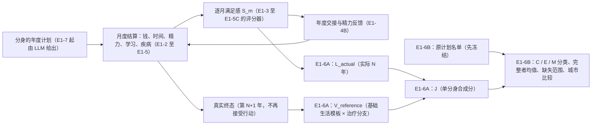

# E1-6 跨期评价：技术说明

> **2026-10-19 起只保留产品版（[ADR0037](../../DECISIONS/0037-life-keep-only-product-version.md)）：** 本文的手算例子与配置名来自当时的样例（`synthetic_e1_*`、`run_e1_7b_*` 等），这些配置与旧版本的规则、评分、模板已从仓库删除；机制与公式仍是现行代码的说明，现行样例是 `configs/life/*_product.yaml`。

> **过去过得怎样，留下的资源还能支持怎样的生活；一座城里的分身们，谁完成了、谁出局了、谁还算不出来。**

参数导航（2026-10-12 更新）：[参数与假设目录](parameter-assumption-register.md#evaluation) 的 EV-01–11 是 A 的参数与规则（2026-10-12 改了 EV-04–06、
EV-09），EV-12–17 是 B 的口径（新增；2026-10-12 收尾改了 EV-12、EV-16、EV-17，新增 EV-18 标准开局）。规则见 [ADR0028](../../DECISIONS/0028-life-single-clone-evaluation.md)（A）与
[ADR0029](../../DECISIONS/0029-life-e1-6a-closeout-and-city-aggregation.md)（A 收尾与 B），任务原文见 [A 的 prompt](prompts/2026-10-11-e1-6a-evaluation.md)
与 [收尾与 B 的 prompt](prompts/2026-10-12-e1-6b-aggregation.md)、[B 的最小收尾 prompt](prompts/2026-10-12-e1-6b-closeout.md)。

更新：2026-10-12（E1-6A 收尾与 E1-6B 已实现；E1-6B 的独立审核发现 R1–R3，最小收尾已实现、本轮自测通过，**待独立复核**——见 9.1、9.3、9.6、9.8；E1-6A 主体 2026-10-11）。补记（2026-10-12）：最小收尾同日在合成范围内通过独立复核（审核摘要（本机记录）），E1-6 的 V1 工程范围结束；下一步 E1-7A 见 [E1-7 技术说明](e1-7-agent-loop.md)。读者：项目所有者、架构讨论者与 coding
agent；数学只用到加减乘除和加权平均。

补记（2026-10-18）：日常生活便利（[ADR0033](../../DECISIONS/0033-life-daily-convenience.md)）的评价规格用六个基础生活模板（两种岗位 × 三种生活方案），见第 10 节；评价数学与 E1-6B 的口径都没有变。同日在声明的 V1 合成范围内通过独立审核（本机记录），可以交接 E3；真实资料接入和参数标定尚未完成。

## 阅读与效力

- **E1-6 只有两轮：** **A**——单个分身的实际生活汇总、期末估值、两部分合成（第 1–8 节；2026-10-12 收尾修了身份、已有物品、运行入口配置检查，
  并把参考方案拆成"基础生活模板 + 治疗分支"）；**B**——按原计划名单汇总同城多分身：完整者均值、确认出局、模拟缺失范围、事件链、硬要求、城市比较
  与评价对照（第 9 节）。不实现城市排名，不进入 E1-7。
- **当前代码：** 评价版本 `e1-6a-evaluation-v2`、执行修订 `e1-6a-r2`（v1 / r1 的配置与证据原样保留，当前代码拒绝执行）；汇总版本
  `e1-6b-aggregation-v1`。合成样例的协议 `life-v1-e1-6a-eval`（A）与 `life-v1-e1-6b-agg`（B）都沿用 E1-5C 的全部生活规则
  （`e1-5c-monthly-health-v1`）与评分版本（`e1-5c-health-v1`），**没有改任何生活或评分语义**。代码未提交，停在审核点。
- 所有数字都是**合成设定**，只检验规则是否按设计执行；不是现实价格、工资、医疗或心理规律，**不是城市评价，也不排序城市**。
- 所有者最新明确决定优先；[README](../../README.md) 管愿景，[PLAN](../../PLAN.md) 管工程状态，ADR 管具体规则。本文解释它们并导航代码。

## 1. 在整个项目里的位置

前面各轮回答"一个月过得怎样"（满足感）与"这一年能不能过下去"（结算）。E1-6A 第一次回答**一个分身的整段生活**，E1-6B 把同一用户在同一座城的
多个分身放在一起：

| 量 | 回答什么 | 不回答什么 |
|---|---|---|
| **L_actual**（实际体验） | 这个分身实际生活的 N 年里，平均每个月过得怎样 | 期末还剩什么；别的分身怎样 |
| **V_reference**（未来估值） | 从真实终态出发，按预先声明的少量基础生活模板（带病时再分治 / 不治），留下的现金、物品、资格与健康还能支持怎样的 12 个月 | 不是"明年会怎样"的预测，不是 LLM 第 N+1 年的真实行动，不是对全部可能行动的全局最优 |
| **J**（单分身合成） | 把实际 N 年与估值期按月份权重放在一起 | 不是货币；不是"现实幸福的百分比"；不是城市分 |
| **城市报告**（E1-6B） | 原计划多少人；完整评价的分身平均 J（及同一批人的 L、V）；确认出局多少、怎样出局；还算不出来的部分可能落在哪个范围 | 不是置信区间，不是城市排名，不代表全部可能人生 |

钱、物品与资格**不直接加分**：它们只通过估值期里实际买得起、用得上、做得了的生活起作用——这延续了"钱通过消费、学习和应对冲击发挥
作用，不直接等于幸福"与"不加独立的储蓄安心分"。

## 2. 公式

记实际模拟长度 N 年，T = 12N 个月（N 读协议，不写死 36）；估值期 H = 12 个月；评价规格声明月度时间权重 δ（0 < δ ≤ 1）。

* 实际生活：w_m = δ^(m−1)，W_actual = Σ_{m=1..T} w_m，**L_actual = Σ w_m S_m ÷ W_actual**。只有 T 个月都有合法评分才给。
* 估值分支 p（基础生活模板 + 治疗选择）：**V_p = Σ_{k=1..H} δ^(k−1) S_future[p,k] ÷ Σ_{k=1..H} δ^(k−1)**；**V_reference = max_p V_p**（只在能完整执行、
  完整评分、已知满足硬要求的分支里取）。
* 合成：W_future = Σ_{k=1..H} δ^(T+k−1)，**J = [Σ_m δ^(m−1) S_m + Σ_k δ^(T+k−1) S_future[选中,k]] ÷ (W_actual + W_future)**。

主设定 δ = 1（每个月同等重要）时，N = 3：W_actual = 36、W_future = 12，**J = 0.75 L_actual + 0.25 V_reference**；N = 1 时各占一半。0.75 只是
"实际 36 个月对估值 12 个月"的月份比例，**不能解释成"75% 的真实幸福"**。δ 是报告的时间评价参数，不改用户偏好，也不改分身的行为；本轮的
非 1 对照 δ = 0.99 只验证机制，没有实证依据。

**精度：** S_m 是评分器的浮点结果，按最短十进制写法换成精确分数（复用 `econ.life_feedback.score_fraction`）后全程用有理数算；显示值四舍五入
到 6 位另存，不参与判断；不加 epsilon。逐月汇总与"先对评分器的年度浮点均值再平均"可能只在最末一位不同（例：u68 是 0.5370003886513797
与 0.5370003886513798）——差异来自评分器浮点求和的顺序，不是公式不同，结果里写明原因，依据以逐月汇总为准；不为此改旧评分器。

### 2.1 一个手算例子（故事一的 u62）

几种月份的满足感先手算（评分规格原样，见 [E1-5 说明](e1-5-career-savings-risk.md) C 部分）：S = 0.8 × B + 0.2 × H，B 按去掉医疗维后的
权重（物质 1/3、安全 1/9、发展 2/9、休闲 1/9、环境 1/9、交通 1/9）加权，每个分项 s = z/(z + τ)（不超过 0.9）。

| 分项（τ） | 基本生活（远处住房、基本食品、门店兼职） | 较舒适（近处住房、新鲜食材、健身、洗衣设备） |
|---|---|---|
| 物质：居住面积 600 平方英尺 → 6（τ 6） | 6/12 = 0.5 | 0.5 |
| 物质：新鲜餐 3 / 21 顿每周（τ 7） | 3/10 = 0.3 | 21/28 = 0.75 |
| 物质：洗衣（有设备 z = 3，τ 1） | 0 | 3/4 = 0.75 |
| 物质 = 0.5 × 居住 + 0.3 × 新鲜 + 0.2 × 洗衣 | 0.34 | 0.625 |
| 安全 z 3（τ 3）、发展 z 2（τ 2）、环境 z 3（τ 3） | 0.5、0.5、0.5 | 同左 |
| 休闲：基础 4 + 健身 8 次（τ 12） | 4/16 = 0.25 | 12/24 = 0.5 |
| 交通：k = 0.25 + 0.75 × 到岗 10/20 = 0.625，T_eq = k × 往返分钟 | 60/(60 + 0.625 × 70) = 0.578313 | 60/(60 + 0.625 × 30) = 0.761905 |
| B | 0.34/3 + (0.5 + 2 × 0.5 + 0.25 + 0.5 + 0.578313)/9 = 0.427590 | 0.625/3 + (0.5 + 1 + 0.5 + 0.5 + 0.761905)/9 = 0.570767 |
| S = 0.8 B + 0.2（健康） | **0.542072** | **0.656614** |

u62 开局现金 9,000，三年每个月都是基本生活：门店兼职 1,500，远处住房 1,000 + 基本食品 380，每月净存 120（金额都是 USD_2024_LOCAL，当地基年
不变价）。

1. **实际三年：** 36 个月都是 0.542072 → L_actual = 0.542072。期末现金 9,000 + 36 × 120 = 13,320。
2. **估值期额度：** 第 3 年完整年度满足感 0.542072，按原反馈政策 250 × (1 + 0.10 × 0.542072) = 263.55（向下保留到 0.01）。
3. **基础生活模板（12 个月；u62 期末健康，每个模板一个分支）：** p1 基本生活每月 0.542072，V = 0.542072；p2 较舒适：第 1 月 13,320 + 1,500 − 1,400
   − 450 − 60 − 2,400（买洗烘一体机）= 10,510，之后每月 −410，第 12 月末 6,000，付得起，每月 0.656614，V = 0.656614；p3、p4 要会计资格，u62 没有，
   已知不可行。（v1 还有 p5"基本但不治疗"，健康期初与 p1 完全相同；v2 把它并进 p1 的不治疗分支，健康期初只执行一次。）
4. **V_reference** = max(0.542072, 0.656614) = 0.656614（p2）。
5. **J** = (36 × 0.542072 + 12 × 0.656614) / 48 = 0.75 × 0.542072 + 0.25 × 0.656614 = **0.570708**。

同样三年、开局 500 的 u61 期末只有 4,820：p2 第 1 月后剩 2,010、之后每月 −410，第 7 月月初 1,520 − 为食品预留的 380 = 1,140 < 1,400 的近处
房租，**已知不可行**；u61 的 V = 0.542072，J = 0.542072。两人实际生活与 L 完全相同，差别只来自期末现金能支持的未来生活。

## 3. 实际生活：只认同一次受控运行

`econ.life_evaluation.verify_trajectory` 只接受 `run_life_year` 产生的 `LifeYearResult` 序列：

* 每一年必须带着 `run_life_year` 当场封存的年度绑定 `ScoredYear`（挂在结果的**私有属性**上，不序列化、不参与校验，已有输出逐字节不变）。
  从 JSON 还原的结果没有它，明确拒绝："本轮不支持直接导入，请从保存的原始输入重放"。
* 核对：封存标记与对象指纹；**评价器拿到的城市目录就是封存生活所在的那座城**；结果里的账目与分数就是绑定里的那一份；**外层标签（人、分身、城市、
  年份）与封存的 `ScoredYear` 逐项相同**（2026-10-12 收尾 F1）；协议、目录、税绑定、评分输入（规格、城市评分条件、偏好、硬要求）的指纹与评价器
  拿到的相同——产品陈述与研究真值不混用；同一人、分身、城市；年份从 1 起连续、不重复、不超过 N；第 y 年正式交接的状态正是第 y+1 年绑定里的
  年初状态。完整轨迹与只有一年的部分轨迹受同样的核对。
* **成绩只认封存记录，不认信封上的标签**：`CloneEvaluation` 的人、分身、城市与重复分身序号（封存年初状态的 `health.repeat_index`，没有健康规则
  时为空）都从已核对的封存绑定取；重新计算结果指纹不能把错标签变成合法结果。拒绝时写明是第几份年度结果的哪个外层字段与哪份封存记录不一致。
* **交接不信结果对象里的字段**：从封存绑定按同一份协议重新推出反馈记录、交接种类与交出去的状态（`econ.life_year.handoff_from`，`run_life_year`
  与核对共用这一份），对不上就拒绝——终态只认最后一次真实交接。

分类（给 E1-6B；口径见第 6 节）：`complete`、`score_incomplete`（终态正常但有月份评分不完整）、`life_exit`、`stopped`（E1-5C 停止，原样保留种类）、
`feedback_blocked`、`settlement_failed`、`not_finished`。逐月明细列满 T 个月，每个月写状态：`scored`、`incomplete`、`exit_month`、`after_exit`、
`stopped_month`、`after_stop`、`not_simulated`。部分轨迹保留已知月份、分数与加权贡献、缺失位置与原因、出局或停止记录、事件链（发病、治疗、
病假、出局、停止）与硬要求逐月汇总，**不给 L_actual**，不用已知月份平均冒充完整生活，也不补零。2026-10-12 起另记**逐月事实摘要**（`MonthFact`：
月初 / 月末现金、收入、税、最低生活、支出、健康状态、病假、治疗状态与付款，原样取自封存的结算记录）与每年的结算问题代码，只供 B 的事件链与
缺失原因引用，不参与任何计算。

## 4. 期末估值：基础生活模板与治疗分支怎样变成结算输入

### 4.1 估值上下文（只在估值入口构造）

`econ.life_terminal_value.value_terminal` 只对**正常结束**的终态估值；出局、停止、反馈受阻、结算失败或没跑完的轨迹返回"不适用"，估值器不复活它们。
真实终态（`terminal`，第 N+1 年）本身不动——普通 `settle_year` 照旧拒绝它（`state_not_active`），估值前后它的指纹相同。估值入口记下每一项转换：

| 转换 | 内容 | 为什么 |
|---|---|---|
| 协议 | 从实际协议派生：`simulation_years` N → N+1；事件来源换成派生的 `none`（流版本不变）；其余原样 | 让第 N+1 年成为可以结算的一年；"估值期没有新发疾病"是确定性条件，不是把概率改成 0 |
| 状态 | `terminal` → `active`；**年份不重置**（第 N+1 年）；现金、能力、岗位记录、培训进度、资金目标、疾病与病史原样；已到期（剩 0 个月）的持有物不带入 | 能力生效年份、物品寿命与病程都按真实年份走 |
| 健康绑定 | 事件来源指纹改指派生的 `none` 来源；疾病规则指纹不变，照常核对 | 换了来源的状态不会被当成原来源的状态 |
| 精力额度 | 见 4.4 | 终态里存的是第 N 年自己用的额度 |

派生的协议与状态只存在于估值入口内；结果里只有它们的指纹与摘要（估值期初状态、各分支期末状态），没有可以拿去继续结算的状态对象。

### 4.2 基础生活模板与治疗分支（v2，2026-10-12）

评价规格（`configs/life/evaluation_e1_6a_v2.yaml`；B 的样例用 `evaluation_e1_6b.yaml`）在看结果之前冻结一个小型**基础生活模板**集合（最多 6 个）。
模板由**槽位**组成，槽位在比较组里共用，各城只写它绑定到目录里的哪一项、或"确定没有"、或"资料未知"——比较组里模板类别、选择规则与资料要求
相同，价格与供给可以不同，不能给某座城多一类更有利的生活。**模板不含治疗选择。**

| 模板 | 岗位 | 住房 | 食品 | 服务 | 条件购买 |
|---|---|---|---|---|---|
| p1_current_basic 现职 + 基本 | 终态里的当前岗位 | 基本（远） | 基本 | — | — |
| p2_current_comfort 现职 + 较舒适 | 当前岗位 | 较舒适（近） | 新鲜 | 健身 | 期初没有在用的洗衣设备才在第 1 月买 |
| p3_qualified_basic 已具资格岗位 + 基本 | 绑定的要求资格的岗位 | 基本 | 基本 | — | — |
| p4_qualified_comfort 已具资格岗位 + 较舒适 | 同上 | 较舒适 | 新鲜 | 健身 | 同 p2 |

**治疗分支**（`treatment_branching: by_continuing_illness_v1`，按估值期初的健康状态展开，各城同一规则）：

* **估值期初健康**：每个模板**一个**分支，编号就是模板编号，治疗选择记为"未触发"——估值期没有新发疾病，治不治都不会发生；年度计划里的应急安排
  写 decline 只为满足年度计划的格式，**不代表用户偏好**，也不重复计算两份相同的生活。最多 6 次试算。
* **估值期初带病**：每个模板展开两个分支，只针对**正在延续的这场病**（不遍历未来疾病组合）：`模板.treat`——对这场病写"条件允许就治"；
  `模板.decline`——不治疗。最多 12 次试算。本样例 4 个模板，最多 8 次。
* 每个分支变成一份普通年度计划（`YearAction`，理由写明"估值专用，不是分身的真实行动"），由现有 `settle_year`（E1-5C 规则原样）按月执行：
  **不治疗的分支不会因为现金够而被改成治疗**；治疗分支照旧受资金、时间、精力、供给与病程规则约束（付不起、资料未知照原规则处理）。应急安排只在
  协议带疾病规则时写（E1-4B 到 E1-5B 的协议不允许写健康字段——收尾时发现的潜在缺陷，已修正）。
* 治疗选择**不由医疗点数生成**，也不调用 LLM 猜用户的医疗决定。选中的分支是参考估值，不声称实际分身一定会这样选。
* v1（2026-10-11）的五个参考方案把治疗选择写在方案里（p1–p4"条件允许就治"，p5 = 现职 + 基本但不治）；**已由 v2 取代**。旧配置
  `configs/life/evaluation_e1_6a.yaml` 与 E1-6A 证据原样保留；当前代码拒绝 v1 规格，并指向 ADR0029（项目约定不保留旧修订的执行器）。

**分支结果四类**（每个分支都记下实际动作、适用性、结算状态、逐月分数、硬要求、期初与期末现金、逐月健康状态、期末状态摘要与原因）：

* **完整**：按声明执行（任何一项、任何一个月都没有被拒）、12 个月完整评分、已知满足硬要求 → 有 V_p；
* **已知不可行**：资格不足、本城确定没有、估值期出局、计划不可行（自选住房或食品付不起又没声明兜底、时间或精力超限、应急安排撑不住延续的
  疾病）、分支里任何一项某个月因钱不够被拒；
* **违反硬要求**：明确违反已声明的硬要求，不作为满足这个用户要求的选项；
* **无法评价**：资料未知（槽位资料未知、要治疗而本城治疗资料未知）、评分不完整、硬要求无法判断、偏好信息不足、输入错误。

**选择：** 比较的是"模板 + 治疗分支"。没有"无法评价"的候选且至少一个完整 → V_reference = 最高的 V_p（并列时按分支编号的字典序展示，数值
不变）；有任何"无法评价"的候选 → **不给** V_reference，另存"已知分支里的最好结果"只作诊断（理由文字只在确有已知完整分支时才提它，没有就明说"已知的分支里没有任何一个能完整执行、
完整评分并满足硬要求"——2026-10-12 收尾订正）；全部已知不可行 → "没有可行的参考分支"。都不填 0，
也不把实际完成生活的分身改成出局。

**例（B 样例的 β r1 在 A95）：** β 第 3 年第 12 月得大病，**它自己的年度计划写的是大病不治**，带着病了 1 个月的大病进入终态，现金 6,820。估值
把 4 个模板各分治 / 不治，共 8 次试算。p1 的两个分支同一份生活（现职门店兼职、远处住房、基本食品），只差治疗：

| 分支 | 估值期现金 | 逐月健康 | V |
|---|---|---|---|
| p1_current_basic.treat | 6,820 − 1,380（病假月只付住房食品）− 2,000（住院）+ 11 × 120 = **4,760** | 大病 1 个月（第 1 月末治愈）、健康 11 个月 | (0.619355 + 11 × 0.662651)/12 = **0.659043** |
| p1_current_basic.decline | 6,820 − 2 × 1,380 + 10 × 120 = **5,260** | 大病 2 个月（病满 3 个月，第 2 月末自然恢复）、健康 10 个月 | (2 × 0.619355 + 10 × 0.662651)/12 = **0.655435** |

β 只看重交通：上班月 0.8 × 60/(60 + 0.625 × 70) + 0.2 = 0.662651，大病月不到岗 0.8 × 60/(60 + 0.25 × 70) = 0.619355。门店兼职每月只到岗
10 次，所以少病一个月更好，选中 `p1_current_basic.treat`；较舒适与已具资格的分支已知不可行（付不起或没有资格）。

### 4.3 钱、物品、资格、课程与疾病

* **现金**：就是真实终态的那一笔余额；未来工资、税与支出由现有账本结算；不额外造钱，不把余额直接换成分数。多留现金可以支持原本付不起的生活；
  所有分支都付得起之后，更多现金**不再提高**有限期估值（演示里开局现金 500 → 20,000 的网格：期末 7,319 时 V = 0.542072，7,320 起 V = 0.656614 不再变）。
  **现金单调性不是一般保证**：所有者 2026-10-12 撤回了"现金更多，V 必须不下降"的普遍验收要求。v1 里较舒适方案写死"条件允许就治"，独立审核找到
  钱多反而 V 低的反例（只看重交通、每月到岗 20 次的人，期末现金 3,850 的治了病、分数反而比 3,700 的低）；v2 拆开治疗选择后，钱多的人也能过钱少的人
  那份不治疗的生活，那个例子里两人 V 相同——这是那个例子的事实，不是定理。健康样例的现金网格测试保留为"这个样例里的事实"。
* **物品**：数量与真实剩余服务月原样带入；只有估值期实际提供的服务进入评分，不另加转售残值；估值期之后剩下的服务月列入"未估值"。条件购买
  `buy_if_not_held`（2026-10-12 收尾 F2）：槽位绑定到一项明确的目录机会时，**先看估值期初有没有它在服务期内**——有就照用（不买、不重复付款、不重置
  寿命），**不要求新品可得，也不要求新品报价**；没有才检查供给、价格与资金。"新品报价未知"不影响照用旧的；旧物品自己的服务规格未知，照常在评分里
  报未知（不当成没有）。槽位"确定没有 / 资料未知"认不出是哪一件，照旧按槽位报告；不做跨品牌替代或物品匹配。到期的持有物不在估值期初状态里，
  不提供服务，也不挡正常购买。
* **资格与岗位**：第 N 年完成的课程授予的能力从第 N+1 年起可用，正好可以支持估值期的相关岗位；职业、雇主与能力作用域照常用
  `qualification_gaps` 按估值期初状态核对；有资格不等于涨薪——只有分支实际执行这份岗位才有它的工资、税、工时与负担；不默认选最高工资，按估值期
  的完整评分选。
* **课程**：估值期不新开课程、不续学未完成的课程；未完成课程不算取得资格，已付学费不退、不补能力，这部分潜力列入"未估值"。
* **疾病**：终态里正在延续的疾病、已病月数与治疗历史原样带入，照同一套病程、治疗、病假与恢复规则走完，不在入口痊愈；估值期不发生新病；治疗与
  否由分支显式声明（4.2），不由医疗点数生成。
* **价格与环境**：冻结的合成目录、税绑定、城市评分条件与评分规格；当地基年价，不预测涨薪、通胀或房价；缺资料就报告，不补默认条件。
* **资金目标**：不按目标名称、金额或"完成目标"加分，目标不触发购买；估值中的购买不回写真实目标历史。

### 4.4 估值期的精力额度

真实第 N 年结束后直接进入终态，不会计算第 N+1 年的额度，终态里存的是第 N 年自己用的额度。所以估值期起始额度按实际运行的反馈政策重算：开着时用
**第 N 年完整年度满足感**调用已有的 `quota_from_score`（例：u63 第 3 年 0.582072 → 250 × (1 + 0.10 × 0.582072) = 264.5518 → 264.55，终态里是
263.55）；关闭或 α = 0 时用基础值 250；第 N 年评分不完整时额度无法确定，估值不完整（不补零、不沿用旧额度）。额度只在估值上下文里，估值期内不再
滚动更新，不用三年总分、估值或 J 计算。

## 5. 评价规格、内容身份与结果绑定

`EvaluationSpec`（`common/life_evaluation_contracts.py`）的**内容身份** = 去掉 `spec_id`、`note`、模板标签与说明、槽位说明、绑定原因之后的规范 JSON 的
SHA-256：δ（按数值，"1" 与 "1.0" 相同）、H、估值事件条件、选择规则、合成公式、执行修订、**治疗分支规则**、槽位与角色、**基础生活模板**、各城绑定。
同名但计算内容不同就是另一个身份；v2 的身份与 v1 不同。单个评价结果 `CloneEvaluation` 绑定规格身份、协议、目录、税、评分输入、实际轨迹（各年年度
绑定指纹）、终态、估值上下文与各分支的计划 / 结果 / 分数指纹，`result_fingerprint` 覆盖全部内容；同样输入重放逐字节相同，改了内容的结果在重新
校验时被拒绝。

**运行入口与加载入口同一份配置检查**（2026-10-12 收尾 F4）：一座城的绑定与目录对得上——绑定存在、引用的机会在这座城的目录里、结算角色与槽位一致
（住房与食品按城市最低生活声明的合格名单认定）——只写一份 `ledger.life_evaluation_config.city_binding_problems(spec, catalog)`。加载器逐城调用它，
再做比较组层面的检查（城市集合、同一槽位在各城声明同一组功能）；econ 的正式入口 `evaluate_clone` 与 `value_terminal` 在**任何试算之前**经
`check_city_binding` 调用同一份按城检查，不通过就报**配置错误**，不伪装成城市资料未知或"无法评价"。合法的"确定没有 / 资料未知"声明不受影响。

**信息隔离：** 评价规格、基础生活模板、逐月明细与事实摘要、估值、合成分与它们原样序列化后的字典都是内部对象（`internal_evaluation_models`），
L、V、J、分支比较与评价参数的键名是保留键（`RESERVED_EVALUATION_KEYS`，不与可见字段重名），三处检查（正式加载、可见投影、最终 payload）都拒绝。
将来给最终用户看报告，不等于给正在接受检验的分身泄露裁判信息。

## 6. 城市层面的口径（所有者 2026-10-11 确认、2026-10-12 补充；E1-6B 已实现，见第 9 节）

1. 确认生活出局的分身**不进城市平均分**，也不作为未知分数放进缺失范围；保留全部已发生生活与事件链，独立报告；**出局人数占比用原计划人数作分母**。
2. 因模拟问题没算完的分身（资料缺失、评分不支持、反馈受阻、执行支持或程序问题）与生活出局分开，不解释为生活差；留在原计划名单里，进模拟缺失
   范围，不默认补零。
3. 部分分身停止不取消其他分身的有效结果；城市平均的含义是"完成且评分完整的分身平均"，不宣称代表原计划全部分身或全部可能人生。
4. 现有的 E1-5C 停止（`stopped`）不自动改称生活出局：疾病之后应急安排不足、资源执行受阻或资料缺口都保留实际状态与原因；有疾病事件不等于证明
   了生活出局。
5. （2026-10-12）不设置未经所有者决定的最低通过人数或缺失比例门槛：把实际人数与范围展示出来。
6. （2026-10-12）不增加"有积蓄让我安心"的奖励。

这条口径更正了早期"出局者不从平均分母删除"的说法：生活评分排除已确认的生活出局者；原计划人数、出局比例及原因的报告保留全部分身；模拟问题
造成的未完成计算另作不确定性分析（第 9.4 节的模拟缺失范围）。旧文档原文保留，加了指针。

## 7. 当前实现、尚未实现与合成假设

**已实现（合成探索）：** A——实际轨迹核对与分类（含外层身份核对）；逐月汇总 L_actual（N 由协议决定，δ 显式声明）；部分轨迹的逐月明细与事实
摘要；期末估值上下文、基础生活模板与治疗分支、条件购买先看持有；运行入口的配置检查；V_reference 与诊断用的已知最好结果；J；内容身份与结果
绑定；信息隔离；可手算演示。B——原计划名单的冻结与核对；C / E / M 分类与八种缺失原因；完整者均值（同批 L、V）、出局与缺失比例；模拟缺失范围；
出局与停止的事实事件链；硬要求报告；同一用户的城市比较；缺失集中表；两个评价对照臂；小型离线批次演示。

**没有实现：** 估值期之后剩余资产的价值；课程续学与新课程；估值期的新疾病风险；估值期的 LLM 行动；更多模板或任何优化；H 的敏感性（只支持 12）；
人口加权；真实数据与参数标定；E1-7 的正式调度、重试与用户前端；城市排名。

**合成选择（不是实证结论）：** δ = 1；H = 12；参考集合内最佳可行分支；估值期没有新发疾病；四个基础生活模板、治疗分支的展开规则与 A93、B94、
A95、B96 的绑定；B 的名单（两位用户、每城 5 / 2 个重复分身）与两个评价对照臂；样例里的价格、工资、学费、疾病与评分参数。

### 7.1 每项省略影响谁

| 省略 / 假设 | 受影响的人 | 方向 |
|---|---|---|
| 基础生活模板只有四个（带病时各分治 / 不治），只在其中取最高 | 偏好别的生活方式（例如更大的房子、不同的消费组合、换城市）的人 | V 被低估；不同城市的低估程度可能不同 |
| 估值期没有新发疾病 | 年龄大、工作负担重、健康风险高的人 | V 偏乐观（现实中他们更可能在估值期生病） |
| 价格与目录冻结在当地基年 | 价格会大幅上涨或下降城市里的人 | 估值不反映价格变化 |
| 不新开、不续学课程 | 期末只学了一半的人 | 已付学费与进度的潜力没有进入 V（列为未估值）；与"没学"的人看起来一样 |
| 估值期只有 12 个月 | 持有长寿命物品、大额存款或刚拿到资格的人 | 更长远的收益被低估 |
| δ = 1 | 更看重眼前或更看重将来的人 | 时间权重与他们的真实取舍不一致；δ 不改他们的行为 |
| 交通—健康反例（已知，不处理） | 只看重交通、经常到岗的人 | 生大病的月份分数可能高于上班月（u70：0.619355 vs 0.569231），L 与 J 都更高；本轮不调疾病惩罚、不改交通权重，也不保证反例消失 |
| 完成者均值（B） | 容易出局或容易遇到资料缺口的人 | 均值只描述完成且评价完整的分身；出局与缺失另报，不能只看幸存者的高分 |
| 每城重复分身很少（B 样例 α 5 个、β 2 个） | 所有用户 | 均值不是稳定的抽样证据；范围只覆盖"算不出来"的部分，不覆盖"人数少" |

## 8. 代码、配置、测试与证据

| 内容 | 位置 |
|---|---|
| 评价规格、模板、分支、结果与状态的形状 | `src/common/life_evaluation_contracts.py` |
| 配置加载与跨对象检查（按城检查 `city_binding_problems` + 比较组层面的检查） | `src/ledger/life_evaluation_config.py` |
| 轨迹核对（含外层身份）、逐月汇总与事实摘要、合成、结果编排 | `src/econ/life_evaluation.py` |
| 估值上下文、模板与治疗分支、条件购买、选择、运行入口的配置检查 | `src/econ/life_terminal_value.py` |
| 封存绑定挂在年度结果上；共用的交接推导 `handoff_from`；税与评分输入的身份函数 | `src/common/life_feedback_contracts.py`、`src/econ/life_year.py` |
| 汇总的形状、局部约束与内容身份（名单、分类、范围、报告） | `src/common/life_aggregation_contracts.py` |
| 名单加载与跨对象检查（共同开局摘要） | `src/ledger/life_roster.py` |
| 冻结名单、结果核对、分类、均值、范围、比较、事件链、评价对照 | `src/econ/life_aggregation.py` |
| 内部对象与保留键的登记 | `src/common/life_scoring_contracts.py`（`internal_models`）、`src/agentlayer/life_views.py`、`src/ledger/life_catalog.py` |
| A 的合成样例、评分配置、评价规格 | `configs/life/synthetic_e1_6a_evaluation.yaml`、`scoring_e1_6a_evaluation.yaml`、`evaluation_e1_6a_v2.yaml`（v1：`evaluation_e1_6a.yaml`，历史） |
| B 的合成样例、评分配置、评价规格、名单 | `configs/life/synthetic_e1_6b_aggregation.yaml`、`scoring_e1_6b_aggregation.yaml`、`evaluation_e1_6b.yaml`、`evaluation_e1_6b_delta099.yaml`、`evaluation_e1_6b_basic_only.yaml`、`roster_e1_6b.yaml` |
| 演示 | `scripts/demo_life_e1_6a.py`、`scripts/demo_life_e1_6b.py`（`uv run python scripts/demo_life_e1_6b.py --out runs/<新目录>`） |
| 测试 | `tests/life/test_evaluation_actual.py`、`test_evaluation_terminal.py`、`test_evaluation_integrity.py`、`test_evaluation_closeout.py`（辅助 `evaluation_support.py`）；`test_aggregation.py`、`test_aggregation_boundaries.py`（标准开局、冻结前检查、证据配对；辅助 `aggregation_support.py`） |
| 运行证据 | 本机运行记录（A）；本机运行记录（独立审核，只读）；本机运行记录（A 收尾与 B）；本机运行记录（B 的独立审核，只读）；本机运行记录
（R1–R3 收尾） |

## 9. E1-6B：城市汇总

### 9.1 汇总单位与原计划名单（先冻结）

汇总单位是**同一用户（偏好组）× 城市 × 重复分身序号**。城市目录可以不同；不同用户分别出报告，不混成一个人的城市推荐分；不新增人口加权。

**标准开局 v1（2026-10-12 收尾 R1，`START_CONDITION_RULE = v1_standard_start_2026_10_12`）。** 审核发现原来的开局比较只比"现金、能力、年龄……以及
持有物的件数与剩余月数"：A 城健康、B 城已在生大病，或 A 城有洗衣机、B 城有手机，都被当成同一个起点。所有者收紧了范围——本版不做跨城物品等价
映射、初始疾病抽样或状态生成器，只接受一种明确的起点：

| 类别 | 内容 |
|---|---|
| 同一用户要求一致的个人条件（`common_start_digest`，键见 `PERSONAL_CONDITIONS`） | 账户口径与开局现金、年度净可分配小时、精力额度与尺度、资源预算依据、基础精力额度、开局能力（编号、来源、可用年）、年龄、陈述的职业（有岗位记录时取 `stated_occupation`，旧协议取 `occupation`）、旧协议的数值技能、文字目标；偏好来自同一份 `StatedLifeProfile`（按人） |
| 允许不同 | 分身编号、城市、重复分身序号、开局声明的当地岗位（城市专属编号）、健康绑定；城市目录、报价、当地岗位与税绑定 |
| 本版不接受的既有生活状态（`standard_start_problems`） | 不是第 1 年 active；开局持有物；开局培训进度；结构化资金目标；有健康协议时正在生病、有病史或已有月份负担记录；经历摘要；不是开局声明的岗位记录；不是第一年基础值的精力额度；来自培训的能力 |

检查在 `ledger.life_roster.roster_problems` 里，`load_roster` 与直接调用 `freeze_roster` 用同一份规则：在冻结之前拒绝，逐条写出分身、字段与原因
（例："名单项 u101.b96.r0: 标准开局 v1_standard_start_2026_10_12 不接受——health.episode：开局正在生病（major，已病 1 个月）——只接受健康开局"；
同一用户的个人条件不同时写出是哪个字段、各分身各是什么值）。这是"本次城市比较不支持这种初态"，不是生活出局，也不先运行再归入 M；不删人、不改
原计划人数，不修改、补齐或清空传入的状态。这条检查**只在城市比较的名单检查里**，不进通用生活引擎：开局都没有物品、之后在不同城市买到不同东西，
开局都健康、第一个月抽到病，第二年带着上一年的物品、课程进度、疾病与目标继续生活，从带物品、带病的真实终态估值——都照旧可以执行。旧协议没有的
字段（健康、资金目标、岗位记录）沿用原有含义，不强迫添加。审核的"洗衣机对手机"反例被拒绝的理由是"本版不接受开局持有物"——这是缩小支持范围，
**不是**已经能比较一般初态。将来接收用户真实拥有的家具、病史、在学课程时，再扩展共同起点的映射与校验（PLAN §3.0.1 产品输入行）。

原计划名单（`configs/life/roster_e1_6b.yaml`）写明比较组、用户与人、每个名单项的分身、完整城市身份与重复序号、运行臂（一个主臂与事先声明的
评价对照臂）。`econ.life_aggregation.freeze_roster` 在**跑任何生活之前**先做 ledger 的跨对象检查（`roster_problems`：用户有产品路径的偏好陈述；
分身的第 1 年开局在声明的城市、属于声明的人、重复序号一致；标准开局 v1；城市有目录、在比较组里、在每个运行臂的评价规格里有绑定；每个运行臂的评价
规格通过完整的跨城检查——见 9.3），
再记下内容身份：每个运行臂的协议指纹、评价规格内容身份与执行修订、δ、H、N 与精确时间权重 W_actual、W_future；各城的目录与税绑定指纹；每个名单项
的开局指纹、共同开局摘要指纹、评分输入指纹与用户声明的硬要求。分类规则 `c_e_m_owner_2026_10_12_v1`、范围规则 `known_months_plus_unit_bounds_v1`、
通过的开局检查 `v1_standard_start_2026_10_12` 与汇总的执行修订 `e1-6b-r2` 的名字也冻结在里面（城市报告抄录后两项）；旧的冻结名单没有后两项，
按新契约读入会被拒绝，不给历史结果事后补上"已通过新检查"的标签。名单为空、名单内部冲突（重复分身、同一用户同城同序号两项、未声明的用户、两个主臂）都整体拒绝，不伪装成若干普通缺失。**不从收到多少结果
反推原计划人数。**

### 9.2 分类：每个名单项恰好一类

| 类 | 条件 | 进均值 | 进范围 | 比例的分母 |
|---|---|---|---|---|
| **C** 完整 J | 实际生活正常完成、实际评分完整、估值完整、`combined.status = complete`、J 非空且在 [0, 1]，且身份与证据核对通过 | 是 | 取 [J, J] | 原计划人数 N |
| **E** 确认的生活出局 | 可信的实际结算记录明确为付不起最低住房与食品而出局（`life_exit` 且出局原因 `minimum_living_unaffordable`） | 否 | 否 | N |
| **M** 模拟或评价不完整 | 其余全部 | 否 | 是 | N |

N_planned = C + E + M。M 的原因按**最早失败的环节**八选一：

| 原因 | 什么时候 | 例 |
|---|---|---|
| 未运行 / 未返回 | 名单上有、没有收到结果；或只返回到中途 | B 样例刻意不运行 u101.a95.r4 |
| 计划或执行未完成 | 结算 `plan_infeasible`，或年初资格不合格的计划被退回（`qualification_missing`） | 第 1 年选近处住房 + 新鲜食材又没有兜底 |
| 资料缺失 | 结算 `data_error`（结算要用的城市资料缺失或不完整） | — |
| 评分不完整 | 终态正常，但有月份有正权重的资料未知 | — |
| 精力反馈受阻 | 反馈开着而上一年评分不完整 | — |
| E1-5C 停止 | 疾病之后应急安排不足或资料缺口（原样保留，不改称出局） | α r1、r2 在 B96：要住院而住院资料未知 |
| 估值不完整或没有可用参考分支 | 实际生活完整，但有可能适用而无法评价的分支，或全部分支已知不可行 / 违反硬要求 | β r1 在 B96 |
| 输入 / 配置 / 程序错误 | 结果核对不通过、重复结果、运行时被拒绝的输入、意外异常 | 改过外层城市的结果 |

`owner_category = completed_scored` **不是** C 的充分条件：β r1 在 B96 实际三年完整（`completed_scored`），估值不完整，J 为空，归 M。生病、低分、
违反硬要求、停止、资料缺口、计划不可行、没有可行参考分支本身都不是生活出局。将来若某个 M 被确认生活出局，分类与分母按新事实更新。

### 9.3 输入核对

每份评价结果进入汇总前都要重新核对（`_verification_problems`）：结果指纹按内容重算（不信 `model_copy` 改过的对象）；人、分身、城市、重复序号就是
名单项；评价规格的编号、内容身份与执行修订就是这个运行臂冻结的那一份；协议、城市目录与税绑定、评分输入就是冻结的那一份；第 1 年的年初状态就是
名单项冻结的开局；实际月数、实际与未来的时间权重、估值期长度与运行臂一致（不同 δ、H、N 不能静默平均）。

* 明确到单个名单项的问题（核对不通过、同一项收到两份结果、运行失败记录）记为**这一项**的 M（输入 / 配置 / 程序错误），**不提取其中任何"已知
  月份"**去收窄范围；其他合法结果照常。意外程序错误显式标出，报告里注明"不能假定它只影响这一个分身"。
* 名单外的结果单列拒收，不进任何城市、任何分母。
* 名单自身冲突、共享规格不一致在冻结时整体拒绝。**冻结前对每个声明的运行臂复用 `evaluation_spec_problems`**（2026-10-12 收尾 R2：原来只有
  正常加载会做，直接在内存里冻结会漏掉跨城检查——"洗衣设备"槽位可以在 B96 绑到一件没有洗衣功能的合法耐用品，两城结果照样都算 C）：同城角色、
  不存在的引用、比较组不一致、同一槽位在各城不是同一类东西都按配置错误拒绝，在任何生活运行或估值试算之前；缺某个运行臂的规格、多出名单没声明的
  规格也给明确诊断（不是 KeyError）。合法的"确定没有 / 资料未知"与各城不同的报价不受影响。
* 不要求不同城市的目录或税绑定指纹相同：各城分别绑定自己的事实；共同的是规则（协议、评价规格、评分规格、分类与范围规则）。
* 输入的顺序不影响结果：名单项按名单顺序出记录，城市报告内按重复序号排序，同样输入重放逐字节相同。
* 评价对照（9.8）同样不信改写过的对象：两份运行臂报告的内容要对得上各自的报告指纹，用来判断"同一批生活"的评价结果要对得上
  结果指纹，否则拒绝比较。

### 9.4 完整者均值与模拟缺失范围

* **完整评价分身的平均分** = Σ_{i∈C} J_i ÷ C；同一批 C 的 L、V 平均一起给（不用不同样本分别求均值）。C = 0 时为空（不填 0，不用 L 代替 J）。
* **出局比例** = E ÷ N，**缺失比例** = M ÷ N。
* **模拟缺失范围**：对每个 M 项，K = 可信的已知实际月份的加权分数和，W_known = 它们的权重和，W_actual = 全部实际 T 个月的权重，W_future = 估值期
  H 个月在 J 里的权重；V 完整时 v_low = v_high = V，否则 v_low = 0、v_high = 1：

  下界 = (K + W_future × v_low) ÷ (W_actual + W_future)
  上界 = (K + W_actual − W_known + W_future × v_high) ÷ (W_actual + W_future)

  完整 J 的项取 [J, J]；**确认出局者不进这个集合**。城市范围 = Σ 下界 ÷ (C + M) 到 Σ 上界 ÷ (C + M)。检查 0 ≤ 下界 ≤ 上界 ≤ 1，矛盾就报错，不裁剪。
* 范围的含义：**在当前评分尺度与已确认出局的排除规则下，给模拟尚不能计算的部分保留的可能范围。** 它不是 95% 置信区间，不是抽样误差条，不是疾病
  发生概率，也不是全体真实人生的均值区间；不要求缺失随机，不新增 bootstrap、插补或重加权；也不预测没跑完的分身继续运行后一定能完成。
* 不把"已知最好分支"当成 V，也不拿它收窄下界；不把不同分支各自最好的月份拼成一个不存在的未来；核对不通过的记录不提取"好看的月份"。
* 全员完整：范围退化为均值。没有 C 但有 M：均值为空，只报范围。全员出局：均值与范围都为空，出局比例 100%。原计划为空：拒绝（没有计划样本，
  不除零）。只有 1 个完整分身：照给它的均值，人数写 1，并注明不是稳定的抽样证据。

**手算例一（公式构造单测，不是模拟结果）：** 原计划 10 人：6 人 J 完整、合计 3.6；2 人确认出局；2 人因模拟问题完全缺失（没有可信记录，各取
[0, 1]）。完整者均值 3.6 ÷ 6 = **0.6**；出局比例 2 ÷ 10 = **20%**；缺失比例 2 ÷ 10 = **20%**；范围 [3.6 ÷ 8, (3.6 + 2) ÷ 8] = **[0.45, 0.70]**
（分母 C + M = 8，出局的 2 人不在里面）。

**手算例二（部分记录，公式构造）：** δ = 1，实际应有 36 个月，已知 24 个月、每月 0.6，另外 12 个实际月与未来 12 个月未知：K = 14.4，W_known = 24，
W_actual = 36，W_future = 12。下界 (14.4 + 12 × 0) ÷ 48 = **0.3**，上界 (14.4 + 36 − 24 + 12 × 1) ÷ 48 = **0.8**。不是补零：已知的 24 个月照算，
未知的部分两端都留着。

**手算例三（真实引擎，B 样例 α 在 A95）：** α 每月门店兼职 1,500、远处住房 1,000 + 基本食品 380，净存 120；原计划 5 个分身。

1. r0 健康：36 个月都是 0.542072，期末 6,320，只付得起基本生活，V = 0.542072，**J = 0.542072**。
2. r1 第 2 年第 5 月大病（月初 3,920）：病假没有工资，付住房食品 1,380 → 2,540，住院 2,000 → 540，月末治愈；L = (35 × 0.542072 + 0.359484) ÷ 36 =
   0.537000，V = 0.542072，**J = 0.75 × 0.537000 + 0.25 × 0.542072 = 0.538268**。
3. r3 第 2 年第 3 月小病，门诊 300，照常上班：小病月 0.542072 − 0.2 × 0.5 = 0.442072，L = 0.539295，**J = 0.539989**。
4. r2 第 1 年第 2 月大病（月初 2,120）：病假收入 0，付住房食品 1,380 → 740，住院 2,000 付不起；第 3 月 740 < 1,000 + 380，差 640 → **确认出局（E）**。
5. r4 没有返回 → **M（未运行 / 未返回）**，范围 [0, 1]。

完整者均值 = (0.542072 + 0.538268 + 0.539989) ÷ 3 = **0.540110**（同一批人的 L 0.539456、V 0.542072）；出局比例 1/5 = 20%，缺失比例 1/5 = 20%；
范围分母 C + M = 4：[1.620329 ÷ 4, (1.620329 + 1) ÷ 4] = **[0.405082, 0.655082]**——它担心的只是 r4：它的 48 个月权重全部未知。

**手算例四（实际完整、估值缺失，β r1 在 B96）：** 36 个月都已知，L = (35 × 0.612903 + 0.581818) ÷ 36 = 0.612040；带着大病进入估值期，B96 住院资料
未知 → 治疗分支无法评价，V 不完整。K = 36 × 0.612040 = 22.033431，范围 [22.033431 ÷ 48, (22.033431 + 12) ÷ 48] = **[0.459030, 0.709030]**，宽度只有
12/48 = 0.25——已知的实际生活被利用了，没有把整个 J 都当成未知。

### 9.5 出局与停止的事件链

只从已核对的记录生成（逐月事实摘要、事件、出局 / 停止记录），带年月与金额，不调用 LLM，不另写工资、税或疾病算法。窗口从出局 / 停止前两个月或
（12 个月内）发病那个月开始，到出局 / 停止那个月为止；发病单独成一步（停止那个月没有提交的月度账，也要有发病这一步）。例（α r2 在 A95）：

1. 第 1 年第 1 月：月初现金 2,000，收入 1,500，付出 1,380，月末现金 2,120
2. 第 1 年第 2 月月初新发大病（实验指定的事件）
3. 第 1 年第 2 月（大病）：月初现金 2,120，收入 0（大病病假，没有工资），付出 1,380，要治疗，但付完住房与食品后现金不够，没有治疗，月末现金 740
4. 第 1 年第 3 月：可用现金 740，最低住房 1,000 + 最低食品 380 = 1,380，差 640 → 付不起最低生活，出局

措辞规则：停止写"停止（资料缺口 / 应急安排不足）"，不写成"看不起病"；资料未知写"资料未知"，不写成"当地没有"。事件标签（出现过大病病假、
出现过小病、记录到治疗费用、最低住房与食品付不起、资料缺口停止、应急安排不足停止）**不互斥**，只描述发生过什么，不是独立的因果贡献；事件链只写
事实发生的顺序，不宣称"房租贡献了多少因果影响"。

### 9.6 硬要求

每条硬要求按名单项报告"每月都满足 / 违反 / 未知 / 只在生活过的月份满足"及违反、未知的分身编号，并写明分母（2026-10-12 收尾）：原计划人数、
有可信记录的**核验人数**（四类之和）与**未核验人数**（没返回、核对不通过、输入或程序错误的名单项）——没有记录不能理解成"核验过、没有问题"。用户
声明的每条硬要求都会列出（冻结名单记下了它们），哪怕没有任何可信记录。**不因违反硬要求删掉完整 J 分身，不改成出局，
不另加惩罚**；城市报告在有违反、未知或未核验时注明"均值高不代表完全符合用户要求"。例：β 要求"住房到工作地往返 ≤ 70 分钟"，B96 远处住房往返 90 分钟，
两个分身每个月都违反——r0 仍是完整评价（J = 0.662058），硬要求违反单独列出。最终交互式推荐与解释在后续产品流程。

### 9.7 城市比较与缺失集中

同一运行臂、同一用户两座城：完整者均值差（两边都有 C 时；注明各城的有效分身数可能不同）；**范围差 = [A 下界 − B 上界, A 上界 − B 下界]**——
含 0 就是"这些缺失范围下不能确定方向"，不含 0 是"在这个范围规则下方向一致"；出局比例与有效分身数一起展示。不是显著性检验，也不是总体因果结论；
不发布排行，不能只看幸存者高分宣布某城全面更好。例：α 的 A95 对 B96 均值差 0.004954，范围差 [−0.283183, 0.295984]；β 均值差 0.018049，范围差
[−0.005436, 0.119564]——两者都不能确定方向。

缺失集中表按用户、城市与原因列出人数与占原计划的比例（出局另列一行，注明不是缺失），让读者看出缺失集中在哪座城、哪种原因。不从这么小的样本拟合
"哪类人容易失败"，不按结果临时划分有利组别。

### 9.8 评价对照

名单里事先声明的对照臂，用**同一批实际生活**（逐年封存绑定指纹相同）重新评价，只改评价规格，不改账目、不重新选人、不覆盖主结果。报告每个
用户 × 城市的完整人数、L / V / J 的均值（各用这个臂自己的那一批完整分身）、范围与比较方向的变化，以及换了类别的名单项与理由。

**"同一批生活"要用属于这两份报告的证据说明（2026-10-12 收尾 R3）。** 审核让对照里的 α r0 在 A95 第 1 月多去一次音乐会，J 从 0.5420722891566265
变成 0.5424206818885556；给正确的记录会报"生活不同"，给新报告配旧缓存或两边空列表，却会说"同一批生活、只换评价规格"。现在 `sensitivity`：

1. 照旧核对两份报告与每份评价结果自身的指纹，以及两份报告属于同一份冻结名单；
2. 按报告里每个名单项记下的评价指纹（`evaluation_fingerprint`）把传入的评价结果一一配对——缺、多（名单外而报告没有拒收的）、重复、指纹不同（旧缓存
   或另一次运行）、来自别的评价规格，都是证据问题；不用字典覆盖静默挑一份；
3. 报告里没有可信评价的名单项（没返回、核对不通过……）保留原来的缺失含义：不拿别的结果补，也不算证据问题，列在"未比较"里；
4. 证据配对之后，才比较两边都有可信评价的分身的逐年封存生活绑定。

状态（`lives_check`）：`identical`——比较过的分身全部相同，只换了评价假设；`different`——有分身的实际生活不同，这不是只改评价假设的对照；
`evidence_mismatch`——证据与报告不配套，不能判断，**也不等于生活不同**；`no_comparable_evidence`——没有任何分身两边都有可信评价，什么都证明不了。
`actual_lives_identical` 只在 `identical` 时为真。报告写明比较了哪些分身、哪些没比较及原因（例：u101.a95.r4 两边都没有可信评价——"未运行 / 未返回"，
不说成已经证明相同）。核验失败不改写、不删减两份报告，也不取消主结果。本样例两个对照臂都是 `identical`：比较 13 个分身，u101.a95.r4 未比较。

* **δ = 0.99**（只验证机制）：月份的权重变了，L、V、J 都可能变（逐月分数都一样时不变：α 的估值期 12 个月都是基本生活，V 仍是
  0.542072；α 在 A95 的 L 均值 0.539456 → 0.539411）；β 在 A95 的 J 均值 0.680108 → 0.677041、在 B96 0.662058 → 0.653553，
  β 的比较方向从"不能确定"变成"A95 更高"。
* **只含基本生活模板 p1、p3**：β 在 B96 的 r0 只剩远处住房的分支（违反硬要求）与要求会计资格的分支（没有资格，B96 也没有这个岗位）→ 没有可行
  参考分支，C → M（估值不完整，不是出局）；β 在 A95 两个分身都还完整，L 不变（同一批生活、同一个 δ），V 均值 0.734283 → 0.660847
  （r0 没有了较舒适模板），J 均值 0.680108 → 0.661749。
* H 只支持 12 个月：报告这一限制，不为"H 敏感性"增加任意长度的估值引擎。

### 9.9 限制

* 均值只描述完成且评价完整的分身，有选择性；每城重复分身很少，不是稳定的抽样证据。
* 范围只覆盖"模拟算不出来"的部分，不覆盖抽样波动、模型误差或参数不确定性。
* 一切数值来自合成样例，`status` 仍是 `exploratory_synthetic`，不能改成正式可评价，也不能据此排序真实城市。
* 只支持标准开局 v1：用户真实拥有的家具、病史、在学课程与旧的资金目标还不能导入；需要它们的人现在只能从"什么都没有"的开局比较，这会低估已有
  物品与资格对他们的作用，也忽略已有病情的风险。
* 证据配对只说明"这些报告用的是不是同一批生活记录"，不说明合成参数在现实中正确。
* 不建 E1-7 的正式调度、重试或用户前端；本轮的批次只是离线演示（`scripts/demo_life_e1_6b.py`）：按名单逐个分身调用现有入口，`LifeContractError`
  记为输入或配置被拒绝，其他异常记为意外程序错误并显式报告。

## 10. 日常生活便利的期末估值模板（2026-10-18，ADR0033）

只改配置（`configs/life/evaluation_e1_convenience.yaml`），评价数学不变。六个基础生活模板 = 两种岗位安排 × 三种生活方案：

| 模板 | 岗位 | 生活方案 |
|---|---|---|
| p1 / p4 | 现职 / 已具会计资格的岗位 | 基本生活：远处住房、基本食品；不另买设备或服务（已有的设备照用） |
| p2 / p5 | 同上 | 较舒适＋便利设备：近处住房、新鲜食材、健身；估值期初没有在用的设备包就在第 1 月买一套（`buy_if_not_held`） |
| p3 / p6 | 同上 | 较舒适＋人工杂务服务：近处住房、新鲜食材、健身，全年按月购买日常杂务服务 |

两座城用同一套槽位（`convenience_device` 是耐用品、`chore_service` 是按月服务）。估值期初还在服务期内的设备照用——不重复购买、不重复付款、不重置寿命；
人工服务按月实际付费；估值期照常有收入，不新增成长，不追加第二份资产残值。需要会计资格的三个模板在没有资格时是已知不可行。V 仍只是这个参考集合里的最好
表现，不是全局最优，也不是预测。

例（离线故事 6，K51，全职文员）：第 1 年买了设备包、之后不再买的分身，期末设备还剩 24 个月——p2 不再买（"照用旧的"），p1 也有便利分（0.554427），高于从来
没有设备的分身的 p1（0.469094）；没有设备的分身在 p2 的估值期第 1 月买一套，p3 按月付费。真实试跑里 K51 分身三年都按月买服务，参考集合里最好的是 p3（V 0.676239）。

独立审核（2026-10-18，审核说明（本机记录））另跑了一个期末估值探针（`runtime/probe_terminal.py`）：设备期末只剩 5 个月时按剩余寿命用到到期，人工服务
全年按月收费，通过。真实模型没有执行设备购买，设备路径的期末估值由离线与 mock 验证；M52 没有开始实际生活（M，不是 E），没有期末估值。
