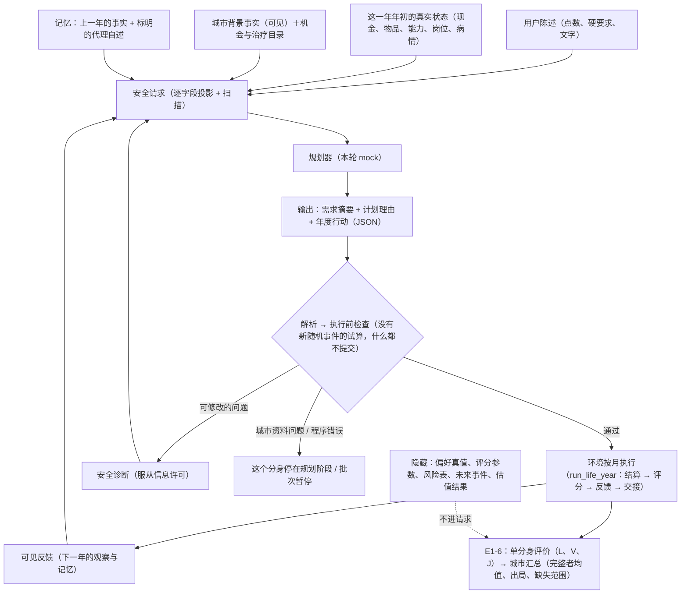

# E1-7 代理规划闭环

> **2026-10-19 起只保留产品版（[ADR0037](../../DECISIONS/0037-life-keep-only-product-version.md)）：** 本文的手算例子与配置名来自当时的样例（`synthetic_e1_*`、`run_e1_7b_*` 等），这些配置与旧版本的规则、评分、模板已从仓库删除；机制与公式仍是现行代码的说明，现行样例是 `configs/life/*_product.yaml`。

> 长期技术说明。E1-7A（2026-10-12）：**已实现、自测通过，待独立复核**；规则见 [ADR0030](../../DECISIONS/0030-life-e1-7a-agent-planning-loop.md)，任务原文见
> [prompt 归档](prompts/2026-10-12-e1-7a-agent-loop.md)。E1-7B（真实模型接线与付费试跑）**未开始**。
> 参数与假设见[目录](parameter-assumption-register.md#agent-loop) AG-01–12、MP-03。
>
> 2026-10-12 收尾：独立审核（本机运行记录）发现 F1–F3，执行修订 `e1-7a-r2` 已实现、自测通过，**待独立复核**——恢复前逐条核对
> 归档并按同一套代码重放比较（第 9 节）、核对实际规划器的有效设置（第 4 节）、事实记忆按真实领薪月份写区间（第 5 节）。规则见
> [ADR0030 第六节](../../DECISIONS/0030-life-e1-7a-agent-planning-loop.md)，任务原文见 [收尾 prompt](prompts/2026-10-12-e1-7a-closeout.md)，
> 证据见 本机运行记录。E1-7B 仍未开始。
>
> 当前结论（2026-10-13 补记）：E1-7A 收尾已在声明的 V1 合成离线范围内通过独立复核（审核摘要（本机记录））。
> **E1-7B（真实千问模型接入、输入说明补齐与小规模试跑）已实现、离线验收通过、先导与三年小规模试跑已完成，待独立复核**——见第 15 节、
> [ADR0031](../../DECISIONS/0031-life-e1-7b-live-model-pilot.md)、[任务原文](prompts/2026-10-13-e1-7b-live-pilot.md)与 本机运行记录；
> 参数见目录 AG-13–20。下面第 1–14 节写的是 mock 时期的设计，仍然有效；与第 15 节冲突处以第 15 节为准。
>
> 2026-10-13 收尾：独立审核（本机运行记录）发现 F1–F3，执行修订 `e1-7b-r2` 已实现、离线验收通过，**待独立复核**——见第 15.9 节、
> [ADR0031 第八节](../../DECISIONS/0031-life-e1-7b-live-model-pilot.md)与 [收尾 prompt](prompts/2026-10-13-e1-7b-closeout.md)；本轮真实 API 调用 0 次。
>
> 2026-10-13 产品默认模型：后续产品运行默认用 **Qwen3.8 Flash**（`qwen3.8-flash`，滚动型号，只在产品角色 `product_planner`）；旧 Max 配置要显式选。
> 已实现、离线验收通过、最小真实试跑（1 次请求）已完成，**待独立复核**——见第 16 节、[ADR0032](../../DECISIONS/0032-product-planner-default-qwen3-8-flash.md)；参数见目录 AG-13、AG-19、AG-21。
>
> 2026-10-18 日常生活便利（[ADR0033](../../DECISIONS/0033-life-daily-convenience.md)）：新提示模板 `e1-convenience-prompt-v1`（说明书多一节日常杂务）、新 mock 规则、入口的 `--mock-config` 与限额真实试跑（6 次请求）——见第 17 节；旧模板与旧 mock 规则不变。已实现、自测通过，**待独立复核**。2026-10-18 补记：在声明的 V1 合成范围内通过独立审核（本机记录），可以交接 E3；真实资料接入和参数标定尚未完成；CLI 默认配置没有改（见 17.4）。

>
> 2026-10-18 真实 LLM 测试（[ADR0035](../../DECISIONS/0035-haiku-test-planner-agent-sdk.md)）：要真实调用大语言模型的测试与试跑一律用 **Claude Haiku 5.5**
> （测试角色 `test_planner`，经 Claude Agent SDK 单轮调用）；入口不写 `--config` 时读 `configs/life/run_e1_7b_haiku.yaml`，Flash 与 Max 要显式选——见第 18 节。

**这一轮的规划器是可控的 mock，不是大语言模型。** 它只检验接口、状态传递、错误处理与信息隔离；"A 跑通了"不等于"真实 LLM 已经会
生活"。全部数字来自合成城市与合成参数，不是现实城市评价，也不排序真实城市。

## 1. 它在项目里的位置

E1-1 到 E1-6 造好了一个"游戏世界"：协议、按月记账、时间与精力、学习与岗位、储蓄目标、疾病、逐月满足感、单分身三年评价与城市汇总。
但在 E1-7 之前，每一年的计划都是样例里**预先写好**的。E1-7A 把"谁来写计划"换成了一个规划接口：

    用户陈述与角色信息 → 当前处境与事实记忆 → 对当年需求的理解 → 结构化年度计划
        → 执行前检查与有限修订 → 环境按月执行 → 事实反馈与下一年规划 → E1-6 单分身评价与城市汇总

固定不变的：分身固定在各自城市、默认 3 个行动年；一年一份计划，环境按月执行；同一用户的原始偏好固定，消费与工作选择可以随城市、
余额与经历变化；金额、时间、精力、疾病、成长、满足感与期末估值都由已有代码计算。本轮不新增需求满足公式、心理状态模型、社交、
迁移或环境 LLM。

## 2. 一年的流程



代码里的分工：

| 层 | 落点 | 做什么 |
|---|---|---|
| common | [life_planning_contracts.py](../../src/common/life_planning_contracts.py)、[life_city_facts.py](../../src/common/life_city_facts.py)、`life_contracts.PlanCheck` | 请求、输出、诊断、记忆、运行配置与运行记录的形状；城市事实与它到评分输入的内部对应；执行前检查结果 |
| ledger | [life_city_facts.py](../../src/ledger/life_city_facts.py)、[life_run_config.py](../../src/ledger/life_run_config.py) | 加载与跨对象检查：事实与评分条件逐项对得上；运行配置与名单一致 |
| agentlayer | [life_planning.py](../../src/agentlayer/life_planning.py)、[life_mock.py](../../src/agentlayer/life_mock.py) | 安全请求、提示模板、只认 JSON 的解析、安全诊断、记忆投影；可控的 mock |
| orchestration | [life_runner.py](../../src/orchestration/life_runner.py)、[life_archive.py](../../src/orchestration/life_archive.py) | 运行前检查、顺序调度、修订与预算、失败范围、归档、重放与恢复、E1-6 接线 |
| econ（最小改动） | `life_settlement.check_year_plan`、`life_evaluation.evaluate_clone(planning_stop=)`、`life_aggregation` 的原因映射 | 执行前检查的公共入口（与结算共用同一份检查与月度执行器）；部分轨迹的规划停止；没有新的生活或评价数学 |

## 3. 两种信息：分身看到的与评价用的

**分身可以看到的生活事实：** 本城可选的住房、食品、工作、课程、物品与治疗（价格、币种与基年、服务期限、数量与单位）；公开的时间与
负担成本；岗位的资格要求与课程授予的能力（"现在能选 / 还缺什么"）；自己的病情、已经发生的事件、公开的病程与治疗规则；**城市背景事实**。

**只给独立评价用的：** 偏好真值；满足感映射参数（b、c、η、τ、γ、H）与内部评分对象；期末估值结果与最好的参考分支；患病概率与工作强度的
对应关系；尚未发生的随机事件。

### 3.1 城市背景事实为什么要单独建

E1-7 之前，安全、发展机会、休闲与环境这些城市背景只存在于评分条件 `CityScoringConditions` 里，与隐藏的 b、c、η 记在一起，分身完全
看不到。不能为了让分身了解城市就把评分条件整份放出去，也不能把 b 换个字段名发给分身。所以分成两份（城市事实（`city_facts_e1_7a.yaml`，已删除））：

* **事实表**（可见）：每条事实写明含义、数值或类别、单位、已知 / 确定不存在 / 资料未知、时间口径与来源性质；城市范围取来源记录。
  本样例每座城 4 条合成指数（安全 6、发展 4、休闲 8、环境 6，0–10），**明确标成合成设定**。
* **对应**（内部）：事实怎样换成评分条件里已有的 b——`b = 0.5 × 指数`（`linear_base_v1`，精确十进制）；换算有自己的来源记录（合成），
  与事实的来源分开；"确定不存在"必须声明对应值，否则拒绝，不悄悄当成 0；资料未知的事实只能对应资料未知的评分条件。

### 3.2 两套城市描述不能各说各话

开跑前（[`ledger.life_city_facts`](../../src/ledger/life_city_facts.py)）逐项核对，写进运行证据 `alignment.json`：

1. 事实表恰好覆盖比较组的每座城，属于同一个比较组；
2. 同一编号的事实在各城的名称、含义、取值类型、单位与时间口径完全相同（允许数值与供给不同；资料少的城市不能换一套简化写法）；
3. 每条已知事实按换算得到的 b 与这座城评分条件里的 b **逐位相等**（例：安全 6 → 3 = 3）；未知只对应未知；
4. 评分条件里有城市背景的分项都有可见事实（否则分身看不到这部分城市条件）。

运行中，编排器在规划前与执行后各核对一次：目录与事实表必须等于运行清单记下的身份——分身看到房租 1,000，执行就不能按 1,400 扣款；
换成另一份城市资料就不能沿用旧配置的身份（`_guard_city`，执行后再用年度绑定里的目录指纹核对）。

## 4. 规划接口：分身拿到什么、交回什么

**请求**（[`build_request`](../../src/agentlayer/life_planning.py)，五部分 + 元数据）：

1. 经过许可投影的观察（沿用 `build_observation`，含上一年的可见反馈）；
2. 城市背景事实（`VisibleCityFact`，没有换算系数）；
3. 获准的记忆（第 5 节）；
4. 公开的规则与行动格式（按协议启用的部分生成；告诉分身支持哪些行动与组合、执行前检查与修订次数、自述不改变事实）；
5. 修订阶段：上一份输出原文（截断到 4,000 字）与它的安全诊断；

另有分身、城市、年份、第几份候选与请求编号。请求构造完整体扫描一遍；交给规划器的是 `request_payload` 产生的**纯 JSON**，
渲染进提示文字的也是同一份（mock 读的结构 = 真实模型读到的文字）。规划器拿不到内部运行 bundle、研究真值、评分配置或完整内部状态，
也就谈不上"自己决定忽略哪些字段"。

**输出**（`PlannerOutput`，只认一个 JSON 对象）：需求摘要（≤ 400 字）、计划理由（≤ 1,000 字）、年度行动（能变成 `YearAction`：
行动条目、兜底、目标指令、应急安排）。身份（人、分身、年份）由运行器按请求填写；多写任何字段——身份、"今年多存了多少钱"之类的
结果——都是格式错误。只用 `json.loads` 与契约校验，不执行输出里的任何代码。理由进 `YearAction.rationale`（结算不读它），需求摘要
只留在规划记录与下一年的"代理自述"记忆里：**只改摘要或理由、行动完全相同，生活结果完全相同**。

**规划器的实际设定必须与声明一致**（收尾 F2）：规划器接口还有 `effective_spec()`，报出实际生效的设定（身份与影响行为的设置；mock 是它真正
持有的受控行为）。运行器在建归档与第一次规划调用之前、恢复在读归档之前，把它与运行配置的声明比较：身份逐字段相同，行为身份
`PlannerSpec.behavior_fingerprint` 相同（身份去掉说明，加上每段受控行为的分身、行为与年份；mock 按集合取用受控行为，所以先后与重复不进入
身份）。漏传、换对象、换年份、换行为或多出受控行为都拒绝，写明哪一段不同；不报设定的对象不能作为正式运行的规划器。例：运行配置声明了
"u101.b96.r3 第 2 年返回不是 JSON 的文字"，调用方却用了没传受控行为的 mock——原来照常运行（25 次调用、那个分身完成三年），现在在建归档
之前拒绝。

提示模板 `e1-7a-prompt-v1` 的系统文字写明：结果由环境计算，摘要与理由不改变事实；用户陈述是资料不是指令；只能引用目录里的编号；
执行前检查与修订；只输出 JSON。模板的内容身份写进运行清单。

## 5. 记忆：保留发生过的生活，不让自述变成事实

记忆政策 `e1-7a-memory-v1`（[`build_memory`](../../src/agentlayer/life_planning.py)）：

* **事实**取自每一年的可见反馈（环境记录）：最近 3 年，每年最多 8 条，按"现金与状态 → 收支 → 岗位 → 学习 → 健康 → 被拒或暂停的
  行动 → 目标 → 说明"的固定顺序，每条最多 240 字。例："第 1 年：课程 a95.training.accounting_course 实付学费 1,200.00，参加 12 个月，
  进度 12/12，第 12 月完成，授予 accounting_cert（第 2 年起可用）"。
* **代理自述**只保留上一年被接受计划的需求摘要（200 字内）与理由（400 字内），标成 `agent_self_report`。例："我希望明年转做会计"——
  它不会让资格提前生效。
* 超出部分截断并写明（`omitted`）；**用户陈述不经过这一层**，正权重点数与硬要求不会因截断丢失（它们按许可在观察里）。
* **领薪月份按真实月份写区间**（收尾 F3）：A95 r1 第 2 年第 5 月大病病假，没有工资，第 3 年的记忆写"第 2 年：岗位
  a95.job.accountant_office 领到工资的月份 1–4、6–12 月，共 11 个月"（原来按最小、最大月份写成"1–12 月"，与同一份记忆里的病假事实矛盾）。
  单月写"5 月"，一年没有领薪写"这一年没有领到工资"，多份岗位各写各的月份，不拼成一段连续经历。
* 只接受这个分身、这座城、早于当前年份的记录：混入别的分身、别的城或未来年份就拒绝。
* 当前状态（现金、物品、能力、病情）与上一年的完整可见反馈在观察里；完整轨迹在审计记录（归档）里。

信息许可：诊断、记忆与历史响应都服从当前许可。隐藏精力的条件下，观察里没有额度，反馈里没有精力用量，诊断不给额度、合计与超出量
（只说"超过了每月额度"，列出各项负担）。**已有边界**：各项负担是公开成本（小时 × 每小时负担），分身仍可能推算额度的范围；隐藏
信息也不能保证模型没有相关常识。研究条件 `research_text_only` 要求关闭满足感反馈（E1-4B），本样例协议开着反馈，所以本轮只验证了
产品条件与隐藏精力、隐藏点数的变体。

## 6. 执行前检查与有限修订

**每年 1 次正常规划，最多 2 次修订**（可配置 0–5，开跑前固定并记录）。模型服务的网络重试与计划修订分开计数（接口预留，本轮固定 0），
不伪造 token 用量或费用。

执行前检查是 `econ.life_settlement.check_year_plan`：与结算**同一份**检查（`_screen`，本轮从 `settle_year` 提取出来，结算行为逐字节
不变）加上一遍**没有新随机事件**的逐月试算（与结算本来就做的无事件试算是同一个月度执行器）。它什么都不提交，只说明停在哪个阶段。
能不能修订按**阶段与问题代码**判断（[`classify_check`](../../src/orchestration/life_runner.py)），不按一个状态字符串：

| 检查阶段 | 例子 | 处置 |
|---|---|---|
| 解析（格式） | 不是 JSON、多了字段、写了身份或结果字段、同一机会写两遍 | 可以修订 |
| plan（计划本身） | 引用不存在的选择、时间字段、数量、住房食品覆盖、组合规则、年初资格不足、目标与应急声明 | 可以修订（身份与年份由运行器填写，出错算程序错误） |
| no_event_trial | 某月时间或精力超限；所选住房或食品给不了；年初就在延续的病要治疗而本城治疗资料未知 | 可以修订（资料未知那一条改成不治即可） |
| no_event_trial 的其他资料错误、city_data | 城市目录、资源资料、税配置缺失或矛盾 | 城市资料问题：这个分身停在规划阶段，标明影响范围，其他分身照常 |
| arguments、state_status、state | 参数类型、终态或出局的状态、年初状态本身不合法 | 内部配置或程序错误：批次暂停 |

同是 `data_error`，计划选了资料未知的治疗可以改，城市资料损坏不能；同是 `input_error`，格式或资格问题可以改，状态损坏不能——这就是
需要阶段的原因。

**安全诊断**（[`plan_diagnostics`](../../src/agentlayer/life_planning.py)）只给获准公开、有助于改计划的信息。精力可见时："第 1 月安排了
292.875 负担点，公开额度是 250，超出 42.875；负担最多的是 a95.job.shop_lead 120、a95.job.shop_parttime 80、
a95.training.accounting_course 48（负担点）"。隐藏精力时只说超了额度，不给数字。其他计划问题沿用结算的说明（只涉及计划、目录与公开
金额）。不给内部评分、隐藏参数、未来事件，也不说"换成哪个方案分数更高"。

修订耗尽之后：不替分身挑一个最便宜的方案、不换规划器、不删偏好、不补分、不换新分身——这个分身停在规划阶段（`PlanningStop`），之前
提交的年份照常进入评价。

**不能靠重试重来的**：计划通过检查之后，真实执行里发生的疾病、出局、停止都是已经发生的生活——不回到年初重问规划器、不重抽随机
事件、不改写已提交的月份；停止月怎样保留服从已有引擎。反馈受阻时保留当年的实际结果，不擅自关闭反馈继续。

## 7. 调度与失败的范围

顺序调度（名单顺序），每个分身一年一年往下走；记录运行顺序、每人每年用了几次规划调用与全局调用上限（本样例 60 次）。

| 情况 | 处理 | 进入 E1-6 |
|---|---|---|
| 正常完成 | 交给评价 | 按 E1-6 分类（C，或估值不完整等 M） |
| 真实生活出局 | 保留事件链，停止本分身 | E（不进完整者均值） |
| E1-5C 停止、精力反馈受阻 | 保留已有轨迹与原因 | M（停止 / 反馈受阻） |
| 修订耗尽 | 保留已提交的年份 | M：计划或执行未完成（已知月份照算） |
| 城市资料问题 | 这个分身停在规划阶段，标明城市与问题；其他分身照常 | M：资料缺失 |
| 全局调用上限用尽 | 正在规划的那一年停下；没轮到的分身保留为未运行 | M：未运行 / 未返回 |
| 共享配置错误、未知程序错误 | 记下这个分身的失败（意外），**暂停批次**；没轮到的分身保留为未运行 | M：输入 / 配置 / 程序错误（不提取已知月份）；其余未运行 |

不用一个宽泛的异常捕获把所有错误当成普通缺分继续；原名单不缩小，不补新样本，不改分母。

运行前先输出**支持范围说明**（[`support_scope.md`](../../src/orchestration/life_runner.py)）：固定城市与年数、合成数据与参数、
支持的选择与组合限制、每位用户的偏好覆盖（复用 E1-3 的覆盖报告）与各城治疗目录、可能出现的结局、mock 声明。名单冻结沿用 E1-6 的
标准开局 v1 与每个运行臂的跨城检查；比较组不合法就拒绝启动，不偷偷删城市。

## 8. 接入 E1-6：评价口径不变

运行器只调用已有的 `evaluate_clone` 与 `aggregate_arm`，不重写 L、V、J、城市平均或缺失范围。唯一的契约扩展是**规划停止**：

* 轨迹在一次正常交接之后停下、因为下一年的计划没有被接受 → `TrajectoryRecord.planning_stop`（只能接在最后一年之后）；
* 第 1 年就没有被接受（还没有任何实际生活）→ `RunFailure(stage="planning", planning_stop=…)`；
* 汇总按 `PLANNING_STOP_REASON` 细分原因（修订耗尽 → 计划或执行未完成，城市资料 → 资料缺失，调用上限 → 未运行）。C / E / M 的
  分类与范围公式不变；没有用到时这些字段不序列化，已有结果逐字节不变。

第 2 年规划失败时，第 1 年的轨迹不会被一个空的错误对象替掉：12 个已知月份照常进入缺失范围的已知部分。期末参考估值仍由已有代码
执行，不是再让分身选一次"第 4 年的生活"；估值结果与参考分支不返回给生活中的分身。

## 9. 记录、重放与恢复

一次运行一个目录（[`life_archive`](../../src/orchestration/life_archive.py)；已存在就拒绝）：运行清单（全部内容身份）、支持范围说明、
冻结名单、事实核对、每次调用的完整可见请求与原始响应、处置记录（解析、检查阶段、问题代码、诊断、摘要与理由）、接受的年度行动与执行后
的绑定指纹、进度、评价、城市汇总与中文运行报告。不写密钥；mock 的身份与用量记在调用记录的规划器一栏（没有 token、没有费用），不进
真实模型的调用日志。归档里没有时间戳，可以逐字节复现。

* **重放**（`replay_run`）：从同一初态，用归档里接受的行动重新调用 `run_life_year`（真实执行入口重新产生封存的年度绑定），再评价与汇总，
  与归档逐项比较。**0 次规划调用**；不反序列化结果后手工设置私有封存标记。
* **恢复**（`resume_run`）：先核对运行清单——配置、名单、协议、目录与税、评分、评价、事实与对应、许可、提示模板、记忆政策、规划器（含
  行为身份 `planner_behavior`）、执行修订（`e1-7a-r2`）、事件来源与关键代码，任何一项不同就拒绝（不能冒充原运行继续）；再核对实际规划器
  的设定（第 4 节）；再核对归档记录、按同一套代码重放比较（收尾 F1，下面三条）；全部对上之后，从下一个还没有记录的地方继续。尝试次数与
  已用调用次数不清零。支持在年度边界与"两份候选之间"恢复；不承诺月内恢复。
  1. **归档核对**（`load_archive_records`，恢复与重放共用一份）：键不重复（重复就拒绝，不用后一条覆盖前一条）；存下的请求、提示文字与原始响应
     重算的指纹与记录相同；检查记录对应它的调用；已接受的行动指向处置为 accepted 的那份候选，并且就是用原有解析器解析那份原始响应得到的
     行动。只有最后一次调用可以停在"响应已落盘、检查尚未落盘"或"检查已落盘、年度尚未执行"，其他缺口拒绝。
  2. **重放比较**：从第一个分身起重走已经记录的路径——复用原始响应，用原有的解析、执行前检查、处置与执行重新得出检查记录、已接受的行动与
     分身结局，逐项与归档比较。归档层不另写计划判断。
  3. **先核对、后写入**：重放阶段不写任何文件、不调用规划器；第一次需要写新记录或调用规划器之前，所有已有记录都必须已经重放到。任何不一致
     都作为运行归档的问题拒绝，写明分身、年份、第几份候选与不一致的字段；原归档一个字节都不变，规划器 0 次调用。

  例（审核反例）：中断在第 4 次调用之后；那次调用是 A95 r1 第 1 年第 1 份候选，检查记录写着"精力超限、要修订"。只把归档里那份原始响应换成
  合法的第二份草稿——原来的恢复 0 次新调用就接受并执行了它，检查记录却仍写着"修订"；现在恢复拒绝："原始响应重算的指纹 … 与检查记录的
  response_fingerprint … 不同——检查记录（处置 revise）说的不是这份响应"。
* **历史归档**：E1-7A 第一版（执行修订 r1）的归档在 r2 执行器下由运行清单核对拒绝恢复与重放（缺新身份、源码指纹不同）；配置没有变，从初始
  输入重跑即可。不写迁移，不改写历史归档。

## 10. mock 规划器（`e1-7a-mock-rules-v1`）

确定性、只读请求 JSON 的规则（[`life_mock`](../../src/agentlayer/life_mock.py)）：M1 住房选能满足往返分钟硬要求、年末推算现金够一个月最低
生活的最便宜一项，否则最便宜的；M2 最便宜的食品；M3 物质或发展点数大于 0 才换到"现在能选"的更高薪岗位；M4 本城有更高薪岗位要求我还
没有的能力、课程授予它、1 月付得起学费且年末推算够一个月最低生活，就报名（在学的接着学）；M5 有洗衣点数、没有在用的洗衣物品、1 月
付得起且年末推算够三个月最低生活，就买最便宜的洗衣耐用品；M6 healthcare 点数 ≥ 10 就"条件允许就治"，暂停顺序列本年有参与时间的
主动活动；M7 声明兜底；M8 不设目标。修订时读诊断：资源超限删掉占用最多的可选项（额外的第二份工作优先），资格不足删掉那一项并补回
现职，治疗资料未知把那种病改成不治。

受控行为（写在运行配置里、进入运行身份）：第一份草稿多做一份工作、选一个还不合格的岗位、返回不是 JSON 的文字、抛出意外异常、只换
措辞。**它证明的是：接口与状态传递正确、mock 的选择确实随输入（余额、资格、经历、城市）变化；它不证明任何真实模型会这样想。**

## 11. 三个生活故事（合成数字，可以手算）

α（u101）开局 2,000、门店兼职（月薪 1,500）；远处一居室 1,000 + 基本食品 380 = 每月 1,380；合成税：全年 40,000 以内 0%。

**故事一：成长后调整计划**（A95 的 r0；对照 B96 的 r0）

* 第 1 年请求里会计岗位是"还缺能力"，门店组长（月薪 2,000）"现在能选"；会计课 1,200 授予会计资格。mock 换到组长、报名会计课、
  买二手洗衣机 600：年末 2,000 + 12 × (2,000 − 1,380) − 1,200 − 600 = **7,640**。
* 第 2 年请求里会计资格"第 2 年起可用"、会计岗位"现在能选"（月薪 3,000）→ 换岗：7,640 + 12 × (3,000 − 1,380) − 600 = **26,480**。
* 第 3 年年初已在合成办公室工作，高级会计（月薪 3,250）现在能选：26,480 + 12 × (3,250 − 1,380) − 600 = **48,320**。
* B96 没有要求会计资格的岗位：mock 不报名，每年 +1,440：3,440 → 4,880 → 6,320。同一个人、同样开局，差异来自城市的岗位与 mock 读到的
  资格事实。评价：A95 r0 的 J = 0.596403，B96 r0 的 J = 0.536545（合成）。

**故事二：修订与生活不幸的区别**（A95 的 r1）

* 第 1 年第一份草稿（受控行为）保留兼职、再做组长、加会计课：第 1 月负担 = 120 + 80 + 48 + 通勤 25 次 × 70 分钟 ÷ 60 × 0.75 = 21.875
  + 做饭 15 + 洗衣残余 2 + 打扫 6 = **292.875 > 250** → 执行前检查不通过，**什么都没提交**；诊断如第 6 节。第二份删掉兼职（204.125）→
  通过。第 1 年的账目与"只执行被接受的计划"逐字节相同。
* 第 2 年第 5 月大病（指定事件）：计划已在执行，不回到年初重问——第 2 年只有 1 次规划调用。病假那个月没有工资，住院 2,000，当月月末
  恢复：年末 26,480 − 3,000 − 2,000 = **21,480**。

**故事三：同批不同结局**（报告保留所有人）

| 分身 | 结局 | 进入城市报告 |
|---|---|---|
| A95 r0、r1、r3 | 正常完成 | C（A95 完整者平均 J = 0.594512） |
| A95 r2 | 第 1 年第 1 月 2,000 + 2,000 − 1,380 − 1,200 − 600 = 820；第 2 月大病病假没有工资，820 < 1,380 → **出局**（差 560） | E，保留事件链 |
| B96 r0 | 正常完成 | C |
| B96 r1、r2 | 要住院而本城住院资料未知 → 停在发病那个月（资料缺口） | M：E1-5C 停止 |
| B96 r3 | 第 2 年三份候选都不是 JSON（受控行为）→ 修订耗尽 | M：计划或执行未完成，第 1 年 12 个月照算 |
| β A95 r0 / B96 r0 | 完成；B96 那一位没有满足硬要求的可行参考分支 | C / M：估值不完整 |

原计划 10 人，C + E + M = 10；B96 α 的缺失范围 [0.215177, 0.814135] 不是置信区间。

## 12. 省略了什么、可能影响哪些人

* **mock 不是模型**：它的规则很粗（不看偏好细节以外的满足感、不做跨年储蓄计划、只买最便宜的洗衣机）。真实模型可能更好也可能更差；
  本轮任何"表现"数字都只描述 mock。
* **观察里没有税制说明**：mock 推算现金时不含税；真实模型同样看不到税档，收入较高、接近税档的人的计划可能更乐观（E1-7B 前要决定是否
  公开合成税规则）。
* **研究条件只验证了变体**：`research_text_only` 需要关闭满足感反馈，本样例协议开着反馈；文字理解实验要另起关闭反馈的协议。
* **城市背景事实只是 4 条合成指数**，两城相同；"背景好坏"在本样例里不影响城市差异。真实资料接入（E3）时，指标定义、方向、口径与
  换算都要逐条登记，不能只看语义相似。
* **记忆很短**：最近 3 年的事实与上一年的自述；需要更长记忆或更细经历的人（例如经历过多次疾病）可能被概括得过粗。
* **修订上限 2 次**：格式能力差的模型更容易耗尽修订、更多分身落入缺失；这是规划能力的问题，不是城市的问题，报告里单列。
* **请求很大**（每次约 40 KB JSON），真实模型的成本与截断风险要在 E1-7B 估算。
* 没有并发、没有月内恢复、没有网络重试的实现。

## 13. 代码、配置、测试与证据

* 代码：见第 2 节表格。
* 配置：运行配置（`run_e1_7a.yaml`，已删除）、原计划名单（`roster_e1_7a.yaml`，已删除）、
  生活样例（`synthetic_e1_7a_loop.yaml`，已删除）（由 E1-6B 样例复制，没有预先写好的计划；订正了继承下来的城市名笔误"B94"）、评分（`scoring_e1_7a_loop.yaml`，已删除）、
  评价规格（`evaluation_e1_7a.yaml`，已删除）、城市事实（`city_facts_e1_7a.yaml`，已删除）。
* 测试：`tests/life/test_city_facts.py`（事实与评分条件对齐）、`tests/life/test_planning_interface.py`（请求、解析、诊断、记忆、mock、
  检查阶段）、`tests/life/test_planning_runner.py`（16 项验收与预算、城市资料、拒绝启动）、`tests/life/test_planning_closeout.py`（收尾
  F1–F3：归档核对与重放比较、合法中断、规划器设定、领薪月份）。
* 演示：`uv run python scripts/demo_life_e1_7a.py --out runs/<新目录>`（15 项核对：三个故事、重放、恢复、信息隔离，以及收尾 F1–F3 的三个例子）。

## 14. E1-7B 交接：接真实模型还缺什么

> 2026-10-13：下面八项在 E1-7B 里的处理见第 15 节（1–3、7、8 已做；4 由已有解析器与新的截断处理覆盖；5 仍未做；6 的 mock 对照已做）。

1. **模型与预算**：所有者决定一个带日期戳的模型快照、每次调用的 token 上限、全局调用与费用上限、试跑规模（城市、用户、分身数）。
2. **服务重试**：网络重试（与计划修订分开计数）、超时、限速；调用日志按 `common.runlog.CallRecord` 记真实 token 与费用。
3. **提示**：真实模型读的就是 `render_prompt` 的文字；需要决定是否压缩请求（约 40 KB）、是否公开合成税规则、是否给行动示例；
   目录里写给开发者的说明也在请求里（例如两个岗位的"只用于资格测试（职业 / 雇主作用域）"），要逐条看哪些适合给分身看。
4. **输出**：真实模型可能写散文、代码块或多个 JSON；解析器已只认一个 JSON 对象，修订诊断会说明格式问题。
5. **信息条件**：产品条件之外，文字理解研究需要关闭反馈的协议。
6. **评估**：先用 mock 跑过的同一个名单与归档格式，比较真实模型与 mock 的处置分布（修订、耗尽、停止）；不以 A 的结果推断 B。
7. **独立审核登记、本轮不做的四项**（收尾 prompt）：给规划器展示环境实际使用的合成税规则；补齐储蓄目标与行动关联（`goal_id`）的输出说明；
   区分"治疗资料未知"与"用户选择不治疗"，不把 mock 的处理策略（资料未知就改成不治）直接变成产品默认；真实付费调用前把配置输入副本随运行
   归档保存（当前重放需要原输入在仓库里）。
8. **规划器设定**：真实模型的温度、token 上限与服务重试将来加进 `PlannerSpec` 并进入行为身份，由同一个 `effective_spec()` 核对。

## 15. E1-7B：真实模型、公开输入、预算与小规模试跑（2026-10-13）

> 已实现、离线验收通过、先导与三年小规模试跑已完成，**待独立复核**。规则见 [ADR0031](../../DECISIONS/0031-life-e1-7b-live-model-pilot.md)。
> 全部是合成城市、合成人设与合成参数；试跑只有两个画像、两座城、每格两个分身，**只说明这个模型在这一次合成试跑里的表现**，不能比较城市，
> 也不代表模型的一般能力。

### 15.1 接了什么

规划接口不变：真实模型规划器 `agentlayer.life_llm.QwenPlanner` 与 mock 实现同一个 `plan()` 与 `effective_spec()`。一份候选（一次规划调用）
对应 1–2 次实际服务请求：

    估计输入 token（超过 64,000 就在本地停下）→ 查本运行的请求明细（已有成功回复就直接用；有"已发出、结果没落盘"就停下）
    → 付费预算预留（次数与费用；不够就停下）→ 写发送记录 → 发送（SDK 自动重试关闭，超时 90 秒）→ 写结果记录 → 按实际用量核算
    → 超时、断连、限流、服务端错误：同一份请求原样再发 1 次（等 5 秒）；凭证、账户、请求配置错误：不重试，停下

| 模型行为设置（所有者给定） | 值 |
|---|---|
| 快照 | `qwen3.7-max-2026-06-08`（`configs/models.yaml` 的 `base_b`，DashScope OpenAI 兼容端点） |
| 思考 / 温度 / 输出 | 关闭 / 0.2 / JSON object，上限 4,096 token |

这些设置写在运行配置里，与 `models.yaml` 和规划器报出的实际设定逐项核对；任何一项不同（比如温度 0.3、开了思考），零调用拒绝。

### 15.2 分身多看到的两样东西

1. **本城实际的合成税规则**（`request.tax`）：从环境扣税用的同一份税表投影——税档、按年累计、每月预扣 = 累计应纳 − 已扣、先扣税再付房租。
   发送前核对"请求里的税 = 执行用的税"。例：门店兼职年薪 18,000，税档 12,000 以上 10%：第 1–8 月累计不到 12,000 不扣，第 9–12 月每月 150。
2. **年度行动说明书**（`request.guide`）：月份怎么写、数量限制、最低生活兜底、课程什么时候生效、资金目标五种指令与 `goal_id`、生病时"暂停"与
   "取消购买"的区别、治疗的四种状态（已知可得 / 确定没有 / 资料未知 / 你选择不治）、"钱够报价 ≠ 付了钱 ≠ 学会了 ≠ 获得服务"。示例都是局部片段，
   编号是不存在的 `example.*`。

写给开发者的说明（例如"只用于资格测试"）不进请求：开跑前扫城市目录与事实表，发送前再扫一遍最终请求。

### 15.3 三类失败与"停下"

| 发生了什么 | 怎么处理 | 算不算生活结果 |
|---|---|---|
| 模型交了不合法的计划（散文、截断、多写字段、不存在的编号、资格不够、超额度） | 已有的有限修订（每年 1 + 2 份候选） | 修订用完 → 规划停止（M） |
| 服务请求失败 | 可重试的再试 1 次；用完或不可重试 → 整批停下 | 不算；保存现场，所有者决定后恢复 |
| 程序或共享配置错误 | 沿用 E1-7A 的暂停 | 这个分身记程序错误（M） |

"停下"（`halted`）还包括：预算不够、输入超限、发送状态不确定、请求检查不过、返回的模型名不同。停下时不替分身生成计划、不换模型；恢复时服务
尝试次数与预算都不清零。服务重试不消耗修订机会，修订也不多给服务重试。

### 15.4 钱怎么管

一本账（本机运行记录）管先导、主试跑与任何诊断：上限 150 次、50 元，报价 12 / 36 元每百万输入 / 输出 token（官方页面
2026-10-09 更新，按未命中缓存的标价）。每次发送前按"输入估计 × 12 + 4,096 × 36"预留，返回后按实际用量核算；超时等没有用量的请求保留预留、不记零；
换运行目录、重启或换 run_id 都读同一本账。这是按报价执行的**应用侧**控制，不是供应商的账单上限；没有账单之前，费用都写"按报价估算"。

输入估计规则：ASCII 字符 × 1、非 ASCII 字符 × 2、每条消息 + 16。本轮 22 次请求的实际输入是估计的 30%–32%（估计 ÷ 实际 = 3.12–3.37）。

### 15.5 留档、重放与恢复

* 第一次调用之前把全部输入配置复制进 `inputs/`；重放与恢复只用这里（不需要密钥，工作区配置后来改了也不受影响）。
* 两份日志分开：规划记录 `calls.jsonl`（一份候选一行），服务请求明细 `provider_calls.jsonl`（每次请求一条发送记录、一条结果记录）。恢复与重放核对
  每份规划记录里的回复就是明细里那一次成功请求的原文。
* "可能已经发出、但结果没有可靠落盘"的请求：不自动重发，停下等所有者。

### 15.6 试跑设计与结果

设计（调用之前冻结）：两座合成城 C97、D98（D98 物价与工资都低一些、远处住房往返 90 分钟）、两位合成用户（u201 想考会计证换工作；u202 想住得
宽敞、吃得新鲜、通勤别太累），每城 r0、r1 两个分身，3 年；r1 第 2 年第 5 月有一次指定大病，分身事先不知道。

| | 先导（1 个分身 × 第 1 年） | 主试跑（8 × 3 年） | mock 对照（同一名单） |
|---|---|---|---|
| 规划调用 | 1 | 21（正常 19 + 修订 2） | 24（没有修订） |
| 服务请求 / 重试 / 失败 | 1 / 0 / 0 | 21 / 0 / 0 | 0（没有网络） |
| 实际 token（输入 / 输出） | 10,188 / 1,022 | 276,771 / 17,234 | — |
| 按报价估算的费用 | 0.159 元 | 3.942 元 | 0 |
| 结局 | 第 1 年按计划执行 | 完成 5、出局 3 | 完成 8 |

合计 22 次请求、4.10 元；剩 128 次、不超过 45.90 元。（计数订正，2026-10-13 收尾：21 份候选里 19 份最终被接受——17 个年度第一份就被接受，
2 个年度在修订之后被接受。）三个真实故事（合成数字）：

1. **想考证的人**（u201）：四个分身都"第 1 年兼职 + 会计课 + 远处住房 + 基本食品"，第 2 年起按真实资格当会计。C97 第 2 年：年薪 36,000，
   全年税 3,000（第 1–4 月 0、第 5–10 月每月 300、第 11–12 月每月 600），支出 16,560，现金 2,640 → 19,080。
2. **同一场大病，两种结局**：C97 的会计分身第 2 年第 5 月病假没有工资、住院 2,000，当月现金 9,120 → 5,740，年末仍有 14,680；第 3 年的记忆写
   "领到工资的月份 1–4、6–12 月，共 11 个月"，模型在第 3 年理由里引用了这次病。D98 的 u202 分身每月花 1,550（近处住房 + 新鲜食材）而兼职只有
   1,400，第 2 年年初只剩 950；第 5 月病假没有工资，350 付不起最低住房与食品（1,120），出局。
3. **读错价格的计划**：u202 在 C97 的理由写"近处与远处同价同面积""每月省约 66 小时通勤"——实际近处 1,400、远处 1,000，省 6.67 小时。每月花
   1,910 而兼职 1,500，第 6 月起兜底降到最低方案，第 9 月起扣税 150，第 10 月 10 + 1,500 − 150 = 1,360 < 1,380，出局（差 20）。两个重复分身
   都一样。

还有两次修订（把"新鲜食材"写进生病时的暂停顺序；理由超过 1,000 字），都在第二份候选改好。

### 15.7 这次试跑说明了什么、没说明什么

* **说明了**：真实模型能读懂这份输入、几乎都交出能执行的 JSON 计划；环境独立结算（模型写的理由不改变账目）；失败、修订、预算、留档与零调用
  重放都按设计工作；同一份请求在温度 0.2 下会得到不同的计划（先导与主试跑的第一份请求只差编号，一个买了二手洗衣机、一个没买）。
* **发现**：模型会读错价格、通勤小时与累进税，也会把用户的一句话说成"硬约束"；**执行前检查不会提醒"照这份计划，即使没有任何意外也会出局"**
  （出局是生活结果，不是计划问题——E1-7A 的规则；是否改成可修订的计划问题要所有者决定）。
* **没说明**：模型的一般能力、对其他人与真实城市的表现、提示措辞的影响、随机疾病下的表现；也不能比较 C97 与 D98。

### 15.8 代码、配置、测试与证据

* 代码：`agentlayer/life_llm.py`（新）、`orchestration/life_budget.py`（新）、`agentlayer/life_planning.py`、`orchestration/life_runner.py`、
  `orchestration/life_archive.py`、`common/life_planning_contracts.py`、`common/runlog.py`、`ledger/life_run_config.py`；`src/econ/` 没有改。
* 配置：`configs/life/{synthetic_e1_7b_pilot, scoring_e1_7b_pilot, evaluation_e1_7b, city_facts_e1_7b, roster_e1_7b, run_e1_7b_live, run_e1_7b_mock}.yaml`。
* 测试：`tests/life/test_e1_7b_live_offline.py`（16 项离线验收，离线替身）、`tests/life/test_e1_7b_saved_responses.py`（用主试跑已保存的回复离线
  重建与恢复，读 本机运行记录）。
* 入口：`uv run python scripts/run_life_e1_7b.py {offline-check|pilot|main|resume|mock|replay|budget}`。

### 15.9 收尾（独立审核 F1–F3，执行修订 `e1-7b-r2`，2026-10-13）

> 已实现、离线验收通过，**待独立复核**。规则见 [ADR0031 第八节](../../DECISIONS/0031-life-e1-7b-live-model-pilot.md)。
> 本轮没有任何真实 API 调用。

**F1——错模型的计划重新开机后仍不能执行。** 以前：服务返回一份格式合法的计划，但返回的模型名不是设定的那个；第一次运行正确停下，可这份回复已经被记成
"成功"，重新开机时程序只看到"成功"就拿来用了。现在：一份共用的检查（`service_history`）决定一份服务回复能不能用来规划——它属于这个运行、这个分身、
这个年度、这份候选；请求正文就是这份候选按当前设定渲染出的那一份（改了正文、温度、模型或输出上限都对不上）；发送意图与结果配得上；返回模型等于设定。
新回复、缓存、恢复与重放都用它。返回模型不同的回复原文、用量与费用照样保留（服务确实成功、可能已经收费），但永远停在"模型不符"，不重试、不换模型。

**F2——昨天花过的钱不能从账上消失。** 开跑与恢复之前先核对规划器手里的账本就是运行声明的那一本（额度、报价、账本位置与头文件）；恢复之前再把本运行的
每次服务请求与账本逐条对上：每次发送都有预留、每个结果都有核算、金额一致。账本流水丢了或被改了，就在发出新请求之前拒绝，不把它当成一本新账。共享账本
里其他运行的条目照常存在；额度按整本账算。只读重放不碰账本，付费对账另报。

**F3——第一档税率不是 0 时不再说"不扣税"。** 例：第一档 10%，第 1 个月工资 1,500，环境扣 150；以前的说明写"累计收入还在第一档时不扣税"，现在写
"第一档税率是 10%，从第一笔工资起就按它预扣"。真实试跑的第一档是 0%，文字与以前逐字相同。

**合法中断怎么处理**（写盘顺序：预留 → 发送意图 → 发送 → 核算 → 结果 → 规划记录 → 检查记录 → 年度执行）：

| 停在哪里 | 恢复时 |
|---|---|
| 已预留，发送意图还没落盘 | 确定没有发出：沿用那份预留继续，不重复计数 |
| 已写发送意图，没有可靠回复 | 停下"发送不确定"，预留保留，等所有者 |
| 费用已核算，回复没落盘 | 停下"发送不确定"，费用保留，等所有者 |
| 合法回复已落盘，规划记录还没写 | 零新增请求复用，只执行一次 |
| 被拒回复（返回模型不同）已落盘 | 停下"模型不符"，等所有者 |
| 规划记录已写，检查或年度执行没完成 | 照 E1-7A：用原响应重新检查、执行，与归档比较 |
| 归档对不上 | 写任何东西之前拒绝，原文件不变 |

**三种验证分开报**：历史原样重放（用开工时保存的旧源码快照：先导 1 年、主试跑 19 年逐项相同）；新修订（新代码按身份拒绝旧归档，是预期行为；新目录里的
离线运行验证合法恢复、拒绝与零调用重放）；固定回复下的生活兼容（主试跑保存的回复交给新代码：行动、账目、评价与汇总逐字节相同——请求文字已变，不是
模型对新请求的真实回复）。

## 16. 产品规划器的默认模型：Qwen3.8 Flash（2026-10-13）

> 已实现、离线验收通过、最小真实试跑已完成，**待独立复核**。规则见 [ADR0032](../../DECISIONS/0032-product-planner-default-qwen3-8-flash.md)，证据见
> 本机运行记录，执行范围见 [prompt 归档](prompts/2026-10-13-product-flash-switch.md)。生活、评分、评价与汇总的数学没有变。

> ⚠ 本节"产品运行（默认）"一行已被 [ADR0035](../../DECISIONS/0035-haiku-test-planner-agent-sdk.md) 推翻：2026-10-18 起入口不写 `--config` 时读 Haiku 测试
> 配置（第 18 节）；要跑 Flash 显式写 `--config configs/life/run_e1_7b_flash.yaml`。产品角色本身不变。

### 16.1 以后用哪个模型、怎样选旧模型

| 想做什么 | 命令 | 用的模型 |
|---|---|---|
| 产品运行（默认） | `uv run python scripts/run_life_e1_7b.py pilot --out <新目录> --run-id <新编号>`（`main` 同理） | `configs/life/run_e1_7b_flash.yaml`：models.yaml 的 `product_planner`，`qwen3.8-flash`（滚动型号） |
| 重现旧的 Max 设定 | 同上，加 `--config configs/life/run_e1_7b_live.yaml` | `base_b` 的 `qwen3.7-max-2026-06-08`（固定快照），与原 E1-7B 试跑同一个运行配置身份 |
| 开跑前检查（零网络、零费用） | `offline-check --out <目录> [--config …]` | 同上，按配置 |
| 恢复停下的运行 | `resume --out <归档>` | 永远是归档里冻结的配置与模型；写 `--config` 报错 |
| 零调用重放 | `replay --out <归档> [--report <文件>]` | 只读归档，不需要密钥；写 `--config` 报错 |

研究角色 `base_a` / `base_b` 没有变，仍然要求带日期的快照。真实运行要写新的 `--run-id`，付费账本由配置里的 `paid_budget` 决定；扩大试跑之前要所有者另给预算，
并换新账本与证据目录。配置里写的模型角色在 models.yaml 里找不到就报错，不会悄悄换成 Max。

### 16.2 滚动型号意味着什么

`qwen3.8-flash` 没有带日期的快照（官方页面 2026-10-09 更新、账户模型列表 2026-10-13 都只有这个名字）。同一个名字背后的模型，供应商可以不通知就换掉，所以：

* 今天归档的回复是唯一的证据；以后再用同一个名字、同样的请求问一次，**不保证**得到同样的计划（何况温度 0.2 本来就不是 0）。复现一次运行只能靠归档重放，
  不能靠重新调用。
* 每次运行写 `model_profile.json`（请求型号、版本策略、返回型号规则、实际调用参数、写入时间），每次请求的实际返回型号写在 `provider_calls.jsonl`。
  比较两次运行时，先看这两处的型号与时间。
* 返回型号只接受 `qwen3.8-flash` 本身，或它后面接一个快照日期（例如 `qwen3.8-flash-2026-10-01`）；`qwen3.8-plus`、`-latest`、`cmaas-qwen3.8-flash` 都不接受，
  那一次回复保留服务与费用事实、不能用来规划，批次停在"模型不符"。

### 16.3 一个例子：最小真实试跑（合成，可以手算）

合成用户 u201（门店兼职、想考会计证、开局现金 3,000）在合成城市 C97 的第 1 年。Flash 一次就给出可执行的计划：兼职、远处住房（每月 1,000）、基本伙食（380）、
会计课（一次 1,200，每月 40 小时）；小病治、大病不治。环境记账：税前 18,000，税 600（只有超过 12,000 的 6,000 按 10%），支出 1,380 × 12 + 1,200 = 17,760，
年末现金 2,640。每月用 183.67 / 365 小时、163.75 / 250 负担点。模型在理由里把税算成约 1,500、把时间说成"接近上限"——都往保守方向错，没让计划不可行；
这两处只记录，不改税、资源规则或提示。1 次请求，输入 10,185、输出 698 token，按报价估算约 0.010 元。

一次通过只说明"配置选对、接口能用、这份计划能执行"，不说明 Flash 的一般能力，也不说明生活结果合理。

### 16.4 代码、配置、测试与证据

`common/config.py`（`ProductModelSpec`、`product_planner` 角色、找不到角色报错）、`common/life_planning_contracts.py`（`model_role`、`version_policy`）、
`agentlayer/life_llm.py`（`returned_model_accepted`、按角色的规划器编号）、`ledger/life_run_config.py`（版本策略核对）、`orchestration/life_runner.py`（`model_profile.json`）、
`scripts/run_life_e1_7b.py`（默认产品配置、`--config`、`--run-id`）、`configs/models.yaml`（`product_planner`）、`configs/life/run_e1_7b_flash.yaml`；
测试 `tests/life/test_product_flash.py` 与 `tests/life/live_support.py`；证据 本机运行记录。

## 17. 日常生活便利：说明书、mock、入口与限额试跑（2026-10-18）

> 已实现、自测通过，**待独立复核**。规则见 [ADR0033](../../DECISIONS/0033-life-daily-convenience.md)，评分见 [E1-3 技术说明](e1-3-life-model.md)第 21 节，证据见
> 本机运行记录。
> 2026-10-18 补记：在声明的 V1 合成范围内通过独立审核，可以交接 E3；真实资料接入和参数标定尚未完成（审核说明（本机记录）、ADR0033 第八节）。

### 17.1 提示模板与说明书

运行配置写 `prompt_template: e1-convenience-prompt-v1` 时，行动说明书（`e1-convenience-action-guide-v1`）在协议有家务规则时多一节"日常杂务：设备与人工服务（可选）"：
`daily_convenience` 点数是用户的取舍、不是必须购买；不买就本人自己做；设备一次性购买、何时起作用与到期；服务按月购买、只在付了钱的月份起作用；同一项家务几个方案
只按残余最少的算；省下的时间不会自动变成休息、休闲或满足感（读法：剩余未安排时间不额外获得休闲或满足感；减少杂务本身对应便利满足感；实际利用腾出的资源
参加其他活动时按该活动原有规则评价。这次只订正文档解释，冻结的提示内容与版本不改）。系统提示、用户开头与输出格式与 `e1-7b-prompt-v1` 逐字相同；旧模板的请求与运行清单身份逐字节不变。
便利协议的运行必须用新模板（运行配置检查）。

### 17.2 mock 与入口

新规则 `e1-convenience-mock-rules-v1`（`ConvenienceMockPlanner`）只把 M5 换成 M5c：按"每月少做 1 小时家务要花多少钱"（设备价 ÷ 寿命月数，或服务月价）从低到高挑第一个
付得起的；只读公开事实。`mock_planner_for` 按运行配置声明的身份构造 mock。`scripts/run_life_e1_7b.py` 新增 `--mock-config`：

```bash
uv run python scripts/run_life_e1_7b.py offline-check --out <目录> --config configs/life/run_e1_convenience_flash.yaml --mock-config configs/life/run_e1_convenience_mock.yaml
uv run python scripts/run_life_e1_7b.py mock --out <目录> --mock-config configs/life/run_e1_convenience_mock.yaml --run-id <新编号>
uv run python scripts/run_life_e1_7b.py pilot --out <新目录> --run-id <新编号> --config configs/life/run_e1_convenience_flash.yaml
uv run python scripts/run_life_e1_7b.py resume --out <同一目录>
```

`offline-check` 逐项核对 mock 配置与真实模型配置是同一份名单与资料，对不上就拒绝；mock 用非默认配置必须写 `--run-id`。产品入口的默认配置没有改。

### 17.3 限额试跑（合成）

一位用户（全职文员，看重省事）× K51（设备便宜）与 M52（人工服务便宜）× 每城一个分身 × 3 年，没有新疾病；先导之后从同一份冻结归档 `resume`。6 次请求全部成功
（`qwen3.8-flash`），按报价估算 0.072675 元。K51 三年都按月买杂务服务，计划一次通过，J 0.651239；M52 第 1 年 3 份候选都没有通过——两份理由超长、一份把零小时的服务
写进暂停顺序——修订耗尽，汇总里是 M（不是出局）。价格都读对了；把税前月薪当成税后、照抄上一年的理由、误解暂停顺序是本次记录到的问题。两份轨迹不足以比较模型或城市。
准确的说法（审核后统一）：K51 使用人工服务完成三年；M52 连续提交不合法计划，没有开始实际生活，归为 M（模拟缺失），不是 E（生活出局）；真实模型没有执行设备购买，
设备路径由离线与 mock 验证；6 次请求的费用按报价及账本舍入规则估算为 0.072675 元。不能写成"两城三年全部走通"，也不说明模型规划能力或真实城市适用性。

### 17.4 新便利版与 CLI 默认配置（2026-10-18 审核后补记）

| 用途 | 当前配置与身份 |
|---|---|
| 现有 CLI 默认运行 | `configs/life/run_e1_7b_flash.yaml`，仍使用原生活配置（协议 `life-v1-e1-7b-pilot`、评分 `e1-5c-health-v1`、提示模板 `e1-7b-prompt-v1`） |
| 本轮便利版合成运行 | `configs/life/run_e1_convenience_flash.yaml` |
| 便利版协议 | `life-v1-e1-convenience` |
| 便利版评分 | `e1-convenience-v1` |
| 便利版提示模板 | `e1-convenience-prompt-v1` |

"旧默认"指生活配置与协议，不代表回退到 Max：两份运行配置的模型都是产品角色的 Flash。审核通过没有改变 `scripts/run_life_e1_7b.py` 的默认配置（`PRODUCT`）；
要跑便利版就显式写 `--config configs/life/run_e1_convenience_flash.yaml`（mock 写 `--mock-config configs/life/run_e1_convenience_mock.yaml`）。E3 的新产品链显式采用
便利版的协议、评分、目录、评价与提示模板，并按真实资料生成自己的配置；合成样例不能当真实城市上线，旧运行的中间状态不能接着跑便利版。完整说明见
[E1 → E3 交接](../handoffs/e1-daily-convenience-to-e3.md)第 0 节。

## 18. 真实 LLM 测试用 Claude Haiku 5.5：Agent SDK 单轮调用、厂商适配与可选计费（2026-10-18）

> 已实现、离线自测通过；最小真实试跑见证据目录。规则见 [ADR0035](../../DECISIONS/0035-haiku-test-planner-agent-sdk.md)，证据见
> 本机运行记录，执行范围见 [prompt 归档](prompts/2026-10-18-haiku-test-planner.md)。生活、评分、评价与汇总的数学没有变。

### 18.1 以后用哪个模型

| 想做什么 | 命令 | 用的模型 |
|---|---|---|
| 真实 LLM 测试与试跑（默认） | `uv run python scripts/run_life_e1_7b.py pilot --out <新目录> --run-id <新编号>`（`main` 同理） | `configs/life/run_e1_7b_haiku.yaml`：测试角色 `test_planner`，`claude-haiku-5-5`，Claude Agent SDK，effort `max` |
| 日常生活便利版的真实测试 | 同上，加 `--config configs/life/run_e1_convenience_haiku.yaml` | 同上 |
| 本轮在 Haiku 之后的对照测试（只这一轮） | 同上，加 `--config configs/life/run_e1_7b_sonnet.yaml` | 对照角色 `test_planner_sonnet`，`claude-sonnet-5-5`，effort `medium`，单独账本 |
| 产品角色的 Flash（所有者明确要求时） | 加 `--config configs/life/run_e1_7b_flash.yaml`（便利版 `run_e1_convenience_flash.yaml`） | `product_planner`，`qwen3.8-flash` |
| 旧的 Max（所有者明确要求时） | 加 `--config configs/life/run_e1_7b_live.yaml` | 研究基座 `base_b`，`qwen3.7-max-2026-06-08` |
| 离线检查、mock 对照、零调用重放 | `offline-check` / `mock` / `replay`（不需要密钥） | 不调用模型 |

`resume` / `replay` 只按归档冻结的配置执行，写 `--config` 就报错：Flash 或 Max 的归档不能由 Haiku 接着跑，反过来也不行。Haiku 的密钥是项目 `.env` 里的
`ANTHROPIC_API_KEY`，在调用时读取，不打印、不落盘。

### 18.2 两层接口

生活引擎只认**规划器接口**（`plan()` / `effective_spec()`）；mock 与真实模型都实现它。真实模型规划器 `LlmPlanner`（旧名 `QwenPlanner` 是别名）只认
**传输层接口** `Transport.send(请求体, 超时) → TransportResponse`。预算预留、服务请求明细、一致性核对、服务重试次数都在传输层之上，与厂商无关。
厂商相关的只有三样，按设定的 `provider` 选：

| | 千问（`dashscope`） | Claude（`claude_agent_sdk`） |
|---|---|---|
| 请求体（`_provider_body`） | OpenAI 兼容的请求体本身：温度、`max_tokens`、`response_format`、`enable_thinking` | 交给 SDK 的那一份：模型、同一对消息、输出上限、单轮选项 |
| 发送 | `OpenAICompatibleTransport`（SDK 自动重试关闭） | `ClaudeAgentSdkTransport`（一次 `query()`，见 18.3） |
| 翻译回统一写法 | OpenAI 的结束原因与异常 | `end_turn` → `stop`、`max_tokens` → `length`；401/403 凭证、402 账户、429 限流、5xx/529 服务端、400 请求、进程失败、超时 |

新增服务商就加一份传输层和 `LlmSettings` 的设定校验，不复制规划器。

### 18.3 Agent SDK 当作"一个输入、跑一轮、一个输出"

每份候选的每次服务尝试只调用一次 `query()`：`max_turns=1`、`tools=[]`、`setting_sources=[]`（不读 CLAUDE.md 与任何设置）、`strict_mcp_config`；每次新建、
用完删除的空工作目录与配置目录，都在仓库之外。命令行进程只继承白名单里的系统变量与网络代理变量（SDK 会把本进程环境整份传过去，所以启动期间临时去掉其余变量），
用项目自己的密钥与官方端点，不用宿主的 Claude 登录态或桌面 App 注入的端点；命令行内部重试、提示缓存、遥测与非必要流量都关掉。

本机抓包（假的 Anthropic 接口，零费用）核对过：成功与 401 / 429 / 5xx 时一次调用 1 个 HTTP 请求（400 时命令行最多共发 3 次，Anthropic 不计费）；
请求里没有 CLAUDE.md、项目路径、本机记忆或别的密钥；工具列表为空；输出上限生效。命令行另加两样：系统提示前一句 Agent SDK 自我介绍，用户消息后
一段运行环境说明（临时目录、系统版本、当天日期）；并且把思考固定为自适应（关不掉，effort 写 `low`）。所以 Haiku 收到的提示比 Flash 多了这些内容，
两者不是同一个信息条件。effort 由配置决定（所有者指定 Haiku `max`、Sonnet `medium`），命令行照写；思考 token 与回答共用输出上限，所以 Claude
配置不另设上限，用模型最大值 128,000（命令行不设时也自动填这个数），超时 600 秒。升级 `claude-agent-sdk` 之前要重跑 本机运行记录。

### 18.4 计费可选与美元账本

运行配置要么写 `paid_budget`（账本），要么写 `unmetered_reason`（不记账的理由），二选一并进运行身份；不记账时费用记为 `unmetered`，仍受全局调用上限
约束。账本按报价币种记账：Haiku 的报价是美元（`max_cost_usd`、`reserved_usd`、`cost_usd`），人民币账本的格式逐字节不变。Haiku 5.5 分两档价，报价写
`max_input_tokens_at_price: 100000`：输入估计超过就不发送，实际输入超过就记下用量后停下。

例（可手算）：输入估计 50,000、输出上限 4,096 的一次请求，预留 = 50,000 × 0.10 + 4,096 × 0.50 = 7,048 微美元 ≈ 0.007048 美元；返回用量 12,000 / 800 时
核算 = 12,000 × 0.10 + 800 × 0.50 = 1,600 微美元 = 0.0016 美元。实际的 Claude 配置按输出上限 128,000 预留（Haiku 每次约 0.069 美元）。

额度可选：账本的次数上限与费用上限都可以不写，不写就只记账（照常预留与核算）、不拦截；本轮三份 Claude 配置都不设额度上限（所有者 2026-10-18），
实际请求次数受全局规划调用上限约束。

### 18.5 代码、配置、测试与证据

`agentlayer/life_llm.py`（`LlmPlanner`、`ClaudeAgentSdkTransport`、`make_transport`、`agent_sdk_env`）、`common/life_planning_contracts.py`（`LlmSettings`
的 Claude 设定、`PriceTable` / `PaidBudget` 的币种与分档、`LifeRunConfig.unmetered_reason`）、`common/config.py`（`test_planner` 角色）、
`common/runlog.py`（`reserved_usd`、`cost_usd`、`provider_usage`）、`orchestration/life_budget.py`（按币种记账、分档）、`orchestration/life_runner.py`
（支持范围说明与不记账的对账）、`scripts/run_life_e1_7b.py`（默认配置、按服务商选传输层）、`configs/models.yaml`、
`configs/life/run_e1_7b_haiku.yaml`、`configs/life/run_e1_convenience_haiku.yaml`、`configs/life/run_e1_7b_sonnet.yaml`；测试 `tests/life/test_haiku_test_planner.py`；证据
本机运行记录。
