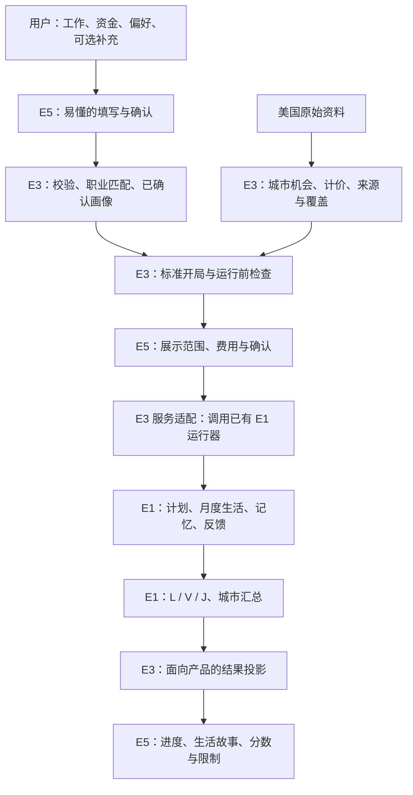

# E3 / E5 共享约定：把用户和真实城市接到 E1

更新：2026-10-17。设计标识：`e3-e5-product-contract-v0.1`。2026-10-18 补记 E3-A 的落地情况（第 10 节）。

**状态：所有者已确认的产品设计，接口待实现。** 本文的消息名称是双方要共同落实的接口草案，不是现有 HTTP API 或 Python 类。E3 第一轮应把它们变成一份可校验的结构定义和公共样例，E5 从同一份定义读取。（2026-10-18：E3-A 已把第 7 节的消息落成可校验的结构定义与公共样例，见第 10 节；已实现、离线自测通过，待独立审核。线上 HTTP 接口仍未实现。）

阅读顺序：本文 → 自己的交接文档（[E3](../handoffs/e3-data-input-handoff.md) / [E5](../handoffs/e5-product-handoff.md)）→ 涉及的 E1 代码。本文集中保存共有语义；两份交接只说明各自怎样实施，避免复制出两套规则。

## 1. 我们要做出的产品

用户用容易理解的语言说明自己的工作、可用资金和生活取舍。系统把同一个人的分身放到不同城市，语言模型制定年度计划，E1 按月算账、执行生活、记录病情并评分。用户最后看到生活过程、完成者得分，以及没有完成的原因。

> **固定的是人的偏好，而不是替他固定消费结果。** 喜欢大房子的人可以在一座城市住大房子，在另一座城市因租金太高而选择小房子；系统不能先替他固定房租占工资的比例。

E1 已在声明的合成范围内通过最终独立核查，见 2026-10-14 审核摘要（本机记录）。这支持进入 E3/E5；不代表真实城市、真实用户输入或托管服务已经就绪。本轮不重跑该审核。

## 2. 分工与修改规则

| 内容 | 负责方 | 另一方怎样使用 |
|---|---|---|
| 用户答案的含义、校验、职业匹配、单位与货币处理 | E3 | E5 展示服务给出的说明和错误，不另写换算 |
| 偏好词表、支持范围、标准初态、城市资料与机会目录 | E3 | E5 读取有版本的选项与能力清单 |
| 共享消息结构、结果投影、对接 E1 的服务逻辑 | E3 主责，E5共同核对可展示性 | 两边引用同一结构定义和样例 |
| 表单、控件、布局、确认、进度、结果页面 | E5 | 使用 E3 的语义；版式、措辞简化不能改变含义 |
| 网页入口与页面流程 | E5 | 只经 E3C 的 HTTP 接口读写（[E3C 交接](../handoffs/e3c-to-e5-service.md)） |
| 访问控制、使用次数、任务排队、预算、删除与过期（托管服务） | E3（E3C，2026-10-23 起；[ADR0043](../../DECISIONS/0043-e3c-hosted-service.md)） | E5 只显示服务给出的次数、阶段与允许的操作，不另做计数、队列或重试 |
| 部署（主机、域名、TLS、备份策略） | 所有者另定 | 本轮没有部署 |
| E1 数学、状态更新、评价与历史兼容 | 沿用 E1 | 必须修改时单列原因、范围和回归；不在前端另写公式 |

双方并行时，共享结构文件由 E3 单方落笔；E5 用具体请求/回复样例提出接口需求。README、PLAN 和共享约定也应约定单一编辑者，避免同一文件同时改。使用独立分支/工作区并不能免除接口协商。

规则效力按[项目索引](../INDEX.md#governance)：所有者明确决定优先。本文记录的是新产品设计，不追溯改变旧协议、ADR 或运行结果。发现现行代码不支持时，报告适配任务，不能拿文档声称已实现。

## 3. E1 可以直接用什么，还缺哪层适配

| 已有能力 | E3/E5 应怎样衔接 |
|---|---|
| 年度计划、月度收支、时间与精力、学习、储蓄目标、疾病、事实记忆 | 继续由 E1 执行。自由文本和模型理由不能直接写工资、资格或分数 |
| 旧的七维 `StatedLifeProfile`（已解决） | 产品采用六维合计 100＋独立健康回答（`ProductLifeProfile`，ADR0034）；七维画像已在 ADR0037 删除 |
| 健康版评分已将医疗点数移出日常生活加权；病痛项全组共用 | 保持六维比例与健康回答的独立语义。不能靠偷偷填 `healthcare=0`、把风险答案塞进自由文本来假装完成适配 |
| 标准开局校验、跨城个人条件核对 | 用同一已确认用户生成名单。不能随机生成不同家具、病史或现金来增加分身差异 |
| 当前运行状态、税绑定与公开税说明仍走合成探索路径 | 真实数据需要显式的资料/税绑定与版本适配；不能只换 YAML 数值、删掉校验或改成“正式”标签 |
| 输入冻结、预算、服务回复身份、恢复与重放 | 服务端复用已有入口；网页重试不能绕过核对或重复收费 |
| L / V / J、C / E / M、缺失范围与硬要求报告 | E3 只做结果投影，E5 只展示；不另算“更好看”的城市分数 |

代码入口：[画像与状态](../../src/common/life_contracts.py)、[陈述偏好到评分](../../src/econ/life_scoring.py)、[标准开局](../../src/ledger/life_roster.py)、[运行器](../../src/orchestration/life_runner.py)、[规划观察](../../src/agentlayer/life_views.py)、[城市报告结构](../../src/common/life_aggregation_contracts.py)。

**第一轮适配应证明：** 同一组六维比例、同一生活轨迹，使用新产品契约不会无故改变六维评分；在固定行动、状态和城市条件下，仅改变健康陈述不会改变环境的患病规则、病痛权重或疗效。健康陈述可以经分身选择工作强度、治疗等，间接改变后续生活。旧协议、研究真值、旧样例与旧归档规则保留。需要改 `src/econ/` 时仍按项目规则取得对应范围授权。

## 4. 用户输入：少问，但不偷偷替用户决定

### 4.1 核心内容

| 用户看到什么 | 记录的含义 | 进入哪里；缺少时怎样处理 |
|---|---|---|
| 想比较哪些城市 | 有完整身份和地理边界的候选集合 | E3 给出可选列表，不用城市中文名拼接数据 |
| 你主要做什么工作 | 原始职业文字、用户确认的任务描述和匹配结果 | 匹配城市岗位；有歧义时给少量易懂选项，不要求职业代码 |
| 年龄 | 模拟开始时的年龄；无需完整生日 | 进入已有年龄规则，说明规则未医学标定；不从职业猜年龄 |
| 开始时能用于生活的钱＋币种 | 可动用的流动资金，不是房产总值、信用额度或未来工资 | E3 转成带基准的初始现金；没填不是 0，不静默借贷 |
| 六方面怎样分配 100 分 | 本次生活情境下的陈述取舍 | 用于日常评分和允许的规划信息；未答不是 0 |
| 物质生活内部重视什么 | 父项内的相对需求，不是开支比例 | 正权重的物质项需要有效细分；不支持的需求先报告 |
| 面对健康风险时倾向怎样安排生活 | 独立的风险应对陈述 | 供分身规划；不解释为“更不怕疼”或“客观更不容易生病” |
| 可选补充、必要时的资格信息 | 用户自己的描述；明确确认的资格事实 | 补充规划。证书只在相关岗位需要时追问，不凭职称自动授予 |

当前工资不作为必答项：普通当地就业情景的收入由城市岗位与实际工作决定。固定远程收入、家庭共同资产等需独立支持后再开放，不能硬套成当地工资。初版可建议面向单个成年人、租房、可匹配岗位的情景；具体首发支持人群由 E3 数据盘点后确认。

### 4.2 六维与物质细分

六维键保持与 E1 对应：`material`（物质生活）、`safety`（安全）、`opportunity`（发展机会）、`leisure`（休闲）、`environment`（环境）、`commute`（交通便捷程度）。健康回答不占这 100 分。

用户可以明确给某项 0 分；不能自动把“没回答”变成 0，也不沿用旧产品草案“每项至少 3 分”。使用定和量表，是为了显式表达取舍；不能宣称已测得人的真实偏好。

六项平均是每项 100/6，旧整数点数不能精确表示。E3-A 要统一内部权重表示、精确合计和显示舍入；不能默默分成前四项 17、后两项 16。用户操作的步长、页面显示的小数位和内部数值表示是三件事，不让用户承担凑整数的偏差。

物质项先定父权重，再在当前受支持的功能内分配。比如物质占 40 分，其中居住空间占一半，对日常六维部分的贡献权重就是 0.4 × 0.5 = 0.2；**不是要求把工资的 20% 花在住房上**，也尚未乘共同健康混合项。实际支出仍由分身决定。

功能例子包括居住空间、饮食、洗衣、通信、工作设备和储物。E1 能表示某项，不等于所有真实城市都有资料；首发可用叶子由 E3 统一发布。现有先导只有部分叶子，不能据此永久删去其它需求。新增叶子时提升词表版本，让用户确认新分配，不自动稀释旧权重。

### 4.3 健康与文字输入

健康问题使用中性的生活取舍例子，避免“爱惜身体 / 不爱惜身体”这样的道德标签。愿意承受工作压力、认为自己不容易生病、患病后愿不愿治疗，是相关但不同的概念；不把一道题自动换算成三者。V1 先记录明确的应对倾向，具体题干、选项及映射须由 E3 第一轮给出可审核样例。

允许明确回答“暂不确定”。此时记为未明确，告知分身没有这一偏好指令，不能补为中等风险或零风险。用户若选择探索用的示例设定，须确认并标注为设定，不冒充本人答案。

可选自由文本用来补充“我喜欢什么、希望怎样生活”。当前画像上限为 2,000 字符，界面应有计数和明确提示，不能静默截断。文本不能自动改权重、现金、能力或硬要求。若提取出候选结构化答案，必须让用户确认并保留原文。V1 不依赖额外一次 LLM 访谈才能开始。

“必须有独立工作空间”与“我比较喜欢安静”应分开。仅对有定义、有数据、能按月核验的条件提供硬要求选项；普通喜欢不能自动升格为硬约束。

### 4.4 标准开局

同一用户跨城市、跨重复序号使用同一套个人起点：可用资金、年龄、明确能力、基础时间与精力等。按 E1 标准开局 v1，从第 1 年、健康、无已有物品、无历史培训进度、无历史资金目标和病史开始；初始能力只来自已确认事实。城市中的具体岗位可以按本地目录匹配。

界面要解释“这是一次搬到候选城市重新开始的简化情景”，不能让用户误以为全部现实家具和健康史已被模拟。不要收集暂时无法使用的详细病历或家具清单。用户文字里提到它们时，说明未纳入，不能悄悄清空后称为完整个性化。

当前 E1 的跨城核对还要求金额口径和陈述职业身份一致。V2 跨币种财富等价、跨国职业映射需要升级这层校验；已有国家字段并不意味着已经支持直接跨国比较。

## 5. 偏差控制：保留取舍，不制造“精确测量”的错觉

| 风险 | 本轮约定的处理 | 仍然存在的限制 |
|---|---|---|
| 默认值、性格套餐锚定答案 | 初始不预填数字或预选人格；平均分配只能由用户主动选择，示例放可选帮助 | 题干和维度顺序仍可能影响回答 |
| 自动调整替用户选择牺牲哪项 | 先从“未分配点数”分配；满额后由用户指定从哪项移给哪项，支持撤销 | 定和仍比独立打分更费思考 |
| 各维“重要”含义不同 | E3 给同一套中性定义、具体改善范围；E5完整保留参考情境 | 100 分不是通用心理计量单位 |
| 拆得越细，获得越多注意与权重 | 先父项、后物质细项；不因增加商品种类扩大物质父权重 | 层级划分本身仍影响回答 |
| 贫穷被误读成不喜欢 | 现金约束与偏好分开问；不从实际开支比例推喜好 | 用户仍可能按现实可负担性回答，需要例子澄清 |
| 社会赞许与健康道德化 | 使用对称、中性的生活取舍，不称某种答案更上进、更自律 | 陈述与行为未必一致 |
| 文字被模型过度解释 | 原文留存，提取结果需确认；不自动改权重或加硬要求 | LLM仍可能在规划中误解文本，需实际检查 |
| 不确定被当成低偏好 | 未答、明确 0、明确无所谓、未支持分别记录 | 正权重缺数据时可能不能给完整评分 |

权重与评价尺度必须一起定义。把交通从 70 分钟改善到 30 分钟，与从 31 分钟改善到 30 分钟，不能仅凭“交通重要”四字视作相同收益。E3 应提供固定、可解释、全比较组共用的改善锚点，并说明与 E1 评分映射的关系；不能按当前城市的最好/最差值偷偷重标权重。尚未找到现实锚点时，把它标作模型设定。

可加 1–2 个不显示城市名的具体取舍检查，帮助用户发现“我给的分数似乎不是我想表达的”。它们不够估计六个权重，也不能把与模型不一致判为用户答错。改分由用户决定。

控件可以减少计算负担，例如粗调后微调，但步长不是测量精度。正式发布前做少量认知访谈和可用性检查：用户能否复述分数含义、是否理解资金与喜好分开、是否看懂未支持项，以及耗时和退出位置。复测与留出选择题可逐步检查稳定性；不把六个不同生活目标当成一条单维心理量表，用一个内部一致性系数宣称有效。

WHOQOL 用于提醒我们检查生活领域是否遗漏；原问卷测近期生活质量，不是城市选择的取舍权重。本产品不称为经验证的 WHOQOL-BREF 改版。疼痛、精力也不能简单说成永远与地点无关：E1 已通过疾病和活动模拟部分影响，其简化应单独说明。

## 6. 跨国与商品异质性：现在保存语义，以后增加数据

| 对象 | V1 需要保留 | V2 才启用的扩展 |
|---|---|---|
| 职业 | 原始文字/语言、确认的职责、内部职业概念、目标国家的分类体系/版本/代码、匹配依据与歧义 | 多国多对多映射、资格承认、同职业不同制度；不把美国代码当用户永久身份 |
| 城市 | `country + scheme + code`，另记地理边界版本与展示名称 | 多国都市区口径对齐，不只把“城市”名称翻译 |
| 金额 | 数额、币种、价格基年、当地价口径、资料时期与转换来源 | 汇率/购买力/财富转换分别定义；不把同一个数复制成美元和人民币 |
| 需求与商品 | 有版本的需求功能、父项、计量语义；商品 `spec` 事实与 `attributes` 属性分开 | 品牌、菜系、档次、外卖/做饭、有机/加工食品等匹配；需要同规格报价和可得性 |
| 用户属性偏好 | 明确偏好、无所谓、未答、已表达但未支持的状态；保留原始陈述 | 在功能内部评价属性，不按价格猜品牌偏好、不重复奖励同一功能 |

比如“更喜欢小米手机”可保留为通信需求下的品牌陈述。V1 若只评价有没有通信设备，就显示“品牌偏好已记录，本版未评分”；不说美国或中国因此更适合。将来引入同规格报价与品牌匹配后，再提升规则版本。

每项输入还应说明它目前用于哪些环节：**规划、资格/状态、评分、仅留存**。文本交给分身参考，也不等于评分器已经理解其中所有偏好。

数据端分别记录：来源性质（观测/派生/估计/合成）、兼容等级、供给状态（可得/确定不可得/资料未知）。三个概念不能合并。消费指数不直接当商品标价；行业年薪不直接当某职业月工资；未知价格不填 0。

美国资料按全国性来源批量获取，对代表性城市做深入核对，所有城市用同一套验收。**没有固定“三座城市”产品上限**；发布数量由资料口径、共同选择集合、覆盖及预算决定。不同城市可以价格和确实供给不同，不能一部分用细资料、一部分用未声明默认值假装同样精细。

## 7. 共享消息：先约定含义，再落地接口

下列为待建的产品消息，不把 E1 内部对象直接暴露到浏览器。字段名在 E3 第一轮确定后由双方共用，不各自翻译一份。共同元数据至少包括：结构版本、语义/问卷版本、适用资料版本、稳定引用 ID；错误给机器代码、字段位置、中文原因及可采取的动作。

| 消息草案 | 至少需要什么 | 责任与约束 |
|---|---|---|
| `ProductCapabilities` | 候选城市、职业搜索能力、六维与物质词表、硬要求选项、支持/未支持项、单位及范围说明 | E3生成，E5呈现；界面不能提供服务端没有的选择 |
| `UserInputDraft` → `ConfirmedProfile` | 原始答案、确认结果、六维/细项、独立健康陈述、职业、现金、年龄、文本；每项来源和确认状态 | 缺失/0/无所谓分开；用户修改后重新校验，不复用旧确认身份 |
| `ProductPreflight` | 可执行/可完整评分/可更新精力三项状态、逐城资料缺口、标准开局摘要、人数与年数、模型、费用/调用上限、输入内容身份 | 不支持就明确说明；E5展示后才提交运行。不能因覆盖率高就补出完整分数 |
| `RunSubmission` → `RunReceipt` | 确认身份、运行前检查身份、幂等键；返回运行 ID 与接受/拒绝原因 | 相同确认的重复点击只生成同一运行；配置、城市或输入变化必须重查。幂等服务尚待实现 |
| `RunProgress` | 任务阶段、已执行年度、每分身状态、暂停原因、已知费用与预留、是否可恢复 | 请求成功、计划可执行、生活完成、评分完整分别记录；不把未运行显示成 0 分 |
| `ProductResult` | 城市 C/E/M、均值分母、缺失范围、L/V/J、事件链、硬要求、覆盖、来源与假设、模型和费用、结果身份 | E3投影已有评价；E5不重算。原始回复和内部参数不默认进产品结果 |

### 7.1 运行边界

同一运行冻结用户确认、城市资料、初始化规则、生活/评分/评价政策、模型设定和预算。变更后另起运行；不能让新模型或新规则接着消费旧年度状态。运行前检查不只校验前端字段，还应复用 E1 的名单和跨对象检查。

预检查的三种能力描述当前输入及已声明的支持范围，不保证未知的每份 LLM 计划和未来事件都能执行或评分。通过预检查后，年度计划仍由 E1 检查，真实发生的出局与模拟问题照实分类。

E5 的网络重试与 E1 的模型修订/服务重试是不同层次。前端断线不应重发一次付费规划；服务端用运行 ID 查进度。现有预算账本只支持串行，初版排队串行执行，不能直接启动多个进程共写账本。托管版的供应商密钥只留服务端；本地开源版可使用自己的配置与密钥，两者消费相同的业务接口。

E1 的 `AgentObservation` 是分身的规划输入，不是网页结果对象。用户可以查看自己的最终评价；这些结果不能原样回灌给仍在生活中的分身。研究真值、隐藏评分参数、内部文件路径和密钥不应混入浏览器响应。真实个人输入与原始回复默认不随开源仓库公开；保存范围和删除方式在上线前明确。

### 7.2 结果必须讲清的分母

`C` 是完成且评价完整的分身；`E` 是确认的生活出局；`M` 是因模拟问题无法完整评价的分身。原计划人数等于 C＋E＋M。服务失败、资料不足、未运行不能写成“在这座城市活不下去”。

例如原计划 10 人，C=7、E=2、M=1，C 的平均 J 为 0.60：

- 主值写“7 个完成且可评价分身的平均 0.60”，不称“10 个分身的平均”。
- 两个出局展示实际事件链，例如“大病无工资 → 余额不足 → 付不起最低住房和食品”；不凭相关性下因果结论。
- 假设这个 M 没有可信的已知月份或终值，其个人 J 范围才是 [0,1]。此时城市模拟缺失范围为 `[4.2/8, (4.2+1)/8] = [0.525, 0.65]`。E 不进入这个分母；若已有可信部分轨迹或已知终值，E1 会据此缩窄范围，E5显示后端结果，不能一律按 [0,1] 重算。
- 这不是置信区间，也不是现实幸福的概率；出局仍可能使完成者均值偏向幸存者，必须并列展示。
- C=0 时平均值为空；全是 E 时缺失范围也为空。没有评分不显示为 0。

L 是实际生活的跨期评价，V 是从终态出发、在预先冻结的参考生活模板与治疗分支中得到的估值，J 是组合。估值期仍可工作挣钱，不自动新增成长，不是花光存款的比赛，也不是预测未来；E5不能将 V 写成“你下一年必得的分数”。

已有“病假少通勤可能提高总分”等模型反例须保留解释入口，不由前端改分消除。敏感性也要区分：固定轨迹重评分只检验评价；用户权重若改变规划或精力反馈，行为敏感性需要独立运行，不能用重评分冒充。

## 8. 两个窗口怎样同时开工

1. **E3 第一轮先冻结最小接口与公共样例。** 不等全国资料采完：从现有 E1 样例构造明确标为合成的产品输入、预检查和结果样例，完成六维/健康适配设计。
2. **E5 可以同时做页面草图和组件。** 在结构定义冻结前只用本文语义做原型；冻结后读取同一份样例和结构，不另维护一套城市/职业/偏好规则。
3. **E3 完成真实资料与运行桥接，E5完成界面与任务流程。** 联调仍调用同一 E1 入口。研究 E4/R 线可以后置，但不能因此声称产品优于其它方法。
4. **共同验收后再开放真实用户。** 数据齐全不等于规划足够好；需要少量经过预算批准的端到端核对和清楚的产品限制。

公共样例至少覆盖：正常填写；职业歧义；未答与明确 0；品牌偏好未支持；正权重资料缺失；标准初态被拒；C/E/M 混合；C=0；硬要求未核验；预算/服务暂停；重复提交；前端断线后查询同一运行。对同一确认输入，网页与本地入口生成相同的个人条件、运行输入及结果口径。

未冻结的细节：首发支持人群与城市集合、改善锚点与题干、独立健康题选项、基础资源默认值依据、真实税与工资映射、每城分身数和付费额度、托管部署与留存期限。分别在 E3/E5 的首轮产出中给具体建议；不能静默沿用合成样例的数字。它们不阻塞离线界面样例开发。

## 9. 依据与后续记录

- [WHOQOL-BREF 原问卷](https://cdn.who.int/media/docs/default-source/publishing-policies/whoqol-bref/english_whoqol_bref.pdf)：检查生活领域与原量表用途，不能把近期体验评分当偏好权重。
- [Weber 等，属性层级与权重拆分](https://pubsonline.informs.org/doi/10.1287/mnsc.34.4.431)：提醒我们细分方式可能改变权重；层级设计是缓解措施，不保证消除偏差。
- [Liu 与 Conrad，滑块默认位置实验](https://journals.sagepub.com/doi/10.1177/0894439318755336)：默认位置的影响取决于任务和刻度；本产品仍需实测，不能直接照搬效应大小。
- [英国政府分析职能的 MCDA 入门](https://analysisfunction.civilservice.gov.uk/policy-store/an-introductory-guide-to-mcda/)：权重要结合属性变化范围解释，不能只问抽象重要性。

题干、词表、锚点、分配规则、默认值和转换假设统一登记到[参数与假设目录](parameter-assumption-register.md#product-input)。用户答案与单位换算不是可自由训练的模型参数。文档不代替量表验证；后续改动说明影响哪些人、哪些记录需重确认、哪些旧结果保持原样。

## 10. E3-A 的落地情况（2026-10-18，已实现、离线自测通过，待独立审核）

规则以 [ADR0034](../../DECISIONS/0034-e3a-product-input-contract.md) 为准，怎样计算与一个完整例子见 [E3-A 技术说明](e3a-product-input.md)。这里只记共享接口现在落在哪里，不另写一套规则。

| 本文的约定 | 现在的实现 |
|---|---|
| 第 7 节的消息草案 | 唯一权威结构 `src/common/product_contracts.py`；导出的 13 份 JSON Schema、`index.json` 与合成样例在 [contracts/product/v2/](../../contracts/product/v2/README.md)（2026-10-18 收尾后 39 份；v1 目录保留为历史导出）；`scripts/product_e3a.py check-schema` 核对一致性 |
| 共同元数据与错误 | `meta` 带结构 / 问卷 / 词表 / 健康问卷 / 转换版本与资料包内容指纹；错误是 `ProductIssue`（代码、字段、中文原因、影响、下一步、严重程度） |
| 4.2 六维与物质细分 | 精确分数（`"30"`、`"50/3"`），显示 1 位小数、不回流；主动均分才生成 50/3 与 100/3；未答 / 无所谓 / 不确定 / 明确 0 分开；父项 0 → 细分不适用 |
| 4.3 健康与文字 | 三道暂定题与四个选项（无预选，未答另存）；只供分身规划，不算总分；文字 2,000 字符不截断、不提取 |
| 4.4 标准开局 | 编译器按 E1 标准开局 v1 生成，复用 E1 的名单与跨城个人条件检查；能力只来自确认事实 |
| 3 节 E1 的适配 | 新增有版本的六维产品画像与偏好来源，只转一次、不补医疗；评分规格内容身份不变；旧七维、研究真值、旧样例与旧归档保留 |
| 6 节 来源与供给 | 便利资料分 `SourceFact` → `OpportunityCandidate` → `CatalogCompilation`，来源性质、供给状态与能否编译分开；`OptionInventoryCoverage` 单独报告 |
| 7.1 运行边界 | 预检查复用 E1 运行前检查与名单冻结，绑定编译产物、协议、评分、评价、提示模板与规划器的身份；输入或配置变了，旧预检查失效 |
| 7.2 分母 | 结果是 E1 报告的白名单投影：N = C + E + M、均值分母 C、缺失范围分母 C + M、空值不补 0、事件链取自环境记录 |

**第 8 节公共样例的覆盖**：正常填写、职业歧义、未答与明确 0、品牌偏好未支持、标准初态被拒、C / E / M 混合、C = 0、全 E、未生成评价、重复提交都有离线
生成的样例；正权重资料缺失（样例 34，受控夹具：工作区副本里把 M52 的安全资料改成未知）由预检查报告，这座城“可评分”只是 partial；硬要求未核验在
样例 23（没有开始生活的模拟问题分身没有可信记录，记为未核验）；预算 / 服务暂停与前端断线后查询同一运行是标明为示例的契约响应（线上接口未实现）。

**第 8 节“未冻结的细节”在 E3-A 的处理**：六维精确均分的内部表示定为规范分数 `50/3`（显示 16.7）；独立健康题给出三道暂定题与四个选项（未经认知访谈）；
参考改善范围写在资料包的维度定义里，都是合成模型里的一档改善、不是现实锚点；首发支持人群与城市集合、基础资源默认值依据、真实税与工资映射、每城分身数与
付费额度、托管部署与留存期限仍未决定，留给所有者与 E3-B / E3-C / E5。

**当前结构是 v3**（`contracts/product/v3/`，生活扩展：物质四项、兴趣与口味、生活事实三栏、编译检查；改动见 [交接](../handoffs/e3-to-e5-life-extension.md)）。**E5 原来用的**：`contracts/product/v2/` 的 schema 与样例（读法见其 README 第 5 节，相对 v1 的字段变化见第 3 节）、能力清单里的题干、支持状态与金额写法、`ProductIssue` 的中文原因与下一步。
E5 不在前端实现职业映射、六维到旧七维的转换、金额换算、标准开局、覆盖率或 C / E / M。

**2026-10-18 收尾（独立审核 F1–F5，已实现、离线自测通过，待独立复核；[ADR0034 第九节](../../DECISIONS/0034-e3a-product-input-contract.md)）**：共享结构升到 `e3a-product-schema-v2`。对共享接口的影响：
分身说明从 `detail_zh` 原文改为按类别生成的 `explanation`，批次暂停从 `pause_reason` 原文改为 `pause`，问题可以带不含内部内容的 `audit_ref`（第 7.1 节“内部路径
不混入浏览器响应”的落实）；覆盖条目分开写供给、资料与编译三种状态（第 6 节“来源性质、兼容等级、供给状态不能合并”的落实）；能力清单写明金额写法；重复或
冲突的答案在确认前拒绝。产品运行的运行清单另记产品规则代码的身份（第 7.1 节“同一运行冻结规则”的落实）。生活数学与 E1 的分类、分母都没有变。

## 11. E3C 托管服务的落地情况（2026-10-23）

规则见 [ADR0043](../../DECISIONS/0043-e3c-hosted-service.md)，机制见 [E3C 托管服务](e3c-service.md)，给界面层的接线说明见 [E3C 交接](../handoffs/e3c-to-e5-service.md)。

| 本文的约定 | 现在的实现 |
|---|---|
| 第 7 节 `RunSubmission` → `RunReceipt` 的幂等服务 | 服务端 SQLite 是唯一权威的提交登记；接受、预留、写稳定运行编号与排队在一个短事务里；同一意图换键仍是原运行；`RunReceipt.service = hosted_service` |
| 第 7 节 `RunProgress` 的已知费用与预留 | 真实模型按报价估算，已核算、用量不确定与在途预留分开写；规划候选与服务尝试分开计（mock 仍是零费用） |
| 第 7.1 节 运行边界 | 先按服务端的正式运行设置编译，再做预检查：用户确认的就是后台实际用的规划器、调用设置、报价与上限；已排队的运行绑定当时的资料快照 |
| 第 7.1 节 前端断线不重发付费规划 | 查询只读 worker 写下的快照，不恢复、不调用规划器；恢复只在服务端判定安全时提供 |
| 第 7.1 节 保存范围与删除方式 | 结果首次结束起 30 天、草稿与等待中的意图 30 天，查看不续期；可删一次运行或全部内容，只留次数记录与最小墓碑 |
| 网页流程的公开视图 | 共享结构 `e3a-product-schema-v3.2`：会话与次数、草稿保存、审阅、确认请求与回复、运行意图视图、运行列表、删除回执、统一安全错误；OpenAPI 在 `contracts/product/v3/openapi.json` |

第 8 节“未冻结的细节”里的每城分身数、付费额度与留存期限，所有者在 E3C 定为：六城 × 每城 4 个分身 × 3 年、每次运行 10 元上限（应用侧按报价估算）、30 天。托管部署仍未决定。
