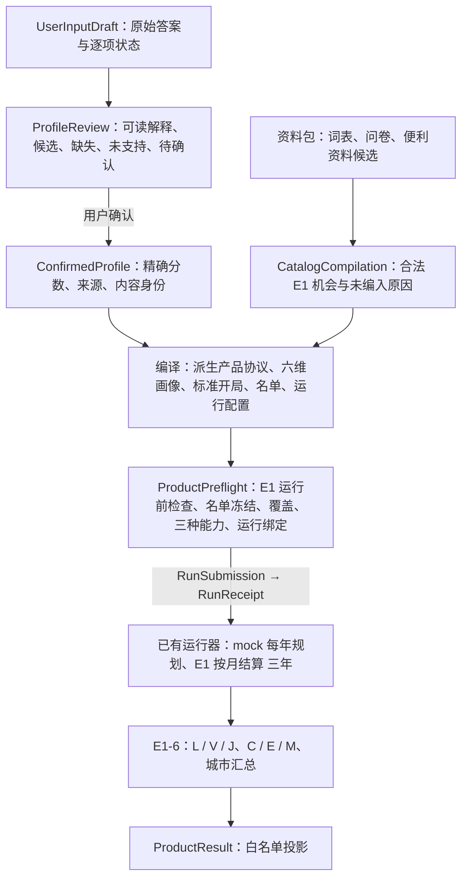

# E3-A 技术说明：用户输入、共享契约与 E1 边界适配

更新：2026-10-18（本地时区 UTC−7）。规则见 [ADR0034](../../DECISIONS/0034-e3a-product-input-contract.md)，任务原文见
[prompt 归档](prompts/2026-10-18-e3-a-input.md)。

**状态：已实现、离线自测通过，待独立审核。** 2026-10-18 补记：独立审核发现 F1–F5，收尾修复已实现、离线自测通过、待独立复核（第 13 节；共享结构升到 v2，导出在 `contracts/product/v2/`）。 全部是合成资料包与可控的 mock 规划器：本文的例子不是真实用户、真实城市或真实大语言模型的轨迹，
跑通不说明问卷有效、模型可靠或城市参数已标定。共享语义仍以 [E3/E5 共享约定](e3-e5-product-contract.md)为准；本文讲它怎样变成代码。

## 1. 一条链：从用户答案到产品结果

每一层只做自己的事：用户决定重视什么；E3 解释、校验并取得确认；分身（这里是 mock）选择怎样生活；E1 决定行动是否可行、实际收支、病情与评价；
E3 只把 E1 的结果投影出来，E5 展示。没有静态效用排序、固定消费篮子或评议 LLM 替代这条生活链。

## 2. 一个完整例子（合成人物 u501，证据 `offline/normal/`）

**用户写了什么。** “我在写字楼做全职文员，平时处理文件和表格”；35 岁；可动用流动资金 3,000（币种 USD、时期 2024）；比较合成城 K51 与 M52；
六维 物质 30、安全 20、发展 20、休闲 10、环境 10、交通 10；物质内部 居住空间 30、新鲜食品 30、日常生活便利 40；健康问卷三题分别是
“不符合我 / 符合我 / 暂不确定”；通勤往返不超过 60 分钟；一段自由文字（不想下班后花很多时间洗衣打扫，愿意为省事花钱，但不想手头太紧）。

**系统怎样理解（`ProfileReview` → `ConfirmedProfile`）。**

| 内容 | 确认后 | 去了哪里 |
|---|---|---|
| 职业文字 | 命中别名“文员”→ 概念“办公室文员”（明确）；内部映射 SOC 2018 `43-9061`，用户看不到代码 | 开局岗位匹配：两座城都匹配到“全职文员（合成写字楼）”；不授予任何资格 |
| 3,000 USD / 2024 | `USD_2024_LOCAL` 300,000 最小单位，换算规则 `identity_same_basis_v1`（同一口径，恒等） | 两座城、每个分身的第 1 年现金都是 3,000 |
| 六维 | 规范分数 `"30" "20" "20" "10" "10" "10"`，显示 30.0 … | 评分偏好（点数 / 100）与分身的观察 |
| 物质三项 | `"30" "30" "40"`，状态 allocated | 评分的物质细项与观察；**不是**开支比例 |
| 健康三题 | 两题已提供（含义照选项写）、一题暂不确定 | 只进分身的观察（“暂不确定：没有这一项的明确指令”）；结算、抽签、评分都不读 |
| 通勤上限 | 硬要求 `commute_limit`：往返 ≤ 60 分钟 | E1 逐月核验，单独报告，不进分数、不拦截计划 |
| 自由文字 | 原文保留（未超过 2,000 字符），不提取、不调分 | 观察里的用户文字 |
| 待确认 | 只需知悉“标准开局”（从健康、没有已有物品开始的简化情景） | 用户勾选后才能确认 |

**跨城开局。** 编译器为 K51、M52 各生成一个分身（`u501.k51.r0`、`u501.m52.r0`）：同样 35 岁、3,000 现金、每月约 365 小时可安排时间、每月 250 个负担点、
没有能力、健康、没有物品；只有城市不同。E1 的标准开局检查与跨城个人条件核对通过，名单冻结。

**实际生活（mock，三年，每年 1 次规划）。** 两个分身第 1 年都做文员、参加 12 个月的会计资格课程，第 2 年起换成会计岗位（资格下一年生效）。
不同的是减少家务的方式：K51 设备便宜，分身第 1 年买下便利设备包（洗烘一体机＋扫地机器人，1,440，能用 5 年）；M52 人工便宜，分身按月买日常杂务服务
（108/月）。家务（协议基准 洗衣 12 + 打扫 10 小时/月）的本人残余与便利分：

| 城市 | 每月残余（洗衣 + 打扫） | 每月少做 q | 便利分 s = min(0.9, q / (q + 8)) |
|---|---|---|---|
| K51（设备包） | 4 + 6 = 10 小时 | (12 − 4) + (10 − 6) = 12 | 12 / 20 = 0.6 |
| M52（杂务服务） | 2 + 2 = 4 小时 | (12 − 2) + (10 − 2) = 18 | 18 / 26 ≈ 0.6923 |

现金（环境记录）：K51 第 1–3 年末 7,200 → 18,840 → 30,480；M52 7,344 → 17,688 → 28,032。两人每个月都住离工作地近的一居室，通勤硬要求 36 个月全部满足。

**结果（`ProductResult`）。** 两个分身都是 C（完成且评价完整）。L 是三年逐月满足感的平均，V 是从第 3 年末出发、在冻结的参考生活模板里的 12 个月估值，
J = 0.75 L + 0.25 V（N = 3、δ = 1）：

| 分身 | L | V | J（手算） |
|---|---|---|---|
| K51 | 0.5939 | 0.6498 | 0.75 × 0.5939 + 0.25 × 0.6498 ≈ 0.6078 |
| M52 | 0.6027 | 0.6498 | 0.75 × 0.6027 + 0.25 × 0.6498 ≈ 0.6145 |

城市行写“原计划 1 个分身——1 个完成且可评价、0 个生活出局、0 个模拟问题；1 个完成且可评价分身的平均 J 为 0.6078（分母只数完成且可评价的分身，不是原计划的
全部分身）”。E1 的城市比较给出范围差 −0.0066（不是显著性检验）；**这不是城市推荐**，两座城和全部参数都是合成的。

钱、偏好与健康信息分别去了哪里：钱 → 开局现金，之后只由环境的收支改变；偏好 → 评分权重与观察，不变成预算；健康回答 → 只给分身读，不改裁判。

## 3. 精确点数与答案状态

* **解析**：手工输入用 `Fraction(Decimal(text))` 精确解析，最多 2 位小数（`"16.5"` → 33/2）；也接受已约分的分数写法（`"50/3"`）。不接受科学计数法、
  千分位、负数与没约分的分数。
* **规范形式**：约分后的整数（`"30"`）或 `分子/分母`（`"50/3"`）；计算、比较与内容身份都用它。显示另算：四舍五入到 1 位小数（`"16.7"`），显示值不回流。
* **均分**：只有用户选择“平均分配”才生成，六维每项 `50/3`、物质每项 `100/3`，精确合计 100；不会出现“前四项 17、后两项 16”。
* **合计**：六维与（父项为正时的）物质三项都必须精确等于 100；不等时写明差多少，由用户决定挪哪一项。
* **状态**：

| 用户的答案 | 记录 | 能确认吗 |
|---|---|---|
| 写了 0 | 已提供，值 0 | 能（0 是数值） |
| 没填 | 未答 | 不能（不会变成 0 或均分） |
| 选“无所谓” | 明确无所谓 | 不能（同上） |
| 选“暂不确定” | 暂不确定 | 不能（同上） |
| 物质父项写 0 | 物质细分“不适用”（`not_applicable_parent_zero`） | 能，不伪造三个回答 |

* **支持与用途**：每项另记支持（支持 / 部分支持 / 未支持）与用途（规划、初态、资格、评分、仅留存）。例：安全与环境是“部分支持”（只有城市背景条件，
  分身不能改善）；品牌偏好是“未支持、仅留存”。

## 4. 六维怎样接入 E1，为什么与旧七维严格等价

旧健康评分版本（`e1-5c-health-v1` 及之后，含便利版）本来就把医疗点数移出日常生活加权：

    w̃_k = w_k / Σ_{j≠healthcare} w_j，   B = Σ_k w̃_k s_k，   S = (1 − γ)·B + γ·H

新产品画像直接给出六维：有效权重 = 点数 / 100（精确相除后只转一次浮点）。旧 27/18/18/9/9/9 + 医疗 10 的 w̃ 是 27/90 = 0.3、18/90 = 0.2、9/90 = 0.1，
与新 30/20/20/10/10/10 的 0.3、0.2、0.1 相同，所以在同一行动与事件下 B、S、年均与反馈额度逐位相同（证据 `equivalence/`：三年年均
0.6414615384615385 / 0.5575407775020679 / 0.6409333333333334；额度 250 × (1 + 0.1 × S) 向下取到 0.01：266.03、263.93）。

这条等价只成立在“六维比例相同”的前提下；它不是把旧答案改读成新答案的理由——旧问卷的医疗点数与新问卷的健康回答是两种东西，加载器互相拒绝。

代码上的分支（`src/econ/` 的窄范围接线，数学不变）：

| 位置 | 做什么 |
|---|---|
| `econ.life_scoring.preference_from_confirmed_profile` | 六维画像 → `ScoringPreference`（来源 `product_confirmed_six_dim`，六维权重） |
| `econ.life_scoring.effective_weights` | 六维来源直接用六维权重；非健康评分版本拒绝（不补医疗占位分） |
| `econ.life_year.PREFERENCE_INPUT_TYPES` | 偏好来源 → 输入类型的显式对照表；不认识的来源或类型报错 |
| `econ.life_aggregation` | 名单项取画像用 `bundle.profile_for`（两种画像） |

## 5. 健康问卷：只给分身读

题目（共同提示“假设基本生活已有保障，判断下面的选择是否符合你。没有正确答案。”）与选项见资料包 `health_questionnaire`；版本
`e3a-health-coping-q-v0.1-draft`，状态“暂定文案，未验证”。每题记 题目 ID、答案状态（已提供 / 暂不确定 / 未答）、选项及其含义、给分身的读法。

* 不算总分；不推断患病概率、疼痛权重、疗效、愿付金额或拒绝治疗。
* 协议声明 `health_input: independent_health_answers`（语义 `independent_health_answers_v1`、用途 `agent_planning_information_only`），疾病规则与
  事件来源的内容身份不变。
* 观察里的可见性由 `show_health_answers` 决定，**没有默认值**（产品运行显式写 true；研究对照可以写 false，被隐藏的部分列在 `not_permitted`）。
* 只改健康回答、行动与事件不变时，账目、病情、B / S 与精力逐位相同；分身看到的请求只在健康回答一处不同（以后的计划可以因此不同，这是允许的间接影响）。
* mock 的应急安排是固定测试政策“能治就治”，不读健康回答；真实模型怎样理解这些回答要另做研究。

## 6. 职业、金额、文字、属性与硬要求

* **职业**（`product.occupation`）：文字规范化后找出现了别名的词表概念：1 个 → 明确（仍请用户确认）；多个 → 歧义，最多列几个可读候选（名称与职责）；
  0 个 → 未知，不归成“普通白领”、不调用 LLM。例：“我在餐厅做店员，有时收银，有时做饮品”命中三个概念，给出“门店销售员 / 收银员 / 柜台点单与饮品
  制作”。职业不授予资格；岗位要求的资格只在用户明确确认后才进入开局能力。
* **金额**：保留原始数额、币种、时期与口径；只有资料包登记的口径能换算。“当前 10,000 美元”（时期 2026-10）没有合法依据 → `money_conversion_missing`，
  不改标签成 2024 年当地美元。
* **自由文字**：上限 2,000 字符，超限报错不截断；不提取、不调分。
* **属性偏好**：品牌、菜系、制作方式、档次、服务质量、上门顾虑——原文与“未支持、仅留存”，不进权重、不交给评分；“不让陌生人进家”被标为不可妥协时报
  `hard_requirement_not_enforceable`（没有执行保障，分身仍可能选上门服务）。
* **硬要求**：本版只开放“住处到就业中心的往返分钟上限”（20–180、步长 5），编成 E1 的结构化硬要求；不进分数、不拦截计划、单独报告。

## 7. 便利资料：来源事实 → 候选 → 合法 E1 机会

资料包（纯合成）给出 14 条来源事实与 8 个候选。编译结果（证据 `contracts/product/v2/samples/18_catalog_compilation.json`；收尾后的来源、单位与状态规则见第 13 节）：

| 候选 | 资料 | 结果 |
|---|---|---|
| K51 / M52 便利设备包 | 报价、5 年寿命、残余 4 + 6 | 编入（可购买） |
| K51 / M52 日常杂务服务 | 月价、残余 2 + 2、本人参与 0 | 编入（可购买，按实际买到的月份减负） |
| K51 烘干机 | 寿命 8 年、效果已知，**报价缺失** | 编成 `availability: unknown`：看得到、不能买，不当免费 |
| K51 扫地机器人 | 有报价、效果已知，**寿命缺失** | 不编入（`lifetime_unknown`）；供给状态照旧是“有卖” |
| M52 保洁服务 | 有报价，**效果缺失** | 不编入（`effect_unknown`），不伪装成“确定没有效果” |
| K51 自动炒菜机 | 做饭不在声明范围 | 目录覆盖里记为“排除”，不进编译 |

受控夹具（样例 20）另演示：观测形状的报价 + 估计寿命 + 合成效果 → 编入，但整条标为最弱的“合成”；2.5 年寿命 → `lifetime_not_integer`（不取整）；
按次上门的报价 → `billing_unit_unsupported`（不换成月套餐）。

**选项目录覆盖**（样例 19）与轨迹可评分、C / E / M 是三件事：K51 已解决 2、未解决 2、排除 1，状态 partial；M52 已解决 2、未解决 1，partial；
分母不因过滤变小；写明“不保证穷尽整个城市市场”。没买任何方案而资源账完整时，便利分是确定的 0（样例 21）；出局之后没有资源记录的月份显示“—”（样例 24）。

## 8. 美国资料盘点（E3-B 的接入口，只是盘点）

E3-B 只需要产出 `SourceFact` 与 `OpportunityCandidate`，经第 7 节的同一个编译器进入 E1。下表列出 E1 现有字段需要的量、候选的全国性来源与已知缺口；
**来源都还没有核实**许可、地理边界、年份、抽样对象与定义，这里不是抓取管线（`scripts/fetch_data.py` 仍是占位）。

| E1 需要的量 | 候选来源（待 E3-B 核实） | 口径与尺度 | 不能直接推出的东西 / 缺口 |
|---|---|---|---|
| 岗位月工资（按职业、都会区） | BLS OEWS（职业 × 都会区的工资估计） | 年薪或时薪、SOC 2018、调查年份 | 行业均薪不是职业工资；工资估计不是录用保证；工时与到岗方式要另定 |
| 住房月租与面积 | HUD 公平市场租金、Census ACS 住房表 | 按卧室数的毛租金（含部分水电）、分位数或中位数；面积需另找 | 分位租金不是某一套房的报价；“离工作地近 / 远”与通勤分钟要按同一地理配对 |
| 住房 → 就业中心的通勤分钟 | Census ACS 通勤时间、LEHD 等就业地资料 | 分钟、居住地口径 | 平均通勤不是某套住房的往返时间；不能自由拼“远处租金＋近处通勤” |
| 食品方案月价 | 尚无合适的全国报价来源；USDA 食品计划成本是全国口径 | 美元/月、全国 | 价格指数（RPP、CPI）不是付款单价；空间调整属于估计映射，要标 estimated |
| 便利设备与杂务服务的报价 | 零售报价需另采；服务可由 OEWS 家政类工资做估计映射 | 一次性价格 / 月价 | 必须同口径（2024 当地基年价）；按次计费要有每月次数依据 |
| 设备寿命、减负残余小时 | 尚无官方来源（行业寿命研究、时间利用调查只能作参考） | 年、小时/月（本人残余） | 只能登记为全组共用的明确假设；不能因为报价是真实的就把效果标成观测 |
| 税 | IRS 联邦税表、各州税表、FICA | 税辖区、年份、收入定义 | 真实税绑定与给分身看的公开说明要同源（E3-C）；不能把旧空间平减税表换标签 |
| 治疗价格与时间 | 医疗价格资料分散（支出调查不是同等治疗的价格） | 一次性价格、小时 | 现实疾病、保险与价格复杂性没有覆盖；资料不足时只能标代理场景 / 合成 |
| 安全、环境背景 | FBI 犯罪资料、EPA 空气质量、NOAA 气候 | 指数或比率，统一空间尺度 | 背景事实 → 评分条件的换算是映射假设，要登记 |
| 价格水平 | BEA RPP | 指数（全美 = 100，仓库里归一为 1） | 只作口径检查或估计映射，不当商品标价 |

## 9. 预检查、提交、进度与结果

* **预检查**的三种能力（逐城与总体）：可执行（标准开局与名单检查通过；年度计划仍由环境逐次检查）、可评分（正权重的评分资料在声明范围内齐全，
  否则 partial 并写原因）、可反馈（上一年 12 个月都完整评分才更新额度）。它们只描述当前输入与声明范围，**不保证**未来每份计划合法。另写开局摘要、
  资料缺口（例如治疗资料未知是警告）、选项目录覆盖状态、人数与年数、规划器与调用上限（离线 mock：0 元）、运行绑定。
* **提交**：确认引用、预检查引用、幂等键；本地离线桥接给出 accepted / duplicate_same_run / rejected。答案改过之后用旧预检查提交被拒（样例 31）。
* **进度**阶段：queued、running、completed、paused、halted、interrupted、budget_exhausted；请求成功、计划可执行、生活完成、评分完整分别记录。
* **结果**：每城 原计划人数 N、C、E、M、完成者均值（分母 C）、出局比例、缺失比例、模拟缺失范围（分母 C + M）、缺失原因分布、硬要求核验；每个分身的类别与
  原因、L / V / J、事件链与逐年生活事实（住房、食品、岗位、**实际参加的课程**、实际支付、在用设备、实际服务月份与没买到的月份、每月家务小时、病情月份）。
  例：样例 23 里 M52 一个分身规划修订耗尽（M，不是出局）、一个出局（E），所以 C = 0、均值为空、缺失范围分母 1（出局者不进）；同一样例里通勤硬要求在
  M52 只有 1 人可核验，没有开始生活的那个分身没有可信记录，记为未核验（不当作满足）；样例 24 全部出局，均值与范围都为空；样例 25 还没有评价，不擅自分类。
* **正权重资料未知**（样例 34，受控夹具）：工作区副本里把 M52 的安全资料改成未知（评分条件与可见事实一起改），用户给安全 20 分。预检查报告
  `positive_weight_data_unknown`，M52 的“可评分”是 partial；覆盖摘要按城计算——M52 资料未知的权重 0.16（= 0.8 × 0.2，健康项占 0.2），K51 是 0；
  比较组共同覆盖 0.84 两城相同。确认画像里的 20 分不删、其余权重不重新归一化。
* **不进结果的东西**：评分参数（τ、γ、H……）、内部对象、模型理由与需求摘要、本机路径、密钥；结果也不回灌给仍在生活的分身。

## 10. 新旧兼容

| 身份 | 旧路径 | 新产品 |
|---|---|---|
| 画像 | `StatedLifeProfile`（七维整数，含 healthcare） | `ProductLifeProfile`（六维精确分数 + 独立健康回答） |
| 偏好来源 | `product_stated_numeric` / `research_synthetic_truth` | `product_confirmed_six_dim` |
| 健康输入声明 | `health_risk_coping_v1`（七维 healthcare 点数） | `independent_health_answers_v1`（独立问卷） |
| 协议 | `life-v1-e1-convenience` | 派生 `life-v1-e3a-product`（规则与评分内容相同） |
| 评分版本与内容身份 | `e1-convenience-v1`、`f209137b…` | 相同 |
| 提示模板 | `e1-7b-prompt-v1`、`e1-convenience-prompt-v1` | `e3a-product-prompt-v1` |
| mock 规则 | `e1-7a-mock-rules-v1`、`e1-convenience-mock-rules-v1` | `e3a-product-mock-rules-v1` |
| CLI 默认 | `scripts/run_life_e1_7b.py` 不写 `--config` 仍是原生活配置 | 不改；产品链用 `scripts/product_e3a.py` 显式编译 |

旧路径的回归：E1-7A、E1-7B、便利版三份 mock 与四份真实模型保存回复的离线替身重放，除改过的源码指纹与时间戳外逐字节相同（证据 `legacy/`）。
混搭被拒绝：七维画像不能进独立健康协议；六维画像不能进非健康评分版本或旧模板；同一个人不能同时有两种画像；产品画像不配研究真值；旧运行的中间状态
不能接着跑新协议（评分输入与协议身份不同）。

## 11. 代码、配置、测试与证据

* 权威结构：`src/common/product_contracts.py`；导出与样例：`contracts/product/v2/`（[README](../../contracts/product/v2/README.md)；v1 目录保留为历史导出）。
* E1 侧：`src/common/life_product_profile.py`、`src/common/life_contracts.py`（健康输入声明、偏好来源）、`src/common/life_scoring_contracts.py`、
  `src/common/life_planning_contracts.py`、`src/ledger/{life_catalog,life_scoring_config,life_roster,life_run_config}.py`、
  `src/agentlayer/{life_views,life_planning,life_mock}.py`、`src/orchestration/life_runner.py`、`src/econ/{life_scoring,life_year,life_aggregation}.py`。
* 产品侧：`src/product/`——`exact`（精确数）、`pack`（资料包与内容身份）、`capabilities`、`occupation`、`answers`（审阅与确认）、`catalog`（便利资料编译与
  目录覆盖）、`compile`（编译成 E1 输入）、`preflight`、`bridge`（提交、离线运行、进度）、`results`（结果投影）、`fixtures`、`scenarios`、`equivalence`。
* 资料包：`configs/product/e3a_synthetic_pack.yaml`（纯合成；显式采用便利版整套配置）。
* 入口：`scripts/product_e3a.py`（`export-schema`、`check-schema`、`samples`、`run-offline`、`reject-example`、`equivalence`）。
* 测试：`tests/product/`（结构与状态、精确分配、确认身份、职业与金额与开局、资料编译、新旧等价与健康独立、规划信息、离线闭环与结果、旧路径、保护）。

## 12. 省略了什么，影响谁

* **问卷没有验证**：题干、参考改善范围、健康三题都是暂定文案；读不懂题、按可负担性回答偏好的人，结果会偏离本意。需要认知访谈与复测。
* **只有表单**：写不清职业、职业不在受控词表里的人只能得到“未知”；访谈与文本提取留以后。
* **金额只有一种口径**：用别的币种或时期填写的人会被阻断，直到 E3-B/C 接入合法换算。
* **便利是粗粒度近似**：设备与人工、品牌、服务质量都没有区分；在乎“不让陌生人进家”的人只能得到“未支持”。
* **mock 不是模型**：mock 的选择（例如第 1 年都去上会计课）是确定性规则，不代表真实模型或真人会这样生活。
* **合成城市**：两座城只为检验接线而设；结果不能排序真实城市。

## 13. 收尾修复：独立审核 F1–F5（2026-10-18，待独立复核）

规则见 [ADR0034 第九节](../../DECISIONS/0034-e3a-product-input-contract.md)，任务原文见 [prompt 归档](prompts/2026-10-18-e3a-closeout.md)。五处都是边界修复，生活链本身没有重新设计，生活数学一处没改。

| 发现 | 原来会错在哪里（生活例子） | 现在怎样处理 | 位置 |
|---|---|---|---|
| F1 规则身份 | 一段模拟中途停下，换了“物质 30、安全 20”的读法再恢复，系统照样接着跑，前后两年按两套规则评价却算同一次运行 | 产品运行的运行清单另记 `source_set` 与 `common/life_product_profile.py` 的指纹；规则一变，恢复在任何规划调用与年度提交之前拒绝；修复前的产品归档拒绝续跑与重放、不补指纹，用当时的源码快照核验 | `orchestration/life_runner.py` |
| F2 资料来源 | 只知道洗衣机多少钱，就被当成“能用几年、每月替人省几小时”也都有观测资料；缺计价单位时自动补“每套”；一个候选的参与时间写成 -1 让整批编译崩掉 | 每个用到的已知字段都要有记录这个字段、单位对得上的来源事实，单个数值还要有事实支持；缺来源、缺单位、非法数值逐候选拒绝，其余照常；供给、资料、编译三种状态分开 | `product/catalog.py` |
| F3 金额 | 用户填“3000,50”想表示三千元五毛，系统删掉逗号变成三十万 | 只接受 `3000.50` 或严格千分位 `3,000.50`；别的写法拒绝并告诉用户怎么改 | `product/exact.py` |
| F4 重复答案 | 同一道健康题先选“不符合我”再选“符合我”，系统悄悄按后一个算；两条通勤上限（60 与 45 分钟）通过确认，编译时才崩 | 同一题、同一资格、同一编号或同一项 E1 需求的要求出现不止一次，确认前一律拒绝（包括两条相同的），不替用户选 | `product/answers.py`、`product/compile.py` |
| F5 公开错误 | 模拟程序出错时，用户看到服务器路径和内部异常原文 | 分身说明、批次暂停与预检查拒绝只由类别生成（原因、影响、下一步与审计编号）；原文留在运行归档或内部诊断 | `product/public_errors.py`、`results.py`、`bridge.py`、`preflight.py` |

**来源检查的规则**（F2）：报价事实的单位以资料包的当地基年价口径开头（例如 `USD_2024_LOCAL/套`），寿命事实的单位是“年”，效果与本人参与事实的单位以“小时/月”
开头；报价与寿命还要有一条事实的原始值等于它（`1440` 对 `1440`），或是写明换算方法的派生 / 估计事实。合成事实必须写假设说明，所以合成路径只有在假设真实
登记并被引用时才能用。来源检查只确认“有登记的来源与单位”，不判断来源本身是否可靠。

**覆盖报告的三种状态**（F2）：

| 例子（受控夹具，样例 35–36） | 供给 | 资料 | 编译 | 分母里 |
|---|---|---|---|---|
| 设备包、杂务服务 | 有卖 | 齐全 | 可购买 | 已解决 |
| 烘干机（报价未知） | 有卖 | 只缺报价 | 资料未知 | 未解决 |
| 另一家杂务服务（不知道有没有） | 不知道 | 齐全 | 资料未知（原因：供给未知） | 未解决 |
| 上门熨烫洗衣（确定没有） | 确定没有 | 不需要 | 未编入 | 已解决（但不能买） |
| 参与小时为负、缺计价单位、只有报价有来源、来源字段不对 | 有卖 | 有缺口 | 未编入 | 未解决 |
| 做饭设备 | 有卖 | 不在范围 | 未编入 | 排除 |

**用户看到的一个拒绝**（F3，样例 37）：原因“金额‘3000,50’的逗号用法不对：千分位必须每三位一组（例如 3,000.50），小数点只能用‘.’。系统不猜你的意思——
‘3000,50’删掉逗号会变成 300,050”；影响“开局现金不能确定：系统不会猜你想填的金额”；下一步“按‘3000.50’或‘3,000.50’这样的写法重新填写”。

**旧归档怎样处理**（F1）：历史读取照旧；修复前的 E3-A 产品归档用 本机运行记录 的源码快照可以零调用重放（实测）；
用现在的代码续跑或重放会被拒绝，提示用归档冻结的输入以新的运行编号重开。旧协议（E1-7A、E1-7B、便利版）的运行清单不变，7 个旧路径场景比较照旧通过。
