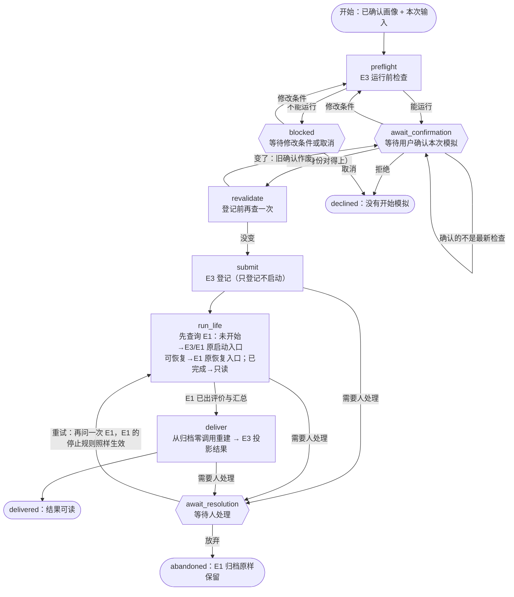

# LangGraph 产品外层流程（原型）

更新：2026-10-18（本地时区 UTC−7）。分支 `langgraph-workflow-prototype`（独立 worktree `C:/dev/homo-spatialis-langgraph`）。任务原文与
两次补充指示见 [prompt 归档](prompts/2026-10-18-langgraph-product-workflow.md)。证据分两轮：

* [第一轮：流程骨架](../../runs/2026-10-18-langgraph-workflow-skeleton/README.md)——E3 当时还在改，E3 / E1 的调用先留占位，只验证流程本身；
* [第二轮：接入真实 E3 / E1](../../runs/2026-10-18-langgraph-e3-wiring/README.md)——E3-A 收尾之后接入，做直接路径与 LangGraph 路径的逐项对照。

**状态：已接入 E3-A 最终版与 E1，离线自测通过，待独立复核。** 规划器只用资料包声明的离线 mock（零网络、零费用，真实 API 调用 0 次）；
没有真实数据、前端、托管服务、账号或并发。这是原型：能证明“外层流程不会让同一次模拟跑两遍、不会重复请求已经保存的回复、出问题时
停下等人”，不能证明生产环境的并发安全，也不能保证供应商那一侧绝不重复收费。

## 1. 一句话

用户确认“按这些个人条件、城市资料与模拟设置开始”之后，流程负责把这件事**做且只做一次**：关掉页面或程序再回来，能接着看进度和结果；
重复点击、进程中途崩溃、重复恢复，都不会再生成一批分身，也不会重复请求已经保存的规划回复。

## 2. 一个用户故事（合成用户 u501，离线 mock 规划器）

1. **开始**：u501 已经在 E3 确认了画像（全职文员，六维 30/20/20/10/10/10，物质里便利占 40，现金 3,000 美元）。流程拿着这份已确认
   画像和本次输入（便利版整套资料包），调用 E3 的运行前检查，然后停下，把 E3 的 ProductPreflight 原样交给前端：两座合成城 K51、M52，
   每城 1 个分身，3 年，离线 mock 规划器，最多 18 次规划调用，可执行、可评分。这时 E3 的登记表与 E1 的归档都还不存在。
2. **确认**：u501 点“开始模拟”，确认里带着她看到的那份检查的身份（`confirm_with`）。流程在登记之前再查一次：资料包、画像、编译出的
   E1 输入都没变，才用稳定的幂等键交给 E3 登记（只登记，不启动），拿到运行编号，再交给 E1 跑。
3. **关掉程序**：E1 跑到第 3 次规划调用时，服务进程被结束（测试里真的结束进程，`os._exit`）。这时 E1 归档里已经有前两次调用的回复、
   检查与已接受的行动；流程的 checkpoint 停在“正在运行”。
4. **恢复**：另起一个进程调用“恢复”。流程先**查询** E1：进度文件说“还在运行”，属于 E1 支持恢复的位置，于是调用 E1 原有的恢复入口
   `resume_run`。E1 逐条核对归档，复用前两次的回复，只重新请求被打断的第 3 次和后面的 3 次。
5. **看结果**：流程从 E1 归档零调用重建结果，交给 E3 投影：两座城都是“完成且可评价”，平均 J 分别是 0.6078、0.6145（合成设定，
   不是现实城市的评价）。这个结果与“同一份输入、从头到尾没出故障”的 E3 直接路径**逐字节相同**（第 8 节）。

外层“已交付”只说明结果可以读了，不代表每个分身都正常完成：出局（E）与模拟问题（M）照实显示，不互换；没生成的结果是空，不补零。

## 3. 流程图



六边形是**等待节点**：第一句就是 LangGraph 的 `interrupt`，前面没有任何写操作（LangGraph 恢复时会从头重跑被中断的节点）。
有副作用的只有 `submit`（登记）与 `run_life`（启动或恢复 E1）；它们都可能在崩溃后被整段重跑，所以都是“先查询、再决定”。
没有任何节点配 LangGraph 的自动重试。

## 4. 谁管什么

| | 负责 | 不负责 |
|---|---|---|
| **LangGraph 外层流程**（`src/workflows/graph.py`、`runtime.py`） | 预检查 → 确认 → 登记 → 启动或恢复 → 交付的顺序；等待用户与等待处理；checkpoint 持久化；幂等键与运行编号的绑定；公开视图里的流程阶段 | 生活、钱、病情、评分；模型调用与重试；预算；结果的任何数字 |
| **接入层**（`src/workflows/e3_adapters.py`） | 按引用加载并核对 E3 对象；调用 E3 / E1 的正式入口；把 E1 的状态映射成“未开始 / 可恢复 / 已完成 / 需要处理” | 不复制 E3 的字段定义，不重写生活、评分或评价数学 |
| **E1**（`orchestration`、`agentlayer`、`econ`） | 分身调度、年度候选与有限修订、服务重试、预算账本、发送意图与结果、归档、恢复与重放、评价与汇总 | 用户确认、产品阶段 |
| **E3**（`product`、`common.product_contracts`） | 已确认画像、运行前检查、登记语义、进度与结果的公开投影、公开错误；**共享接口的唯一权威** | 流程顺序 |
| **E5**（界面，尚未开始） | 展示检查结果、确认按钮、进度、结果与限制；同一次“开始”的重复点击用同一个幂等键 | 不读 checkpoint、`graph.get_state` 或内部异常；不另写评分 |

## 5. 怎样使用（本地演示入口）

入口 `scripts/product_workflow.py`。`--services e3` 是真实接入，需要一个 E3 工作目录（`e3-seed` 会准备它）；`--services synthetic`
（默认）是第一轮的合成替身，只检验流程本身。

```bash
uv run python scripts/product_workflow.py --e3-workspace <目录> e3-seed --example normal
uv run python scripts/product_workflow.py --services e3 --e3-workspace <目录> --db <库> start --workflow-id W1 --profile confirmed.draft.u501.r1 --inputs normal
uv run python scripts/product_workflow.py --services e3 --e3-workspace <目录> --db <库> status --workflow-id W1
uv run python scripts/product_workflow.py --services e3 --e3-workspace <目录> --db <库> confirm --workflow-id W1 --preflight <公开视图里的 confirm_with>
uv run python scripts/product_workflow.py --services e3 --e3-workspace <目录> --db <库> resume --workflow-id W1
uv run python scripts/product_workflow.py --services e3 --e3-workspace <目录> --db <库> resolve --workflow-id W1 --action retry
```

`e3-seed` 的例子与 E3 自己的测试场景是同一组合成输入：`normal`（u501）、`mixed`（u603，C / E / M 都有）、`all_exit`（u604，全部出局）、
`paused`（u606，mock 抛意外异常，E1 暂停批次）。每个命令都输出同一种**公开视图** JSON：

| 字段 | 含义 |
|---|---|
| `stage` / `stage_zh` | 流程阶段（checking、awaiting_confirmation、blocked、declined、submitting、running、needs_attention、delivered、abandoned） |
| `waiting_for` | 现在在等谁：`confirmation`（用户确认）、`revision`（修改条件）、`resolution`（维护者处理），或空 |
| `preflight` / `confirm_with` | E3 的 ProductPreflight 原样放在 `preflight.public`；确认时要带回 `confirm_with`（那份检查的身份） |
| `run_id` / `progress` / `result` | 绑定的运行、E3 的 RunProgress 与 ProductResult（流程不解析、不重算；还没开始时进度为空） |
| `attention` / `notice` / `error` | 公开代码 + 固定中文说明 + 审计编号；不含异常原文、本机路径或密钥 |

Python 接口是 `workflows.runtime.WorkflowRuntime(数据库, e3_services(工作目录))`：`start`、`confirm`、`decline`、`revise`、`resume`、
`resolve`、`status`。所有操作都先核对流程版本与“现在在等什么”：不在等确认时再确认，只返回提示 `already_confirmed` /
`nothing_pending`，不推进流程。幂等键在开始流程时就按 E3 `RunSubmission` 的字段约束校验（不合格当场拒绝，不建流程）。

**流程编号（thread_id）只是一次外层流程的名字，不是用户身份，也不是访问权限。** 谁能操作哪个流程，要由将来的服务层管。

## 6. 外层存什么、不存什么

checkpoint（SQLite）里只有：流程编号与版本（`lg-product-flow-v0`）、已确认画像与本次输入的**引用和内容身份**、最近一次预检查的
引用与结论、用户对本次模拟的确认（绑定检查身份）、幂等键、运行编号、归档与结果的引用、当前阶段、待处理事项的公开代码。

钱、病情、资格、年度评分、检查报告与结果正文都**不在** checkpoint 里。E1 的生活状态只在 E1 归档里；结果在交付时从 E1 归档零调用
重建（`orchestration.life_outcome.outcome_from_archive`，先过 E1 官方重放核对），由 E3 投影。checkpoint 读回时不反序列化任何业务对象，
不会绕过 E1 的年度封存检查。登记之后运行编号不能换；任何服务返回了别的运行编号，流程停在 `run_binding_conflict`。

接入层在 E3 工作目录的 `workflow/` 下存自己的文件（已确认画像、本次输入、预检查记录、编译目录的归属、运行索引、E3 回执、已投影的
结果）；E3 的登记表在 `registry/`，E1 归档在 `archive/<运行编号>/`，都是它们自己的格式。读回这些文件时都按内容身份核对，对不上就
停在 `reference_stale` 或 `archive_conflict`，不当作内部错误，也不改写原文件。

**公共接口与内部状态的区别**：E3 的 ProductPreflight / RunReceipt / RunProgress / ProductResult 是公共接口，前端只经公开视图读它们；
流程阶段、checkpoint、接入层的 `workflow/` 文件与诊断都是内部状态。等待确认是**流程内部**的阶段，展示的是 E3 现有的
ProductPreflight，没有冒用 `RunProgress.paused`，也没有给 E3 的结构加字段。

## 7. 已验证的中断位置与仍不支持的情况

**真实 E3 / E1**（`tests/workflows/test_e3_wiring.py`；崩溃都是真的结束进程，E1 的停下用包住 mock 的离线故障注入，不花钱）：

| 位置 | 结果 |
|---|---|
| 等待确认时进程退出 | 另一个进程读回同一份 ProductPreflight 与 `confirm_with`；确认之前 E3 登记表与 E1 归档都不存在 |
| E3 登记已写下、流程还没记下 | 恢复后 E3 返回同一个运行（`duplicate_same_run`）；登记表 1 条、归档 1 个 |
| E1 第 3 次规划调用开始时进程被结束 | 恢复走 E1 的 `resume_run`；前两次的回复复用，不再请求；结果与无故障的直接路径逐字节相同 |
| E1 已出评价与汇总、流程还没记下 | 恢复只查询与读取：归档逐字节不变，规划调用 0 次 |
| E1 服务失败停下（`halted / service_unavailable`） | 停在 `needs_attention`，“恢复”不会自己重试；人发起重试后经 `resume_run` 接上，结果与直接路径逐字节相同 |
| 发送不确定、预算不足、凭证问题 | 连续三次人工重试仍停在原处（`uncertain_send` / `budget_blocked` / `run_halted`），规划调用次数与归档都不变；放弃也不碰归档 |
| 归档被改、编译出的配置变了、运行索引对不上、运行目录只建了一半、E1 报告被改 | 在执行或投影之前拒绝（`archive_conflict` / `run_binding_conflict` / `run_partially_initialized`），原文件逐字节不变 |

**合成替身**（`tests/workflows/test_workflow_graph.py`，第一轮）另外覆盖了确认门槛、重复操作、流程版本不符、外部追踪等流程本身的行为。

**仍不支持或尚未验证：**

* 中断位置以 E1 已支持的为准（年度边界、两份候选之间，以及 E1-7A/7B 记录的允许中断位置）；不宣称任意指令位置都可恢复。
* 真实模型规划器：接入层只接受资料包声明的离线 mock（与 E3 的 `bridge.run_offline` 相同），遇到真实模型报 `real_planner_not_supported`；
  真实模型运行要按 E1-7B 的规则另行授权预算、接上预算账本后再接。
* 发送状态不确定等需要维护者核对的停下：流程只会停着，没有提供核对与解除的操作；解除要按 E1 的规则在流程之外处理。
* 串行、单执行者：同一个数据库与同一个 E3 工作目录同一时间只应有一个进程推进，没有跨进程锁，不支持并发；不是托管服务，没有账号
  与访问控制。
* 外部追踪：环境里开着 LangSmith / LangChain 追踪时流程拒绝启动（不替用户悄悄关掉）。
* 同一个幂等键可以被两个流程编号共用（例如前端两次点击开了两个流程）：两者绑定同一个运行，第二个只读结果；这依赖前端传稳定的键。
* 有一次合成替身的崩溃类测试在高负载下偶发失败、之后加压 12 次都没有复现，原因未查明（第一轮证据第 4 节）。

## 8. 直接路径与 LangGraph 路径的对照

规则在比较之前写下（[expected_differences.md](../../runs/2026-10-18-langgraph-e3-wiring/expected_differences.md)）：只允许 E3 消息里的
`meta.sample`、归档目录名、直接路径故意多做的第二次登记、流程自己的文件四项不同。对照脚本
`runs/2026-10-18-langgraph-e3-wiring/equivalence/compare_paths.py`，结果 `compare_paths.json`：

| 对照 | 结果 |
|---|---|
| normal、mixed、all_exit、paused 四个场景 | 已确认画像、预检查（含身份）、登记回执、运行编号、编译出的 4 个 E1 输入文件、E3 登记表、E1 归档的每个文件（19–20 个）、每个分身每一年的生活对象（结算、资源账、评分、疾病、交接）、RunProgress、ProductResult（含结果身份）全部相同 |
| normal + 第 3 次调用服务失败、人工重试 | 同上全部相同；实际调用 7 次、6 个不同请求（失败的那一次没有回复，重试时重新请求） |
| normal + 第 3 次调用开始时进程被结束、另起进程恢复 | 同上全部相同；两个进程分别调用 3 次与 4 次、6 个不同请求（被打断的那一次重新请求，已保存的两次没有） |

也就是说：行动、现金、病情、资源、逐月评分、L / V / J、C / E / M 与公开报告完全相同；不同的只有流程身份、checkpoint 与接入层自己的
记录。第一次试跑对照时发现过一处差异，是接入层的缺陷（见第 10 节第 1 条），修正之后才运行正式对照。

## 9. 接入层怎样接 E3 / E1

| 接口 | 接到 | 说明 |
|---|---|---|
| `PreflightPort.check` / `describe` | `product.preflight.run_preflight` | 编译进 `compiled/<输入名>`；同一输入、同一编译目录重复检查得到同一身份（实测）。已登记运行占用的编译目录名，不同条件不能再用（`workspace_conflict`） |
| `SubmissionPort.submit` | `product.bridge.submit` | 只登记；同键同检查返回原运行，同键不同检查由 E3 拒绝（`identity_conflict`）。登记前写下编译目录的归属 |
| `LifeRunPort.inspect` | 读 E1 进度与归档（只读） | 先按编译出的配置重建 E1 运行世界，核对 E1 运行身份与预检查记下的一致 |
| `LifeRunPort.start` | `product.bridge.run_offline`（E3 原有入口 → E1 `start_run`） | 只在 inspect 判定“未开始”时调用 |
| `LifeRunPort.resume` | `orchestration.life_runner.resume_run`（E1 原有入口） | 只在 inspect 判定“可恢复”时调用；E1 自己核对归档、复用回复、不清零计数 |
| `ProjectionPort.progress` / `result` | `product.bridge.progress` / `product.results.project_result` | 结果需要的 `RunOutcome` 由 `orchestration.life_outcome.outcome_from_archive` 从归档零调用重建 |

`src/orchestration/life_outcome.py` 是这次在 E1 编排包里**新增**的小模块：先调用 E1 官方的 `replay_run` 核对（运行清单、归档记录、逐年
绑定、评价与报告），再按同一条执行路径重建生活对象，评价与报告再与归档比一次，然后返回 `RunOutcome`。没有改 `life_runner.py`（它在
运行清单的关键源码名单里，改一个字就会让所有已有归档在新代码下被按身份拒绝；而且另一个窗口同时在改它）。实测：E3 直接路径的
三个场景里，用重建的 `RunOutcome` 投影出的产品结果与运行器原地给出的逐字节相同。

## 10. 给 E3 的同步清单（建议，不是本轮的修改）

共享接口由 E3 统一维护，本轮没有改 `common.product_contracts`、导出的 schema 或 E3 的交接说明。请 E3 决定：

1. **已确认画像的键顺序会改变预检查身份（接入时发现）**：E3 编译时按传入顺序写 YAML（`sort_keys=False`），点数字典的键顺序进入
   编译产物、预检查身份与 E1 运行身份——两份内容身份相同（`content_fingerprint` 相同）的已确认画像，键顺序不同就得到不同的预检查身份
   与运行编号。接入层第一次试跑时把画像按键排序存盘，于是与直接路径对不上；现在原样保留顺序。E3-C 如果把画像存进会重排键的地方
   （例如 PostgreSQL 的 `jsonb`），同一份确认重新检查时会被当成“条件变了”，同一个幂等键还会被拒绝。建议编译时按资料包声明的维度顺序
   规范化。
2. `RunProgress` 没有“提交前等待确认”的阶段：本原型把它留在流程内部。若前端需要统一的阶段字段，请 E3 增加，不要由流程另造。
3. `RunReceipt.service` 只有 `offline_bridge` 与示例值：经流程登记的运行现在照样是 `offline_bridge`。若要区分，请 E3 定义取值。
4. 幂等键：流程开始时按 `RunSubmission.idempotency_key` 的字段约束（目前 8–80 个字符）校验，约束直接从 E3 的结构读，不抄数字。
   产品里应当由前端传键，同一次“开始”的重复点击用同一个键。
5. 预检查身份：本原型里它覆盖画像、资料包（含规划器与调用上限）、编译出的 E1 输入与 E1 运行身份；真实模型的预算与报价要等真实
   规划器接入时再核对是否也在里面。
6. 断线后的结果查询：E3 目前只在同一进程里投影结果。E3-C 可以直接用 `orchestration.life_outcome.outcome_from_archive`（只读、零调用、
   先过 E1 官方重放核对），或者另定一个 E3 自己的入口；不要从 JSON 拼 `RunOutcome`。
7. 与流程相关的 E5 请求请统一经 E3 的接口回复（主工作区另有 `docs/handoffs/e5-to-e3-interface-requests.md`，本轮没有读取或修改）。
8. E3 与 E5 交接说明里加一句：流程阶段（本文第 5 节）与生活结果分开显示。

## 11. E3-C 与 E5 接下来调用什么

* **E3-C（业务服务）**：在服务层包一层 `WorkflowRuntime(数据库, e3_services(工作目录))`：一个产品运行请求对应一个流程编号；RunSubmission
  的幂等键作为 `start(idempotency_key=...)` 传入；运行前检查、确认、查询、恢复、处理分别对应 `start`、`confirm`、`status`、`resume`、`resolve`。
  服务层负责谁能操作哪个流程（流程编号不是权限），保证同一个数据库与工作目录只有一个执行者（本原型没有锁），把接入层的工作目录换成
  服务端的存储时保留文件里的键顺序（第 10 节第 1 条）。
* **E5（界面）**：只调用 E3-C 的服务，展示公开视图：`waiting_for = confirmation` 时展示 `preflight.public` 与“开始模拟”按钮，确认时把
  `confirm_with` 原样带回；`needs_attention` 时展示 `attention.message_zh` 与审计编号，不提供“自动重试”；`delivered` 时展示 `result`，
  流程阶段与生活结果分开显示。界面断线重连只查询，不重新提交。
* 两边都不读 checkpoint、`graph.get_state`、接入层的 `workflow/` 文件或 `diagnostics/`（那是维护者用审计编号查的内部记录）。

## 12. 依赖与旧入口

新增依赖（`pyproject.toml`，版本锁在 `uv.lock`）：`langgraph` 1.2.16、`langgraph-checkpoint` 4.3.0、`langgraph-checkpoint-sqlite` 3.1.2
（随之装入 `langchain-core` 1.6.12、`langsmith` 0.14.11 等；`langsmith` 是 LangGraph 的依赖，流程不使用它，追踪开着就拒绝启动）。

**旧入口照旧可用，本轮没有改**：`scripts/run_life_e1_7b.py` 与 `scripts/product_e3a.py` 一行没动（CLI 的默认配置随主线：本分支的
21:26 快照里是 Flash 配置；主工作区里另一路已按 ADR0035 改成 Haiku 测试规划器配置，合并时以主线为准）。不想用新流程时直接继续用
它们；`common`、`econ`、`ledger`、`agentlayer`、`product`、`orchestration` 都不依赖 LangGraph 或流程包（`tests/workflows/test_isolation.py`
检查），删掉 `src/workflows/` 与新入口不影响任何旧功能；`orchestration/life_outcome.py` 只依赖 E1 自己的模块。

## 13. 代码与测试入口

| 文件 | 内容 |
|---|---|
| `src/workflows/state.py` | 流程状态（只有引用与阶段）、流程版本、公开代码与中文说明 |
| `src/workflows/ports.py` | 四个服务接口、`AttentionRequiredError`、`NotWiredError` |
| `src/workflows/graph.py` | StateGraph（节点、路由、设计约束） |
| `src/workflows/runtime.py` | SQLite 持久化、操作入口、公开视图、本地诊断、追踪检查 |
| `src/workflows/e3_adapters.py` | 真实 E3 / E1 接入层、本次输入（`RunRequest`）、合成样例 `seed_example`、离线测试钩子 |
| `src/workflows/synthetic.py` | 合成替身（第一轮；文件持久化、故障注入；不是 E1 或 E3） |
| `src/orchestration/life_outcome.py` | 从已结束运行的归档零调用重建 `RunOutcome` |
| `scripts/product_workflow.py` | 本地演示入口 |
| `tests/workflows/` | 54 个用例：真实接入 27（`test_e3_wiring.py`）、合成流程 21（`test_workflow_graph.py`）、隔离 6（`test_isolation.py`）；对照与测试共用 `e3_support.py` |
