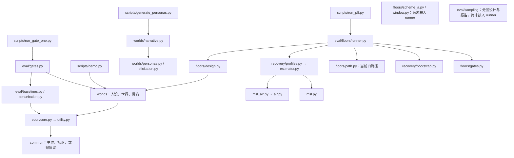

# Python 代码审核、文件用途与依赖图

审核日期：2026-09-28（温哥华）
基线提交：`c3b9171`
范围：Git 跟踪的全部 **133 个 Python 文件、23,253 行**，包括 70 个 `src` 文件、16 个脚本和 47 个测试/fixture 文件。行数包含注释和文档字符串；不把虚拟环境、第三方包及运行产物算作项目源码。

## 结论

这是一个以**合成实验、福利真值和偏好回收**为中心的研究原型。分层总体清楚，经济真值、选择生成、回收与校准已有较完整的单元测试。当前最大的风险是：**新的研究协议已有独立函数和测试，但实际运行入口没有同步切换**。

存在值得清理的重复实现，尤其是 ALR 变换、权重提取、矩统计和诊断脚本的数据构造。自写整个福利模型、研究专用校准与 ALR 面板似然有明确需求，不能仅因为代码量大就认定应替换成通用库。

本次新增审核说明和依赖图，没有修改业务 Python 文件，也没有运行付费模型调用或主规模实验。

## 1. 按优先级列出的问题

### F1 · P1：P8 入口仍执行已被替换的 t 路径

位置：[runner.py:221](../../../src/eval/floors/runner.py:221)，对照 [scheme_a.py:270](../../../src/eval/floors/scheme_a.py:270) 和 [决策 0015](../../../DECISIONS/0015-estimand-scheme-a-and-gate-inputs.md)。

- `scripts/run_p8.py → run_p8 → _lambda_path` 仍在权重空间同时插值均值与协方差，然后调用 `calibrate_logistic_normal`。
- 方案 A 要求固定共享权重中心，仅在 ALR 空间插值协方差，再校准位置。`scheme_a_path` 目前只被包入口再导出和测试调用，没有接入这个运行路径。
- 最小探针给 `_lambda_path` 两个 t 点，证实旧校准器被调用两次；产出仍标记 `interpolated_with_covariance_(1-t)*injected+t*matched`。
- **影响：**用现有 CLI 重跑会得到旧协议的 λ(t)。新模块的测试通过，不能证明 CLI 产物采用了新协议。
- **建议：**为运行入口增加明确的协议字段；正式入口接入 `scheme_a_path`，旧协议须显式选择并标记。增加一条从 CLI/runner 验证实际协议和固定中心的集成测试。

### F2 · P1：门二把地板斜率标准误当作联合窗口标准误

位置：[runner.py:290](../../../src/eval/floors/runner.py:290)，特别是 303–319 行；已有正确汇总接口在 [window.py:68](../../../src/eval/floors/window.py:68)。

- `_bootstrap_window` 接收 `shuffled_arm`，但完全不读取它。每次只重拟合地板臂，最后把 `std(lambda)` 同时写到 `lambda_se` 和 `window_se`。
- 目标应是同次重抽里的 `std(s_shuffled − lambda)`；打乱臂的波动和与地板臂的协方差都不能省略。
- 最小探针把 `shuffled_arm` 换成“任何读取都会报错”的对象，函数依然成功返回，且两个标准误都为 0.1。
- **影响：**门二 2b 的窗口信噪比会算错，方向不一定是偏高。现在默认小 B、空阈值会阻止正式 PASS，但只调大 B、填入阈值并不能修复计算；输出的 `se_basis` 默认还会声称使用了联合窗口。
- **建议：**各臂共用同一次 persona 抽样，重估共享几何，逐 replicate 保存成对斜率，再调用 `window_uncertainty`。正式判定前检查有效次数与 SE 来源。

### F3 · P1：AgentInput 的答案隔离检查可以被正常数据结构绕过

位置：[types.py:452](../../../src/econ/types.py:452) 与 [types.py:478](../../../src/econ/types.py:478)。

- `_reject_answer_side` 只递归 Mapping/Sequence，不遍历 `Observable`、`PersonaBrief` 等 dataclass 字段。把 `PersonaParams` 放入 `Observable.l0_amenities` 后，再构造 `AgentInput`，检查会放行。
- 新增的 `ChoiceSetTruth` 也不在 forbidden 列表中；直接放进 `options` 同样被接受。Python 类型注解本身不会阻止这件事。
- 两条路径均已离线复现。已有边界测试只覆盖顶层答案对象和裸 dict/list 嵌套，没有覆盖 Observable 内部及 ChoiceSetTruth。
- **影响：**后续适配器若序列化这个被接受的 payload，就可能把真值送入提示词，污染回收实验。此次没有向任何模型发送这些对象。
- **建议：**明确校验允许的输入类型，递归检查 dataclass 字段，补齐所有答案侧对象；把序列化后的最终 payload 也纳入边界测试。此修复会涉及受保护的 `src/econ`，应按仓库规则在修复阶段单独处理。

### F4 · P2：两套 ALR→权重转换已发生语义分叉

位置：[alr.py:53](../../../src/eval/recovery/alr.py:53)，对照 [scheme_a.py:74](../../../src/eval/floors/scheme_a.py:74)。

- 回收分支先把每个 ALR 坐标裁剪至 ±40；方案 A 直接使用减去最大值后的稳定 softmax。
- 输入 `a=[60,50,0,0,0,0]`、基准维 0：前者给两个主要维度 `[0.5,0.5]`，后者给 `[0.9999546,0.0000454]`，最大差约 **0.49995**。
- 这不是微小舍入误差：分别裁剪 60 和 50 会抹掉它们之间的差。ALR 优化的解析梯度仍按未裁剪 softmax 推导，也未包含裁剪的导数。
- **影响：**当潜在坐标进入截断区，校准、似然和后验可能不再对应同一个模型。没有据此断言所有既有拟合都受影响；需额外量化历史拟合的截断命中率。
- **建议：**统一一个稳定权重转换；如确需有界参数，应显式建模并匹配梯度。补充极端坐标下的梯度和换基不变性检查。

### F5 · P2：冻结散文仅按流水 ID 绑定，会静默匹配到不同真值

位置：[narrative.py:190](../../../src/worlds/narrative.py:190) 与 [narrative.py:210](../../../src/worlds/narrative.py:210)，ID 来源：[personas.py:138](../../../src/worlds/personas.py:138)。

- 不同 seed/config 抽出的人都会使用 `p00000` 等流水 ID。冻结文件记录散文与 ID，但没有它对应的生成配置/真值指纹。
- `attach_frozen` 仅查 ID。用 seed=10 冻结、再用 seed=11 生成一人，真值不同而 ID 相同，旧散文仍成功绑定。
- **影响：**变更先验、种子或生成算法后，匹配臂可能在不报错的情况下变成错配臂。
- **建议：**将人设生成版本、配置、seed 和答案侧指纹放在独立的冻结清单中；加载时验证，指纹无需进入代理可见文本。补充“同 ID、不同真值必须拒绝”的测试。

## 2. 有没有重复造轮子

### 建议保留的自研部分

| 部分 | 保留理由 |
|---|---|
| `econ/utility.py` 与 `econ/core.py` | 项目专属福利定义、两通道参数映射、计价单位和信息边界，需要一个明确的真值来源。 |
| `worlds/difficulty.py`、`targets.py` | 研究所需的精确并列、福利离散度目标和对抗情境，并非普通随机数据生成。 |
| `recovery/msl_alr.py` | simplex 权重、完整相关结构、面板似然和个体后验一起构成项目所需模型；通用对角 mixed logit 不能直接等价替换。 |
| `recovery/bootstrap.py` | 按人设整块、可分层重抽、重拟合和失败记录是研究语义；通用“对数组做 bootstrap”不是同一接口。 |
| `floors/scheme_a.py` 与共享几何 | 项目特有的校准协议，必须显式实现。 |
| `Money`/`WelfareLevel` | 薄类型的价值在于单位和参照系约束，不必为少量运算引入大型货币框架。 |

本地 xlogit 0.2.7 的能力测试已通过：项目使用它交叉验证对角规格；完整协方差与个体后验由自有后端完成。官方示例也提供面板与随机参数入口，但不能由此推断其能表达本项目完整 ALR 规格。[xlogit 文档](https://xlogit.readthedocs.io/en/stable/)

`msl.py` 和 `msl_alr.py` 对应两种模型，不应整文件合并。它们已共用面板聚合、抽样和后验归一化等底层逻辑；应进一步清晰化公共接口，而非消除有意保留的历史对照。

### 值得减少的重复

| 优先顺序 | 重复位置 | 判断与建议 |
|---|---|---|
| 1 | `recovery/alr.py`、`floors/scheme_a.py`、`sampling/moments.py` | 统一 ALR 正逆变换；已经出现 F4 的实际分叉。位置校准与参数估计保留各自职责。 |
| 2 | `floors/runner.py` 与 `scheme_a.py`/`window.py` | 新旧算法并存但调用链未迁移，比几行重复公式更危险；先修入口。 |
| 3 | `floors/bias.py` 的 `MomentSet`/矩计算与 `sampling/moments.py` 的 `WeightMoments` | 统一估计对象与 ddof。当前前者 `np.cov` 默认 N−1，后者 S 真值规定除 N；N=10 时分母差 11.1%，N=1000 时约 0.1%。 |
| 4 | `floors/design.py:70` 和 `sampling/draw.py:36` 的 `weights_of` | 两份相同的七维权重提取，适合移到一个语义明确的公共函数。narrative 的字典版可在其上薄封装。 |
| 5 | 多个 `scripts/diagnostics/*.py` 的 build/真值抽取/面板似然循环 | 抽出共同的数据构造和只读固定参数评价接口；独立数学交叉核验仍需保留独立实现，否则会丧失抓共同 bug 的能力。 |
| 6 | `msl.py:61` 的 van der Corput/Halton | SciPy 已有 `qmc.Halton`；本项目已有 SciPy 依赖。切换前需保存旧序列协议，核对公共随机数和 golden 输出，不能假定换库不影响数值结果。[官方 API](https://docs.scipy.org/doc/scipy/reference/generated/scipy.stats.qmc.Halton.html) |
| 7 | 多处普通 softmax/log-sum-exp | 可用 SciPy 的稳定实现，避免各自维护溢出处理。按 task 分段的 `reduceat` 实现有特定性能用途，不应盲目替换。[softmax 文档](https://docs.scipy.org/doc/scipy/reference/generated/scipy.special.softmax.html) |
| 8 | `worlds/generator.py:100` 的 `_standard_normal_cdf` | 仓库内未发现调用者，优先删除死代码；如重新需要，复用 `scipy.special.ndtr`。[官方 API](https://docs.scipy.org/doc/scipy/reference/generated/scipy.special.ndtr.html) |

还有一类属于**提前声明的依赖**：在本次 133 个文件的静态导入中，pandas、openpyxl、httpx、tenacity、pyarrow、polars、matplotlib 没有直接调用。它们多数服务尚未实现的数据管线和绘图。可按 data/plots/dev 拆依赖组；这不等于它们在 notebook 或间接依赖中绝对未使用。

## 3. 实际完成程度与架构观察

- **M1 数据抓取未实现。** `data/__init__.py` 是占位，`fetch_data.py` 明确退出；`CLAUDE.md` 的“已完成”状态已过时。
- **M1.5 只落地了 RPP 归一化和若干溯源契约。** `freeze_reference.py` 尚未实现。
- **M2/M3 是当前核心；M5 已有大量实现。** `CLAUDE.md` 把 M5 记为“待做”，同样过时。
- **M4/M6 仍是包占位。** 已有人设散文生成客户端，但它不等于完整的被评估代理层。
- P10 的分层抽样、逐人报告、新路径与联合窗口函数有测试，尚未接到现有 P8 CLI；不应把“函数存在”写成“完整实验已接通”。
- `Makefile` 的 `gates` 当前只调用门一，不能实现文档里“一条命令跑三个门”的描述。
- `econ.types` 与 `econ.utility` 有静态双向依赖：types 中为延迟导入，因此当前不是启动即报错的循环。长期可把选择集统计从基础类型文件拆开，但不值得为画成 DAG 而改经济真值。
- `eval/recovery/__init__.py` 集中再导出多种实现。调用者一旦导入包入口，会装载较大范围的模块；“没有直接箭头”不表示不存在传递依赖。

### 主运行关系概览

箭头表示**使用/依赖**，不是数据流方向；这里隐藏了 `__init__.py` 再导出等细节。

## 4. 验证与边界

- `pytest --tb=short`：**648 passed，3 deselected**，约 40 秒。3 项是默认排除的联网测试。
- Ruff 检查通过；格式检查通过。
- 首轮测试有 20 项因 pytest 临时目录权限失败；获准重跑后全部通过，故不列为代码缺陷。
- F1/F2 使用替身验证调用关系，未进行主规模拟合；F3/F4/F5 通过真实类型/数学/冻结加载函数复现。
- 没有跑真实模型端点、真实数据抓取或完整 P8 数小时实验；本报告不声称审计了既有所有实验产物的数值正确性。
- 对每个文件提取语法树、导入和定义；重点人工检查运行入口、核心数学、数据边界、缓存与重复实现。文件清单完整不等于对全部数学结论作形式证明。

## 5. 逐文件用途与直接依赖

下表每行对应一个 Python 文件。只列项目内的直接显式导入；标准库与第三方依赖不展开。延迟导入也列入，因此不应把表中所有边解释为启动时导入。`__init__.py` 保留为真实节点。

pytest 的 `conftest.py` 由框架自动加载，不要求测试文件显式 import；“无项目内导入”不代表没有 fixture 依赖。依赖图另补充已确认的两个动态加载关系，并标记其类型。

### scripts（8 个文件）

| 文件 | 行数 | 用途 | 直接项目依赖 |
|---|---:|---|---|
| [_bootstrap.py](../../../scripts/_bootstrap.py) | 13 | 让直接运行的脚本能够导入 src 中的包。 | 无显式项目导入 |
| [check_env.py](../../../scripts/check_env.py) | 157 | 检查工具链、凭证来源、模型快照及两个基座的连通性；运行时可能调用网络。 | [scripts/_bootstrap.py](../../../scripts/_bootstrap.py) [common/config.py](../../../src/common/config.py) |
| [demo.py](../../../scripts/demo.py) | 73 | 演示生成世界、人设、福利计算与选择自检的最小流程。 | [scripts/_bootstrap.py](../../../scripts/_bootstrap.py) [common/config.py](../../../src/common/config.py) [common/runlog.py](../../../src/common/runlog.py) [worlds/difficulty.py](../../../src/worlds/difficulty.py) [worlds/generator.py](../../../src/worlds/generator.py) [worlds/personas.py](../../../src/worlds/personas.py) [worlds/selfcheck.py](../../../src/worlds/selfcheck.py) |
| [fetch_data.py](../../../scripts/fetch_data.py) | 13 | M1 数据抓取入口占位；目前仅打印未实现并以退出码 1 结束。 | 无显式项目导入 |
| [freeze_reference.py](../../../scripts/freeze_reference.py) | 13 | M1.5 参照总体/分位表冻结入口占位；目前以退出码 1 结束。 | 无显式项目导入 |
| [generate_personas.py](../../../scripts/generate_personas.py) | 55 | 一次性生成研究人设，调用模型撰写散文并冻结。 | [scripts/_bootstrap.py](../../../scripts/_bootstrap.py) [common/config.py](../../../src/common/config.py) [worlds/dimensions.py](../../../src/worlds/dimensions.py) [worlds/narrative.py](../../../src/worlds/narrative.py) [worlds/personas.py](../../../src/worlds/personas.py) |
| [run_gate_one.py](../../../scripts/run_gate_one.py) | 61 | 读取配置并运行门一，保存个性化收益与问卷噪声地板的比较。 | [scripts/_bootstrap.py](../../../scripts/_bootstrap.py) [common/config.py](../../../src/common/config.py) [common/runlog.py](../../../src/common/runlog.py) [eval/gates.py](../../../src/eval/gates.py) |
| [run_p8.py](../../../scripts/run_p8.py) | 34 | 读取配置、运行 P8 估计器自检并保存结果；实际进入 floors.runner。 | [scripts/_bootstrap.py](../../../scripts/_bootstrap.py) [common/runlog.py](../../../src/common/runlog.py) [eval/floors/__init__.py](../../../src/eval/floors/__init__.py) |

### scripts/diagnostics（8 个文件）

| 文件 | 行数 | 用途 | 直接项目依赖 |
|---|---:|---|---|
| [check_base_change.py](../../../scripts/diagnostics/check_base_change.py) | 556 | 核查 ALR 基准维变换恒等式、似然差距与重优化；管理带数据/规格指纹的拟合缓存。 | [eval/recovery/__init__.py](../../../src/eval/recovery/__init__.py) [eval/recovery/alr.py](../../../src/eval/recovery/alr.py) [eval/recovery/estimator.py](../../../src/eval/recovery/estimator.py) [eval/recovery/msl.py](../../../src/eval/recovery/msl.py) [eval/recovery/msl_alr.py](../../../src/eval/recovery/msl_alr.py) [eval/recovery/profiles.py](../../../src/eval/recovery/profiles.py) [worlds/attributes.py](../../../src/worlds/attributes.py) [worlds/difficulty.py](../../../src/worlds/difficulty.py) [worlds/dimensions.py](../../../src/worlds/dimensions.py) [worlds/generator.py](../../../src/worlds/generator.py) [worlds/personas.py](../../../src/worlds/personas.py) [worlds/selfcheck.py](../../../src/worlds/selfcheck.py) |
| [check_integration_precision.py](../../../scripts/diagnostics/check_integration_precision.py) | 259 | 消费基准变换缓存，在固定参数下检查总体矩和个体后验的积分误差；不验证参数重估精度。 | [scripts/diagnostics/check_base_change.py](../../../scripts/diagnostics/check_base_change.py) [eval/recovery/alr.py](../../../src/eval/recovery/alr.py) [eval/recovery/msl.py](../../../src/eval/recovery/msl.py) [eval/recovery/msl_alr.py](../../../src/eval/recovery/msl_alr.py) |
| [compare_commute.py](../../../scripts/diagnostics/compare_commute.py) | 155 | 比较旧通勤设计与长通勤实验臂的回收表现。 | [eval/recovery/__init__.py](../../../src/eval/recovery/__init__.py) [worlds/attributes.py](../../../src/worlds/attributes.py) [worlds/difficulty.py](../../../src/worlds/difficulty.py) [worlds/dimensions.py](../../../src/worlds/dimensions.py) [worlds/generator.py](../../../src/worlds/generator.py) [worlds/personas.py](../../../src/worlds/personas.py) [worlds/selfcheck.py](../../../src/worlds/selfcheck.py) |
| [compare_p9.py](../../../scripts/diagnostics/compare_p9.py) | 149 | 比较 P9 的差分正态/ALR 参数化和协方差规格，含留出似然。 | [eval/recovery/__init__.py](../../../src/eval/recovery/__init__.py) [eval/recovery/alr.py](../../../src/eval/recovery/alr.py) [eval/recovery/design.py](../../../src/eval/recovery/design.py) [eval/recovery/msl.py](../../../src/eval/recovery/msl.py) [eval/recovery/msl_alr.py](../../../src/eval/recovery/msl_alr.py) [worlds/personas.py](../../../src/worlds/personas.py) |
| [diag1_multistart.py](../../../scripts/diagnostics/diag1_multistart.py) | 166 | 通过多个起点定位 leisure 异常是否由优化落点造成。 | [eval/recovery/__init__.py](../../../src/eval/recovery/__init__.py) [eval/recovery/alr.py](../../../src/eval/recovery/alr.py) [eval/recovery/msl.py](../../../src/eval/recovery/msl.py) [eval/recovery/msl_alr.py](../../../src/eval/recovery/msl_alr.py) [worlds/attributes.py](../../../src/worlds/attributes.py) [worlds/difficulty.py](../../../src/worlds/difficulty.py) [worlds/dimensions.py](../../../src/worlds/dimensions.py) [worlds/generator.py](../../../src/worlds/generator.py) [worlds/personas.py](../../../src/worlds/personas.py) [worlds/selfcheck.py](../../../src/worlds/selfcheck.py) |
| [diag2_tasks.py](../../../scripts/diagnostics/diag2_tasks.py) | 150 | 改变每人不同选择集的数量，分析回收精度与估计器上限。 | [eval/recovery/__init__.py](../../../src/eval/recovery/__init__.py) [worlds/attributes.py](../../../src/worlds/attributes.py) [worlds/difficulty.py](../../../src/worlds/difficulty.py) [worlds/dimensions.py](../../../src/worlds/dimensions.py) [worlds/generator.py](../../../src/worlds/generator.py) [worlds/personas.py](../../../src/worlds/personas.py) [worlds/selfcheck.py](../../../src/worlds/selfcheck.py) |
| [diag3_material.py](../../../scripts/diagnostics/diag3_material.py) | 171 | 定位 material 总体方差低估，并检查进入 P8 的条件。 | [eval/recovery/__init__.py](../../../src/eval/recovery/__init__.py) [eval/recovery/alr.py](../../../src/eval/recovery/alr.py) [eval/recovery/msl.py](../../../src/eval/recovery/msl.py) [eval/recovery/msl_alr.py](../../../src/eval/recovery/msl_alr.py) [worlds/attributes.py](../../../src/worlds/attributes.py) [worlds/difficulty.py](../../../src/worlds/difficulty.py) [worlds/dimensions.py](../../../src/worlds/dimensions.py) [worlds/generator.py](../../../src/worlds/generator.py) [worlds/personas.py](../../../src/worlds/personas.py) [worlds/selfcheck.py](../../../src/worlds/selfcheck.py) |
| [diagnose_commute.py](../../../scripts/diagnostics/diagnose_commute.py) | 252 | 分析通勤维的变化幅度、信息量和理想参数下的个体回收能力。 | [eval/recovery/__init__.py](../../../src/eval/recovery/__init__.py) [worlds/attributes.py](../../../src/worlds/attributes.py) [worlds/difficulty.py](../../../src/worlds/difficulty.py) [worlds/dimensions.py](../../../src/worlds/dimensions.py) [worlds/generator.py](../../../src/worlds/generator.py) [worlds/personas.py](../../../src/worlds/personas.py) [worlds/selfcheck.py](../../../src/worlds/selfcheck.py) |

### src/agentlayer（1 个文件）

| 文件 | 行数 | 用途 | 直接项目依赖 |
|---|---:|---|---|
| [__init__.py](../../../src/agentlayer/__init__.py) | 9 | M4 代理层包说明与占位；没有可运行代理实现。 | 无显式项目导入 |

### src/common（10 个文件）

| 文件 | 行数 | 用途 | 直接项目依赖 |
|---|---:|---|---|
| [__init__.py](../../../src/common/__init__.py) | 6 | common 包标记与职责说明，无计算逻辑。 | 无显式项目导入 |
| [config.py](../../../src/common/config.py) | 233 | 加载 YAML/.env；校验实验配置、固定日期模型版本和密钥来源冲突。 | 无显式项目导入 |
| [countries.py](../../../src/common/countries.py) | 44 | 注册与查找 CountryPack，提供未来跨国扩展的装配入口。 | [common/providers.py](../../../src/common/providers.py) |
| [ids.py](../../../src/common/ids.py) | 100 | 城市、职业、行政区和人口单元标识，防止字符串语义混用。 | 无显式项目导入 |
| [leakcheck.py](../../../src/common/leakcheck.py) | 390 | 扫描文本中的真值数字、权重向量指纹和叙述顺序泄漏。 | 无显式项目导入 |
| [money.py](../../../src/common/money.py) | 144 | 带计价单位的 Money 与 WelfareLevel；阻止跨单位/参照系的无效运算比较。 | 无显式项目导入 |
| [provenance.py](../../../src/common/provenance.py) | 53 | 记录字段来源和 A/B/C 可比性等级。 | 无显式项目导入 |
| [providers.py](../../../src/common/providers.py) | 167 | 定义房价、支出份额、税、舒适度标度与国家数据包的协议及数据结构。 | [common/ids.py](../../../src/common/ids.py) [common/money.py](../../../src/common/money.py) [common/provenance.py](../../../src/common/provenance.py) |
| [runlog.py](../../../src/common/runlog.py) | 139 | 运行 ID、Git 状态元数据及逐次模型调用 JSONL 日志。 | 无显式项目导入 |
| [weights.py](../../../src/common/weights.py) | 88 | 权重向量规范化、归一化熵、距中心距离与最大距离。 | 无显式项目导入 |

### src/data（1 个文件）

| 文件 | 行数 | 用途 | 直接项目依赖 |
|---|---:|---|---|
| [__init__.py](../../../src/data/__init__.py) | 4 | M1 数据获取包说明与占位；没有实际抓取实现。 | 无显式项目导入 |

### src/econ（7 个文件）

| 文件 | 行数 | 用途 | 直接项目依赖 |
|---|---:|---|---|
| [__init__.py](../../../src/econ/__init__.py) | 4 | econ 包标记与真值边界说明，无计算逻辑。 | 无显式项目导入 |
| [core.py](../../../src/econ/core.py) | 454 | 福利装配中心：城市记录→收入/价格/舒适度→可见观察与隐藏真值；提供集合评分与精确并列接口。 | [common/ids.py](../../../src/common/ids.py) [common/money.py](../../../src/common/money.py) [common/providers.py](../../../src/common/providers.py) [econ/graph.py](../../../src/econ/graph.py) [econ/types.py](../../../src/econ/types.py) [econ/utility.py](../../../src/econ/utility.py) [econ/variety.py](../../../src/econ/variety.py) |
| [graph.py](../../../src/econ/graph.py) | 136 | 效用计算的审计图，检查同一原始量是否被重复计入或进入错误项；不是 Python 导入图。 | 无显式项目导入 |
| [kernel.py](../../../src/econ/kernel.py) | 209 | 按实际工资、房租与利率推进多年度状态，累计储蓄并计算效用轨迹。 | [common/ids.py](../../../src/common/ids.py) [common/money.py](../../../src/common/money.py) [econ/types.py](../../../src/econ/types.py) |
| [types.py](../../../src/econ/types.py) | 501 | 人设、城市、观察、真值与 AgentInput 的共享契约；同时实现选择集福利统计和信息边界检查。 | [common/ids.py](../../../src/common/ids.py) [common/money.py](../../../src/common/money.py) [common/providers.py](../../../src/common/providers.py) [econ/utility.py](../../../src/econ/utility.py) |
| [utility.py](../../../src/econ/utility.py) | 374 | Cobb–Douglas 效用、最优消费、对数分解、并列反解、货币度量和福利损失的纯数学真源。 | [econ/types.py](../../../src/econ/types.py) |
| [variety.py](../../../src/econ/variety.py) | 71 | 品种价格调整协议及 V1 恒零实现，保留跨市场商品组合扩展接口。 | [common/ids.py](../../../src/common/ids.py) |

### src/eval（5 个文件）

| 文件 | 行数 | 用途 | 直接项目依赖 |
|---|---:|---|---|
| [__init__.py](../../../src/eval/__init__.py) | 4 | eval 包标记与评估层职责说明。 | 无显式项目导入 |
| [baselines.py](../../../src/eval/baselines.py) | 213 | 计算 L_rep/L_s/L_amen 三条零调用基准线和偏好扰动福利损失；始终按真值计价。 | [common/ids.py](../../../src/common/ids.py) [econ/core.py](../../../src/econ/core.py) [econ/types.py](../../../src/econ/types.py) [econ/utility.py](../../../src/econ/utility.py) |
| [gates.py](../../../src/eval/gates.py) | 194 | 编排门一：福利离散度阶梯、个性化基准、噪声地板、bootstrap 中位数区间与结果保存。 | [common/money.py](../../../src/common/money.py) [common/providers.py](../../../src/common/providers.py) [econ/core.py](../../../src/econ/core.py) [eval/baselines.py](../../../src/eval/baselines.py) [eval/perturbation.py](../../../src/eval/perturbation.py) [worlds/attributes.py](../../../src/worlds/attributes.py) [worlds/generator.py](../../../src/worlds/generator.py) [worlds/personas.py](../../../src/worlds/personas.py) [worlds/targets.py](../../../src/worlds/targets.py) |
| [individual.py](../../../src/eval/individual.py) | 255 | 从已拟合后验构建逐人误差表，按事前/真值分组并比较各臂；目前未接入运行入口。 | 无显式项目导入 |
| [perturbation.py](../../../src/eval/perturbation.py) | 220 | 生成满足总和与边界限制的问卷扰动，并诊断扰动的熵偏移。 | [common/weights.py](../../../src/common/weights.py) |

### src/eval/floors（11 个文件）

| 文件 | 行数 | 用途 | 直接项目依赖 |
|---|---:|---|---|
| [__init__.py](../../../src/eval/floors/__init__.py) | 138 | P8 对外 API 的集中再导出；导出新函数不代表运行入口已调用它。 | [eval/floors/bias.py](../../../src/eval/floors/bias.py) [eval/floors/design.py](../../../src/eval/floors/design.py) [eval/floors/gates.py](../../../src/eval/floors/gates.py) [eval/floors/geometry.py](../../../src/eval/floors/geometry.py) [eval/floors/path.py](../../../src/eval/floors/path.py) [eval/floors/reuse.py](../../../src/eval/floors/reuse.py) [eval/floors/runner.py](../../../src/eval/floors/runner.py) [eval/floors/scheme_a.py](../../../src/eval/floors/scheme_a.py) [eval/floors/sigma.py](../../../src/eval/floors/sigma.py) [eval/floors/window.py](../../../src/eval/floors/window.py) |
| [bias.py](../../../src/eval/floors/bias.py) | 210 | 对已知注入总体构造偏差表：均值、协方差、逐人误差及高/低方差校准案例。 | [eval/floors/design.py](../../../src/eval/floors/design.py) [eval/recovery/__init__.py](../../../src/eval/recovery/__init__.py) [eval/recovery/profiles.py](../../../src/eval/recovery/profiles.py) [worlds/personas.py](../../../src/worlds/personas.py) |
| [design.py](../../../src/eval/floors/design.py) | 198 | 定义 P8 参考设计，生成真值 softmax 地板臂与合成打乱臂。 | [econ/types.py](../../../src/econ/types.py) [eval/recovery/__init__.py](../../../src/eval/recovery/__init__.py) [worlds/attributes.py](../../../src/worlds/attributes.py) [worlds/difficulty.py](../../../src/worlds/difficulty.py) [worlds/dimensions.py](../../../src/worlds/dimensions.py) [worlds/generator.py](../../../src/worlds/generator.py) [worlds/personas.py](../../../src/worlds/personas.py) [worlds/selfcheck.py](../../../src/worlds/selfcheck.py) |
| [gates.py](../../../src/eval/floors/gates.py) | 299 | 计算门二测量窗口和门三不一致度依赖，并输出 pass/fail/pending 等状态。 | 无显式项目导入 |
| [geometry.py](../../../src/eval/floors/geometry.py) | 174 | 构建共享中心、距离和方向，计算投影、臂斜率及坍缩比例。 | 无显式项目导入 |
| [path.py](../../../src/eval/floors/path.py) | 220 | 历史权重空间均值/协方差校准与路径可行性检查；仍被 P8 入口调用。 | [eval/recovery/alr.py](../../../src/eval/recovery/alr.py) |
| [reuse.py](../../../src/eval/floors/reuse.py) | 176 | 比较实验设计描述，决定一条地板能否用于另一次实验。 | 无显式项目导入 |
| [runner.py](../../../src/eval/floors/runner.py) | 329 | P8 自检的实际编排与落盘；旧路径和仅地板臂 bootstrap 尚未替换。 | [eval/floors/bias.py](../../../src/eval/floors/bias.py) [eval/floors/design.py](../../../src/eval/floors/design.py) [eval/floors/gates.py](../../../src/eval/floors/gates.py) [eval/floors/geometry.py](../../../src/eval/floors/geometry.py) [eval/floors/path.py](../../../src/eval/floors/path.py) [eval/floors/sigma.py](../../../src/eval/floors/sigma.py) [eval/recovery/__init__.py](../../../src/eval/recovery/__init__.py) [eval/recovery/design.py](../../../src/eval/recovery/design.py) [eval/recovery/msl_alr.py](../../../src/eval/recovery/msl_alr.py) [eval/recovery/schema.py](../../../src/eval/recovery/schema.py) [worlds/difficulty.py](../../../src/worlds/difficulty.py) [worlds/generator.py](../../../src/worlds/generator.py) [worlds/personas.py](../../../src/worlds/personas.py) |
| [scheme_a.py](../../../src/eval/floors/scheme_a.py) | 287 | 方案 A：固定共享权重中心，在 ALR 协方差路径上校准位置，并用独立抽样核验。 | 无显式项目导入 |
| [sigma.py](../../../src/eval/floors/sigma.py) | 254 | 统计重复选择分歧率，在同批情境上二分标定噪声 σ，并提供合成重复数据。 | 无显式项目导入 |
| [window.py](../../../src/eval/floors/window.py) | 155 | 由同次 replicate 的打乱/地板斜率差计算联合窗口标准误和区间。 | 无显式项目导入 |

### src/eval/recovery（13 个文件）

| 文件 | 行数 | 用途 | 直接项目依赖 |
|---|---:|---|---|
| [__init__.py](../../../src/eval/recovery/__init__.py) | 271 | P9 对外 API 的集中再导出与使用说明；导入该包会装载多个回收子模块。 | [eval/recovery/alr.py](../../../src/eval/recovery/alr.py) [eval/recovery/bootstrap.py](../../../src/eval/recovery/bootstrap.py) [eval/recovery/design.py](../../../src/eval/recovery/design.py) [eval/recovery/estimator.py](../../../src/eval/recovery/estimator.py) [eval/recovery/identifiability.py](../../../src/eval/recovery/identifiability.py) [eval/recovery/inversion.py](../../../src/eval/recovery/inversion.py) [eval/recovery/msl.py](../../../src/eval/recovery/msl.py) [eval/recovery/msl_alr.py](../../../src/eval/recovery/msl_alr.py) [eval/recovery/profiles.py](../../../src/eval/recovery/profiles.py) [eval/recovery/results.py](../../../src/eval/recovery/results.py) [eval/recovery/schema.py](../../../src/eval/recovery/schema.py) |
| [alr.py](../../../src/eval/recovery/alr.py) | 157 | ALR 坐标与权重互换、Cholesky 参数化和总体矩；当前有 ±40 坐标裁剪。 | [eval/recovery/design.py](../../../src/eval/recovery/design.py) |
| [bootstrap.py](../../../src/eval/recovery/bootstrap.py) | 205 | 按人设整块重抽（可分层）、重新拟合并汇总指标/分位区间。 | [eval/recovery/estimator.py](../../../src/eval/recovery/estimator.py) [eval/recovery/results.py](../../../src/eval/recovery/results.py) [eval/recovery/schema.py](../../../src/eval/recovery/schema.py) |
| [design.py](../../../src/eval/recovery/design.py) | 137 | 基准维选择、差分设计矩阵、效用恒等式及条件数/维度变化诊断。 | [worlds/dimensions.py](../../../src/worlds/dimensions.py) |
| [estimator.py](../../../src/eval/recovery/estimator.py) | 303 | 通用回收入口：选择差分正态或 ALR 后端，反解权重并组装诊断和多基准稳健性结果。 | [eval/recovery/design.py](../../../src/eval/recovery/design.py) [eval/recovery/inversion.py](../../../src/eval/recovery/inversion.py) [eval/recovery/msl.py](../../../src/eval/recovery/msl.py) [eval/recovery/msl_alr.py](../../../src/eval/recovery/msl_alr.py) [eval/recovery/results.py](../../../src/eval/recovery/results.py) [eval/recovery/schema.py](../../../src/eval/recovery/schema.py) [worlds/dimensions.py](../../../src/worlds/dimensions.py) |
| [identifiability.py](../../../src/eval/recovery/identifiability.py) | 169 | 检查选择集内部的有效属性信息、单纯形切空间秩和各维独有变化。 | [eval/recovery/design.py](../../../src/eval/recovery/design.py) [eval/recovery/schema.py](../../../src/eval/recovery/schema.py) [worlds/dimensions.py](../../../src/worlds/dimensions.py) |
| [inversion.py](../../../src/eval/recovery/inversion.py) | 127 | 差分正态分支的系数→权重反解、协方差回构、尺度退化与单纯形检查。 | [eval/recovery/design.py](../../../src/eval/recovery/design.py) |
| [msl.py](../../../src/eval/recovery/msl.py) | 452 | 差分正态面板混合 logit 模拟似然、解析梯度、抽样和个体后验；也提供两分支共用底层函数。 | [eval/recovery/design.py](../../../src/eval/recovery/design.py) [eval/recovery/schema.py](../../../src/eval/recovery/schema.py) |
| [msl_alr.py](../../../src/eval/recovery/msl_alr.py) | 283 | ALR/logistic-normal 分支的模拟似然、梯度、优化和个体后验。 | [eval/recovery/alr.py](../../../src/eval/recovery/alr.py) [eval/recovery/design.py](../../../src/eval/recovery/design.py) [eval/recovery/msl.py](../../../src/eval/recovery/msl.py) [eval/recovery/schema.py](../../../src/eval/recovery/schema.py) |
| [profiles.py](../../../src/eval/recovery/profiles.py) | 205 | 冻结 ALR+完整协方差+material 研究规格，以多个起点拟合并选择最高模拟似然。 | [eval/recovery/alr.py](../../../src/eval/recovery/alr.py) [eval/recovery/design.py](../../../src/eval/recovery/design.py) [eval/recovery/estimator.py](../../../src/eval/recovery/estimator.py) [eval/recovery/msl.py](../../../src/eval/recovery/msl.py) [eval/recovery/msl_alr.py](../../../src/eval/recovery/msl_alr.py) [eval/recovery/results.py](../../../src/eval/recovery/results.py) [eval/recovery/schema.py](../../../src/eval/recovery/schema.py) |
| [results.py](../../../src/eval/recovery/results.py) | 208 | 总体/个体回收结果、单纯形合法性、协方差诊断及序列化摘要。 | [eval/recovery/inversion.py](../../../src/eval/recovery/inversion.py) [worlds/dimensions.py](../../../src/worlds/dimensions.py) |
| [schema.py](../../../src/eval/recovery/schema.py) | 301 | 验证并排序长表选择数据，建立人设/情境索引，转换 M2 特征并支持整人重抽。 | [econ/utility.py](../../../src/econ/utility.py) [worlds/dimensions.py](../../../src/worlds/dimensions.py) |
| [xlogit_backend.py](../../../src/eval/recovery/xlogit_backend.py) | 106 | 调用 xlogit 交叉验证差分正态的对角规格，检查本地库能力边界。 | [eval/recovery/design.py](../../../src/eval/recovery/design.py) [eval/recovery/schema.py](../../../src/eval/recovery/schema.py) |

### src/eval/sampling（6 个文件）

| 文件 | 行数 | 用途 | 直接项目依赖 |
|---|---:|---|---|
| [__init__.py](../../../src/eval/sampling/__init__.py) | 130 | P10 对外 API 再导出及估计对象口径说明。 | [eval/sampling/draw.py](../../../src/eval/sampling/draw.py) [eval/sampling/moments.py](../../../src/eval/sampling/moments.py) [eval/sampling/plan.py](../../../src/eval/sampling/plan.py) [eval/sampling/report.py](../../../src/eval/sampling/report.py) [eval/sampling/strata.py](../../../src/eval/sampling/strata.py) |
| [draw.py](../../../src/eval/sampling/draw.py) | 162 | 按冻结层边界及配额抽人设，记录实际层人数、设计权重和未使用样本。 | [econ/types.py](../../../src/econ/types.py) [eval/sampling/plan.py](../../../src/eval/sampling/plan.py) [eval/sampling/strata.py](../../../src/eval/sampling/strata.py) [worlds/dimensions.py](../../../src/worlds/dimensions.py) [worlds/personas.py](../../../src/worlds/personas.py) |
| [moments.py](../../../src/eval/sampling/moments.py) | 220 | 区分 P 原总体/Q 配额总体/S 实现名单的矩，计算真值协方差及 ALR 矩。 | [worlds/personas.py](../../../src/worlds/personas.py) |
| [plan.py](../../../src/eval/sampling/plan.py) | 300 | 分配比例/等额/尾部加强配额，定义抽样计划、层实现和两种设计权重。 | [eval/sampling/strata.py](../../../src/eval/sampling/strata.py) |
| [report.py](../../../src/eval/sampling/report.py) | 199 | 分别输出总体加权报告、层内条件报告及明确选择权重口径的跨层回归。 | [eval/sampling/plan.py](../../../src/eval/sampling/plan.py) |
| [strata.py](../../../src/eval/sampling/strata.py) | 161 | 以注入均值计算事前距离 z，从独立参照总体冻结层界和层概率。 | [worlds/personas.py](../../../src/worlds/personas.py) |

### src/ledger（2 个文件）

| 文件 | 行数 | 用途 | 直接项目依赖 |
|---|---:|---|---|
| [__init__.py](../../../src/ledger/__init__.py) | 4 | ledger 包标记与溯源/参照表职责说明；完整数据流水线尚未实现。 | 无显式项目导入 |
| [normalization.py](../../../src/ledger/normalization.py) | 34 | 将发布口径的价格指数（如全国=100）归一为模型口径（全国=1）。 | 无显式项目导入 |

### src/ui（1 个文件）

| 文件 | 行数 | 用途 | 直接项目依赖 |
|---|---:|---|---|
| [__init__.py](../../../src/ui/__init__.py) | 1 | M6 前端包说明与占位；没有问卷或结果界面实现。 | 无显式项目导入 |

### src/worlds（13 个文件）

| 文件 | 行数 | 用途 | 直接项目依赖 |
|---|---:|---|---|
| [__init__.py](../../../src/worlds/__init__.py) | 5 | worlds 包标记与合成世界/人设职责说明。 | 无显式项目导入 |
| [attributes.py](../../../src/worlds/attributes.py) | 470 | 七维合成属性的物理锚点、因子载荷、相关结构和长通勤等标定配置。 | [worlds/dimensions.py](../../../src/worlds/dimensions.py) |
| [controls.py](../../../src/worlds/controls.py) | 107 | 构造属性交换、移除人设文字、错配人设文字三个对照组。 | [common/ids.py](../../../src/common/ids.py) [econ/types.py](../../../src/econ/types.py) [worlds/generator.py](../../../src/worlds/generator.py) |
| [difficulty.py](../../../src/worlds/difficulty.py) | 355 | 定义占优、权衡、精确并列、货币幻觉四档情境，并按人设实例化。 | [common/ids.py](../../../src/common/ids.py) [econ/core.py](../../../src/econ/core.py) [econ/types.py](../../../src/econ/types.py) [worlds/dimensions.py](../../../src/worlds/dimensions.py) [worlds/generator.py](../../../src/worlds/generator.py) |
| [dimensions.py](../../../src/worlds/dimensions.py) | 54 | 统一七个偏好维度的名字、顺序及物质/舒适度拆分。 | 无显式项目导入 |
| [elicitation.py](../../../src/worlds/elicitation.py) | 232 | 把定和量表、行为题和受限文本调整映射成人设与效用参数。 | [common/ids.py](../../../src/common/ids.py) [common/providers.py](../../../src/common/providers.py) [econ/types.py](../../../src/econ/types.py) [worlds/dimensions.py](../../../src/worlds/dimensions.py) [worlds/shares.py](../../../src/worlds/shares.py) |
| [generator.py](../../../src/worlds/generator.py) | 380 | 生成带相关属性、税制和增长率的合成城市世界，并按设计矩阵条件数验收。 | [common/ids.py](../../../src/common/ids.py) [econ/core.py](../../../src/econ/core.py) [econ/kernel.py](../../../src/econ/kernel.py) [econ/types.py](../../../src/econ/types.py) [worlds/attributes.py](../../../src/worlds/attributes.py) [worlds/dimensions.py](../../../src/worlds/dimensions.py) [worlds/taxes.py](../../../src/worlds/taxes.py) |
| [narrative.py](../../../src/worlds/narrative.py) | 257 | 把偏好变为定性提示词，生成散文，做泄漏检查、冻结与重新绑定。 | [common/leakcheck.py](../../../src/common/leakcheck.py) [econ/types.py](../../../src/econ/types.py) [worlds/dimensions.py](../../../src/worlds/dimensions.py) |
| [personas.py](../../../src/worlds/personas.py) | 242 | 按非对称 Dirichlet 抽研究人设；提供参照人设及注入均值/协方差闭式解。 | [common/ids.py](../../../src/common/ids.py) [econ/types.py](../../../src/econ/types.py) [worlds/attributes.py](../../../src/worlds/attributes.py) [worlds/dimensions.py](../../../src/worlds/dimensions.py) [worlds/elicitation.py](../../../src/worlds/elicitation.py) [worlds/shares.py](../../../src/worlds/shares.py) |
| [selfcheck.py](../../../src/worlds/selfcheck.py) | 168 | 用 M2 真值和 softmax 噪声生成选择记录，供零模型调用的回收自检。 | [econ/types.py](../../../src/econ/types.py) [worlds/difficulty.py](../../../src/worlds/difficulty.py) |
| [shares.py](../../../src/worlds/shares.py) | 120 | 从家庭规模、居住、汽车、餐饮和参照收入等行为题计算临时支出份额。 | [common/ids.py](../../../src/common/ids.py) [common/providers.py](../../../src/common/providers.py) |
| [targets.py](../../../src/worlds/targets.py) | 244 | 改变城市舒适度，以达到指定福利间隔/离散度；核验实际达成值。 | [common/ids.py](../../../src/common/ids.py) [econ/core.py](../../../src/econ/core.py) [econ/types.py](../../../src/econ/types.py) [econ/utility.py](../../../src/econ/utility.py) |
| [taxes.py](../../../src/worlds/taxes.py) | 111 | 实现合成世界的联邦/州/地方税结构，供福利核心调用；不是现实报税引擎。 | [common/ids.py](../../../src/common/ids.py) [common/money.py](../../../src/common/money.py) |

### tests（11 个文件）

| 文件 | 行数 | 用途 | 直接项目依赖 |
|---|---:|---|---|
| [__init__.py](../../../tests/__init__.py) | 0 | 空文件：把 tests 标记为 Python 包。 | 无显式项目导入 |
| [conftest.py](../../../tests/conftest.py) | 81 | pytest 自动加载的共享 fixture：世界、人设、情境与福利核心。 | [common/money.py](../../../src/common/money.py) [econ/core.py](../../../src/econ/core.py) [worlds/difficulty.py](../../../src/worlds/difficulty.py) [worlds/generator.py](../../../src/worlds/generator.py) [worlds/personas.py](../../../src/worlds/personas.py) |
| [test_baselines.py](../../../tests/test_baselines.py) | 152 | 测试：C1：三条零调用基准线与噪声地板。 | [common/providers.py](../../../src/common/providers.py) [econ/types.py](../../../src/econ/types.py) [eval/baselines.py](../../../src/eval/baselines.py) [eval/perturbation.py](../../../src/eval/perturbation.py) [worlds/personas.py](../../../src/worlds/personas.py) |
| [test_config.py](../../../tests/test_config.py) | 158 | 验证配置校验、模型日期快照、.env 加载、优先级与冲突处理。 | [common/config.py](../../../src/common/config.py) |
| [test_live_base_models.py](../../../tests/test_live_base_models.py) | 80 | 测试：被测基座的连通性冒烟测试。**默认不跑。** | [common/config.py](../../../src/common/config.py) |
| [test_money.py](../../../tests/test_money.py) | 70 | 测试：README §5.8 in executable form. | [common/money.py](../../../src/common/money.py) |
| [test_perturbation.py](../../../tests/test_perturbation.py) | 111 | 测试：问卷粒度扰动的三条约束，以及方向性推力诊断。 | [common/weights.py](../../../src/common/weights.py) [eval/perturbation.py](../../../src/eval/perturbation.py) |
| [test_repo_hygiene.py](../../../tests/test_repo_hygiene.py) | 112 | 测试：CLAUDE.md hard rule 2, checked mechanically. | 无显式项目导入 |
| [test_runlog.py](../../../tests/test_runlog.py) | 73 | 验证运行目录、元数据和逐行模型调用日志的写入/读取。 | [common/runlog.py](../../../src/common/runlog.py) |
| [test_seams.py](../../../tests/test_seams.py) | 251 | 测试：The cross-country claim, made falsifiable. | [common/countries.py](../../../src/common/countries.py) [common/ids.py](../../../src/common/ids.py) [common/money.py](../../../src/common/money.py) [common/provenance.py](../../../src/common/provenance.py) [common/providers.py](../../../src/common/providers.py) |
| [test_weights.py](../../../tests/test_weights.py) | 106 | 测试：P6:权重熵与到中心的距离。 | [common/weights.py](../../../src/common/weights.py) |

### tests/econ（11 个文件）

| 文件 | 行数 | 用途 | 直接项目依赖 |
|---|---:|---|---|
| [__init__.py](../../../tests/econ/__init__.py) | 0 | 空文件：把 econ 测试目录标记为包。 | 无显式项目导入 |
| [conftest.py](../../../tests/econ/conftest.py) | 257 | 福利核心 fixture 与故意写错的核心实现，用于验证守护断言能抓到错误。 | [common/ids.py](../../../src/common/ids.py) [common/money.py](../../../src/common/money.py) [common/providers.py](../../../src/common/providers.py) [econ/core.py](../../../src/econ/core.py) [econ/graph.py](../../../src/econ/graph.py) [econ/kernel.py](../../../src/econ/kernel.py) [econ/types.py](../../../src/econ/types.py) [econ/utility.py](../../../src/econ/utility.py) |
| [test_assertions.py](../../../tests/econ/test_assertions.py) | 225 | 测试：写在数学之前的四条断言。 | [common/money.py](../../../src/common/money.py) [econ/types.py](../../../src/econ/types.py) [econ/utility.py](../../../src/econ/utility.py) [tests/econ/conftest.py](../../../tests/econ/conftest.py) |
| [test_boundary.py](../../../tests/econ/test_boundary.py) | 114 | 测试：CLAUDE.md hard rule 1 / README §3.2: the type boundary. | [common/money.py](../../../src/common/money.py) [econ/types.py](../../../src/econ/types.py) |
| [test_contract.py](../../../tests/econ/test_contract.py) | 84 | 测试：EconomicCore 协议的契约测试。真核已经落地，这些不再 skip。 | [common/money.py](../../../src/common/money.py) [common/providers.py](../../../src/common/providers.py) [econ/core.py](../../../src/econ/core.py) [econ/types.py](../../../src/econ/types.py) [tests/econ/conftest.py](../../../tests/econ/conftest.py) |
| [test_kernel.py](../../../tests/econ/test_kernel.py) | 102 | 测试：三年转移核：两个决定的可检验形式。 | [common/money.py](../../../src/common/money.py) [econ/kernel.py](../../../src/econ/kernel.py) |
| [test_leak.py](../../../tests/econ/test_leak.py) | 183 | 测试：README §10.2：自动泄漏测试，改为数值比对之后的版本。 | [common/leakcheck.py](../../../src/common/leakcheck.py) [econ/types.py](../../../src/econ/types.py) [tests/econ/conftest.py](../../../tests/econ/conftest.py) |
| [test_money_metric.py](../../../tests/econ/test_money_metric.py) | 109 | 测试：P2：货币度量与两个真值对象。§9.1.1 的美元口径由此而来。 | [econ/types.py](../../../src/econ/types.py) [econ/utility.py](../../../src/econ/utility.py) |
| [test_order_leakage.py](../../../tests/econ/test_order_leakage.py) | 102 | 测试：顺序泄漏：数值扫描完全抓不到的一条通道（架构修正五）。 | [common/leakcheck.py](../../../src/common/leakcheck.py) |
| [test_single_count.py](../../../tests/econ/test_single_count.py) | 89 | 测试：CLAUDE.md hard rule 4 / README §7.4 / §10.1. | [common/money.py](../../../src/common/money.py) [econ/graph.py](../../../src/econ/graph.py) [tests/econ/conftest.py](../../../tests/econ/conftest.py) |
| [test_tie_and_entropy.py](../../../tests/econ/test_tie_and_entropy.py) | 141 | 测试：README §11.6：第三档为什么必须用精确并列构造。 | [econ/types.py](../../../src/econ/types.py) [tests/econ/conftest.py](../../../tests/econ/conftest.py) |

### tests/eval（16 个文件）

| 文件 | 行数 | 用途 | 直接项目依赖 |
|---|---:|---|---|
| [__init__.py](../../../tests/eval/__init__.py) | 0 | 空文件：把 eval 测试目录标记为包。 | 无显式项目导入 |
| [conftest.py](../../../tests/eval/conftest.py) | 17 | 回收测试的标准/小规模合成数据 fixture。 | [tests/eval/synthetic.py](../../../tests/eval/synthetic.py) |
| [synthetic.py](../../../tests/eval/synthetic.py) | 84 | 构造真值已知的选择面板，供估计器数学、集成和交叉验证测试。 | [eval/recovery/__init__.py](../../../src/eval/recovery/__init__.py) [worlds/personas.py](../../../src/worlds/personas.py) |
| [test_estimand_and_scheme_a.py](../../../tests/eval/test_estimand_and_scheme_a.py) | 315 | 测试：本轮的三块新东西：估计对象（P/Q/S）、方案 A 的 t 路径、逐人层。 | [eval/floors/scheme_a.py](../../../src/eval/floors/scheme_a.py) [eval/individual.py](../../../src/eval/individual.py) [eval/sampling/__init__.py](../../../src/eval/sampling/__init__.py) [eval/sampling/moments.py](../../../src/eval/sampling/moments.py) [worlds/dimensions.py](../../../src/worlds/dimensions.py) [worlds/personas.py](../../../src/worlds/personas.py) |
| [test_floors.py](../../../tests/eval/test_floors.py) | 519 | 测试：P8：地板、几何、σ 标定、Σ_w(t) 路径与门二/门三。 | [eval/floors/__init__.py](../../../src/eval/floors/__init__.py) [eval/floors/runner.py](../../../src/eval/floors/runner.py) [eval/floors/sigma.py](../../../src/eval/floors/sigma.py) [eval/recovery/__init__.py](../../../src/eval/recovery/__init__.py) [worlds/dimensions.py](../../../src/worlds/dimensions.py) [worlds/personas.py](../../../src/worlds/personas.py) |
| [test_gate_one_calibration.py](../../../tests/eval/test_gate_one_calibration.py) | 96 | 测试：门一的世界标定选择键。 | [eval/gates.py](../../../src/eval/gates.py) [worlds/attributes.py](../../../src/worlds/attributes.py) [worlds/generator.py](../../../src/worlds/generator.py) [worlds/personas.py](../../../src/worlds/personas.py) |
| [test_identifiability.py](../../../tests/eval/test_identifiability.py) | 203 | 测试：M3 可识别性诊断（P9 第八节、第十四节 14.5）。只读，不改任何生成。 | [eval/recovery/__init__.py](../../../src/eval/recovery/__init__.py) [worlds/dimensions.py](../../../src/worlds/dimensions.py) [tests/eval/synthetic.py](../../../tests/eval/synthetic.py) |
| [test_minimal_check_cache.py](../../../tests/eval/test_minimal_check_cache.py) | 259 | 测试：`check_base_change.py` 的拟合缓存。 | [scripts/diagnostics/check_base_change.py](../../../scripts/diagnostics/check_base_change.py) [tests/eval/synthetic.py](../../../tests/eval/synthetic.py) |
| [test_recovery_alr.py](../../../tests/eval/test_recovery_alr.py) | 329 | 测试：ALR / logistic-normal 分支（P9 第四至七节）。 | [eval/recovery/__init__.py](../../../src/eval/recovery/__init__.py) [eval/recovery/alr.py](../../../src/eval/recovery/alr.py) [eval/recovery/msl.py](../../../src/eval/recovery/msl.py) [eval/recovery/msl_alr.py](../../../src/eval/recovery/msl_alr.py) [worlds/dimensions.py](../../../src/worlds/dimensions.py) [tests/eval/synthetic.py](../../../tests/eval/synthetic.py) |
| [test_recovery_bootstrap.py](../../../tests/eval/test_recovery_bootstrap.py) | 227 | 测试：按人设重抽的 block bootstrap（P9 第九、十一节）。 | [eval/recovery/__init__.py](../../../src/eval/recovery/__init__.py) [eval/recovery/bootstrap.py](../../../src/eval/recovery/bootstrap.py) [tests/eval/synthetic.py](../../../tests/eval/synthetic.py) |
| [test_recovery_estimator.py](../../../tests/eval/test_recovery_estimator.py) | 337 | 测试：估计器集成测试与个体后验（P9 第十一节的后两组）。 | [eval/recovery/__init__.py](../../../src/eval/recovery/__init__.py) [eval/recovery/msl.py](../../../src/eval/recovery/msl.py) [worlds/dimensions.py](../../../src/worlds/dimensions.py) [tests/eval/synthetic.py](../../../tests/eval/synthetic.py) |
| [test_recovery_golden.py](../../../tests/eval/test_recovery_golden.py) | 103 | 测试：差分正态分支的 golden 回归保护。 | [eval/recovery/__init__.py](../../../src/eval/recovery/__init__.py) [eval/recovery/msl.py](../../../src/eval/recovery/msl.py) [tests/eval/synthetic.py](../../../tests/eval/synthetic.py) |
| [test_recovery_math.py](../../../tests/eval/test_recovery_math.py) | 232 | 测试：P9 的纯数学部分：差分、反解、协方差回构。不跑优化器。 | [eval/recovery/__init__.py](../../../src/eval/recovery/__init__.py) [worlds/dimensions.py](../../../src/worlds/dimensions.py) [worlds/personas.py](../../../src/worlds/personas.py) |
| [test_recovery_schema.py](../../../tests/eval/test_recovery_schema.py) | 294 | 测试：输入 schema 的验证与信息边界（P9 第五节）。 | [econ/utility.py](../../../src/econ/utility.py) [eval/recovery/__init__.py](../../../src/eval/recovery/__init__.py) [worlds/dimensions.py](../../../src/worlds/dimensions.py) [worlds/selfcheck.py](../../../src/worlds/selfcheck.py) [tests/eval/synthetic.py](../../../tests/eval/synthetic.py) |
| [test_recovery_xlogit.py](../../../tests/eval/test_recovery_xlogit.py) | 66 | 测试：与 xlogit 的交叉验证，以及对它能力边界的**实测**（P9 第四节）。 | [eval/recovery/__init__.py](../../../src/eval/recovery/__init__.py) [eval/recovery/xlogit_backend.py](../../../src/eval/recovery/xlogit_backend.py) [tests/eval/synthetic.py](../../../tests/eval/synthetic.py) |
| [test_sampling.py](../../../tests/eval/test_sampling.py) | 570 | 测试：P10：分层抽样、设计权重、两个报告接口，以及 P8 的复用边界。 | [eval/floors/__init__.py](../../../src/eval/floors/__init__.py) [eval/recovery/bootstrap.py](../../../src/eval/recovery/bootstrap.py) [eval/sampling/__init__.py](../../../src/eval/sampling/__init__.py) [worlds/personas.py](../../../src/worlds/personas.py) [tests/eval/synthetic.py](../../../tests/eval/synthetic.py) |

### tests/worlds（9 个文件）

| 文件 | 行数 | 用途 | 直接项目依赖 |
|---|---:|---|---|
| [test_attributes.py](../../../tests/worlds/test_attributes.py) | 53 | 测试：相关结构：因子模型，不是两两手填。 | [worlds/attributes.py](../../../src/worlds/attributes.py) [worlds/dimensions.py](../../../src/worlds/dimensions.py) |
| [test_controls_and_selfcheck.py](../../../tests/worlds/test_controls_and_selfcheck.py) | 193 | 测试：三个对照组，以及零调用成本的估计器自检数据。 | [worlds/controls.py](../../../src/worlds/controls.py) [worlds/difficulty.py](../../../src/worlds/difficulty.py) [worlds/personas.py](../../../src/worlds/personas.py) [worlds/selfcheck.py](../../../src/worlds/selfcheck.py) |
| [test_difficulty.py](../../../tests/worlds/test_difficulty.py) | 151 | 测试：四档难度，以及"存函数不存配对"这条接口纪律。 | [worlds/difficulty.py](../../../src/worlds/difficulty.py) [worlds/personas.py](../../../src/worlds/personas.py) |
| [test_elicitation.py](../../../tests/worlds/test_elicitation.py) | 173 | 测试：三种输入形式 → 一个 Persona。研究模式与产品模式共用这一层。 | [common/ids.py](../../../src/common/ids.py) [worlds/dimensions.py](../../../src/worlds/dimensions.py) [worlds/elicitation.py](../../../src/worlds/elicitation.py) [worlds/shares.py](../../../src/worlds/shares.py) |
| [test_generator.py](../../../tests/worlds/test_generator.py) | 90 | 测试：世界生成与它的硬验收：条件数。 | [econ/core.py](../../../src/econ/core.py) [worlds/dimensions.py](../../../src/worlds/dimensions.py) [worlds/generator.py](../../../src/worlds/generator.py) |
| [test_long_commute_arm.py](../../../tests/worlds/test_long_commute_arm.py) | 254 | 测试：长通勤实验臂（`DECISIONS/0012`）。默认关闭，关闭时与旧实现逐位一致。 | [eval/recovery/__init__.py](../../../src/eval/recovery/__init__.py) [worlds/attributes.py](../../../src/worlds/attributes.py) [worlds/difficulty.py](../../../src/worlds/difficulty.py) [worlds/dimensions.py](../../../src/worlds/dimensions.py) [worlds/generator.py](../../../src/worlds/generator.py) [worlds/personas.py](../../../src/worlds/personas.py) [worlds/selfcheck.py](../../../src/worlds/selfcheck.py) |
| [test_money_metric_on_real_personas.py](../../../tests/worlds/test_money_metric_on_real_personas.py) | 125 | 测试：P2 的货币度量，跑在真实规模的人设与世界上（六维舒适度）。 | [econ/types.py](../../../src/econ/types.py) [econ/utility.py](../../../src/econ/utility.py) [worlds/personas.py](../../../src/worlds/personas.py) |
| [test_narrative.py](../../../tests/worlds/test_narrative.py) | 180 | 测试：散文生成与三道闸。用桩客户端，不碰网络。 | [worlds/dimensions.py](../../../src/worlds/dimensions.py) [worlds/narrative.py](../../../src/worlds/narrative.py) [worlds/personas.py](../../../src/worlds/personas.py) |
| [test_targets.py](../../../tests/worlds/test_targets.py) | 174 | 测试：P5：按目标福利量求解城市属性。门一与问题三的分组依赖它。 | [econ/utility.py](../../../src/econ/utility.py) [worlds/personas.py](../../../src/worlds/personas.py) [worlds/targets.py](../../../src/worlds/targets.py) |

## 6. 文件级完整图

全部文件与显式边见 [完整 Mermaid 图](2026-09-28-python-dependencies.mmd)。

- 普通实线：模块级 import / 包再导出。
- 虚线：函数内延迟导入或已确认的动态文件加载。
- 一个文件即使仅作占位或没有入边，也保留节点。
- 这是**导入依赖图**，不是完整函数调用图。运行时通过对象传入的依赖（如 `kernel.run(core)`）、pytest fixture 自动注入，以及 JSON/YAML/缓存文件读写不伪装成 import 边。
- 手工补充 `check_integration_precision → check_base_change`、`test_minimal_check_cache → check_base_change` 的动态加载。图不展开 Python 解释器隐式执行的父包初始化边，但父包实际源码的导入/再导出均被扫描。

## 7. 建议处理顺序

1. 先修 P8 的协议路由和联合 bootstrap，补足入口集成测试。
2. 修 AgentInput 隔离及人设冻结文件的绑定校验。
3. 统一 ALR 变换与矩口径，确认历史结果是否需要重新标记或计算。
4. 整理诊断公共函数、移除死代码、拆分尚未使用的依赖组。
5. 同步项目状态文档，再继续代理层与主实验。

优先解决**同一个科学量在两处被不同地计算**的问题；函数名相似、数学模型不同的部分则保留清楚的分工。
